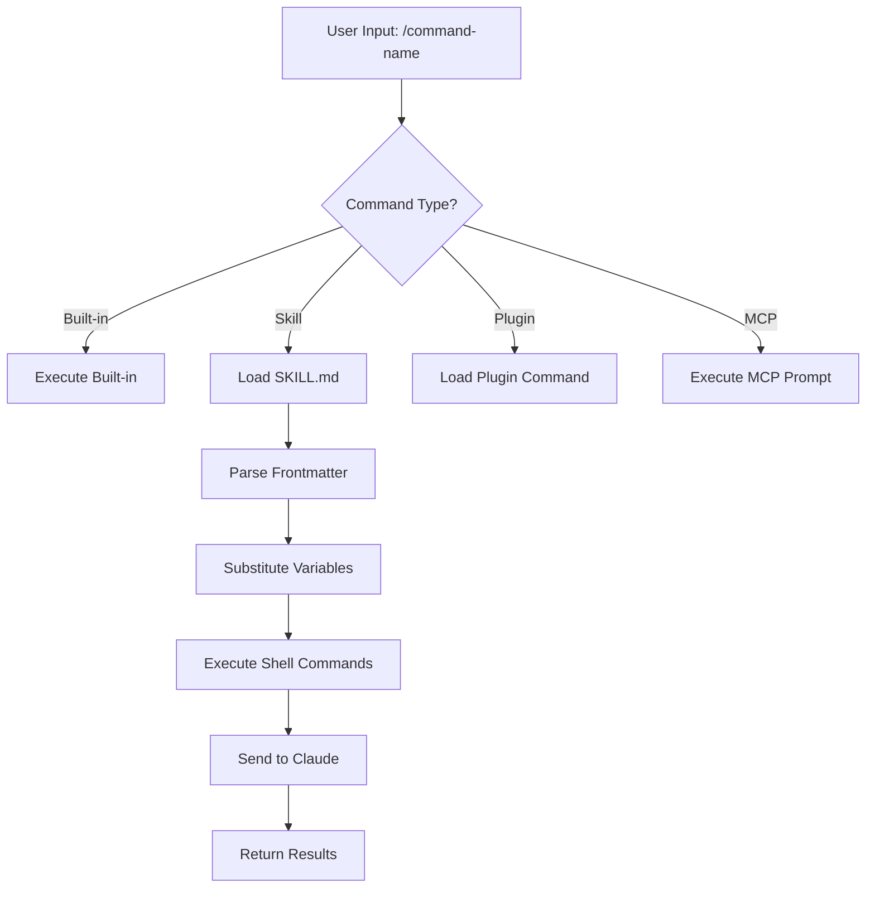
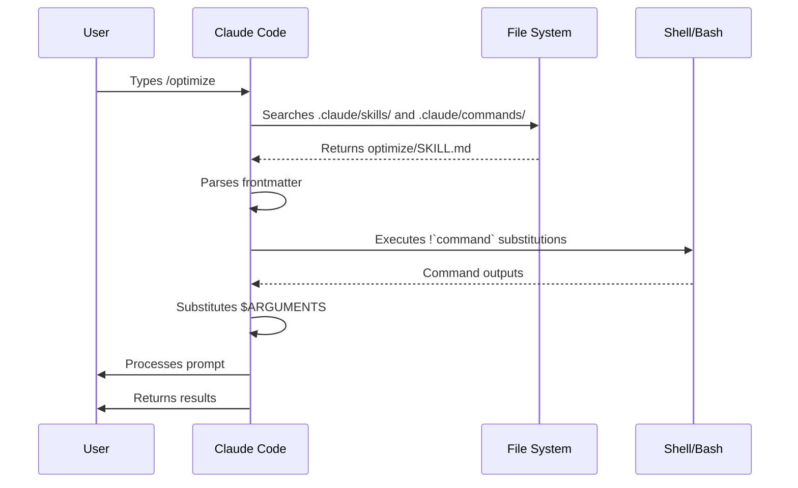

<!-- i18n-source: 01-slash-commands/README.md -->
<!-- i18n-source-sha: d17d515 -->
<!-- i18n-date: 2026-10-26 -->

<picture>
  <source media="(prefers-color-scheme: dark)" srcset="../../resources/logos/claude-howto-logo-dark.svg">
  
</picture>

# 슬래시 명령어

## 개요

슬래시 명령어는 대화 세션 중에 Claude의 동작을 제어하기 위한 단축 명령입니다. 다음과 같은 몇 가지 종류가 있습니다:

- **내장 명령어**: Claude Code가 제공합니다(`/help`, `/clear`, `/model`)
- **스킬**: 사용자가 `SKILL.md` 파일로 정의하는 명령어(`/optimize`, `/pr`)
- **플러그인 명령어**: 설치된 플러그인이 제공하는 명령어(`/frontend-design:frontend-design`)
- **MCP 프롬프트**: MCP 서버가 제공하는 명령어(`/mcp__github__list_prs`)

> **참고**: 커스텀 슬래시 명령어는 스킬로 통합되었습니다. `.claude/commands/`의 파일은 계속 동작하지만, 지금은 `.claude/skills/`의 스킬 방식이 권장됩니다. 둘 다 `/command-name` 단축 명령을 만듭니다. 전체 레퍼런스는 [스킬 가이드](../03-skills/)를 참고하세요.

## 내장 명령어 레퍼런스

내장 명령어는 자주 쓰는 동작의 단축 명령입니다. **60종 이상의 내장 명령어**와 **약 20개의 동봉 스킬**을 사용할 수 있습니다. Claude Code에서 `/`를 입력하면 목록이 나타납니다. `/` 뒤에 글자를 이어서 입력하면 필터링할 수 있습니다.

| 명령어 | 용도 |
|---------|------|
| `/add-dir <path>` | 작업 디렉터리 추가 |
| `/agents` | 현재는 동작하는 명령어가 아닙니다. 대화형 마법사는 v2.1.198에서 삭제되었고, v2.1.281부터 `/agents`는 `/` 메뉴에도 `/help`에도 표시되지 않습니다 — 입력해도 마법사가 어디로 갔는지 설명만 나옵니다. 서브에이전트 생성이나 관리는 Claude에게 요청하거나 `.claude/agents/`의 파일을 직접 편집합니다 |
| `/branch [name]` | 대화를 분기해 새 세션으로 만듭니다(별칭: `/fork`). 참고: `/fork`는 v2.1.77에서 `/branch`로 이름이 바뀌었습니다 |
| `/btw <question>` | Claude가 메인 작업을 진행하는 동안 메인 대화의 컨텍스트를 어지럽히지 않고 일시적인 곁다리 질문을 합니다 |
| `/chrome` | Chrome 브라우저 연동 설정 |
| `/clear` | 대화 지우기(별칭: `/reset`, `/new`) |
| `/color [color\|default]` | 프롬프트 바의 색상 설정 |
| `/compact [instructions]` | 선택적 초점 지시를 붙여 대화 압축 |
| `/config` | 설정 열기(별칭: `/settings`) |
| `/context` | 컨텍스트 사용량을 컬러 그리드로 시각화 |
| `/copy [N]` | 어시스턴트 응답을 클립보드에 복사. `w`로 파일에 저장 |
| `/cost` | `/usage`의 타이핑용 별칭 — 비용 탭을 엽니다(v2.1.118+) |
| `/desktop` | Desktop 앱에서 계속하기(별칭: `/app`) |
| `/diff` | 커밋되지 않은 변경 사항의 대화형 diff 뷰어 |
| `/doctor` | 설치 상태 진단 — Claude가 응답 중이어도 열 수 있습니다. 번들 스킬이며, Claude가 설정을 점검해 수정을 제안하고 확인 후 적용합니다(읽기 전용 진단은 `claude doctor`) |
| `/effort [low\|medium\|high\|xhigh\|max\|auto]` | 화살표 키 슬라이더로 사고량 설정. 수준: `low` → `medium` → `high` → `xhigh`(v2.1.111에서 추가) → `max`. Opus 4.7의 기본값은 `xhigh`, `max`는 Opus 4.7이 필요합니다 |
| `/exit` | REPL 종료(별칭: `/quit`) |
| `/export [filename]` | 현재 대화를 파일 또는 클립보드로 내보내기 |
| `/extra-usage` | 레이트 리밋 추가 사용량 설정 |
| `/fast [on\|off]` | 고속 모드 전환 |
| `/feedback` | 피드백 보내기 |
| `/focus` | 포커스 뷰 전환(v2.1.110에서 추가. 포커스 전환은 `Ctrl+O`에서 이 명령어로 이동) |
| `/help` | 도움말 표시 |
| `/hooks` | 훅 설정 표시 |
| `/ide` | IDE 연동 관리 |
| `/init` | `CLAUDE.md` 초기화. 대화형 흐름을 쓰려면 `CLAUDE_CODE_NEW_INIT=1`을 설정 |
| `/insights` | 세션 분석 보고서 생성 |
| `/install-github-app` | GitHub Actions 앱 설정 |
| `/install-slack-app` | Slack 앱 설치 |
| `/keybindings` | 키 바인딩 설정 열기 |
| `/fewer-permission-prompts` | 최근 Bash/MCP 도구 호출을 분석해 우선순위가 높은 허용 목록을 `.claude/settings.json`에 추가하고 권한 프롬프트를 줄입니다(v2.1.111에서 추가) |
| `/login` | Anthropic 계정 전환 |
| `/logout` | Anthropic 계정에서 로그아웃 |
| `/mcp` | MCP 서버와 OAuth 관리 |
| `/memory` | `CLAUDE.md` 편집, 자동 메모리 전환 |
| `/mobile` | 모바일 앱 QR 코드(별칭: `/ios`, `/android`) |
| `/model [model]` | 모델 선택. 좌우 키로 사고량 변경 |
| `/output-style [name]` | 출력 스타일 목록 표시와 전환(v2.1.91에서 삭제된 뒤 v2.1.269에서 재추가). 인수 없이 실행하면 스타일을 나열하고 현재 스타일을 표시합니다. 헤드리스와 Remote Control 세션에서도 동작하며, 선택 내용은 `.claude/settings.local.json`에 저장됩니다 |
| `/passes` | Claude Code 무료 1주일 공유 |
| `/permissions` | 권한 표시/업데이트(별칭: `/allowed-tools`) |
| `/plan [description]` | 플랜 모드 진입 |
| `/plugin` | 플러그인 관리 |
| `/proactive` | `/loop`의 별칭(v2.1.105에서 추가) |
| `/powerup` | 애니메이션 데모가 포함된 대화형 레슨으로 기능 알아보기 |
| `/privacy-settings` | 개인정보 설정(Pro/Max 전용) |
| `/release-notes` | 변경 이력 표시 |
| `/recap` | 세션으로 돌아왔을 때 세션 복습/요약 표시(v2.1.108에서 추가) |
| `/reload-plugins` | 활성 플러그인 다시 불러오기. v2.1.221부터 대부분의 설치는 즉시 활성화되므로, 설치 요약에 `Run /reload-plugins to activate.`가 표시된 경우에만 필요합니다 |
| `/remote-control` | claude.ai에서 원격 제어(별칭: `/rc`) |
| `/remote-env` | 기본 원격 환경 설정 |
| `/rename [name]` | 세션 이름 바꾸기 |
| `/resume [session]` | 대화 재개(별칭: `/continue`) |
| `/review [low\|medium\|high\|xhigh\|max\|ultra] [--fix] [--comment] [pr#\|branch\|path]` | `/code-review`의 별칭(v2.1.223). 현재 diff 또는 전달한 PR 번호·브랜치·경로를 리뷰합니다(예: `/review 1234`). 같은 effort 수준과 플래그를 받습니다. 수준을 생략하면 직전에 입력한 `low`~`max` 수준을 재사용합니다 |
| `/rewind` | 대화나 코드 되감기(별칭: `/checkpoint`, `/undo`) |
| `/sandbox` | 샌드박스 모드 전환 |
| `/schedule [description]` | 클라우드 예약 작업 생성/관리 |
| `/security-review` | 브랜치를 보안 취약점 관점에서 분석 |
| `/skills` | 사용 가능한 스킬 목록 표시 |
| `/stats` | `/usage`의 타이핑용 별칭 — 통계 탭(일일 사용량, 세션, 스트릭)을 엽니다(v2.1.118+) |
| `/stickers` | Claude Code 스티커 주문 |
| `/status` | 버전, 모델, 계정 표시 |
| `/statusline` | 상태 표시줄 설정 |
| `/tasks` | 백그라운드 작업 목록/관리 |
| `/team-onboarding` | 지난 30일간의 Claude Code 세션, 명령어, MCP 이용 현황으로 팀원용 온보딩 가이드를 생성하고 공유 링크를 반환합니다(v2.1.101에서 신규) |
| `/terminal-setup` | 터미널 키 바인딩 설정 |
| `/theme` | 테마 선택기 열기/커스텀 테마 관리(v2.1.118). 커스텀 테마는 `~/.claude/themes/<name>.json`에 JSON으로 정의합니다 |
| `/tui [default\|fullscreen]` | 터미널 UI 렌더러를 설정하고 재시작합니다(`fullscreen`이면 깜빡임 없는 그리기). 인수 없는 `/tui`는 현재 렌더러를 표시합니다(v2.1.110에서 추가) |
| `/ultrareview` | 멀티 에이전트 분석을 이용한 종합적인 클라우드 기반 코드 리뷰(v2.1.111에서 추가). 현재 권장 호출은 `/code-review ultra`이며, `/ultrareview`는 그 별칭으로 남아 있습니다. Pro와 Max에서는 3회까지 무료, 이후에는 사용 크레딧이 필요합니다 |
| `/upgrade` | 상위 플랜 업그레이드 페이지 열기 |
| `/usage` | 정식 사용 현황 대시보드(v2.1.118) — 플랜 사용량 한도, 레이트 리밋, 비용, 일일 세션 통계를 통합. `/cost`와 `/stats`는 특정 탭을 여는 타이핑용 별칭입니다 |
| `/voice` | 푸시 투 토크 음성 입력 전환 |

### 동봉 스킬

이 스킬들은 Claude Code에 동봉되어 있으며 슬래시 명령어처럼 호출할 수 있습니다:

| 스킬 | 용도 |
|-------|------|
| `/batch <instruction>` | 워크트리를 사용한 대규모 병렬 변경을 오케스트레이션합니다 |
| `/claude-api` | 프로젝트 언어에 맞는 Claude API 레퍼런스를 불러옵니다 |
| `/debug [description]` | 디버그 로그 활성화 |
| `/loop [interval] [prompt]` | 프롬프트를 주기적으로 반복 실행 |
| `/simplify [focus]` | 변경된 파일을 코드 품질 관점에서 리뷰 |

### 지원 중단 명령어

| 명령어 | 상태 |
|---------|----------|
| `/fork` | `/branch`로 이름 변경(별칭은 계속 유효, v2.1.77) |
| `/pr-comments` | v2.1.91에서 삭제 — Claude에게 직접 PR 댓글을 보도록 요청합니다 |
| `/vim` | v2.1.92에서 삭제 — /config → 에디터 모드를 사용합니다 |

### 최근 변경 사항

- `/fork`를 `/branch`로 이름을 바꾸고 `/fork`는 별칭으로 유지(v2.1.77)
- `/output-style`은 삭제(v2.1.91)된 뒤 **v2.1.269에서 재추가**되어 v2.1.278에서는 다시 사용 가능한 명령어입니다. 헤드리스와 Remote Control 세션에서도 동작합니다. 출력 스타일 자체는 `/config` 또는 `outputStyle` 설정으로도 계속 사용할 수 있습니다
- `/review`가 `/code-review`의 완전한 별칭이 되었습니다 — 대상, effort 수준, 플래그가 모두 같습니다(v2.1.223). 이력: v2.1.186에서 먼저 `/code-review medium` 엔진으로 이전했지만 당시에는 PR 전용이었습니다
- `/effort` 명령어 추가. `max` 수준은 Opus 4.7이 필요합니다(처음에는 Opus 4.6 한정)
- 푸시 투 토크 음성 입력용 `/voice` 명령어 추가
- 예약 작업 생성/관리용 `/schedule` 명령어 추가
- 프롬프트 바를 꾸미는 `/color` 명령어 추가
- /pr-comments를 v2.1.91에서 삭제 — Claude에게 직접 PR 댓글을 보도록 요청합니다
- /vim을 v2.1.92에서 삭제 — /config → 에디터 모드를 사용합니다
- `/ultraplan`은 v2.1.222에서 삭제되었습니다 — 대신 플랜 모드를 사용합니다
- 대화형 기능 레슨용 /powerup 추가
- 샌드박스 모드 전환용 /sandbox 추가
- `/model` 선택기가 원시 모델 ID 대신 읽기 쉬운 라벨(예: "Sonnet 4.6")을 표시하게 되었습니다
- `/resume`이 `/continue` 별칭을 지원
- MCP 프롬프트를 `/mcp__<server>__<prompt>` 명령어로 사용 가능([MCP 프롬프트를 명령어로 사용하기](#mcp-프롬프트를-명령어로-사용하기) 참고)
- 팀원용 온보딩 가이드를 자동 생성하는 `/team-onboarding` 추가(v2.1.101)
- 깜빡임 없는 전체 화면 TUI 그리기용 `/tui` 명령어 추가(v2.1.110)
- 포커스 뷰 전환용 `/focus` 명령어 추가. `Ctrl+O`는 상세 트랜스크립트 전환 전용으로(v2.1.110)
- 세션 컨텍스트 복습을 수동으로 발동하는 `/recap` 명령어 추가(v2.1.108)
- `/undo`를 `/rewind`의 별칭으로 추가(v2.1.108). 지금도 `/checkpoint`와 함께 `/rewind`의 별칭입니다
- `/proactive`를 `/loop`의 별칭으로 추가(v2.1.105)
- `/effort`에 대화형 화살표 키 슬라이더가 생기고 `high`와 `max` 사이에 새 `xhigh` 수준이 추가되었습니다. Opus 4.7 플랜에서는 기본 사고량이 `xhigh`로 올라갔습니다(v2.1.111)
- 종합적인 클라우드 기반 멀티 에이전트 코드 리뷰용 `/ultrareview` 추가(v2.1.111). v2.1.223에서 `/code-review ultra`가 권장 호출이 되었고 `/ultrareview`는 별칭으로 남았습니다
- Bash/MCP 도구 호출을 분석해 `.claude/settings.json`의 허용 목록으로 권한 프롬프트를 줄이는 `/fewer-permission-prompts` 추가(v2.1.111)
- Opus 4.7을 사용하는 Max 구독자는 Auto 모드에 `--enable-auto-mode` 플래그가 필요 없어졌습니다(v2.1.112)

### `/team-onboarding` — 팀원용 온보딩 가이드

> **v2.1.101에서 신규 추가**

`/team-onboarding`을 사용하면 프로젝트의 로컬 Claude Code 이용 현황으로 팀원용 온보딩 가이드를 생성할 수 있습니다. Claude는 지난 30일간의 세션, 명령어, MCP 서버 이용 현황을 분석해 새 개발자가 바로 생산성을 낼 수 있는 온보딩 가이드를 만들고 그 공유 링크를 반환합니다.

내장 명령어이므로 설치 작업은 필요 없습니다.

**사용법:**

```bash
claude /team-onboarding
```

생성되는 가이드는 다음 정보를 바탕으로 만들어집니다:

- 최근 세션에서 반복해서 나타나는 워크플로
- 자주 실행하는 명령어
- 사용 중인 [MCP 서버](../05-mcp/README.md)

**제공 시작:** Claude Code v2.1.101(2026년 4월 11일)에 동봉.

## 커스텀 명령어(현재는 스킬)

커스텀 슬래시 명령어는 **스킬로 통합되었습니다**. 어느 방식으로든 `/command-name`으로 호출할 수 있는 명령어를 만들 수 있습니다:

| 방식 | 위치 | 상태 |
|------|---------|----------|
| **스킬(권장)** | `.claude/skills/<name>/SKILL.md` | 현행 표준 |
| **레거시 명령어** | `.claude/commands/<name>.md` | 계속 동작 |

스킬과 명령어가 같은 이름으로 존재하면 **스킬이 우선합니다**. 예를 들어 `.claude/commands/review.md`와 `.claude/skills/review/SKILL.md`가 둘 다 있으면 스킬 버전이 사용됩니다.

### 이전 경로

기존 `.claude/commands/` 파일은 변경 없이 계속 동작합니다. 스킬로 이전하려면:

**변경 전(명령어):**
```
.claude/commands/optimize.md
```

**변경 후(스킬):**
```
.claude/skills/optimize/SKILL.md
```

### 왜 스킬인가요?

스킬은 레거시 명령어에 없는 다음 기능을 제공합니다:

- **디렉터리 구조**: 스크립트, 템플릿, 참조 파일을 한데 모을 수 있습니다
- **자동 실행**: 관련이 있을 때 Claude가 자동으로 스킬을 발동할 수 있습니다
- **실행 제어**: 사용자, Claude, 둘 다 중 누가 실행할 수 있는지 선택할 수 있습니다
- **서브에이전트 실행**: `context: fork`로 격리된 컨텍스트에서 스킬을 실행할 수 있습니다
- **점진적 공개**: 필요할 때만 추가 파일을 불러옵니다

### 스킬로 커스텀 명령어 만들기

`SKILL.md`를 포함하는 디렉터리를 만듭니다:

```bash
mkdir -p .claude/skills/my-command
```

**파일:** `.claude/skills/my-command/SKILL.md`

```yaml
---
name: my-command
description: What this command does and when to use it
---

# My Command

Instructions for Claude to follow when this command is invoked.

1. First step
2. Second step
3. Third step
```

### 프런트매터 레퍼런스

| 필드 | 용도 | 기본값 |
|----------|------|----------|
| `name` | 명령어 이름(`/name`이 됩니다) | 디렉터리 이름 |
| `description` | 간단한 설명(Claude가 언제 사용할지 판단하는 근거) | 첫 번째 비어 있지 않은 줄 |
| `argument-hint` | 자동 완성용 예상 인수 | 없음 |
| `allowed-tools` | 권한 없이 사용할 수 있는 도구 | 상속 |
| `model` | 사용할 특정 모델 | 상속 |
| `disable-model-invocation` | `true`이면 사용자만 실행 가능(Claude는 불가) | `false` |
| `user-invocable` | `false`이면 `/` 메뉴에서 숨김 | `true` |
| `context` | `fork`로 설정하면 격리된 서브에이전트에서 실행 | 없음 |
| `agent` | `context: fork` 사용 시 에이전트 종류 | `general-purpose` |
| `hooks` | 스킬 실행 시 등록되는 훅(임의의 훅 이벤트. 등록 후에는 세션이 끝날 때까지 유효) | 없음 |

### 인수

명령어는 인수를 받을 수 있습니다:

**`$ARGUMENTS`로 전체 인수 받기:**

```yaml
---
name: fix-issue
description: Fix a GitHub issue by number
---

Fix issue #$ARGUMENTS following our coding standards
```

사용법: `/fix-issue 123` → `$ARGUMENTS`는 "123"이 됩니다

**개별 인수를 `$0`, `$1` 등으로 받기:**

```yaml
---
name: review-pr
description: Review a PR with priority
---

Review PR #$0 with priority $1
```

사용법: `/review-pr 456 high` → `$0`="456", `$1`="high"

### 셸 명령어를 이용한 동적 컨텍스트

프롬프트 앞에서 `` !`command` ``로 bash 명령어를 실행합니다:

> **참고(v2.1.299)**: `UserPromptSubmit` 훅은 명령어가 전개되기 전에 실행되므로, 프롬프트를 차단하는 훅은 이 `!` 명령어의 실행도 막습니다.

```yaml
---
name: commit
description: Create a git commit with context
allowed-tools: Bash(git *)
---

## Context

- Current git status: !`git status`
- Current git diff: !`git diff HEAD`
- Current branch: !`git branch --show-current`
- Recent commits: !`git log --oneline -5`

## Your task

Based on the above changes, create a single git commit.
```

### 파일 참조

`@`로 파일 내용을 포함시킵니다:

```markdown
Review the implementation in @src/utils/helpers.js
Compare @src/old-version.js with @src/new-version.js
```

## 플러그인 명령어

플러그인은 커스텀 명령어를 제공할 수 있습니다:

```
/plugin-name:command-name
```

또는 이름 충돌이 없으면 간단히 `/command-name`.

**예:**
```bash
/frontend-design:frontend-design
/commit-commands:commit
```

## MCP 프롬프트를 명령어로 사용하기

MCP 서버는 프롬프트를 슬래시 명령어로 공개할 수 있습니다:

```
/mcp__<server-name>__<prompt-name> [arguments]
```

**예:**
```bash
/mcp__github__list_prs
/mcp__github__pr_review 456
/mcp__jira__create_issue "Bug title" high
```

### MCP 권한 문법

권한 설정으로 MCP 서버 접근을 제어합니다:

- `mcp__github` — GitHub MCP 서버 전체에 접근
- `mcp__github__*` — 모든 도구에 와일드카드 접근
- `mcp__github__get_issue` — 특정 도구에 접근

> **v2.1.299+:** 규칙은 이름을 지정한 서버에만 적용됩니다 — `mcp__github`은 이제 `github__x`나 `github_`라는 이름의 서버에는 일치하지 않습니다. 정규화 후 이름에 `__`가 포함된 서버에는 `mcp__<정규화 후 전체 이름>__*`로 씁니다(서브에이전트의 `tools:` 목록도 마찬가지).

## 명령어 아키텍처



## 명령어 수명 주기



## 이 폴더에서 제공하는 명령어

이 예제 명령어들은 스킬로도, 레거시 명령어로도 설치할 수 있습니다.

### 1. `/optimize` — 코드 최적화

성능 문제, 메모리 누수, 최적화 여지를 분석합니다.

**사용법:**
```
/optimize
[Paste your code]
```

### 2. `/pr` — 풀 리퀘스트 준비

린트, 테스트, 커밋 메시지 형식 등 PR 준비 체크리스트를 안내합니다.

**사용법:**
```
/pr
```

**스크린샷:**


### 3. `/generate-api-docs` — API 문서 생성

소스 코드에서 포괄적인 API 문서를 생성합니다.

**사용법:**
```
/generate-api-docs
```

### 4. `/commit` — 컨텍스트가 포함된 git 커밋

저장소의 동적 컨텍스트를 포함해 git 커밋을 만듭니다.

**사용법:**
```
/commit [optional message]
```

### 5. `/push-all` — 스테이징·커밋·push

모든 변경 사항을 스테이징하고, 커밋을 만들고, 안전성 검사를 거쳐 원격으로 push합니다.

**사용법:**
```
/push-all
```

**안전성 검사:**
- 시크릿: `.env*`, `*.key`, `*.pem`, `credentials.json`
- API 키: 실제 키인지 플레이스홀더인지 판별
- 큰 파일: Git LFS 없는 `>10MB`
- 빌드 산출물: `node_modules/`, `dist/`, `__pycache__/`

### 6. `/doc-refactor` — 문서 재구성

프로젝트 문서를 명확성과 접근성 관점에서 재구성합니다.

**사용법:**
```
/doc-refactor
```

### 7. `/setup-ci-cd` — CI/CD 파이프라인 설정

품질 보증을 위해 pre-commit 훅과 GitHub Actions를 도입합니다.

**사용법:**
```
/setup-ci-cd
```

### 8. `/unit-test-expand` — 테스트 커버리지 확충

테스트되지 않은 분기와 엣지 케이스를 겨냥해 테스트 커버리지를 높입니다.

**사용법:**
```
/unit-test-expand
```

## 설치

### 스킬로(권장)

스킬 디렉터리에 복사합니다:

```bash
# skills 디렉터리 생성
mkdir -p .claude/skills

# 각 명령어 파일마다 스킬 디렉터리 생성
for cmd in optimize pr commit; do
  mkdir -p .claude/skills/$cmd
  cp 01-slash-commands/$cmd.md .claude/skills/$cmd/SKILL.md
done
```

### 레거시 명령어로

commands 디렉터리에 복사합니다:

```bash
# 프로젝트 전체(팀용)
mkdir -p .claude/commands
cp 01-slash-commands/*.md .claude/commands/

# 개인용
mkdir -p ~/.claude/commands
cp 01-slash-commands/*.md ~/.claude/commands/
```

## 직접 명령어 만들기

### 스킬 템플릿(권장)

`.claude/skills/my-command/SKILL.md`를 만듭니다:

```yaml
---
name: my-command
description: What this command does. Use when [trigger conditions].
argument-hint: [optional-args]
allowed-tools: Bash(npm *), Read, Grep
---

# Command Title

## Context

- Current branch: !`git branch --show-current`
- Related files: @package.json

## Instructions

1. First step
2. Second step with argument: $ARGUMENTS
3. Third step

## Output Format

- How to format the response
- What to include
```

### 사용자만 실행할 수 있는 명령어(자동 실행 없음)

부수 효과가 있어 Claude가 자동으로 발동하게 하고 싶지 않은 명령어용:

```yaml
---
name: deploy
description: Deploy to production
disable-model-invocation: true
allowed-tools: Bash(npm *), Bash(git *)
---

Deploy the application to production:

1. Run tests
2. Build application
3. Push to deployment target
4. Verify deployment
```

## 모범 사례

| 하기 | 하지 않기 |
|------|---------|
| 동사 중심의 명확한 이름 사용 | 일회성 작업을 명령어로 만들기 |
| 실행 조건이 담긴 `description` 포함 | 명령어 안에 복잡한 로직 구성 |
| 단일 작업에 집중한 명령어로 만들기 | 민감 정보 하드코딩 |
| 부수 효과가 있으면 `disable-model-invocation` 사용 | description 필드 생략 |
| 동적 컨텍스트에는 `!` 접두사 사용 | Claude가 현재 상태를 알고 있다고 가정 |
| 관련 파일은 스킬 디렉터리로 정리 | 모든 것을 파일 하나에 몰아넣기 |

## 문제 해결

### 명령어를 찾을 수 없음

**대처:**
- 파일이 `.claude/skills/<name>/SKILL.md` 또는 `.claude/commands/<name>.md`에 있는지 확인
- 프런트매터의 `name` 필드가 기대하는 명령어 이름과 일치하는지 확인
- Claude Code 세션 재시작
- `/help`로 사용 가능한 명령어 확인

### 명령어가 기대대로 동작하지 않음

**대처:**
- 지시를 더 구체적으로 작성
- 스킬 파일에 예시 포함
- bash 명령어를 사용한다면 `allowed-tools` 확인
- 먼저 단순한 입력으로 테스트

### 스킬과 명령어가 충돌함

같은 이름으로 둘 다 존재하면 **스킬이 우선합니다**. 둘 중 하나를 삭제하거나 이름을 바꿉니다.

## 관련 가이드

- **[스킬](../03-skills/)** — 스킬의 전체 레퍼런스(자동 실행되는 기능)
- **[메모리](../02-memory/)** — CLAUDE.md를 통한 영속 컨텍스트
- **[서브에이전트](../04-subagents/)** — 위임형 AI 에이전트
- **[플러그인](../07-plugins/)** — 묶음으로 제공되는 명령어 모음
- **[훅](../06-hooks/)** — 이벤트 기반 자동화

## 추가 리소스

- [공식 대화형 모드 문서](https://code.claude.com/docs/en/interactive-mode) — 내장 명령어 레퍼런스
- [공식 스킬 문서](https://code.claude.com/docs/en/skills) — 스킬의 전체 레퍼런스
- [CLI 레퍼런스](https://code.claude.com/docs/en/cli-reference) — 명령줄 옵션

---

**최종 업데이트**: 2026년 10월 18일
**Claude Code 버전**: 2.1.302
**Sources**:
- https://code.claude.com/docs/en/commands
- https://code.claude.com/docs/en/output-styles
- https://code.claude.com/docs/en/interactive-mode
- https://code.claude.com/docs/en/changelog
- https://github.com/anthropics/claude-code/releases/tag/v2.1.118
- https://github.com/anthropics/claude-code/releases/tag/v2.1.116
- https://github.com/anthropics/claude-code/releases/tag/v2.1.281
- https://code.claude.com/docs/en/hooks#hooks-in-skills-and-agents
- https://code.claude.com/docs/en/permissions#mcp
- https://code.claude.com/docs/en/changelog#2-1-299
- https://code.claude.com/docs/en/hooks#hook-lifecycle
- https://code.claude.com/docs/en/fullscreen
- https://code.claude.com/docs/en/model-config
- https://code.claude.com/docs/en/skills
**Compatible Models**: Claude Sonnet 4.6, Claude Opus 4.7, Claude Haiku 4.5

*[Claude How To](../) 가이드 시리즈의 일부*
