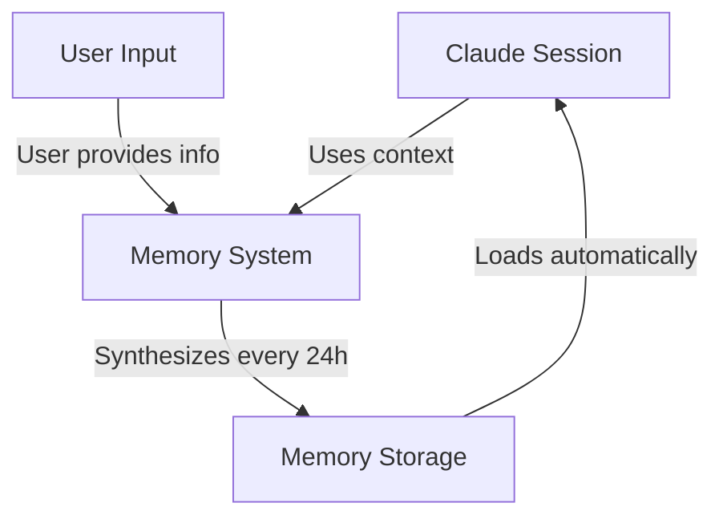
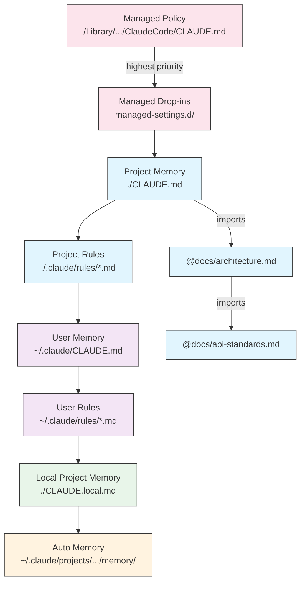
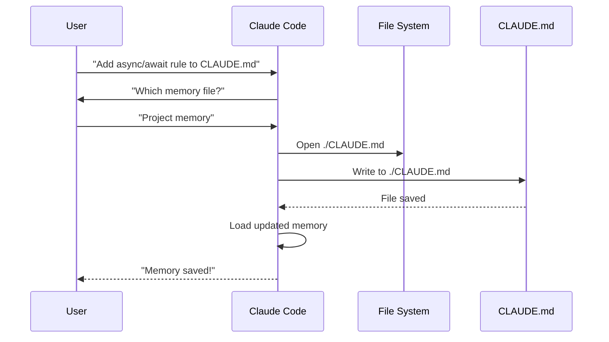
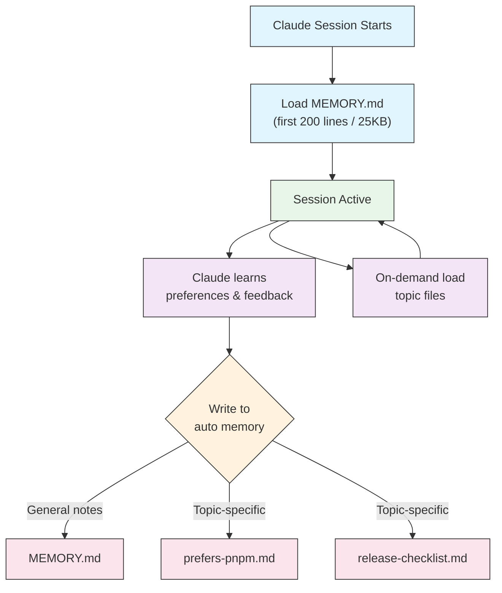

<!-- i18n-source: 02-memory/README.md -->
<!-- i18n-source-sha: d17d515 -->
<!-- i18n-date: 2026-10-26 -->

<picture>
  <source media="(prefers-color-scheme: dark)" srcset="../../resources/logos/claude-howto-logo-dark.svg">
  
</picture>

# 메모리 가이드

메모리를 통해 Claude는 세션과 대화를 넘어 컨텍스트를 유지할 수 있습니다. 메모리에는 두 가지 형태가 있습니다: claude.ai의 자동 합성과 Claude Code의 파일 시스템 기반 CLAUDE.md입니다.

## 개요

Claude Code의 메모리는 여러 세션과 대화에 걸쳐 지속되는 컨텍스트를 제공합니다. 일시적인 컨텍스트 윈도우와 달리 메모리 파일은 다음을 가능하게 합니다:

- 프로젝트 표준을 팀과 공유
- 개인의 개발 선호 사항 저장
- 디렉터리별 규칙과 설정 유지
- 외부 문서 가져오기
- 메모리를 프로젝트의 일부로 버전 관리

메모리 시스템은 전역 개인 설정부터 특정 서브디렉터리까지 여러 계층에서 동작하며, Claude가 무엇을 기억하고 그것을 어떻게 적용할지 세밀하게 제어할 수 있습니다.

## 메모리 명령어 퀵 레퍼런스

| 명령어 | 용도 | 사용법 | 사용 시점 |
|---------|------|-------|--------------|
| `/init` | 프로젝트 메모리 초기화 | `/init` | 새 프로젝트 시작 시, 첫 CLAUDE.md 설정 |
| `/memory` | 에디터에서 메모리 파일 편집 | `/memory` | 대규모 업데이트, 재구성, 내용 검토 |
| `#` 접두사 | ~~한 줄을 빠르게 메모리에 추가~~ **폐지됨** | — | 대신 `/memory`를 사용하거나 대화로 요청 |
| `@path/to/file` | 외부 콘텐츠 가져오기 | `@README.md` 또는 `@docs/api.md` | CLAUDE.md에서 기존 문서를 참조 |

## 퀵 스타트: 메모리 초기화

### `/init` 명령어

`/init` 명령어는 Claude Code에서 프로젝트 메모리를 설정하는 가장 빠른 방법입니다. 기본 프로젝트 문서를 담은 CLAUDE.md 파일을 초기화합니다.

**사용법:**

```bash
/init
```

**기능:**

- 프로젝트에 새 CLAUDE.md 파일 생성(보통 `./CLAUDE.md` 또는 `./.claude/CLAUDE.md`)
- 프로젝트 관례와 가이드라인 확립
- 세션을 넘어 컨텍스트를 유지하기 위한 기반 설정
- 프로젝트 표준을 문서화하기 위한 템플릿 구조 제공

**강화된 인터랙티브 모드:** `CLAUDE_CODE_NEW_INIT=1`을 설정하면 프로젝트 설정을 단계별로 안내하는 여러 단계의 인터랙티브 흐름이 활성화됩니다:

```bash
CLAUDE_CODE_NEW_INIT=1 claude
/init
```

**`/init`을 사용하는 상황:**

- Claude Code로 새 프로젝트를 시작할 때
- 팀의 코딩 표준과 관례를 확립할 때
- 코드베이스 구조에 관한 문서를 만들 때
- 공동 개발을 위해 메모리 계층을 설정할 때

**워크플로 예시:**

```markdown
# In your project directory
/init

# Claude creates CLAUDE.md with structure like:
# Project Configuration
## Project Overview
- Name: Your Project
- Tech Stack: [Your technologies]
- Team Size: [Number of developers]

## Development Standards
- Code style preferences
- Testing requirements
- Git workflow conventions
```

### 메모리 간편 업데이트

> **참고**: 인라인 메모리용 `#` 단축키는 폐지되었습니다. `/memory`로 메모리 파일을 직접 편집하거나, Claude에게 대화로 기억해 달라고 요청하세요(예: "TypeScript strict 모드를 반드시 사용한다는 것을 기억해 줘").

메모리에 정보를 추가하는 권장 방법:

**방법 1: `/memory` 명령어 사용**

```bash
/memory
```

메모리 파일이 시스템 에디터에서 열리며 직접 편집할 수 있습니다.

**방법 2: 대화로 요청**

```
Remember that we always use TypeScript strict mode in this project.
Please add to memory: prefer async/await over promise chains.
```

Claude에게 무언가를 기억하라고 요청하면 자동 메모리에 저장됩니다. 대신 CLAUDE.md를 변경하고 싶다면 "이것을 CLAUDE.md에 추가해 줘"라고 요청하거나 `/memory`로 파일을 직접 편집하세요.

**과거 기록용 참고**(현재는 동작하지 않음):

`#` 접두사 단축키는 예전에 규칙을 인라인으로 추가할 수 있었습니다:

```markdown
# Always use TypeScript strict mode in this project  ← no longer works
```

이 패턴에 의존했다면 `/memory` 명령어나 대화 요청으로 전환하세요.

### `/memory` 명령어

`/memory` 명령어는 Claude Code 세션 안에서 CLAUDE.md 메모리 파일을 직접 편집하는 수단을 제공합니다. 메모리 파일을 시스템 에디터에서 열어 포괄적으로 편집할 수 있습니다.

**사용법:**

```bash
/memory
```

**기능:**

- 메모리 파일을 시스템 기본 에디터에서 엽니다
- 대규모 추가, 수정, 재구성을 할 수 있습니다
- 계층 안의 모든 메모리 파일에 직접 접근할 수 있습니다
- 세션을 넘어 지속되는 컨텍스트를 관리할 수 있습니다

**`/memory`를 사용하는 상황:**

- 기존 메모리 내용을 검토할 때
- 프로젝트 표준을 대규모로 업데이트할 때
- 메모리 구조를 재구성할 때
- 상세한 문서나 가이드라인을 추가할 때
- 프로젝트 진화에 맞춰 메모리를 유지보수·업데이트할 때

**비교: `/memory`와 `/init`**

| 관점 | `/memory` | `/init` |
|------|-----------|---------|
| **목적** | 기존 메모리 파일 편집 | 새 CLAUDE.md 초기화 |
| **사용 시점** | 프로젝트 컨텍스트 업데이트/수정 | 새 프로젝트 시작 시 |
| **동작** | 편집용 에디터 열기 | 스타터 템플릿 생성 |
| **워크플로** | 지속적인 유지보수 | 일회성 설정 |

**워크플로 예시:**

```markdown
# Open memory for editing
/memory

# Claude presents options:
# 1. Managed Policy Memory
# 2. Project Memory (./CLAUDE.md)
# 3. User Memory (~/.claude/CLAUDE.md)
# 4. Local Project Memory

# Choose option 2 (Project Memory)
# Your default editor opens with ./CLAUDE.md content

# Make changes, save, and close editor
# Claude automatically reloads the updated memory
```

**메모리 임포트 활용:**

CLAUDE.md 파일은 외부 콘텐츠를 가져오는 `@path/to/file` 구문을 지원합니다:

```markdown
# Project Documentation
See @README.md for project overview
See @package.json for available npm commands
See @docs/architecture.md for system design

# Import from home directory using absolute path
@~/.claude/my-project-instructions.md
```

**임포트 기능:**

- 상대 경로와 절대 경로 모두 지원(예: `@docs/api.md`, `@~/.claude/my-project-instructions.md`)
- 재귀적 임포트 지원(최대 깊이 4홉)
- 외부 위치에서 처음 가져올 때는 보안을 위해 승인 대화 상자가 표시됩니다
- 임포트 지시문은 Markdown 코드 스팬이나 코드 블록 안에서는 평가되지 않습니다(예시로 적어도 안전합니다)
- 기존 문서를 참조하여 중복을 피할 수 있습니다
- 참조된 콘텐츠가 Claude의 컨텍스트에 자동으로 포함됩니다

## 메모리 아키텍처

Claude Code의 메모리는 스코프마다 다른 목적을 가진 계층 시스템을 따릅니다:



## Claude Code의 메모리 계층

Claude Code는 다층 메모리 시스템을 사용합니다. Claude Code 시작 시 메모리 파일이 자동으로 로드되며, 상위 레벨 파일이 우선합니다.

**메모리 계층 전체(우선순위 높은 순):**

1. **Managed Policy** — 조직 전체 지침
   - macOS: `/Library/Application Support/ClaudeCode/CLAUDE.md`
   - Linux/WSL: `/etc/claude-code/CLAUDE.md`
   - Windows: `C:\Program Files\ClaudeCode\CLAUDE.md`

2. **Managed Drop-ins** — 알파벳순으로 병합되는 정책 파일(v2.1.83+)
   - 관리 정책 CLAUDE.md와 나란히 있는 `managed-settings.d/` 디렉터리
   - 모듈식 정책 관리를 위해 알파벳순으로 병합됩니다

3. **Project Memory** — 팀 공유 컨텍스트(버전 관리 대상)
   - `./.claude/CLAUDE.md` 또는 `./CLAUDE.md`(저장소 루트)
   - v2.1.277부터, 작업 디렉터리와 그 상위에 `CLAUDE.md`도 `CLAUDE.local.md`도 없으면 같은 계층에서 대신 `./AGENTS.md`를 읽어 들입니다. `/config`의 **Project instructions**로 제어합니다

4. **Project Rules** — 모듈식·주제별 프로젝트 지침
   - `./.claude/rules/*.md`

5. **User Memory** — 개인 설정(모든 프로젝트)
   - `~/.claude/CLAUDE.md`

6. **User-Level Rules** — 개인 규칙(모든 프로젝트)
   - `~/.claude/rules/*.md`

7. **Local Project Memory** — 프로젝트별 개인 설정
   - `./CLAUDE.local.md`

> **참고**: `CLAUDE.local.md`는 완전히 지원되며 [공식 문서](https://code.claude.com/docs/en/memory)에도 기재되어 있습니다. 버전 관리에 커밋하지 않는 프로젝트별 개인 설정을 제공합니다. `CLAUDE.local.md`는 `.gitignore`에 추가하세요.

8. **Auto Memory** — Claude가 자동으로 남기는 메모와 학습 내용
   - `~/.claude/projects/<project>/memory/`

**메모리 탐색 동작:**

Claude는 다음 순서로 메모리 파일을 탐색하며, 상위 위치가 우선합니다:



## `claudeMdExcludes`로 CLAUDE.md 파일 제외하기

대규모 모노레포에는 현재 작업과 관계없는 CLAUDE.md가 있을 수 있습니다. `claudeMdExcludes` 설정을 사용하면 특정 CLAUDE.md 파일을 건너뛰어 컨텍스트에 로드하지 않을 수 있습니다:

```jsonc
// In ~/.claude/settings.json or .claude/settings.json
{
  "claudeMdExcludes": [
    "**/packages/legacy-app/CLAUDE.md",
    "**/vendors/**/CLAUDE.md"
  ]
}
```

패턴은 glob 구문으로 절대 파일 경로에 대해 매칭되므로, 저장소 안의 패턴은 `**/`로 시작합니다. 특히 다음 경우에 유용합니다:

- 많은 서브프로젝트를 가진 모노레포에서 일부만 관련 있을 때
- 벤더·서드파티 CLAUDE.md를 포함하는 저장소
- 오래되거나 무관한 지침을 제외하여 Claude의 컨텍스트 윈도우 노이즈를 줄이고 싶을 때

## 설정 파일 계층

Claude Code의 설정(`autoMemoryDirectory`, `claudeMdExcludes` 등 포함)은 5단계 계층에서 해석되며 상위 레벨이 우선합니다:

| 레벨 | 위치 | 스코프 |
|-------|------|--------|
| 1(최고) | 관리 정책(시스템 레벨) | 조직 전체 강제 |
| 2 | `managed-settings.d/`(v2.1.83+) | 모듈식 정책 드롭인, 알파벳순 병합 |
| 3 | `.claude/settings.local.json` | 로컬 오버라이드(git 무시) |
| 4 | `.claude/settings.json` | 프로젝트 레벨(git에 커밋) |
| 5(최저) | `~/.claude/settings.json` | 사용자 설정 |

**플랫폼별 설정(v2.1.51+):**

설정은 다음 방법으로도 구성할 수 있습니다:
- **macOS**: 프로퍼티 리스트(plist) 파일
- **Windows**: Windows 레지스트리

이러한 플랫폼 네이티브 방식은 JSON 설정 파일과 함께 읽히며 같은 우선순위 규칙을 따릅니다.

> **참고(v2.1.119)**: `/config`의 변경은 이제 `~/.claude/settings.json`에 영구 저장됩니다. `/config`로 쓴 값은 위의 정책/로컬/프로젝트 우선순위 체인에 참여합니다 — 더 이상 세션 한정이 아닙니다. 인터랙티브 편집에는 `/config`를, 스크립트화되거나 관리되는 설정에는 `settings.json` 파일 직접 편집을 사용하세요.

### 보존 기간과 정리 설정

| 설정 | 타입 | 기본값 | 설명 |
|------|---|---------|------|
| `cleanupPeriodDays` | 정수(일) | 30 | 세션 트랜스크립트 및 `~/.claude/` 아래 기타 애플리케이션 데이터의 보존 기간. `file-history/`(체크포인트 스냅샷), `plans/`, `debug/`, `tasks/`, `shell-snapshots/`, `backups/` 등이 대상입니다. `~/.claude/checkpoints/`라는 폴더는 존재하지 않습니다. 기간보다 오래된 파일은 시작 시 삭제됩니다. |

```jsonc
// ~/.claude/settings.json
{
  "cleanupPeriodDays": 14
}
```

### 어트리뷰션·음성·PR URL 설정

| 설정 | 타입 | 설명 |
|------|---|------|
| `attribution.commit` | string | Claude가 만든 커밋에 추가할 텍스트(기본값은 `Co-Authored-By: Claude` 트레일러). `""`로 숨깁니다. 폐지 예정인 `includeCoAuthoredBy` 플래그를 대체합니다. |
| `attribution.pr` | string | Claude가 만든 풀 리퀘스트 설명에 추가할 텍스트. `""`로 숨깁니다. PR에 대해 폐지 예정인 `includeCoAuthoredBy` 플래그를 대체합니다. |
| `voice.enabled` | boolean | 푸시 투 토크 음성 입력(`/voice`)을 활성화합니다. 폐지 예정인 `voiceEnabled` 플래그를 대체합니다. |
| `prUrlTemplate` | string | **v2.1.119에서 신규.** 푸터의 PR 배지용 사용자 정의 URL 템플릿. GitLab, Bitbucket, 사내 코드 리뷰 기반 등에서 유용합니다. `{host}`, `{owner}`, `{repo}`, `{number}`, `{url}` 플레이스홀더를 지원합니다. GitLab 머지 리퀘스트 링크는 변경되지 않습니다. |

```jsonc
// ~/.claude/settings.json
{
  "attribution": {
    "commit": "",
    "pr": ""
  },
  "voice": {
    "enabled": true
  },
  "prUrlTemplate": "https://reviews.example.com/{owner}/{repo}/pull/{number}"
}
```

빈 문자열(`""`)로 해당 어트리뷰션을 숨길 수 있고, `"attribution": false`로 전부 숨길 수 있습니다(v2.1.281+).

#### 폐지 예정인 설정 키

다음 레거시 설정 키는 계속 동작하지만 폐지 예정입니다. 위의 대체 키를 우선하세요.

| 폐지 예정 키 | 대체 | 비고 |
|----------|--------|------|
| `includeCoAuthoredBy` | `attribution.commit` / `attribution.pr` | 기존의 단일 플래그가 커밋용과 PR용의 별도 스위치로 분리되었습니다. 오래된 설치 환경의 사용자는 레거시 키를 계속 써도 되지만, 새 프로젝트는 중첩 형식을 사용해야 합니다. |
| `voiceEnabled` | `voice.enabled` | 향후 음성 관련 옵션과 마찬가지로 `voice` 네임스페이스에 모였습니다. |

## 모듈식 규칙 시스템

`.claude/rules/` 디렉터리 구조를 사용하면 정리된 경로별 규칙을 만들 수 있습니다. 규칙은 프로젝트 레벨과 사용자 레벨 모두에서 정의할 수 있습니다:

```
your-project/
├── .claude/
│   ├── CLAUDE.md
│   └── rules/
│       ├── code-style.md
│       ├── testing.md
│       ├── security.md
│       └── api/                  # Subdirectories supported
│           ├── conventions.md
│           └── validation.md

~/.claude/
├── CLAUDE.md
└── rules/                        # User-level rules (all projects)
    ├── personal-style.md
    └── preferred-patterns.md
```

규칙은 `rules/` 디렉터리 안에서 재귀적으로 발견됩니다(서브디렉터리 포함). `~/.claude/rules/`의 사용자 레벨 규칙은 프로젝트 레벨 규칙보다 먼저 로드되어, 프로젝트가 덮어쓸 수 있는 개인 기본값을 설정할 수 있습니다.

### YAML 프런트매터를 이용한 경로별 규칙

특정 파일 경로에만 적용되는 규칙을 정의할 수 있습니다:

```markdown
---
paths: src/api/**/*.ts
---

# API Development Rules

- All API endpoints must include input validation
- Use Zod for schema validation
- Document all parameters and response types
- Include error handling for all operations
```

**glob 패턴 예시:**

- `**/*.ts` — 모든 TypeScript 파일
- `src/**/*` — src/ 아래 모든 파일
- `src/**/*.{ts,tsx}` — 여러 확장자
- `{src,lib}/**/*.ts, tests/**/*.test.ts` — 여러 패턴

### 서브디렉터리와 심볼릭 링크

`.claude/rules/`의 규칙은 두 가지 정리 기능을 지원합니다:

- **서브디렉터리**: 규칙은 재귀적으로 발견되므로 주제별 폴더로 정리할 수 있습니다(예: `rules/api/`, `rules/testing/`, `rules/security/`)
- **심볼릭 링크**: 여러 프로젝트 간에 규칙을 공유하기 위해 심볼릭 링크를 지원합니다. 예를 들어 공유 규칙 파일을 중앙 위치에서 각 프로젝트의 `.claude/rules/` 디렉터리로 심볼릭 링크할 수 있습니다

## 메모리 위치 목록

| 위치 | 스코프 | 우선순위 | 공유 | 접근 | 적합한 용도 |
|------|--------|-------|------|--------|----------|
| `/Library/Application Support/ClaudeCode/CLAUDE.md`(macOS) | Managed Policy | 1(최고) | 조직 | 시스템 | 회사 전체 정책 |
| `/etc/claude-code/CLAUDE.md`(Linux/WSL) | Managed Policy | 1(최고) | 조직 | 시스템 | 조직 표준 |
| `C:\Program Files\ClaudeCode\CLAUDE.md`(Windows) | Managed Policy | 1(최고) | 조직 | 시스템 | 전사 가이드라인 |
| `managed-settings.d/*.md`(정책과 나란히) | Managed Drop-ins | 1.5 | 조직 | 시스템 | 모듈식 정책 파일(v2.1.83+) |
| `./CLAUDE.md` 또는 `./.claude/CLAUDE.md` | Project Memory | 2 | 팀 | Git | 팀 표준, 공유 아키텍처 |
| `./.claude/rules/*.md` | Project Rules | 3 | 팀 | Git | 경로별·모듈식 규칙 |
| `~/.claude/CLAUDE.md` | User Memory | 4 | 개인 | 파일 시스템 | 개인 설정(모든 프로젝트) |
| `~/.claude/rules/*.md` | User Rules | 5 | 개인 | 파일 시스템 | 개인 규칙(모든 프로젝트) |
| `./CLAUDE.local.md` | Project Local | 6 | 개인 | Git(무시) | 프로젝트별 개인 설정 |
| `~/.claude/projects/<project>/memory/` | Auto Memory | 7(최저) | 개인 | 파일 시스템 | Claude가 자동으로 남기는 메모와 학습 내용 |

## 메모리 업데이트 라이프사이클

Claude Code 세션에서 메모리 업데이트가 어떻게 흐르는지 보여 줍니다:



## 자동 메모리(Auto Memory)

자동 메모리는 Claude가 프로젝트에서 작업하는 동안 타입이 붙은 메모(`user`, `feedback`, `project`, `reference`)를 자동으로 저장하는 영구 디렉터리입니다. 아키텍처, 파일 경로, 디버깅 수정 내용처럼 코드베이스에서 도출할 수 있는 것은 저장하지 않습니다. 직접 작성하고 유지하는 CLAUDE.md 파일과 달리, 자동 메모리는 세션 중에 Claude 자신이 기록합니다.

### 자동 메모리의 동작 방식

- **위치**: `~/.claude/projects/<project>/memory/`
- **진입점**: `MEMORY.md`가 자동 메모리 디렉터리의 메인 파일 역할을 합니다
- **주제 파일**: 메모리마다 선택적으로 파일 하나(예: `prefers-pnpm.md`, `release-checklist.md`)
- **로드 동작**: 세션 시작 시 `MEMORY.md`의 처음 200줄(또는 처음 25KB 중 먼저 도달하는 쪽)이 컨텍스트에 로드됩니다. 주제 파일은 시작 시가 아니라 필요할 때 로드됩니다
- **읽기/쓰기**: Claude는 사용자의 선호, 피드백, 프로젝트 맥락을 배우면서 세션 중에 메모리 파일을 읽고 씁니다

### 자동 메모리 아키텍처



### 자동 메모리 디렉터리 구조

```
~/.claude/projects/<project>/memory/
├── MEMORY.md              # Entrypoint (first 200 lines / 25KB loaded at startup)
├── prefers-pnpm.md        # Topic file (loaded on demand)
├── release-checklist.md   # Topic file (loaded on demand)
└── team-contacts.md       # Topic file (loaded on demand)
```

### 버전 요구 사항

자동 메모리에는 **Claude Code v2.1.59 이상**이 필요합니다. 오래된 버전을 사용 중이라면 먼저 업그레이드하세요:

```bash
npm install -g @anthropic-ai/claude-code@latest
```

### 사용자 정의 자동 메모리 디렉터리

기본적으로 자동 메모리는 `~/.claude/projects/<project>/memory/`에 저장됩니다. `autoMemoryDirectory` 설정(**v2.1.74** 이상에서 사용 가능)으로 위치를 변경할 수 있습니다:

```jsonc
// In any settings file: user, project, local, or managed policy
{
  "autoMemoryDirectory": "/path/to/custom/memory/directory"
}
```

> **참고**: `autoMemoryDirectory`는 모든 설정 스코프(사용자, 프로젝트, 로컬, 관리 정책, `--settings`)에서 읽힙니다. 값은 절대 경로이거나 `~/`로 시작하는 경로여야 합니다.

이는 다음과 같은 용도에 편리합니다:

- 자동 메모리를 공유·동기화 가능한 위치에 저장하고 싶을 때
- 기본 Claude 설정 디렉터리에서 자동 메모리를 분리하고 싶을 때
- 기본 계층 바깥에 프로젝트별 경로를 사용하고 싶을 때

### 워크트리와 저장소 간 공유

같은 git 저장소 안의 모든 워크트리와 서브디렉터리는 하나의 자동 메모리 디렉터리를 공유합니다. 즉, 워크트리를 전환하거나 같은 저장소의 다른 서브디렉터리에서 작업해도 같은 메모리 파일을 읽고 씁니다.

### 서브에이전트의 메모리

서브에이전트(Agent 도구로 시작되는 것)는 독자적인 영구 메모리를 가질 수 있습니다. 서브에이전트 정의의 `memory` 프런트매터 필드로 그 메모리 디렉터리의 위치를 지정합니다:

```yaml
memory: user      # ~/.claude/agent-memory/<agent-name>/
memory: project   # .claude/agent-memory/<agent-name>/ (git으로 공유 가능)
memory: local     # .claude/agent-memory-local/<agent-name>/ (체크인하지 않음)
```

서브에이전트는 시작 시 해당 디렉터리의 `MEMORY.md` 처음 200줄 / 25KB를 읽어 들이고, 이를 유지하기 위한 Read/Write/Edit를 부여받습니다. 자동 메모리가 비활성화된 경우에는 효과가 없습니다.

> **참고**: 서브에이전트는 독자적인 자동 메모리도 가질 수 있습니다. 자세한 내용은 [공식 서브에이전트 메모리 문서](https://code.claude.com/docs/en/sub-agents#enable-persistent-memory)를 참고하세요.

### 자동 메모리 제어

자동 메모리는 `CLAUDE_CODE_DISABLE_AUTO_MEMORY` 환경 변수로 제어할 수 있습니다:

| 값 | 동작 |
|----|------|
| `0` | 자동 메모리를 **강제 ON** |
| `1` | 자동 메모리를 **강제 OFF** |
| *(미설정)* | 기본 동작(자동 메모리 활성화) |

```bash
# Disable auto memory for a session
CLAUDE_CODE_DISABLE_AUTO_MEMORY=1 claude

# Force auto memory on explicitly
CLAUDE_CODE_DISABLE_AUTO_MEMORY=0 claude
```

## `--add-dir`로 추가 디렉터리 지정하기

`--add-dir` 플래그를 사용하면 현재 작업 디렉터리 외의 디렉터리에서도 CLAUDE.md 파일을 로드할 수 있습니다. 모노레포나 다른 디렉터리의 컨텍스트가 관련된 멀티 프로젝트 구성에서 편리합니다.

이 기능을 활성화하려면 환경 변수를 설정합니다:

```bash
CLAUDE_CODE_ADDITIONAL_DIRECTORIES_CLAUDE_MD=1
```

그리고 플래그를 붙여 Claude Code를 시작합니다:

```bash
claude --add-dir /path/to/other/project
```

Claude는 현재 작업 디렉터리의 메모리 파일에 더해 지정된 추가 디렉터리의 CLAUDE.md를 로드합니다.

## 실제 예시

### 예시 1: 프로젝트 메모리 구조

**파일:** `./CLAUDE.md`

```markdown
# Project Configuration

## Project Overview
- **Name**: E-commerce Platform
- **Tech Stack**: Node.js, PostgreSQL, React 18, Docker
- **Team Size**: 5 developers
- **Deadline**: Q4 2025

## Architecture
@docs/architecture.md
@docs/api-standards.md
@docs/database-schema.md

## Development Standards

### Code Style
- Use Prettier for formatting
- Use ESLint with airbnb config
- Maximum line length: 100 characters
- Use 2-space indentation

### Naming Conventions
- **Files**: kebab-case (user-controller.js)
- **Classes**: PascalCase (UserService)
- **Functions/Variables**: camelCase (getUserById)
- **Constants**: UPPER_SNAKE_CASE (API_BASE_URL)
- **Database Tables**: snake_case (user_accounts)

### Git Workflow
- Branch names: `feature/description` or `fix/description`
- Commit messages: Follow conventional commits
- PR required before merge
- All CI/CD checks must pass
- Minimum 1 approval required

### Testing Requirements
- Minimum 80% code coverage
- All critical paths must have tests
- Use Jest for unit tests
- Use Cypress for E2E tests
- Test filenames: `*.test.ts` or `*.spec.ts`

### API Standards
- RESTful endpoints only
- JSON request/response
- Use HTTP status codes correctly
- Version API endpoints: `/api/v1/`
- Document all endpoints with examples

### Database
- Use migrations for schema changes
- Never hardcode credentials
- Use connection pooling
- Enable query logging in development
- Regular backups required

### Deployment
- Docker-based deployment
- Kubernetes orchestration
- Blue-green deployment strategy
- Automatic rollback on failure
- Database migrations run before deploy

## Common Commands

| Command | Purpose |
|---------|---------|
| `npm run dev` | Start development server |
| `npm test` | Run test suite |
| `npm run lint` | Check code style |
| `npm run build` | Build for production |
| `npm run migrate` | Run database migrations |

## Team Contacts
- Tech Lead: Sarah Chen (@sarah.chen)
- Product Manager: Mike Johnson (@mike.j)
- DevOps: Alex Kim (@alex.k)

## Known Issues & Workarounds
- PostgreSQL connection pooling limited to 20 during peak hours
- Workaround: Implement query queuing
- Safari 14 compatibility issues with async generators
- Workaround: Use Babel transpiler

## Related Projects
- Analytics Dashboard: `/projects/analytics`
- Mobile App: `/projects/mobile`
- Admin Panel: `/projects/admin`
```

### 예시 2: 디렉터리별 메모리

**파일:** `./src/api/CLAUDE.md`

````markdown
# API Module Standards

This file supplements root CLAUDE.md for everything in /src/api/. Memory files are
concatenated, not overridden — the root CLAUDE.md still applies, and Claude Code
loads this file on demand when it reads, writes, or edits files in this subtree.

## API-Specific Standards

### Request Validation
- Use Zod for schema validation
- Always validate input
- Return 400 with validation errors
- Include field-level error details

### Authentication
- All endpoints require JWT token
- Token in Authorization header
- Token expires after 24 hours
- Implement refresh token mechanism

### Response Format

All responses must follow this structure:

```json
{
  "success": true,
  "data": { /* actual data */ },
  "timestamp": "2025-11-06T10:30:00Z",
  "version": "1.0"
}
```

Error responses:
```json
{
  "success": false,
  "error": {
    "code": "VALIDATION_ERROR",
    "message": "User message",
    "details": { /* field errors */ }
  },
  "timestamp": "2025-11-06T10:30:00Z"
}
```

### Pagination
- Use cursor-based pagination (not offset)
- Include `hasMore` boolean
- Limit max page size to 100
- Default page size: 20

### Rate Limiting
- 1000 requests per hour for authenticated users
- 100 requests per hour for public endpoints
- Return 429 when exceeded
- Include retry-after header

### Caching
- Use Redis for session caching
- Cache duration: 5 minutes default
- Invalidate on write operations
- Tag cache keys with resource type
````

### 예시 3: 개인 메모리

**파일:** `~/.claude/CLAUDE.md`

```markdown
# My Development Preferences

## About Me
- **Experience Level**: 8 years full-stack development
- **Preferred Languages**: TypeScript, Python
- **Communication Style**: Direct, with examples
- **Learning Style**: Visual diagrams with code

## Code Preferences

### Error Handling
I prefer explicit error handling with try-catch blocks and meaningful error messages.
Avoid generic errors. Always log errors for debugging.

### Comments
Use comments for WHY, not WHAT. Code should be self-documenting.
Comments should explain business logic or non-obvious decisions.

### Testing
I prefer TDD (test-driven development).
Write tests first, then implementation.
Focus on behavior, not implementation details.

### Architecture
I prefer modular, loosely-coupled design.
Use dependency injection for testability.
Separate concerns (Controllers, Services, Repositories).

## Debugging Preferences
- Use console.log with prefix: `[DEBUG]`
- Include context: function name, relevant variables
- Use stack traces when available
- Always include timestamps in logs

## Communication
- Explain complex concepts with diagrams
- Show concrete examples before explaining theory
- Include before/after code snippets
- Summarize key points at the end

## Project Organization
I organize my projects as:

   project/
   ├── src/
   │   ├── api/
   │   ├── services/
   │   ├── models/
   │   └── utils/
   ├── tests/
   ├── docs/
   └── docker/

## Tooling
- **IDE**: VS Code with vim keybindings
- **Terminal**: Zsh with Oh-My-Zsh
- **Format**: Prettier (100 char line length)
- **Linter**: ESLint with airbnb config
- **Test Framework**: Jest with React Testing Library
```

_직접 해 본 테스트_
Claude에게 새 규칙을 저장해 달라고 요청합니다.


어디에도 `Claude.md` 파일을 두지 않았기 때문에 Claude는 규칙을 저장하지 않았습니다. 이어서 Claude에게 저장 위치 확인을 요청했습니다.


### 예시 4: 세션 중 메모리 업데이트

활성 Claude Code 세션 중에 CLAUDE.md에 새 규칙을 추가할 수 있습니다(Claude에게 "기억해 줘"라고 요청하면 대신 자동 메모리에 저장됩니다). 방법은 두 가지입니다.

#### 방법 1: 직접 요청

```markdown
User: Add this to CLAUDE.md: I prefer using React hooks instead of class components
     for all new components.

Claude: I'm adding that to your memory. Which memory file should this go in?
        1. Project memory (./CLAUDE.md)
        2. Personal memory (~/.claude/CLAUDE.md)

User: Project memory

Claude: ✅ Memory saved!

Added to ./CLAUDE.md:
---

### Component Development
- Use functional components with React Hooks
- Prefer hooks over class components
- Custom hooks for reusable logic
- Use useCallback for event handlers
- Use useMemo for expensive computations
```

#### 방법 2: "# new rule into memory" 패턴 사용

명시적인 패턴 "# new rule into memory"로 메모리 업데이트를 트리거할 수도 있습니다:

```markdown
User: # new rule into memory
      Always validate user input with Zod schemas before processing.

Claude: I'm saving this rule to memory. Which memory file should I use?
        1. Project memory (./CLAUDE.md)
        2. Personal memory (~/.claude/CLAUDE.md)

User: Project memory

Claude: ✅ Memory saved!

Added to ./CLAUDE.md:
---

### Input Validation
- Always validate user input with Zod schemas before processing
- Define schemas at the top of each API handler file
- Return 400 status with validation errors
```

#### 메모리 추가 요령

- 규칙은 구체적이고 실행 가능하게 작성합니다
- 관련 규칙은 섹션 제목 아래에 모읍니다
- 내용을 중복시키지 말고 기존 섹션을 업데이트합니다
- 적절한 메모리 스코프(프로젝트 vs 개인)를 선택합니다

## 메모리 기능 비교

| 기능 | Claude Web/Desktop | Claude Code(CLAUDE.md) |
|------|-------------------|------------------------|
| 자동 합성 | ✅ 24시간마다 | ✅ 자동 메모리 |
| 프로젝트 간 | ✅ 공유 | ❌ 프로젝트별 |
| 팀 접근 | ✅ 공유 프로젝트 | ✅ Git 관리 |
| 검색 가능 | ✅ 기본 탑재 | ✅ `/memory`를 통해 |
| 편집 가능 | ✅ 채팅 안에서 | ✅ 파일 직접 편집 |
| 가져오기/내보내기 | ✅ 가능 | ✅ 복사/붙여넣기 |
| 영속성 | ✅ 24시간 이상 | ✅ 무기한 |

### Claude Web/Desktop의 메모리

#### 메모리 합성 타임라인


**메모리 요약 예시:**

```markdown
## Claude's Memory of User

### Professional Background
- Senior full-stack developer with 8 years experience
- Focus on TypeScript/Node.js backends and React frontends
- Active open source contributor
- Interested in AI and machine learning

### Project Context
- Currently building e-commerce platform
- Tech stack: Node.js, PostgreSQL, React 18, Docker
- Working with team of 5 developers
- Using CI/CD and blue-green deployments

### Communication Preferences
- Prefers direct, concise explanations
- Likes visual diagrams and examples
- Appreciates code snippets
- Explains business logic in comments

### Current Goals
- Improve API performance
- Increase test coverage to 90%
- Implement caching strategy
- Document architecture
```

## 모범 사례

### Do — 포함해야 할 것

- **구체적이고 상세하게**: 모호한 안내가 아니라 명확하고 상세한 지침을 사용합니다
  - ✅ 좋음: "모든 JavaScript 파일에서 2칸 스페이스 들여쓰기를 사용한다"
  - ❌ 피함: "모범 사례를 따른다"

- **정리합니다**: 명확한 Markdown 섹션과 제목으로 메모리 파일을 구조화합니다

- **적절한 계층 레벨을 사용합니다**:
  - **Managed Policy**: 전사 정책, 보안 표준, 컴플라이언스 요구 사항
  - **Project Memory**: 팀 표준, 아키텍처, 코딩 규약(git에 커밋)
  - **User Memory**: 개인 설정, 커뮤니케이션 스타일, 도구 선택
  - **Directory Memory**: 모듈별 규칙과 오버라이드

- **임포트를 활용합니다**: `@path/to/file` 구문으로 기존 문서를 참조합니다
  - 최대 5단계의 재귀적 중첩을 지원합니다
  - 메모리 파일 간 중복을 피합니다
  - 예: `See @README.md for project overview`

- **자주 쓰는 명령어를 기록합니다**: 반복해서 사용하는 명령어를 포함하여 시간을 절약합니다

- **프로젝트 메모리를 버전 관리합니다**: 팀에 도움이 되도록 프로젝트 레벨 CLAUDE.md를 git에 커밋합니다

- **정기적으로 점검합니다**: 프로젝트 진화나 요구 사항 변경에 맞춰 메모리를 정기적으로 업데이트합니다

- **구체적인 예시를 제시합니다**: 코드 스니펫이나 구체적인 시나리오를 포함합니다

### Don't — 피해야 할 것

- **시크릿을 저장하지 않습니다**: API 키, 비밀번호, 토큰, 인증 정보를 절대 포함하지 않습니다

- **민감한 데이터를 포함하지 않습니다**: 개인 정보, 사적인 정보, 독점 기밀 정보는 안 됩니다

- **내용을 중복시키지 않습니다**: 기존 문서를 참조하려면 임포트(`@path`)를 사용합니다

- **모호하게 쓰지 않습니다**: "모범 사례를 따른다", "좋은 코드를 쓴다" 같은 일반적인 기술을 피합니다

- **너무 길게 만들지 않습니다**: 개별 메모리 파일은 초점을 좁혀 500줄 이하로 유지합니다

- **과도하게 정리하지 않습니다**: 계층은 전략적으로 사용합니다. 서브디렉터리 오버라이드를 과하게 만들지 않습니다

- **업데이트를 잊지 않습니다**: 오래된 메모리는 혼란과 시대에 뒤떨어진 관습을 부릅니다

- **중첩 상한을 넘지 않습니다**: 메모리 임포트는 최대 5단계까지입니다

### 메모리 관리 팁

**적절한 메모리 레벨 선택:**

| 사용 사례 | 메모리 레벨 | 이유 |
|-----------|-----------|------|
| 전사 보안 정책 | Managed Policy | 조직 전체의 모든 프로젝트에 적용 |
| 팀 코드 스타일 가이드 | Project | git으로 팀과 공유 |
| 자신이 선호하는 에디터 단축키 | User | 개인 설정이며 공유하지 않음 |
| API 모듈 표준 | Directory | 해당 모듈에만 고유 |

**빠른 업데이트 워크플로:**

1. 규칙 하나인 경우: 대화에서 `#` 접두사를 사용합니다
2. 여러 변경인 경우: `/memory`로 에디터를 엽니다
3. 초기 설정인 경우: `/init`으로 템플릿을 만듭니다

**임포트 모범 사례:**

```markdown
# Good: Reference existing docs
@README.md
@docs/architecture.md
@package.json

# Avoid: Copying content that exists elsewhere
# Instead of copying README content into CLAUDE.md, just import it
```

## 설치 절차

### 프로젝트 메모리 설정

#### 방법 1: `/init` 명령어 사용(권장)

프로젝트 메모리를 설정하는 가장 빠른 방법:

1. **프로젝트 디렉터리로 이동:**
   ```bash
   cd /path/to/your/project
   ```

2. **Claude Code에서 init 명령어 실행:**
   ```bash
   /init
   ```

3. **Claude가 템플릿 구조로 CLAUDE.md를 만들고 채웁니다**

4. **생성된 파일을 프로젝트에 맞게 커스터마이즈합니다**

5. **git에 커밋:**
   ```bash
   git add CLAUDE.md
   git commit -m "Initialize project memory with /init"
   ```

#### 방법 2: 수동 생성

수동으로 설정하고 싶은 경우:

1. **프로젝트 루트에 CLAUDE.md 생성:**
   ```bash
   cd /path/to/your/project
   touch CLAUDE.md
   ```

2. **프로젝트 표준 추가:**
   ```bash
   cat > CLAUDE.md << 'EOF'
   # Project Configuration

   ## Project Overview
   - **Name**: Your Project Name
   - **Tech Stack**: List your technologies
   - **Team Size**: Number of developers

   ## Development Standards
   - Your coding standards
   - Naming conventions
   - Testing requirements
   EOF
   ```

3. **git에 커밋:**
   ```bash
   git add CLAUDE.md
   git commit -m "Add project memory configuration"
   ```

#### 방법 3: `#`으로 빠르게 업데이트

CLAUDE.md가 있으면 대화 중에 빠르게 규칙을 추가할 수 있습니다:

```markdown
# Use semantic versioning for all releases

# Always run tests before committing

# Prefer composition over inheritance
```

Claude가 어느 메모리 파일을 업데이트할지 물어봅니다.

### 개인 메모리 설정

1. **~/.claude 디렉터리 생성:**
   ```bash
   mkdir -p ~/.claude
   ```

2. **개인 CLAUDE.md 생성:**
   ```bash
   touch ~/.claude/CLAUDE.md
   ```

3. **설정 추가:**
   ```bash
   cat > ~/.claude/CLAUDE.md << 'EOF'
   # My Development Preferences

   ## About Me
   - Experience Level: [Your level]
   - Preferred Languages: [Your languages]
   - Communication Style: [Your style]

   ## Code Preferences
   - [Your preferences]
   EOF
   ```

### 디렉터리별 메모리 설정

1. **특정 디렉터리용 메모리 생성:**
   ```bash
   mkdir -p /path/to/directory/.claude
   touch /path/to/directory/CLAUDE.md
   ```

2. **디렉터리별 규칙 추가:**
   ```bash
   cat > /path/to/directory/CLAUDE.md << 'EOF'
   # [Directory Name] Standards

   This file supplements root CLAUDE.md for this directory. Memory files are
   concatenated, not overridden — Claude Code loads this file on demand when it
   reads, writes, or edits files in this directory.

   ## [Specific Standards]
   EOF
   ```

3. **버전 관리에 커밋:**
   ```bash
   git add /path/to/directory/CLAUDE.md
   git commit -m "Add [directory] memory configuration"
   ```

### 설정 확인

1. **메모리 위치 확인:**
   ```bash
   # Project root memory
   ls -la ./CLAUDE.md

   # Personal memory
   ls -la ~/.claude/CLAUDE.md
   ```

2. **Claude Code는 세션 시작 시 이 파일들을 자동으로 로드합니다**

3. **프로젝트에서 새 세션을 시작하여 Claude Code로 테스트합니다**

## 공식 문서

최신 정보는 공식 Claude Code 문서를 참고하세요:

- **[메모리 문서](https://code.claude.com/docs/en/memory)** — 메모리 시스템의 완전한 레퍼런스
- **[슬래시 명령어 레퍼런스](https://code.claude.com/docs/en/interactive-mode)** — `/init`과 `/memory`를 포함한 모든 내장 명령어
- **[CLI 레퍼런스](https://code.claude.com/docs/en/cli-reference)** — 명령줄 인터페이스 문서

### 공식 문서에서 발췌한 주요 기술 세부 사항

**메모리 로드:**

- 모든 메모리 파일은 Claude Code 시작 시 자동으로 로드됩니다
- Claude는 현재 작업 디렉터리에서 상위로 거슬러 올라가며 CLAUDE.md 파일을 발견합니다
- 서브트리 안의 파일은 해당 디렉터리에 접근할 때 문맥에 따라 발견·로드됩니다

**임포트 구문:**

- 외부 콘텐츠를 가져오려면 `@path/to/file`을 사용합니다(예: `@~/.claude/my-project-instructions.md`)
- 상대 경로와 절대 경로 모두 지원
- 재귀적 임포트 지원(최대 깊이 4홉)
- 외부에서 처음 가져올 때는 승인 대화 상자가 표시됩니다
- Markdown 코드 스팬이나 코드 블록 안에서는 평가되지 않습니다
- 참조된 콘텐츠가 Claude의 컨텍스트에 자동으로 포함됩니다

**메모리 계층 우선순위:**

1. Managed Policy(최고 우선순위)
2. Managed Drop-ins(`managed-settings.d/`, v2.1.83+)
3. Project Memory
4. Project Rules(`.claude/rules/`)
5. User Memory
6. User-Level Rules(`~/.claude/rules/`)
7. Local Project Memory
8. Auto Memory(최저 우선순위)

## 관련 개념 링크

### 통합 지점
- [MCP 프로토콜](../05-mcp/) — 메모리와 함께하는 라이브 데이터 접근
- [슬래시 명령어](../01-slash-commands/) — 세션별 단축키
- [스킬](../03-skills/) — 메모리 컨텍스트를 동반한 자동화 워크플로

### 관련 Claude 기능
- [Claude Web 메모리](https://claude.ai) — 자동 합성
- [공식 메모리 문서](https://code.claude.com/docs/en/memory) — Anthropic 문서

---
**최종 업데이트**: 2026년 10월 18일
**Claude Code 버전**: 2.1.302
**Sources**:
- https://code.claude.com/docs/en/memory
- https://code.claude.com/docs/en/memory#agents-md
- https://code.claude.com/docs/en/settings
- https://github.com/anthropics/claude-code/releases/tag/v2.1.117
- https://github.com/anthropics/claude-code/releases/tag/v2.1.119
- https://github.com/anthropics/claude-code/releases/tag/v2.1.288
- https://github.com/anthropics/claude-code/releases/tag/v2.1.293
- https://code.claude.com/docs/en/sub-agents#enable-persistent-memory
- https://code.claude.com/docs/en/settings-reference
- https://code.claude.com/docs/en/claude-directory
**Compatible Models**: Claude Sonnet 4.6, Claude Opus 4.7, Claude Haiku 4.5
