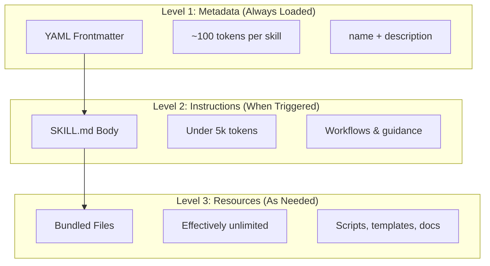
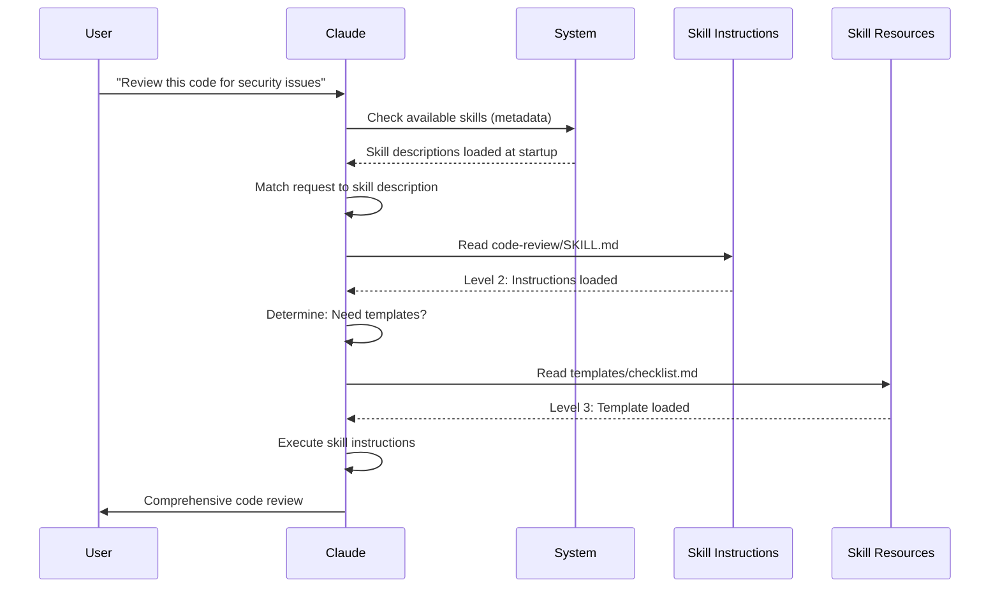

<!-- i18n-source: 03-skills/README.md -->
<!-- i18n-source-sha: 8e1f60f -->
<!-- i18n-date: 2026-10-26 -->
<picture>
  <source media="(prefers-color-scheme: dark)" srcset="../../resources/logos/claude-howto-logo-dark.svg">
  
</picture>

# Agent Skills 가이드

Agent Skills는 Claude의 기능을 확장하는, 재사용 가능하고 파일 시스템에 기반한 능력입니다. 도메인 고유의 전문 지식, 워크플로, 모범 사례를 Claude가 관련성에 따라 자동으로 활용할 수 있는 발견 가능한 컴포넌트로 패키징합니다.

## 개요

**Agent Skills**는 범용 에이전트를 전문가로 탈바꿈시키는 모듈화된 능력입니다. 프롬프트(단발 작업을 위한 대화 수준의 지시)와 달리, 스킬은 필요할 때 불러와지며 여러 대화에 걸쳐 같은 안내를 반복해서 제공할 필요를 없애 줍니다.

### 주요 이점

- **Claude를 전문화**: 도메인 고유 작업에 맞게 능력을 다듬습니다
- **반복 감소**: 한 번 만들면 대화를 넘나들며 자동으로 활용됩니다
- **능력 조합**: 스킬을 조합해 복잡한 워크플로를 구축할 수 있습니다
- **워크플로 확장**: 여러 프로젝트와 팀에서 스킬을 재사용할 수 있습니다
- **품질 유지**: 모범 사례를 워크플로에 직접 심을 수 있습니다

스킬은 [Agent Skills](https://agentskills.io) 오픈 표준을 따르며 여러 AI 도구에서 동작합니다. Claude Code는 호출 제어, 서브에이전트 실행, 동적 컨텍스트 주입 같은 추가 기능으로 표준을 확장합니다.

> **참고**: 커스텀 슬래시 명령어는 스킬로 통합되었습니다. `.claude/commands/` 안의 파일은 계속 동작하며 같은 프런트매터 필드를 지원합니다. 새로 개발할 때는 스킬이 권장됩니다. 같은 경로에 둘 다 존재하면(예: `.claude/commands/review.md`와 `.claude/skills/review/SKILL.md`) 스킬이 우선합니다.

## 스킬의 동작 방식: 점진적 공개

스킬은 **점진적 공개(progressive disclosure)** 아키텍처를 활용합니다. Claude는 모든 것을 미리 소비하는 대신 필요에 따라 단계적으로 정보를 불러옵니다. 덕분에 무제한에 가까운 확장성을 유지하면서도 효율적인 컨텍스트 관리가 가능합니다.

### 3단계 로딩



| 레벨 | 불러오는 시점 | 토큰 비용 | 내용 |
|-------|------------|------------|---------|
| **Level 1: 메타데이터** | 항상(시작 시) | 스킬당 약 100토큰 | YAML 프런트매터의 `name`과 `description` |
| **Level 2: 지시** | 스킬이 트리거될 때 | 5k 토큰 미만 | SKILL.md 본문의 지시와 안내 |
| **Level 3+: 리소스** | 필요에 따라 | 사실상 무제한 | bash를 통해 실행되는 번들 파일(내용은 컨텍스트에 불러오지 않음) |

즉, 컨텍스트에 부담을 주지 않고 많은 스킬을 설치할 수 있습니다. Claude는 실제로 트리거되기 전까지는 각 스킬의 존재와 용도만 알고 있습니다.

## 스킬 로딩 과정



## 스킬의 종류와 위치

| 종류 | 위치 | 범위 | 공유 | 적합한 용도 |
|------|----------|-------|--------|----------|
| **Enterprise** | 관리 대상 설정 | 조직 내 전체 사용자 | 있음 | 조직 전체 표준 |
| **Personal** | `~/.claude/skills/<skill-name>/SKILL.md` | 개인 | 없음 | 개인 워크플로 |
| **Project** | `.claude/skills/<skill-name>/SKILL.md` | 팀 | 있음(git 경유) | 팀 표준 |
| **Plugin** | `<plugin>/skills/<skill-name>/SKILL.md` | 활성화된 범위 | 플러그인에 따라 다름 | 플러그인에 번들 |

스킬 이름이 레벨 간에 중복되면 우선순위가 높은 위치가 우선합니다: **enterprise > personal > project**. 개인 스킬은 기본적으로 프로젝트 스킬을 덮어씁니다. 플러그인 스킬은 `plugin-name:skill-name` 네임스페이스를 사용하므로 충돌하지 않습니다.

### 자동 탐지

**중첩 디렉터리**: 하위 디렉터리 안의 파일을 다룰 때 Claude Code는 중첩된 `.claude/skills/` 디렉터리에서 스킬을 자동으로 탐지합니다. 예를 들어 `packages/frontend/` 안의 파일을 편집 중이라면 Claude Code는 `packages/frontend/.claude/skills/` 안의 스킬도 찾습니다. 이는 패키지마다 고유한 스킬을 갖는 모노레포 구성을 지원합니다.

**`--add-dir` 디렉터리**: `--add-dir`로 추가된 디렉터리의 스킬은 변경 사항 실시간 감지와 함께 자동으로 불러와집니다. 해당 디렉터리 안의 스킬 파일을 편집하면 Claude Code를 재시작하지 않아도 즉시 반영됩니다.

**description 예산**: 스킬 설명(Level 1 메타데이터)은 **컨텍스트 윈도우의 1%**가 상한입니다(폴백: **8,000자**). 많은 스킬을 설치했다면 설명이 줄어들 수 있습니다. 스킬 이름은 항상 포함되지만 설명은 용량에 맞게 잘립니다. 설명에서는 주요 사용 사례를 맨 앞에 두세요. 예산은 환경 변수 `SLASH_COMMAND_TOOL_CHAR_BUDGET`으로 덮어쓸 수 있습니다.

## 커스텀 스킬 만들기

### 기본 디렉터리 구조

```
my-skill/
├── SKILL.md           # 메인 지시(필수)
├── template.md        # Claude가 채우는 템플릿
├── examples/
│   └── sample.md      # 기대하는 형식을 보여 주는 출력 예시
└── scripts/
    └── validate.sh    # Claude가 실행할 수 있는 스크립트
```

### SKILL.md 형식

```yaml
---
name: your-skill-name
description: Brief description of what this Skill does and when to use it
---

# Your Skill Name

## Instructions
Provide clear, step-by-step guidance for Claude.

## Examples
Show concrete examples of using this Skill.
```

### 권장 필드

- **description**(권장): 스킬이 무엇을 하는지와 언제 사용하는지. 생략하면 Claude Code는 markdown 본문의 첫 번째 비어 있지 않은 줄을 사용합니다. `description`과 `when_to_use`를 합친 텍스트는 스킬 목록에서 **1,536자**로 잘립니다(`skillListingMaxDescChars`로 변경 가능). Claude가 스킬을 발동할 시점을 판단할 때 대조하는 것이 바로 이 텍스트입니다.
- **name**(선택): 기본값은 스킬의 **디렉터리 이름**입니다. 지정하면 표시 이름이 되며, 소문자·숫자·하이픈만(최대 64자) 사용하는 것이 권장되는 이식성 있는 형식입니다(claude.ai와 Skills API에서는 필수). Claude Code 자체(v2.1.299+)는 이름에 보이지 않는 문자, 글자 방향을 바꾸는 문자, 공백처럼 보이는 문자, `<`나 `>`가 포함되거나 256자를 넘는 스킬이나 명령어를 이름을 바꿀 때까지 건너뜁니다. Claude Code에서는 `anthropic-skills`와 `synced`가 예약되어 있어 플러그인 밖에서는 불러오지 않습니다. "anthropic"이나 "claude"를 포함할 수 없다는 더 엄격한 제한은 claude.ai나 Skills API에 업로드하는 스킬에 적용됩니다. 플러그인 스킬에서는 `name`이 명령어의 마지막 세그먼트도 결정합니다.

SKILL.md 프런트매터의 필드는 모두 선택 사항이며, 권장되는 것은 `description`뿐입니다.

### 선택적 프런트매터 필드

```yaml
---
name: my-skill
description: What this skill does and when to use it
argument-hint: "[filename] [format]"        # 자동 완성용 힌트
disable-model-invocation: true              # 사용자만 호출 가능
user-invocable: false                       # 슬래시 메뉴에서 숨김
allowed-tools: Read, Grep, Glob             # 스킬 실행 중 이 도구들을 사전 승인(권한 프롬프트 없음)
model: opus                                 # 사용할 모델 지정
effort: high                                # 노력 수준 덮어쓰기(low, medium, high, max)
context: fork                               # 격리된 서브에이전트에서 실행
agent: Explore                              # 에이전트 타입(context: fork와 함께 사용)
shell: bash                                 # 명령어용 셸: bash(기본) 또는 powershell
hooks:                                      # 스킬 호출 시 등록되는 훅
  PreToolUse:
    - matcher: "Bash"
      hooks:
        - type: command
          command: "./scripts/validate.sh"
paths: "src/api/**/*.ts"               # 스킬 발동을 제한하는 glob 패턴
---
```

| 필드 | 설명 |
|-------|-------------|
| `name` | 권장(이식성 있음): 소문자, 숫자, 하이픈만(최대 64자). Claude Code에서는 `anthropic-skills`와 `synced`가 예약되어 있습니다. |
| `description` | 스킬이 무엇을 하는지와 언제 사용하는지. `description`과 `when_to_use`를 합친 텍스트는 스킬 목록에서 1,536자로 잘립니다(`skillListingMaxDescChars`로 변경 가능). 자동 호출 매칭에 중요합니다. |
| `when_to_use` | Claude가 스킬을 호출해야 할 시점에 관한 보충 정보. 스킬 목록에서는 `description` 뒤에 이어 붙으며 1,536자 상한에 포함됩니다. |
| `argument-hint` | `/` 자동 완성 메뉴에 표시되는 힌트(예: `"[filename] [format]"`). |
| `disable-model-invocation` | `true` = 사용자만 `/name`으로 호출할 수 있습니다. Claude는 자동 호출하지 않습니다. |
| `user-invocable` | `false` = `/` 메뉴에서 숨깁니다. Claude만 자동 호출할 수 있습니다. |
| `allowed-tools` | 권한 프롬프트 없이 스킬이 사용할 수 있는 도구의 쉼표 구분 목록. |
| `model` | 스킬이 활성화된 동안의 모델 덮어쓰기(예: `opus`, `sonnet`). |
| `effort` | 스킬이 활성화된 동안의 노력 수준 덮어쓰기: `low`, `medium`, `high`, `max`. |
| `context` | `fork`를 지정하면 스킬을 자체 컨텍스트 윈도우를 가진 포크된 서브에이전트 컨텍스트에서 실행합니다. |
| `agent` | `context: fork`일 때의 서브에이전트 타입(예: `Explore`, `Plan`, `general-purpose`). |
| `shell` | `` !`command` `` 치환과 스크립트에 사용할 셸: `bash`(기본) 또는 `powershell`. |
| `hooks` | 스킬 호출 시 등록되는 훅(settings의 훅과 같은 형식. 임의의 이벤트). 등록 후에는 세션이 끝날 때까지 유효합니다. |
| `paths` | 스킬이 자동 발동하는 조건을 제한하는 glob 패턴. 쉼표 구분 문자열 또는 YAML 목록. 경로별 규칙과 같은 형식. |

## 스킬 콘텐츠의 종류

스킬은 목적에 따라 두 종류의 콘텐츠를 담을 수 있습니다.

### 레퍼런스 콘텐츠

Claude가 현재 작업에 적용할 지식을 추가합니다. 규약, 패턴, 스타일 가이드, 도메인 지식 등입니다. 대화 컨텍스트와 인라인으로 동작합니다.

```yaml
---
name: api-conventions
description: API design patterns for this codebase
---

When writing API endpoints:
- Use RESTful naming conventions
- Return consistent error formats
- Include request validation
```

### 작업 콘텐츠

특정 동작을 수행하는 단계별 지시입니다. `/skill-name`으로 직접 호출되는 경우가 많습니다.

```yaml
---
name: deploy
description: Deploy the application to production
context: fork
disable-model-invocation: true
---

Deploy the application:
1. Run the test suite
2. Build the application
3. Push to the deployment target
```

## 스킬 호출 제어

기본적으로 사용자도 Claude도 어떤 스킬이든 호출할 수 있습니다. 두 개의 프런트매터 필드가 세 가지 호출 모드를 제어합니다.

| 프런트매터 | 사용자 호출 | Claude 호출 |
|---|---|---|
| (기본) | 가능 | 가능 |
| `disable-model-invocation: true` | 가능 | 불가 |
| `user-invocable: false` | 불가 | 가능 |

**`disable-model-invocation: true`를 써야 하는 경우**: 부수 효과가 있는 워크플로(`/commit`, `/deploy`, `/send-slack-message`). 코드가 깔끔해 보인다는 이유로 Claude가 마음대로 배포하는 것은 바라지 않습니다.

**`user-invocable: false`를 써야 하는 경우**: 명령어로 실행할 수 없는 배경 지식. `legacy-system-context` 같은 스킬은 오래된 시스템의 구조를 설명하는 것으로, Claude에게는 유용하지만 사용자에게는 의미 있는 동작이 아닙니다.

## 문자열 치환

스킬은 콘텐츠가 Claude에 도달하기 전에 해석되는 동적 값을 지원합니다.

| 변수 | 설명 |
|----------|-------------|
| `$ARGUMENTS` | 스킬 호출 시 전달된 전체 인수 |
| `$ARGUMENTS[N]` 또는 `$N` | 인덱스(0부터 시작)로 특정 인수에 접근 |
| `${CLAUDE_SESSION_ID}` | 현재 세션 ID |
| `${CLAUDE_SKILL_DIR}` | 스킬의 SKILL.md 파일이 있는 디렉터리 |
| `` !`command` `` | 동적 컨텍스트 주입 — 셸 명령어를 실행하고 출력을 인라인으로 넣습니다 |

**예:**

```yaml
---
name: fix-issue
description: Fix a GitHub issue
---

Fix GitHub issue $ARGUMENTS following our coding standards.
1. Read the issue description
2. Implement the fix
3. Write tests
4. Create a commit
```

`/fix-issue 123`을 실행하면 `$ARGUMENTS`가 `123`으로 치환됩니다.

## 동적 컨텍스트 주입

`` !`command` `` 문법은 스킬 콘텐츠가 Claude에 전송되기 전에 셸 명령어를 실행합니다.

> **참고(v2.1.299)**: `UserPromptSubmit` 훅은 명령어가 전개되기 전에 실행되므로, 프롬프트를 차단하는 훅은 이 `!` 명령어의 실행도 막습니다.

```yaml
---
name: pr-summary
description: Summarize changes in a pull request
context: fork
agent: Explore
---

## Pull request context
- PR diff: !`gh pr diff`
- PR comments: !`gh pr view --comments`
- Changed files: !`gh pr diff --name-only`

## Your task
Summarize this pull request...
```

명령어는 즉시 실행되며 Claude에게는 최종 출력만 보입니다. 기본적으로 `bash`에서 실행됩니다. 프런트매터에서 `shell: powershell`을 설정하면 PowerShell을 사용할 수 있습니다.

## 서브에이전트 안에서 스킬 실행

스킬에 `context: fork`를 추가하면 격리된 서브에이전트 컨텍스트에서 실행됩니다. 스킬 콘텐츠가 자체 컨텍스트 윈도우를 가진 전용 서브에이전트의 작업이 되어, 메인 대화를 어지럽히지 않습니다.

`agent` 필드는 어떤 에이전트 타입을 사용할지 지정합니다.

| 에이전트 타입 | 적합한 용도 |
|---|---|
| `Explore` | 읽기 전용 조사, 코드베이스 분석 |
| `Plan` | 구현 계획 작성 |
| `general-purpose` | 모든 도구가 필요한 폭넓은 작업 |
| 커스텀 에이전트 | 설정에서 정의한 전문 에이전트 |

**프런트매터 예:**

```yaml
---
context: fork
agent: Explore
---
```

**완전한 스킬 예:**

```yaml
---
name: topic-research
description: Research a topic thoroughly
context: fork
agent: Explore
---

Research $ARGUMENTS thoroughly:
1. Find relevant files using Glob and Grep
2. Read and analyze the code
3. Summarize findings with specific file references
```

## 실용 예제

### 예제 1: 코드 리뷰 스킬

**디렉터리 구조:**

```
~/.claude/skills/code-review/
├── SKILL.md
├── templates/
│   ├── review-checklist.md
│   └── finding-template.md
└── scripts/
    ├── analyze-metrics.py
    └── compare-complexity.py
```

**파일:** `~/.claude/skills/code-review/SKILL.md`

```yaml
---
name: code-review-specialist
description: Comprehensive code review with security, performance, and quality analysis. Use when users ask to review code, analyze code quality, evaluate pull requests, or mention code review, security analysis, or performance optimization.
---

# Code Review Skill

This skill provides comprehensive code review capabilities focusing on:

1. **Security Analysis**
   - Authentication/authorization issues
   - Data exposure risks
   - Injection vulnerabilities
   - Cryptographic weaknesses

2. **Performance Review**
   - Algorithm efficiency (Big O analysis)
   - Memory optimization
   - Database query optimization
   - Caching opportunities

3. **Code Quality**
   - SOLID principles
   - Design patterns
   - Naming conventions
   - Test coverage

4. **Maintainability**
   - Code readability
   - Function size (should be < 50 lines)
   - Cyclomatic complexity
   - Type safety

## Review Template

For each piece of code reviewed, provide:

### Summary
- Overall quality assessment (1-5)
- Key findings count
- Recommended priority areas

### Critical Issues (if any)
- **Issue**: Clear description
- **Location**: File and line number
- **Impact**: Why this matters
- **Severity**: Critical/High/Medium
- **Fix**: Code example

For detailed checklists, see [templates/review-checklist.md](templates/review-checklist.md).
```

### 예제 2: 코드베이스 시각화 스킬

인터랙티브 HTML 시각화를 생성하는 스킬입니다.

**디렉터리 구조:**

```
~/.claude/skills/codebase-visualizer/
├── SKILL.md
└── scripts/
    └── visualize.py
```

**파일:** `~/.claude/skills/codebase-visualizer/SKILL.md`

````yaml
---
name: codebase-visualizer
description: Generate an interactive collapsible tree visualization of your codebase. Use when exploring a new repo, understanding project structure, or identifying large files.
allowed-tools: Bash(python *)
---

# Codebase Visualizer

Generate an interactive HTML tree view showing your project's file structure.

## Usage

Run the visualization script from your project root:

```bash
python ~/.claude/skills/codebase-visualizer/scripts/visualize.py .
```

This creates `codebase-map.html` and opens it in your default browser.

## What the visualization shows

- **Collapsible directories**: Click folders to expand/collapse
- **File sizes**: Displayed next to each file
- **Colors**: Different colors for different file types
- **Directory totals**: Shows aggregate size of each folder
````

번들된 Python 스크립트가 무거운 처리를 맡고, Claude는 오케스트레이션을 담당합니다.

### 예제 3: 배포 스킬(사용자 호출 전용)

```yaml
---
name: deploy
description: Deploy the application to production
disable-model-invocation: true
allowed-tools: Bash(npm *), Bash(git *)
---

Deploy $ARGUMENTS to production:

1. Run the test suite: `npm test`
2. Build the application: `npm run build`
3. Push to the deployment target
4. Verify the deployment succeeded
5. Report deployment status
```

### 예제 4: 브랜드 보이스 스킬(배경 지식)

```yaml
---
name: brand-voice
description: Ensure all communication matches brand voice and tone guidelines. Use when creating marketing copy, customer communications, or public-facing content.
user-invocable: false
---

## Tone of Voice
- **Friendly but professional** - approachable without being casual
- **Clear and concise** - avoid jargon
- **Confident** - we know what we're doing
- **Empathetic** - understand user needs

## Writing Guidelines
- Use "you" when addressing readers
- Use active voice
- Keep sentences under 20 words
- Start with value proposition

For templates, see [templates/](templates/).
```

### 예제 5: CLAUDE.md 생성기 스킬

```yaml
---
name: claude-md
description: Create or update CLAUDE.md files following best practices for optimal AI agent onboarding. Use when users mention CLAUDE.md, project documentation, or AI onboarding.
---

## Core Principles

**LLMs are stateless**: CLAUDE.md is the main project file loaded into every conversation (alongside auto memory and unscoped rules).

### The Golden Rules

1. **Less is More**: Keep each CLAUDE.md under 200 lines
2. **Universal Applicability**: Only include information relevant to EVERY session
3. **Don't Use Claude as a Linter**: Use deterministic tools instead
4. **Never Auto-Generate**: Craft it manually with careful consideration

## Essential Sections

- **Project Name**: Brief one-line description
- **Tech Stack**: Primary language, frameworks, database
- **Development Commands**: Install, test, build commands
- **Critical Conventions**: Only non-obvious, high-impact conventions
- **Known Issues / Gotchas**: Things that trip up developers
```

### 예제 6: 스크립트가 포함된 리팩터링 스킬

**디렉터리 구조:**

```
refactor/
├── SKILL.md
├── references/
│   ├── code-smells.md
│   └── refactoring-catalog.md
├── templates/
│   └── refactoring-plan.md
└── scripts/
    ├── analyze-complexity.py
    └── detect-smells.py
```

**파일:** `refactor/SKILL.md`

```yaml
---
name: refactor
description: Systematic code refactoring based on Martin Fowler's methodology. Use when users ask to refactor code, improve code structure, reduce technical debt, or eliminate code smells.
---

# Code Refactoring Skill

A phased approach emphasizing safe, incremental changes backed by tests.

## Workflow

Phase 1: Research & Analysis → Phase 2: Test Coverage Assessment →
Phase 3: Code Smell Identification → Phase 4: Refactoring Plan Creation →
Phase 5: Incremental Implementation → Phase 6: Review & Iteration

## Core Principles

1. **Behavior Preservation**: External behavior must remain unchanged
2. **Small Steps**: Make tiny, testable changes
3. **Test-Driven**: Tests are the safety net
4. **Continuous**: Refactoring is ongoing, not a one-time event

For code smell catalog, see [references/code-smells.md](references/code-smells.md).
For refactoring techniques, see [references/refactoring-catalog.md](references/refactoring-catalog.md).
```

## 보조 파일

스킬은 `SKILL.md` 외에도 여러 파일을 디렉터리에 포함할 수 있습니다. 이러한 보조 파일(템플릿, 예시, 스크립트, 레퍼런스 문서)은 필요할 때 Claude가 불러올 수 있는 추가 리소스를 제공하면서 메인 스킬 파일은 초점이 분명한 상태로 유지해 줍니다.

```
my-skill/
├── SKILL.md              # 메인 지시(필수, 500줄 이하로 유지)
├── templates/            # Claude가 채우는 템플릿
│   └── output-format.md
├── examples/             # 기대하는 형식을 보여 주는 출력 예시
│   └── sample-output.md
├── references/           # 도메인 지식과 사양
│   └── api-spec.md
└── scripts/              # Claude가 실행할 수 있는 스크립트
    └── validate.sh
```

보조 파일 가이드라인:

- `SKILL.md`는 **500줄 이하**로 유지합니다. 상세한 레퍼런스, 큰 예시, 사양은 별도 파일로 옮깁니다.
- `SKILL.md`에서 추가 파일을 참조할 때는 **상대 경로**를 사용합니다(예: `[API reference](references/api-spec.md)`).
- 보조 파일은 Level 3(필요에 따라)에서 불러오므로, Claude가 실제로 읽기 전까지는 컨텍스트를 소비하지 않습니다.

## 스킬 관리

### 사용 가능한 스킬 확인

Claude에게 직접 묻습니다:
```
What Skills are available?
```

또는 파일 시스템을 확인합니다:
```bash
# 개인 스킬 목록
ls ~/.claude/skills/

# 프로젝트 스킬 목록
ls .claude/skills/
```

### 스킬 테스트

테스트 방법은 두 가지입니다.

**Claude가 자동으로 호출하게 하기**: 설명에 맞는 것을 요청합니다:
```
Can you help me review this code for security issues?
```

**스킬 이름으로 직접 호출하기**:
```
/code-review src/auth/login.ts
```

### 스킬 업데이트

`SKILL.md`를 직접 편집하고 `/reload-skills`(v2.1.152 이후)로 스킬 디렉터리를 다시 스캔합니다. 재시작해도 반영되지만 필수는 아닙니다. `--add-dir`의 스킬은 실시간으로 감지되며, `SessionStart` 훅이 `reloadSkills: true`를 반환해도 같은 재스캔이 실행됩니다.

```bash
# 개인 스킬
code ~/.claude/skills/my-skill/SKILL.md

# 프로젝트 스킬
code .claude/skills/my-skill/SKILL.md
```

### Claude의 스킬 접근 제한

Claude가 호출할 수 있는 스킬을 제어하는 세 가지 방법입니다.

**모든 스킬 비활성화**는 `/permissions`에서:
```
# deny 규칙에 추가:
Skill
```

**특정 스킬 허용 또는 거부**:
```
# 특정 스킬만 허용
Skill(commit)
Skill(review-pr *)

# 특정 스킬 거부
Skill(deploy *)
```

**개별 스킬 숨기기**는 프런트매터에 `disable-model-invocation: true`를 추가합니다.

## 모범 사례

### 1. 설명을 구체적으로 작성합니다

- **나쁜 예(모호함)**: "Helps with documents"
- **좋은 예(구체적)**: "Extract text and tables from PDF files, fill forms, merge documents. Use when working with PDF files or when the user mentions PDFs, forms, or document extraction."

### 2. 스킬을 한 가지 목적에 집중시킵니다

- 1 스킬 = 1 기능
- 좋은 예: "PDF form filling"
- 나쁜 예: "Document processing"(너무 넓음)

### 3. 트리거 단어를 포함합니다

사용자 요청과 맞아떨어질 키워드를 설명에 추가합니다:
```yaml
description: Analyze Excel spreadsheets, generate pivot tables, create charts. Use when working with Excel files, spreadsheets, or .xlsx files.
```

### 4. SKILL.md를 500줄 이하로 유지합니다

상세한 레퍼런스는 별도 파일로 옮겨 필요할 때 Claude가 불러올 수 있게 합니다.

### 5. 보조 파일을 참조합니다

```markdown
## Additional resources

- For complete API details, see [reference.md](reference.md)
- For usage examples, see [examples.md](examples.md)
```

### 해야 할 것

- 명확하고 설명적인 이름 사용
- 포괄적인 지시 포함
- 구체적인 예시 포함
- 관련 스크립트와 템플릿을 패키징
- 실제 시나리오로 테스트
- 의존성을 문서화

### 하지 말아야 할 것

- 일회성 작업을 위한 스킬을 만들지 않기
- 기존 기능을 중복해서 만들지 않기
- 스킬을 너무 넓게 만들지 않기
- description 필드를 생략하지 않기
- 신뢰할 수 없는 출처의 스킬을 감사 없이 설치하지 않기

## 문제 해결

### 빠른 참조

| 문제 | 해결책 |
|-------|----------|
| Claude가 스킬을 사용하지 않음 | description을 트리거 문구로 구체화 |
| 스킬 파일을 찾을 수 없음 | 경로 확인: `~/.claude/skills/name/SKILL.md` |
| YAML 오류 | `---` 마커, 들여쓰기, 탭 없음 확인 |
| 스킬이 충돌함 | description에 구별 가능한 트리거 문구 넣기 |
| 스크립트가 동작하지 않음 | 권한 확인: `chmod +x scripts/*.py` |
| Claude가 일부 스킬을 인식하지 못함 | 스킬이 너무 많음. `/context`로 경고 확인 |

### 스킬이 트리거되지 않는 경우

Claude가 기대대로 스킬을 사용하지 않는다면:

1. 사용자가 자연스럽게 쓰는 문구가 description의 키워드에 포함되어 있는지 확인합니다
2. "What skills are available?"이라고 물어 스킬이 표시되는지 확인합니다
3. 요청을 description에 맞도록 바꿔 말합니다
4. `/skill-name`으로 직접 호출해 테스트합니다

### 스킬이 과도하게 트리거되는 경우

의도하지 않은 곳에서 Claude가 스킬을 사용한다면:

1. description을 더 구체적으로 작성합니다
2. 수동 호출만 허용하도록 `disable-model-invocation: true`를 추가합니다

### Claude가 일부 스킬을 인식하지 못하는 경우

스킬 description은 **컨텍스트 윈도우의 1%**를 상한으로 불러옵니다(폴백: **8,000자**). 각 항목의 `description` + `when_to_use`는 기본적으로 1,536자로 제한됩니다(`skillListingMaxDescChars`). `/context`를 실행해 제외된 스킬에 관한 경고를 확인하세요. 예산은 환경 변수 `SLASH_COMMAND_TOOL_CHAR_BUDGET`으로 덮어쓸 수 있습니다.

## 보안 고려 사항

**신뢰할 수 있는 출처의 스킬만 사용하세요.** 스킬은 지시와 코드를 통해 Claude에게 능력을 부여합니다. 악의적인 스킬은 Claude가 유해한 방식으로 도구를 호출하거나 코드를 실행하게 만들 수 있습니다.

**주요 보안 고려 사항:**

- **철저한 감사**: 스킬 디렉터리 안의 모든 파일을 검토합니다
- **외부 출처는 위험이 높음**: 외부 URL에서 가져오는 스킬은 침해되었을 수 있습니다
- **도구 악용**: 악의적인 스킬이 유해한 방식으로 도구를 호출할 수 있습니다
- **소프트웨어 설치와 똑같이 취급**: 신뢰할 수 있는 출처의 스킬만 사용합니다

### 스킬 안의 셸 치환 비활성화

스킬은 Claude가 보기 전에 `` !`command` `` 문법으로 셸 명령어의 출력을 프롬프트에 삽입할 수 있습니다. 보안을 중시하는 환경(공유된 조직 배포, 잠긴 CI 러너)에서는 `disableSkillShellExecution` 설정으로 치환을 완전히 비활성화할 수 있습니다(**v2.1.91**에서 추가):

```jsonc
// ~/.claude/settings.json 또는 관리 정책
{
  "disableSkillShellExecution": true
}
```

`disableSkillShellExecution`이 `true`이면 스킬 안의 각 `` !`command` `` 마커는 실행되지 않고 `[shell command execution disabled by policy]`로 대체됩니다. 스킬 자체를 비활성화하지 않고도 스킬 수준의 셸 인젝션 공격 표면을 제거할 수 있습니다. 다층 방어를 위해 `allowedTools` 허용 목록과 조합하는 것을 고려해 보세요.

## 스킬과 다른 기능 비교

| 기능 | 호출 | 적합한 용도 |
|---------|------------|----------|
| **스킬** | 자동 또는 `/name` | 재사용 가능한 전문 지식, 워크플로 |
| **슬래시 명령어** | 사용자 주도 `/name` | 간단한 단축 명령(스킬로 통합됨) |
| **서브에이전트** | 자동 위임 | 격리된 작업 실행 |
| **메모리(CLAUDE.md)** | 항상 로드 | 영속적인 프로젝트 컨텍스트 |
| **MCP** | 실시간 | 외부 데이터나 서비스 접근 |
| **훅** | 이벤트 기반 | 자동화된 부수 효과 |

## 번들 스킬

Claude Code에는 설치 없이 항상 사용할 수 있는 내장 스킬이 여러 개 동봉되어 있습니다.

| 스킬 | 설명 |
|-------|-------------|
| `/simplify` | 변경된 파일을 재사용성, 품질, 효율 관점에서 리뷰합니다. 3개의 병렬 리뷰 에이전트를 실행 |
| `/batch <instruction>` | git worktree를 사용해 코드베이스 전체에 대규모 병렬 변경을 오케스트레이션 |
| `/debug [description]` | 디버그 로그를 읽어 현재 세션의 문제를 해결 |
| `/loop [interval] [prompt]` | 프롬프트를 주기적으로 반복 실행(예: `/loop 5m check the deploy`) |
| `/claude-api` | Claude API/SDK 레퍼런스를 불러옵니다. `anthropic`/`@anthropic-ai/sdk` 임포트 시 자동 발동 |

이 스킬들은 추가 설치나 설정 없이 바로 사용할 수 있습니다. 커스텀 스킬과 같은 SKILL.md 형식을 따릅니다.

## 스킬 공유

### 프로젝트 스킬(팀 공유)

1. `.claude/skills/`에 스킬을 만듭니다
2. git에 커밋합니다
3. 팀원이 pull하면 즉시 사용할 수 있습니다

### 개인 스킬

```bash
# 개인 디렉터리로 복사
cp -r my-skill ~/.claude/skills/

# 스크립트를 실행 가능하게 설정
chmod +x ~/.claude/skills/my-skill/scripts/*.py
```

### 플러그인 배포

더 넓은 배포를 위해 플러그인의 `skills/` 디렉터리에 스킬을 패키징합니다.

## 더 나아가기: 스킬 컬렉션과 스킬 매니저

스킬을 본격적으로 만들기 시작하면 두 가지가 필수가 됩니다. 검증된 스킬 라이브러리와 그것을 관리하는 도구입니다.

**[luongnv89/skills](https://github.com/luongnv89/skills)** — 거의 모든 프로젝트에서 매일 사용하는 스킬 컬렉션입니다. 하이라이트로 `logo-designer`(프로젝트 로고를 즉석에서 생성)와 `ollama-optimizer`(하드웨어에 맞게 로컬 LLM 성능을 튜닝)가 있습니다. 바로 쓸 수 있는 스킬을 찾고 있다면 좋은 출발점입니다.

**[luongnv89/asm](https://github.com/luongnv89/asm)** — Agent Skill Manager. 스킬 개발, 중복 탐지, 테스트를 다룹니다. `asm link` 명령어로 파일을 복사하지 않고도 어떤 프로젝트에서든 스킬을 테스트할 수 있습니다. 스킬이 조금 늘어나면 없어서는 안 될 도구입니다.

## 추가 리소스

- [공식 스킬 문서](https://code.claude.com/docs/en/skills)
- [Agent Skills 아키텍처 블로그](https://claude.com/blog/equipping-agents-for-the-real-world-with-agent-skills)
- [Skills 저장소](https://github.com/luongnv89/skills) - 바로 쓸 수 있는 스킬 컬렉션
- [슬래시 명령어 가이드](../01-slash-commands/) - 사용자 주도 단축 명령
- [서브에이전트 가이드](../04-subagents/) - 위임된 AI 에이전트
- [메모리 가이드](../02-memory/) - 영속적인 컨텍스트
- [MCP(Model Context Protocol)](../05-mcp/) - 실시간 외부 데이터
- [훅 가이드](../06-hooks/) - 이벤트 기반 자동화

---
**최종 업데이트**: 2026년 10월 18일
**Claude Code 버전**: 2.1.302
**출처**:
- https://code.claude.com/docs/en/skills
- https://code.claude.com/docs/en/settings
- https://code.claude.com/docs/en/changelog
- https://code.claude.com/docs/en/settings-reference
- https://code.claude.com/docs/en/hooks#hooks-in-skills-and-agents
- https://code.claude.com/docs/en/skills#characters-a-skill-name-cant-hold
- https://code.claude.com/docs/en/hooks#hook-lifecycle
- https://code.claude.com/docs/en/changelog#2-1-299
- https://code.claude.com/docs/en/skills#pre-approve-tools-for-a-skill
- https://code.claude.com/docs/en/memory#write-effective-instructions
- https://code.claude.com/docs/en/memory
- https://code.claude.com/docs/en/commands
**지원 모델**: Claude Fable 5, Claude Opus 5, Claude Sonnet 5, Claude Sonnet 4.6, Claude Opus 4.8, Claude Haiku 4.5
