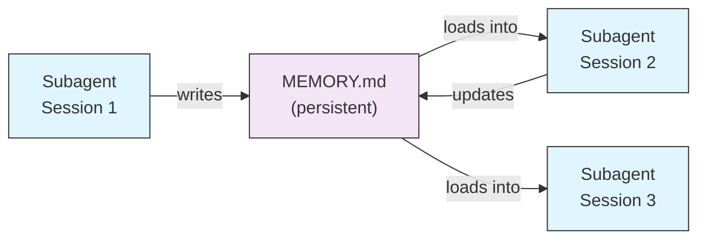
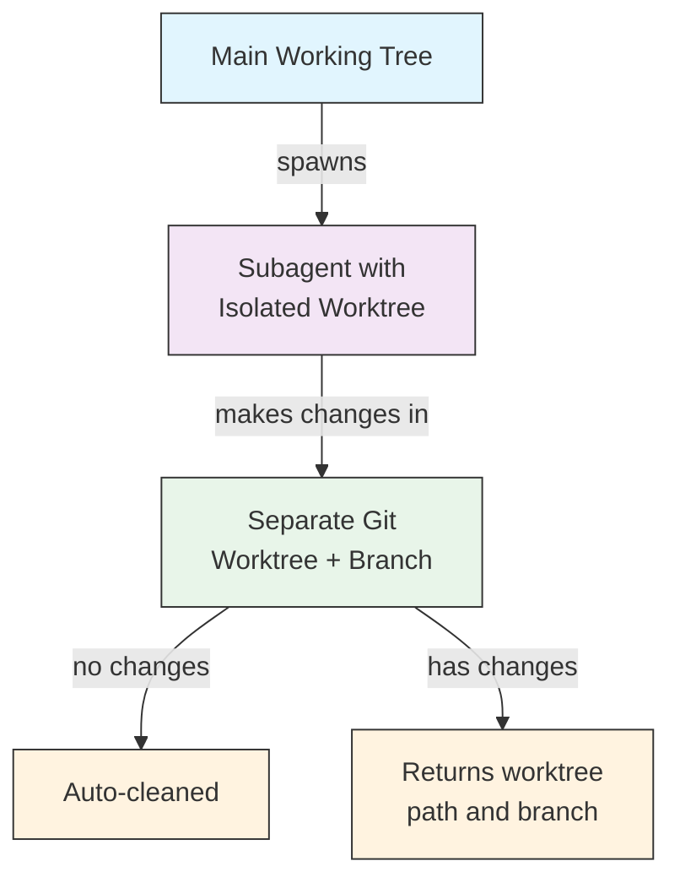
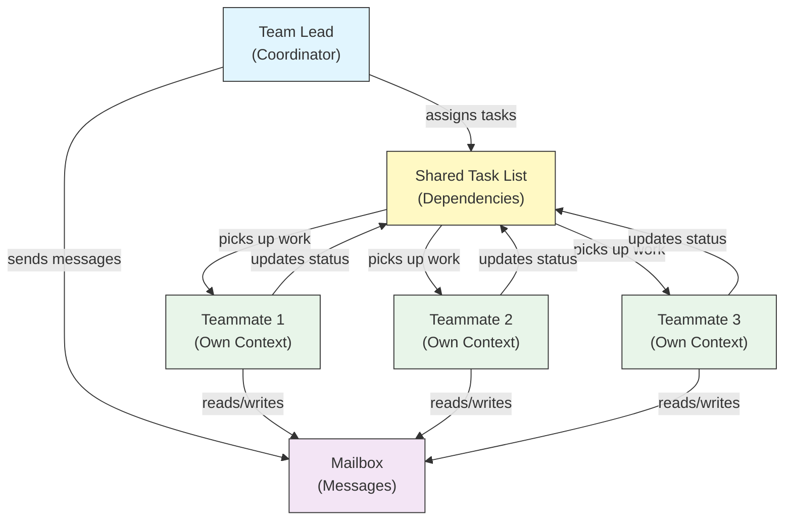
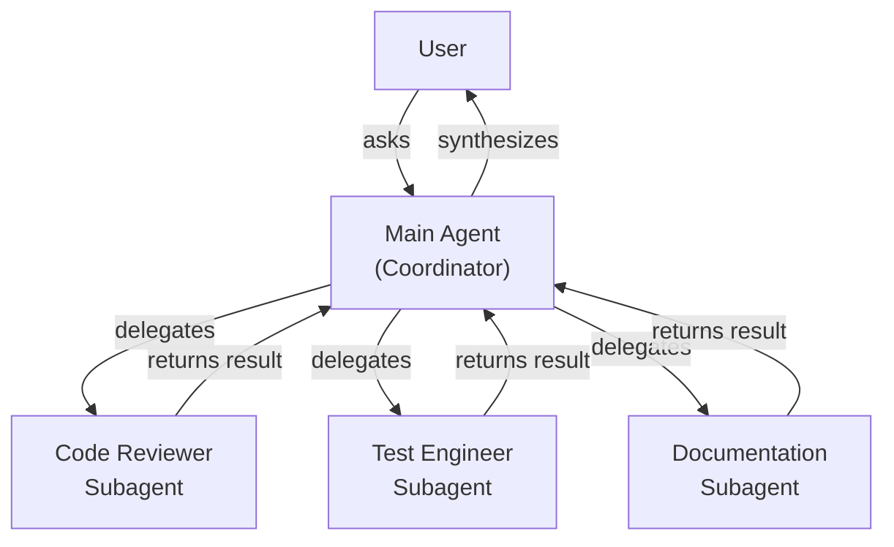
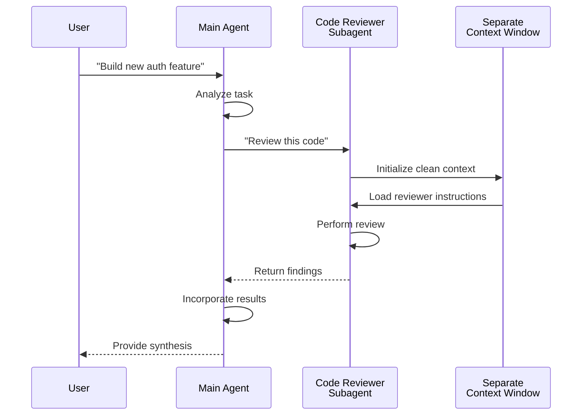
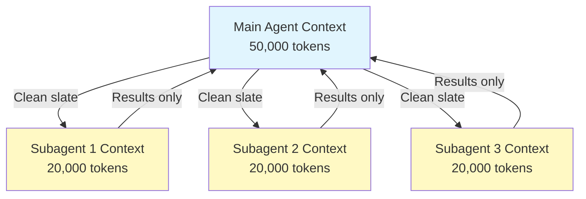
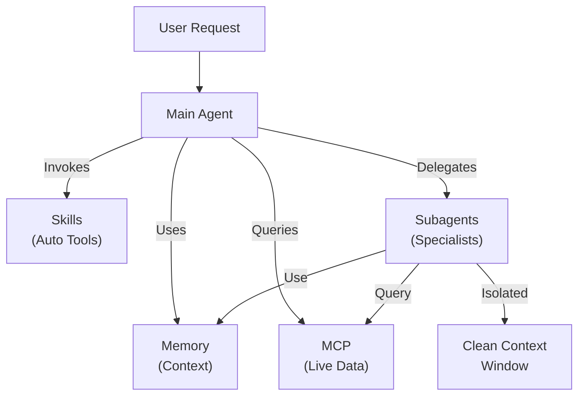

<!-- i18n-source: 04-subagents/README.md -->
<!-- i18n-source-sha: d17d515 -->
<!-- i18n-date: 2026-10-26 -->

<picture>
  <source media="(prefers-color-scheme: dark)" srcset="../../resources/logos/claude-howto-logo-dark.svg">
  
</picture>

# 서브에이전트 — 완전 레퍼런스 가이드

서브에이전트는 Claude Code가 작업을 위임할 수 있는 전문화된 AI 어시스턴트입니다. 각 서브에이전트는 특정 목적을 가지고, 메인 대화와 분리된 자체 컨텍스트 윈도우를 사용하며, 특정 도구와 커스텀 시스템 프롬프트로 구성할 수 있습니다.

## 목차

1. [개요](#개요)
2. [주요 이점](#주요-이점)
3. [파일 위치](#파일-위치)
4. [설정](#설정)
5. [내장 서브에이전트](#내장-서브에이전트)
6. [서브에이전트 관리](#서브에이전트-관리)
7. [서브에이전트 사용법](#서브에이전트-사용법)
8. [재개 가능한 에이전트](#재개-가능한-에이전트)
9. [서브에이전트 체이닝](#서브에이전트-체이닝)
10. [서브에이전트의 영속 메모리](#서브에이전트의-영속-메모리)
11. [백그라운드 서브에이전트](#백그라운드-서브에이전트)
12. [워크트리 격리](#워크트리-격리)
13. [생성 가능한 서브에이전트 제한](#생성-가능한-서브에이전트-제한)
14. [`claude agents` CLI 명령어](#claude-agents-cli-명령어)
15. [Agent Teams(실험적)](#agent-teams실험적)
16. [플러그인 서브에이전트의 보안](#플러그인-서브에이전트의-보안)
17. [아키텍처](#아키텍처)
18. [컨텍스트 관리](#컨텍스트-관리)
19. [서브에이전트를 사용해야 할 때](#서브에이전트를-사용해야-할-때)
20. [모범 사례](#모범-사례)
21. [이 폴더의 예시 서브에이전트](#이-폴더의-예시-서브에이전트)
22. [설치 방법](#설치-방법)
23. [관련 개념](#관련-개념)

---

## 개요

서브에이전트는 Claude Code가 다음을 할 수 있게 하여 작업의 위임 실행을 가능하게 합니다:

- 별도의 컨텍스트 윈도우를 가진 **격리된 AI 어시스턴트** 생성
- 전문 지식을 위한 **맞춤형 시스템 프롬프트** 제공
- 기능을 제한하기 위한 **도구 접근 제어** 강제
- 복잡한 작업으로 인한 **컨텍스트 오염 방지**
- 여러 전문 작업의 **병렬 실행** 실현

각 서브에이전트는 독립적으로 동작하며, 깨끗한 상태에서 해당 작업에 필요한 특정 컨텍스트만 받아 결과를 메인 에이전트에 돌려주어 통합합니다.

**빠른 시작**: Claude에게 서브에이전트 생성을 요청하거나("보안을 리뷰하는 서브에이전트를 만들어 줘") `.claude/agents/<name>.md` 파일을 직접 추가합니다. 자세한 내용은 뒤의 [서브에이전트 관리](#서브에이전트-관리)를 참고하세요.

---

## 주요 이점

| 이점 | 설명 |
|------|------|
| **컨텍스트 보존** | 별도 컨텍스트에서 동작해 메인 대화의 오염을 방지 |
| **전문화된 지식** | 특정 도메인에 맞게 조정되어 성공률이 높음 |
| **재사용성** | 여러 프로젝트에서 사용할 수 있고 팀과 공유 가능 |
| **유연한 권한** | 서브에이전트 종류마다 다른 도구 접근 수준 |
| **확장성** | 여러 에이전트가 서로 다른 측면을 동시에 처리 가능 |

---

## 파일 위치

서브에이전트 파일은 범위가 서로 다른 여러 위치에 저장할 수 있습니다:

| 우선순위 | 종류 | 위치 | 범위 |
|--------|------|------|---------|
| 1(최고) | **관리형** | 관리형 설정 | 조직 전체 |
| 2 | **CLI 정의** | `--agents` 플래그(JSON) | 세션에만 적용 |
| 3 | **프로젝트 서브에이전트** | `.claude/agents/` | 현재 프로젝트 |
| 4 | **사용자 서브에이전트** | `~/.claude/agents/` | 모든 프로젝트 |
| 5(최저) | **플러그인 에이전트** | 플러그인의 `agents/` 디렉터리 | 플러그인 경유 |

같은 이름이 여러 곳에 있으면 우선순위가 높은 소스가 우선합니다.

---

## 설정

### 파일 형식

서브에이전트는 YAML 프런트매터로 정의하고, 그 뒤에 Markdown 형식의 시스템 프롬프트가 이어집니다:

```yaml
---
name: your-sub-agent-name
description: Description of when this subagent should be invoked
tools: tool1, tool2, tool3  # 선택 — 생략하면 모든 도구를 상속
disallowedTools: tool4  # 선택 — 명시적으로 금지할 도구
model: sonnet  # 선택 — sonnet, opus, haiku 또는 inherit
permissionMode: default  # 선택 — 권한 모드
maxTurns: 20  # 선택 — 에이전트 턴 수 제한
skills: skill1, skill2  # 선택 — 컨텍스트에 미리 로드할 스킬
mcpServers: server1  # 선택 — 사용 가능하게 할 MCP 서버
memory: user  # 선택 — 영속 메모리 범위(user, project, local)
background: false  # 선택 — 백그라운드 작업으로 실행
effort: high  # 선택 — 추론 노력(low, medium, high, max)
isolation: worktree  # 선택 — git 워크트리 격리
initialPrompt: "Start by analyzing the codebase"  # 선택 — 자동으로 전송되는 첫 턴
hooks:  # 선택 — 컴포넌트 범위 훅
  PreToolUse:
    - matcher: "Bash"
      hooks:
        - type: command
          command: "./scripts/security-check.sh"
---

서브에이전트의 시스템 프롬프트를 여기에 작성합니다. 여러 단락이 되어도 좋으며,
서브에이전트의 역할, 기능, 문제 해결 접근 방식을 명확하게 정의해야 합니다.
```

### 설정 필드

| 필드 | 필수 | 설명 |
|-----------|-----|------|
| `name` | 예 | 고유 식별자(소문자와 하이픈) |
| `description` | 예 | 용도에 대한 자연어 설명. "use PROACTIVELY"를 포함하면 자동 호출이 촉진됨 |
| `tools` | 아니요 | 특정 도구의 쉼표 구분 목록. 생략하면 모든 도구를 상속. `Agent(agent_name)` 문법으로 생성 가능한 서브에이전트를 제한할 수 있음(`claude --agent`로 메인 스레드로 실행하는 경우에만. 서브에이전트 안에서는 타입 목록이 무시됨). MCP: `mcp__<server>__*`로 서버 전체 허용(v2.1.299+: 정확히 그 서버 이름에만 일치) |
| `disallowedTools` | 아니요 | 서브에이전트가 사용해서는 안 되는 도구의 쉼표 구분 목록 |
| `model` | 아니요 | 사용할 모델: `sonnet`, `opus`, `haiku`, 전체 모델 ID 또는 `inherit`. 기본값은 설정된 서브에이전트 모델 |
| `permissionMode` | 아니요 | `default`(Manual 모드. v2.1.200 이후 `manual`도 별칭으로 유효), `acceptEdits`, `dontAsk`, `bypassPermissions`, `plan`, `auto`. 부모가 `bypassPermissions`, `acceptEdits`, `auto`로 동작 중이면 서브에이전트의 `permissionMode`는 무시됨 |
| `maxTurns` | 아니요 | 서브에이전트가 사용할 수 있는 에이전트 턴의 최대 수 |
| `skills` | 아니요 | 미리 로드할 스킬의 쉼표 구분 목록. 시작 시 스킬의 전체 내용을 서브에이전트의 컨텍스트에 주입 |
| `mcpServers` | 아니요 | 서브에이전트에서 사용 가능하게 할 MCP 서버 |
| `hooks` | 아니요 | 이 서브에이전트가 활성화된 동안에만 실행되는 훅. 모든 훅 이벤트 지원. 자주 쓰는 것은 `PreToolUse`, `PostToolUse`, `Stop`(`SubagentStop`으로 실행) |
| `memory` | 아니요 | 영속 메모리 디렉터리의 범위: `user`, `project`, `local` |
| `background` | 아니요 | `true`로 설정하면 이 서브에이전트를 항상 백그라운드 작업으로 실행 |
| `effort` | 아니요 | 추론 노력 수준: `low`, `medium`, `high`, `max` |
| `isolation` | 아니요 | `worktree`로 설정하면 서브에이전트 전용 git 워크트리를 부여 |
| `initialPrompt` | 아니요 | 서브에이전트가 메인 에이전트로 실행될 때 자동으로 전송되는 첫 턴 |

### 메인 스레드 에이전트의 프런트매터 적용(v2.1.117+/v2.1.119+)

에이전트가 메인 스레드 에이전트로 호출될 때(`claude --agent <name>` 또는 `--print` 모드 경유) 다음 프런트매터 필드가 적용됩니다:

| 필드 | 버전 | 비고 |
|-----------|---------|------|
| `mcpServers` | v2.1.117+ | `claude --agent <name>`으로 메인 스레드 에이전트로 호출될 때 로드 |
| `permissionMode` | v2.1.119+ | `--agent <name>` 경유의 내장 에이전트에서 적용 |
| `tools` / `disallowedTools` | v2.1.119+ | `--print` 모드(비대화형/스크립트 용도)에서 적용 |

**예시 — `mcpServers`와 `permissionMode`를 가진 에이전트:**

```yaml
---
name: secure-researcher
description: Research agent with scoped MCP access and restricted permissions
permissionMode: acceptEdits
mcpServers:
  notion:
    type: http
    url: https://mcp.notion.com/mcp
  github:
    type: http
    url: https://api.githubcopilot.com/mcp/
    headers:
      Authorization: "Bearer ${GITHUB_PERSONAL_ACCESS_TOKEN}"
tools: Read, Grep, Glob
---

You are a research agent. You may query Notion and GitHub through the
configured MCP servers, and read local files, but you cannot write or
execute commands outside of accepted edits.
```

실행:

```bash
claude --agent secure-researcher
```

### 도구 설정 옵션

**옵션 1: 모든 도구 상속(필드 생략)**

```yaml
---
name: full-access-agent
description: Agent with all available tools
---
```

**옵션 2: 개별 도구 지정**

```yaml
---
name: limited-agent
description: Agent with specific tools only
tools: Read, Grep, Glob, Bash
---
```

> **Glob/Grep 관련 참고(v2.1.113+):** 네이티브 macOS/Linux 빌드에서는 Glob과 Grep이 별도 도구가 아니라 Bash 도구를 통해 `bfs`/`ugrep`으로 제공됩니다. Windows와 npm-JS 빌드에서는 계속 독립 도구로 노출됩니다. 작성자는 계속 `allowedTools`에서 Glob/Grep을 참조할 수 있으며, 백엔드 교체는 투명하게 이루어집니다.

**옵션 3: 조건부 도구 접근**

```yaml
---
name: conditional-agent
description: Agent with filtered tool access
tools: Read, Bash(npm:*), Bash(test:*)
---
```

### CLI 기반 설정

`--agents` 플래그를 JSON 형식으로 사용하면 단일 세션용 서브에이전트를 정의할 수 있습니다:

```bash
claude --agents '{
  "code-reviewer": {
    "description": "Expert code reviewer. Use proactively after code changes.",
    "prompt": "You are a senior code reviewer. Focus on code quality, security, and best practices.",
    "tools": ["Read", "Grep", "Glob", "Bash"],
    "model": "sonnet"
  }
}'
```

**`--agents` 플래그의 JSON 형식:**

```json
{
  "agent-name": {
    "description": "Required: when to invoke this agent",
    "prompt": "Required: system prompt for the agent",
    "tools": ["Optional", "array", "of", "tools"],
    "model": "optional: sonnet|opus|haiku"
  }
}
```

**에이전트 정의의 우선순위:**

에이전트 정의는 다음 우선순위로 로드됩니다(먼저 일치한 것이 우선):

1. **관리형** — 관리형 설정(조직 전체)
2. **CLI 정의** — `--agents` 플래그(세션에만 적용, JSON)
3. **프로젝트 수준** — `.claude/agents/`(현재 프로젝트)
4. **사용자 수준** — `~/.claude/agents/`(모든 프로젝트)
5. **플러그인 수준** — 플러그인의 `agents/` 디렉터리

이를 통해 CLI 정의가 단일 세션에서 프로젝트·사용자·플러그인 정의를 덮어쓸 수 있습니다. 다만 관리형 정의는 여전히 우선합니다.

---

## 내장 서브에이전트

Claude Code에는 항상 사용할 수 있는 내장 서브에이전트가 몇 가지 포함되어 있습니다:

| 에이전트 | 모델 | 목적 |
|-------------|-------|------|
| **general-purpose** | 상속 | 복잡한 다단계 작업 |
| **Plan** | 상속 | 플랜 모드의 리서치 |
| **Explore** | 상속(상한은 Opus) | 읽기 전용 코드베이스 탐색(quick/medium/very thorough) |
| **claude** | 상속 | 더 전문적인 에이전트에 해당하지 않는 작업을 위한 범용 에이전트. 서브에이전트가 사용할 수 있는 모든 도구를 가짐. 디스패치된 백그라운드 세션의 기본 에이전트이기도 함 |
| **statusline-setup** | Sonnet | `/statusline`으로 상태 표시줄을 설정할 때 실행 |
| **claude-code-guide** | Haiku | Claude Code 기능에 관한 질문에 답변 |

### General-Purpose 서브에이전트

| 속성 | 값 |
|-----------|-----|
| **모델** | 부모에서 상속 |
| **도구** | 모든 도구 |
| **목적** | 복잡한 조사 작업, 다단계 작업, 코드 변경 |

**사용 시점**: 탐색과 변경이 모두 필요하고 복잡한 추론을 동반하는 작업.

### Plan 서브에이전트

| 속성 | 값 |
|-----------|-----|
| **모델** | 부모에서 상속 |
| **도구** | Read, Glob, Grep, Bash |
| **목적** | 플랜 모드에서 코드베이스를 조사하기 위해 자동으로 사용 |

**사용 시점**: Claude가 플랜을 제시하기 전에 코드베이스를 이해해야 할 때.

### Explore 서브에이전트

| 속성 | 값 |
|-----------|-----|
| **모델** | Haiku(빠르고 지연 시간이 짧음) |
| **모드** | 엄격한 읽기 전용 |
| **도구** | Glob, Grep, Read, Bash(읽기 전용 명령어만) |
| **목적** | 빠른 코드베이스 검색과 분석 |

**사용 시점**: 변경 없이 코드를 검색하고 이해할 때.

**철저도 수준** — 탐색의 깊이를 지정합니다:

- **"quick"** — 최소한의 탐색으로 빠르게 검색. 특정 패턴을 찾는 데 적합
- **"medium"** — 적당한 탐색. 속도와 철저함의 균형이 잡힌 기본 접근 방식
- **"very thorough"** — 여러 위치와 명명 규칙을 아우르는 포괄적 분석. 시간이 걸릴 수 있음

### claude 서브에이전트

| 속성 | 값 |
|-----------|-----|
| **모델** | 부모에서 상속 |
| **도구** | 서브에이전트가 사용할 수 있는 모든 도구 |
| **목적** | 더 전문적인 에이전트에 해당하지 않는 작업을 위한 범용 에이전트 |

**사용 시점**: 더 전문적인 내장 에이전트에 해당하지 않는 작업일 때. 디스패치된 백그라운드 세션의 기본 에이전트이기도 하며, 시작 시의 권한 모드는 해당 세션의 시작 방식에 따라 정해집니다.

### Statusline Setup 서브에이전트

| 속성 | 값 |
|-----------|-----|
| **모델** | Sonnet |
| **도구** | Read, Write, Bash |
| **목적** | Claude Code의 상태 표시줄 설정 |

**사용 시점**: 상태 표시줄을 설정하거나 커스터마이즈할 때.

### Claude Code Guide 서브에이전트(`claude-code-guide`)

| 속성 | 값 |
|-----------|-----|
| **모델** | Haiku(빠르고 지연 시간이 짧음) |
| **도구** | 읽기 전용 |
| **목적** | Claude Code의 기능과 사용법에 관한 질문에 답변 |

**사용 시점**: 사용자가 Claude Code의 동작이나 특정 기능의 사용법에 대해 질문할 때.

---

## 서브에이전트 관리

### `/agents` 명령어 사용(권장)

> **참고**: `/agents`의 대화형 마법사는 v2.1.198에서 제거되었고, v2.1.281 이후에는 `/agents`가 `/` 메뉴에도 `/help`에도 표시되지 않습니다. 서브에이전트를 만들거나 관리하려면 Claude에게 요청하거나(예: "보안을 리뷰하는 서브에이전트를 만들어 줘") `.claude/agents/<name>.md` 파일을 직접 추가하세요.

```text
보안 취약점을 리뷰하는 서브에이전트를 만들어 줘.
```

Claude가 `.claude/agents/<name>.md` 파일을 작성하고 적절한 프런트매터(도구, 모델, 설명)를 골라 줍니다. 그다음 파일을 직접 손보거나 Claude에게 수정을 요청하면 됩니다.

### 직접 파일 관리

```bash
# 프로젝트 서브에이전트 생성
mkdir -p .claude/agents
cat > .claude/agents/test-runner.md << 'EOF'
---
name: test-runner
description: Use proactively to run tests and fix failures
---

You are a test automation expert. When you see code changes, proactively
run the appropriate tests. If tests fail, analyze the failures and fix
them while preserving the original test intent.
EOF

# 사용자 서브에이전트 생성(모든 프로젝트에서 사용 가능)
mkdir -p ~/.claude/agents
```

---

## 서브에이전트 사용법

### 자동 위임

Claude는 다음을 바탕으로 능동적으로 작업을 위임합니다:

- 요청 안의 작업 설명
- 서브에이전트 설정의 `description` 필드
- 현재 컨텍스트와 사용 가능한 도구

능동적인 사용을 촉진하려면 `description` 필드에 "use PROACTIVELY" 또는 "MUST BE USED"를 포함합니다:

```yaml
---
name: code-reviewer
description: Expert code review specialist. Use PROACTIVELY after writing or modifying code.
---
```

### 명시적 호출

특정 서브에이전트를 명시적으로 요청할 수 있습니다:

```
> Use the test-runner subagent to fix failing tests
> Have the code-reviewer subagent look at my recent changes
> Ask the debugger subagent to investigate this error
```

### @-멘션으로 호출

`@` 접두사를 사용하면 특정 서브에이전트가 확실하게 호출됩니다(자동 위임 휴리스틱을 우회):

```
> @"code-reviewer (agent)" review the auth module
```

### 세션 전체 에이전트

특정 에이전트를 메인 에이전트로 삼아 세션 전체를 실행합니다:

```bash
# CLI 플래그로
claude --agent code-reviewer

# settings.json으로
{
  "agent": "code-reviewer"
}
```

### 사용 가능한 에이전트 목록 표시

설정된 서브에이전트를 확인하려면 Claude에게 묻거나 `.claude/agents/`와 `~/.claude/agents/`를 살펴봅니다. (`claude agents`는 별개의 것으로, 백그라운드 세션용 agent view를 엽니다.)

---

## 재개 가능한 에이전트

서브에이전트는 전체 컨텍스트를 유지한 채 이전 대화를 이어갈 수 있습니다:

```bash
# 최초 호출
> Use the code-analyzer agent to start reviewing the authentication module
# agentId를 반환: "abc123"

# 나중에 에이전트 재개
> Resume agent abc123 and now analyze the authorization logic as well
```

**사용 사례**:

- 여러 세션에 걸친 장기 조사
- 컨텍스트를 잃지 않는 반복적인 조정
- 컨텍스트를 유지하는 다단계 워크플로

---

## 서브에이전트 체이닝

여러 서브에이전트를 순차적으로 실행합니다:

```bash
> First use the code-analyzer subagent to find performance issues,
  then use the optimizer subagent to fix them
```

이를 통해 한 서브에이전트의 출력을 다른 서브에이전트로 흘려보내는 복잡한 워크플로를 구현할 수 있습니다.

---

## 서브에이전트의 영속 메모리

`memory` 필드는 대화를 넘어 유지되는 영속 디렉터리를 서브에이전트에 부여합니다. 이를 통해 서브에이전트는 메모나 세션 간에 지속되는 맥락과 발견한 내용을 쌓아 갈 수 있습니다.

### 메모리 범위

| 범위 | 디렉터리 | 사용 사례 |
|---------|------------|------------|
| `user` | `~/.claude/agent-memory/<name>/` | 모든 프로젝트에 공통인 개인 메모와 선호 |
| `project` | `.claude/agent-memory/<name>/` | 팀과 공유하는 프로젝트별 지식 |
| `local` | `.claude/agent-memory-local/<name>/` | 버전 관리에 커밋하지 않는 로컬 프로젝트 지식 |

### 동작 방식

- 메모리 디렉터리 안 `MEMORY.md`의 처음 200줄이 자동으로 서브에이전트의 시스템 프롬프트에 로드됩니다
- 메모리 파일을 관리할 수 있도록 `Read`, `Write`, `Edit` 도구가 서브에이전트에 자동으로 활성화됩니다
- 서브에이전트는 필요에 따라 메모리 디렉터리 안에 추가 파일을 만들 수 있습니다

### 설정 예시

```yaml
---
name: researcher
description: Research assistant that keeps findings in persistent memory across sessions
memory: user
---

You are a research assistant. Use your memory directory to store findings,
track progress across sessions, and build up knowledge over time.

Check your MEMORY.md file at the start of each session to recall previous context.
```



---

## 백그라운드 서브에이전트

서브에이전트는 백그라운드에서 실행할 수 있어, 메인 대화를 다른 작업에 쓸 수 있도록 비워 둘 수 있습니다.

### 설정

프런트매터에서 `background: true`를 설정하면 서브에이전트를 항상 백그라운드 작업으로 실행합니다:

```yaml
---
name: long-runner
background: true
description: Performs long-running analysis tasks in the background
---
```

### 키보드 단축키

| 단축키 | 동작 |
|-------------|------|
| `Ctrl+B` | 현재 실행 중인 서브에이전트 작업을 백그라운드로 전환 |
| `Ctrl+X` `Ctrl+K` | 실행 중인 백그라운드 서브에이전트를 모두 중지(확인을 위해 3초 안에 두 번 누름. `Ctrl+F`에서 대체됨) |

### 백그라운드 작업 비활성화

환경 변수를 설정하면 백그라운드 작업 지원을 완전히 비활성화할 수 있습니다:

```bash
export CLAUDE_CODE_DISABLE_BACKGROUND_TASKS=1
```

---

## 워크트리 격리

`isolation: worktree` 설정을 사용하면 서브에이전트에 자체 git 워크트리가 주어져, 메인 작업 트리에 영향을 주지 않고 독립적으로 변경을 가할 수 있습니다.

### 설정

```yaml
---
name: feature-builder
isolation: worktree
description: Implements features in an isolated git worktree
tools: Read, Write, Edit, Bash, Grep, Glob
---
```

### 동작 방식



- 서브에이전트는 독립된 브랜치 위의 자체 git 워크트리에서 동작합니다
- 서브에이전트가 변경을 가하지 않았다면 워크트리는 자동으로 정리됩니다
- 변경이 있으면 워크트리 경로와 브랜치 이름이 메인 에이전트에 반환되어 리뷰나 머지가 가능해집니다

---

## 포크 서브에이전트

포크 서브에이전트는 포크 시점의 부모 대화 전체(시스템 프롬프트, 도구, 모델, 메시지 이력, 프롬프트 캐시)를 상속하여, 깨끗한 상태가 아니라 그 상태에서 시작합니다. 지금까지의 작업을 잃지 않고 대안을 탐색할 때 유용합니다.

> **가용성**: v2.1.117에서 GA. **v2.1.232 이후 포크 모드는 대화형 세션에서 기본적으로 활성화**되며, 이는 퍼스트파티 여부와 관계없이 모든 빌드에 해당합니다. v2.1.302 이후에는 비대화형 모드(`claude -p`), Agent SDK, 데스크톱 앱, VS Code에서도 기본적으로 활성화됩니다. `claude mcp serve`는 포크 서브에이전트를 제공하지 않습니다. 기본적으로 비활성화된 환경에서 활성화하거나 v2.1.232보다 오래된 Claude Code에서는 `CLAUDE_CODE_FORK_SUBAGENT=1`을 설정합니다.

### 설정

포크는 에이전트 파일에서 정의하지 않습니다. Claude가 Agent 도구에서 `subagent_type: "fork"`를 지정해 시작하거나, 사용자가 `/subtask <task>`(v2.1.212+)로 시작합니다:

```text
/subtask Explore an alternative implementation path and report the trade-offs
```

포크는 다시 포크를 생성할 수 없습니다. 포크를 차단하려면 거부 규칙 `Agent(fork)`를 추가합니다:

```json
{
  "permissions": {
    "deny": ["Agent(fork)"]
  }
}
```

> **주의**: `context: fork`는 **스킬**의 프런트매터 필드이며([스킬](../03-skills/README.md) 참고) 서브에이전트의 필드가 아닙니다. Claude Code는 에이전트 정의 안의 알 수 없는 필드를 경고 없이 무시합니다.

### 외부 빌드에서 활성화

`CLAUDE_CODE_FORK_SUBAGENT=0`을 설정하면 모든 환경에서 포크 모드를 비활성화할 수 있습니다. v2.1.302 이전 버전에서는 `claude -p`와 Agent SDK에서 포크를 활성화하기 위해 `1`을 설정합니다.

```bash
export CLAUDE_CODE_FORK_SUBAGENT=0
claude
```

### 포크와 클린 컨텍스트의 구분

| 시나리오 | 포크(`subagent_type: "fork"`) | 클린 컨텍스트(기본값) |
|---------|-----------------|-------------------------|
| 대안 구현 탐색 | 예 | 아니요(컨텍스트를 잃음) |
| 기존 컨텍스트를 동반한 장기 조사 | 예 | 아니요 |
| 독립된 전문 작업 | 아니요 | 예 |
| 컨텍스트 오염 방지 | 아니요 | 예 |

---

## 생성 가능한 서브에이전트 제한

`tools` 필드에서 `Agent(agent_type)` 문법을 사용하면 `claude --agent`로 메인 스레드로 실행되는 에이전트가 생성할 수 있는 서브에이전트를 제어할 수 있습니다. 위임 대상이 되는 특정 서브에이전트를 허용 목록으로 관리하는 수단이 됩니다. 서브에이전트 정의에서는 괄호 안의 타입 목록이 무시됩니다.

> **참고**: v2.1.63에서 `Task` 도구는 `Agent`로 이름이 바뀌었습니다. 기존 `Task(...)` 참조는 계속 별칭으로 동작합니다.

### 예시

```yaml
---
name: coordinator
description: Coordinates work between specialized agents
tools: Agent(worker, researcher), Read, Bash
---

You are a coordinator agent. You can delegate work to the "worker" and
"researcher" subagents only. Use Read and Bash for your own exploration.
```

이 예시에서 `claude --agent coordinator`로 실행하면 메인 스레드는 `worker`와 `researcher` 서브에이전트만 생성할 수 있습니다. 다른 서브에이전트가 정의되어 있어도 생성할 수 없습니다. `coordinator`가 서브에이전트로 실행되는 경우에는 타입 목록이 무시됩니다.

---

## `claude agents` CLI 명령어

`claude agents`는 **agent view**(v2.1.139+)를 엽니다. 백그라운드 세션을 상태별로 모아 보여 주는 전체 화면 목록입니다. 설정된 서브에이전트 정의는 나열하지 않습니다. 세션 상태를 스크립트로 다루려면 `claude agents --json`을 사용합니다.

```bash
claude agents
claude agents --json
```

설정된 서브에이전트는 `.claude/agents/`(프로젝트)와 `~/.claude/agents/`(사용자)에 둡니다.

---

## Agent Teams(실험적)

Agent Teams는 복잡한 작업에서 협력하는 여러 Claude Code 인스턴스를 조율합니다. 서브에이전트(위임된 하위 작업이 결과를 돌려주는 형태)와 달리, 팀원은 자체 컨텍스트 윈도우에서 독립적으로 동작하며 공유 메일박스 시스템을 통해 서로 직접 메시지를 보낼 수 있습니다.

> **공식 문서**: [code.claude.com/docs/en/agent-teams](https://code.claude.com/docs/en/agent-teams)

> **참고**: Agent Teams는 실험적 기능이며 기본적으로 비활성화되어 있습니다. Claude Code v2.1.32+가 필요합니다. 사용 전에 활성화하세요.

### 서브에이전트 vs Agent Teams

| 관점 | 서브에이전트 | Agent Teams |
|-----|-----------|-------------|
| **위임 모델** | 부모가 하위 작업을 위임하고 결과를 기다림 | 팀 리드가 작업을 조율하고 팀원이 독립적으로 실행 |
| **컨텍스트** | 하위 작업마다 새 컨텍스트, 결과는 요약되어 돌아옴 | 각 팀원이 자체 영속 컨텍스트 윈도우를 유지 |
| **조율** | 부모가 관리하는 직렬 또는 병렬 | 자동 의존성 관리가 있는 공유 작업 목록 |
| **통신** | 부모에 결과만 반환(에이전트 간 메시지 없음) | 팀원끼리 메일박스를 통해 직접 메시지 전송 가능 |
| **세션 재개** | 지원 | 인프로세스 팀원에서는 미지원 |
| **적합한 용도** | 초점이 좁고 잘 정의된 하위 작업 | 에이전트 간 통신과 병렬 실행이 필요한 복잡한 작업 |

### Agent Teams 활성화

환경 변수를 설정하거나 `settings.json`에 추가합니다:

```bash
export CLAUDE_CODE_EXPERIMENTAL_AGENT_TEAMS=1
```

또는 `settings.json`에서:

```json
{
  "env": {
    "CLAUDE_CODE_EXPERIMENTAL_AGENT_TEAMS": "1"
  }
}
```

### 팀 시작

활성화한 뒤에는 프롬프트에서 Claude에게 팀원과 함께 작업하도록 요청합니다:

```
User: Build the authentication module. Use a team — one teammate for the API endpoints,
      one for the database schema, and one for the test suite.
```

Claude가 팀을 만들고 작업을 할당하며 자동으로 작업을 조율합니다.

### 표시 모드

팀원 활동의 표시 방식을 제어합니다:

| 모드 | 플래그 | 설명 |
|-------|------|------|
| **Auto** | `--teammate-mode auto` | 터미널에 가장 적합한 표시 모드를 자동 선택 |
| **In-process**(기본값) | `--teammate-mode in-process` | 현재 터미널에서 팀원의 출력을 인라인으로 표시 |
| **Split-panes** | `--teammate-mode tmux` | tmux 또는 iTerm2의 분할 창에서 각 팀원을 엶 |

```bash
claude --teammate-mode tmux
```

`settings.json`에서 표시 모드를 설정할 수도 있습니다:

```json
{
  "teammateMode": "tmux"
}
```

> **참고**: 분할 창 모드는 tmux 또는 iTerm2가 필요합니다. VS Code 터미널, Windows Terminal, Ghostty에서는 사용할 수 없습니다.

### 탐색

팀원 사이를 이동하려면 에이전트 패널에서 위/아래 화살표 키로 선택하고 Enter를 누르거나(인프로세스 모드), 팀원의 창을 클릭합니다(분할 창 모드).

### 팀 설정

팀 설정은 `~/.claude/teams/{team-name}/config.json`에 저장됩니다.

### 아키텍처



**주요 구성 요소**:

- **Team Lead**: 팀을 만들고 작업을 할당하며 조율하는 메인 Claude Code 세션
- **공유 작업 목록**: 자동 의존성 추적이 있는 동기화된 작업 목록
- **Mailbox**: 팀원이 상태를 주고받고 조율하기 위한 에이전트 간 메시징 시스템
- **Teammates**: 각각 자체 컨텍스트 윈도우를 가진 독립된 Claude Code 인스턴스

### 작업 할당과 메시징

팀 리드는 작업을 태스크로 나누어 팀원에게 할당합니다. 공유 작업 목록이 처리하는 것은:

- **자동 의존성 관리** — 작업은 의존 관계가 완료되기를 기다림
- **상태 추적** — 팀원은 작업하는 동안 작업 상태를 업데이트
- **에이전트 간 메시징** — 조율을 위해 팀원이 메일박스를 통해 메시지를 보냄(예: "데이터베이스 스키마가 준비됐으니 쿼리를 작성해도 됩니다")

### 플랜 승인 워크플로

복잡한 작업에서는 팀원이 작업을 시작하기 전에 팀 리드가 실행 플랜을 만듭니다. 사용자가 플랜을 검토하고 승인함으로써 코드 변경이 이루어지기 전에 팀의 접근 방식이 기대와 일치하는지 확인합니다.

### 팀용 훅 이벤트

Agent Teams는 두 가지 추가 [훅 이벤트](../06-hooks/)를 도입합니다:

| 이벤트 | 발생 시점 | 사용 사례 |
|--------|------------|------------|
| `TeammateIdle` | 팀원이 현재 작업을 끝내고 대기 중인 작업이 없을 때 | 알림 트리거, 후속 작업 할당 |
| `TaskCompleted` | 공유 작업 목록의 작업이 완료로 표시되었을 때 | 검증 실행, 대시보드 업데이트, 의존 작업 연쇄 |

### 모범 사례

- **팀 규모**: 최적의 조율을 위해 팀을 3~5명으로 유지합니다
- **작업 크기**: 작업을 5~15분짜리로 나눕니다 — 병렬화할 만큼 작고, 의미가 있을 만큼 큼
- **파일 충돌 방지**: 머지 충돌을 막기 위해 서로 다른 파일/디렉터리를 서로 다른 팀원에게 할당합니다
- **단순하게 시작**: 첫 팀에서는 인프로세스 모드를 사용합니다. 익숙해지면 분할 창으로 전환합니다
- **명확한 작업 설명**: 팀원이 독립적으로 작업할 수 있도록 구체적이고 실행 가능한 작업 설명을 제공합니다

### 제한 사항

- **실험적**: 기능의 동작은 향후 릴리스에서 바뀔 수 있음
- **세션 재개 없음**: 인프로세스 팀원은 세션 종료 후 재개할 수 없음
- **세션당 팀 하나**: 단일 세션에서 중첩 팀이나 여러 팀을 만들 수 없음
- **고정된 리더십**: 팀 리드 역할은 팀원에게 넘길 수 없음
- **분할 창 제한**: tmux/iTerm2 필요. VS Code 터미널, Windows Terminal, Ghostty에서는 사용 불가
- **세션 간 팀 없음**: 팀원은 현재 세션 안에서만 존재

> **경고**: Agent Teams는 실험적 기능입니다. 중요하지 않은 작업으로 먼저 테스트하고, 예기치 않은 동작이 없는지 팀원의 조율을 모니터링하세요.

---

## 플러그인 서브에이전트의 보안

플러그인이 제공하는 서브에이전트에는 보안을 위해 프런트매터 기능 제한이 있습니다. 플러그인 서브에이전트 정의에서는 다음 필드가 **허용되지 않습니다**:

- `hooks` — 라이프사이클 훅을 정의할 수 없음
- `mcpServers` — MCP 서버를 설정할 수 없음
- `permissionMode` — 권한 설정을 덮어쓸 수 없음

이를 통해 플러그인이 서브에이전트 훅을 통해 권한을 상승시키거나 임의의 명령을 실행하는 것을 막습니다.

---

## 아키텍처

### 상위 수준 아키텍처



### 서브에이전트의 라이프사이클



---

## 컨텍스트 관리



### 핵심 사항

- 각 서브에이전트는 **새로운 컨텍스트 윈도우**를 받으며 메인 대화의 이력을 갖지 않습니다
- 서브에이전트에는 특정 작업에 **관련된 컨텍스트만** 전달됩니다
- 결과는 **요약되어** 메인 에이전트에 반환됩니다
- 이를 통해 장기 프로젝트에서의 **컨텍스트 토큰 고갈**을 방지합니다

### 성능 고려 사항

- **컨텍스트 효율** — 에이전트는 메인 컨텍스트를 보호해 더 긴 세션을 가능하게 합니다
- **지연 시간** — 서브에이전트는 깨끗한 상태에서 시작하므로 초기 컨텍스트 수집에 지연 시간이 더해질 수 있습니다

### 주요 동작

- **중첩 생성 없음** — 서브에이전트는 다른 서브에이전트를 생성할 수 없습니다
- **백그라운드 권한** — 백그라운드 서브에이전트가 사전 승인되지 않은 권한을 필요로 하면 메인 세션에 권한 프롬프트가 표시되며, 요청하는 서브에이전트 이름이 함께 표시됩니다
- **백그라운드 전환** — `Ctrl+B`로 현재 실행 중인 작업을 백그라운드로 전환합니다
- **트랜스크립트** — 서브에이전트의 트랜스크립트는 `~/.claude/projects/{project}/{sessionId}/subagents/agent-{agentId}.jsonl`에 저장됩니다
- **자동 압축** — 서브에이전트의 컨텍스트는 용량의 약 95%에서 자동 압축됩니다(`CLAUDE_AUTOCOMPACT_PCT_OVERRIDE` 환경 변수로 덮어쓸 수 있음)

---

## 서브에이전트를 사용해야 할 때

| 시나리오 | 서브에이전트 사용 | 이유 |
|---------|--------------|-----|
| 다단계의 복잡한 기능 | 예 | 관심사를 분리하고 컨텍스트 오염을 방지 |
| 빠른 코드 리뷰 | 아니요 | 오버헤드가 불필요 |
| 병렬 작업 실행 | 예 | 각 서브에이전트가 자체 컨텍스트를 가짐 |
| 전문 지식 필요 | 예 | 커스텀 시스템 프롬프트 |
| 장시간 분석 | 예 | 메인 컨텍스트 고갈 방지 |
| 단일 작업 | 아니요 | 불필요한 지연 시간이 추가됨 |

---

## 모범 사례

### 설계 원칙

**해야 할 것:**

- Claude가 생성한 에이전트에서 시작합니다 — 초기 서브에이전트를 Claude가 생성하게 한 뒤 커스터마이즈합니다
- 초점이 좁은 서브에이전트를 설계합니다 — 하나로 모든 것을 처리하기보다 단일하고 명확한 책임을 갖게 합니다
- 상세한 프롬프트를 작성합니다 — 구체적인 지시, 예시, 제약을 포함합니다
- 도구 접근을 제한합니다 — 서브에이전트의 목적에 필요한 도구만 부여합니다
- 버전 관리 — 팀 협업을 위해 프로젝트 서브에이전트를 버전 관리에 체크인합니다

**하지 말아야 할 것:**

- 역할이 겹치는 서브에이전트를 만들지 않습니다
- 불필요한 도구 접근을 서브에이전트에 주지 않습니다
- 단순한 단일 단계 작업에 서브에이전트를 사용하지 않습니다
- 서브에이전트 하나의 프롬프트에 여러 관심사를 섞지 않습니다
- 필요한 컨텍스트 전달을 잊지 않습니다

### 시스템 프롬프트 모범 사례

1. **역할을 구체적으로**
   ```
   You are an expert code reviewer specializing in [specific areas]
   ```

2. **우선순위를 명확하게 정의**
   ```
   Review priorities (in order):
   1. Security Issues
   2. Performance Problems
   3. Code Quality
   ```

3. **출력 형식을 지정**
   ```
   For each issue provide: Severity, Category, Location, Description, Fix, Impact
   ```

4. **행동 단계를 포함**
   ```
   When invoked:
   1. Run git diff to see recent changes
   2. Focus on modified files
   3. Begin review immediately
   ```

### 도구 접근 전략

1. **제한에서 시작**: 필수 도구만으로 시작합니다
2. **필요할 때만 확장**: 요구 사항이 요구할 때 도구를 추가합니다
3. **가능하면 읽기 전용으로**: 분석 에이전트에는 Read/Grep을 사용합니다
4. **샌드박스 실행**: Bash 명령어를 특정 패턴으로 제한합니다

---

## 이 폴더의 예시 서브에이전트

이 폴더에는 바로 사용할 수 있는 예시 서브에이전트가 들어 있습니다:

### 1. Code Reviewer(`code-reviewer.md`)

**목적**: 코드 품질과 유지보수성의 종합 분석

**도구**: Read, Grep, Glob, Bash

**전문 분야**:

- 보안 취약점 감지
- 성능 최적화 지점 파악
- 코드 유지보수성 평가
- 테스트 커버리지 분석

**사용 시점**: 품질과 보안에 초점을 맞춘 자동 코드 리뷰가 필요할 때

---

### 2. Test Engineer(`test-engineer.md`)

**목적**: 테스트 전략, 커버리지 분석, 자동화 테스트

**도구**: Read, Write, Bash, Grep

**전문 분야**:

- 단위 테스트 작성
- 통합 테스트 설계
- 엣지 케이스 파악
- 커버리지 분석(80% 이상 목표)

**사용 시점**: 종합적인 테스트 스위트 작성이나 커버리지 분석이 필요할 때

---

### 3. Documentation Writer(`documentation-writer.md`)

**목적**: 기술 문서, API 문서, 사용자 가이드

**도구**: Read, Write, Grep

**전문 분야**:

- API 엔드포인트 문서
- 사용자 가이드 작성
- 아키텍처 문서
- 코드 주석 개선

**사용 시점**: 프로젝트 문서의 작성이나 업데이트가 필요할 때

---

### 4. Secure Reviewer(`secure-reviewer.md`)

**목적**: 최소 권한으로 수행하는 보안 중심 코드 리뷰

**도구**: Read, Grep

**전문 분야**:

- 보안 취약점 감지
- 인증·인가 문제
- 데이터 노출 위험
- 인젝션 공격 파악

**사용 시점**: 변경 기능 없이 보안 감사가 필요할 때

---

### 5. Implementation Agent(`implementation-agent.md`)

**목적**: 기능 개발을 위한 완전한 구현 능력

**도구**: Read, Write, Edit, Bash, Grep, Glob

**전문 분야**:

- 기능 구현
- 코드 생성
- 빌드와 테스트 실행
- 코드베이스 변경

**사용 시점**: 기능을 엔드투엔드로 구현하는 서브에이전트가 필요할 때

---

### 6. Debugger(`debugger.md`)

**목적**: 오류, 테스트 실패, 예기치 않은 동작의 디버깅 전문가

**도구**: Read, Edit, Bash, Grep, Glob

**전문 분야**:

- 근본 원인 분석
- 오류 조사
- 테스트 실패 해결
- 최소 수정 구현

**사용 시점**: 버그, 오류, 예기치 않은 동작을 만났을 때

---

### 7. Data Scientist(`data-scientist.md`)

**목적**: SQL 쿼리와 데이터 인사이트를 다루는 데이터 분석 전문가

**도구**: Bash, Read, Write

**전문 분야**:

- SQL 쿼리 최적화
- BigQuery 작업
- 데이터 분석과 시각화
- 통계적 인사이트

**사용 시점**: 데이터 분석, SQL 쿼리, BigQuery 작업이 필요할 때

---

### 8. Clean Code Reviewer(`clean-code-reviewer.md`)

**목적**: 클린 코드 원칙에 비추어 가독성과 유지보수성을 리뷰

**도구**: Read, Grep, Glob, Bash

**전문 분야**:

- 이름 짓기, 함수 길이, 인수 개수
- 중복 코드와 데드 코드
- 주석의 품질과 의도
- 영리함보다 구조의 명료함

**사용 시점**: 정확성 리뷰와 별개로 스타일과 유지보수성 관점에서 점검하고 싶을 때

---

### 9. Performance Optimizer(`performance-optimizer.md`)

**목적**: 성능 병목을 찾아 개선

**도구**: Read, Edit, Bash, Grep, Glob

**전문 분야**:

- 알고리즘 복잡도와 핫 패스
- 메모리 할당과 누수
- 캐시와 쿼리 최적화
- 동시성과 I/O 병목

**사용 시점**: 측정 가능한 수준으로 느려서 표적화된 최적화가 필요할 때

---

## 설치 방법

### 방법 1: /agents 명령어 사용(권장)

> **참고**: `/agents`의 대화형 마법사는 v2.1.198에서 제거되었고, v2.1.281 이후에는 `/agents`가 `/` 메뉴에도 `/help`에도 표시되지 않습니다. 서브에이전트를 만들거나 관리하려면 Claude에게 요청하거나(예: "보안을 리뷰하는 서브에이전트를 만들어 줘") `.claude/agents/<name>.md` 파일을 직접 추가하세요.

```text
테스트를 실행하고 실패를 수정하는 프로젝트 수준 서브에이전트를 만들어 줘.
Bash, Read, Edit, Grep에 대한 접근 권한을 줘.
```

Claude가 적절한 프런트매터와 함께 `.claude/agents/<name>.md`를 작성합니다. 생성된 파일을 확인한 뒤 사용하세요.

### 방법 2: 프로젝트에 복사

에이전트 파일을 프로젝트의 `.claude/agents/` 디렉터리에 복사합니다:

```bash
# 프로젝트로 이동
cd /path/to/your/project

# agents 디렉터리가 없으면 생성
mkdir -p .claude/agents

# 이 폴더의 모든 에이전트 파일을 복사
cp /path/to/04-subagents/*.md .claude/agents/

# README는 필요 없으므로 삭제
rm .claude/agents/README.md
```

### 방법 3: 사용자 디렉터리에 복사

모든 프로젝트에서 사용할 수 있는 에이전트로:

```bash
# 사용자 agents 디렉터리 생성
mkdir -p ~/.claude/agents

# 에이전트 복사
cp /path/to/04-subagents/code-reviewer.md ~/.claude/agents/
cp /path/to/04-subagents/debugger.md ~/.claude/agents/
# ... 필요에 따라 다른 것도 복사
```

### 검증

설치 후 디렉터리를 나열해 에이전트가 인식되는지 확인합니다:

```bash
ls .claude/agents/
```

현재 세션에서 사용할 수 있는 서브에이전트를 Claude에게 물어볼 수도 있습니다. Claude는 위임할 수 있는 내장 에이전트와 커스텀 에이전트를 알려 줍니다.

---

## 파일 구조

```
project/
├── .claude/
│   └── agents/
│       ├── code-reviewer.md
│       ├── test-engineer.md
│       ├── documentation-writer.md
│       ├── secure-reviewer.md
│       ├── implementation-agent.md
│       ├── debugger.md
│       ├── data-scientist.md
│       ├── clean-code-reviewer.md
│       └── performance-optimizer.md
└── ...
```

---

## 관련 개념

### 관련 기능

- **[슬래시 명령어](../01-slash-commands/)** — 사용자가 호출하는 빠른 단축 명령
- **[메모리](../02-memory/)** — 세션을 넘어 유지되는 영속 컨텍스트
- **[스킬](../03-skills/)** — 재사용 가능한 자율 기능
- **[MCP 프로토콜](../05-mcp/)** — 실시간 외부 데이터 접근
- **[훅](../06-hooks/)** — 이벤트 기반 셸 명령 자동화
- **[플러그인](../07-plugins/)** — 묶어서 배포하는 확장 패키지

### 다른 기능과의 비교

| 기능 | 사용자 호출 | 자동 호출 | 영속성 | 외부 접근 | 격리 컨텍스트 |
|-----|--------------|--------------|--------|------------|------------|
| **슬래시 명령어** | 예 | 아니요 | 아니요 | 아니요 | 아니요 |
| **서브에이전트** | 예 | 예 | 아니요 | 아니요 | 예 |
| **메모리** | 자동 | 자동 | 예 | 아니요 | 아니요 |
| **MCP** | 자동 | 예 | 아니요 | 예 | 아니요 |
| **스킬** | 예 | 예 | 아니요 | 아니요 | 아니요 |

### 통합 패턴



---

## 추가 자료

- [서브에이전트 공식 문서](https://code.claude.com/docs/en/sub-agents)
- [CLI 레퍼런스](https://code.claude.com/docs/en/cli-reference) — `--agents` 플래그와 기타 CLI 옵션
- [플러그인 가이드](../07-plugins/) — 다른 기능과 결합한 번들화
- [스킬 가이드](../03-skills/) — 자동 호출 기능
- [메모리 가이드](../02-memory/) — 영속 컨텍스트
- [훅 가이드](../06-hooks/) — 이벤트 기반 자동화

---

**최종 업데이트**: 2026년 10월 18일
**Claude Code 버전**: 2.1.302
**출처**:

- https://code.claude.com/docs/en/sub-agents
- https://code.claude.com/docs/en/agent-teams
- https://code.claude.com/docs/en/commands
- https://code.claude.com/docs/en/interactive-mode
- https://github.com/anthropics/claude-code/releases/tag/v2.1.117
- https://github.com/anthropics/claude-code/releases/tag/v2.1.119
- https://code.claude.com/docs/en/hooks
- https://code.claude.com/docs/en/cli-reference
- https://code.claude.com/docs/en/agent-view
- https://code.claude.com/docs/en/sub-agents#permission-modes
- https://code.claude.com/docs/en/sub-agents#available-tools
- https://code.claude.com/docs/en/mcp
- https://code.claude.com/docs/en/changelog#2-1-302

**호환 모델**: Claude Sonnet 4.6, Claude Opus 4.7, Claude Haiku 4.5
