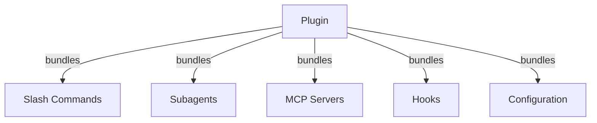
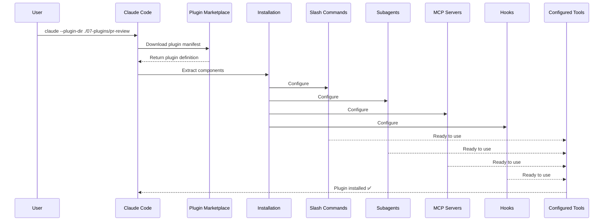
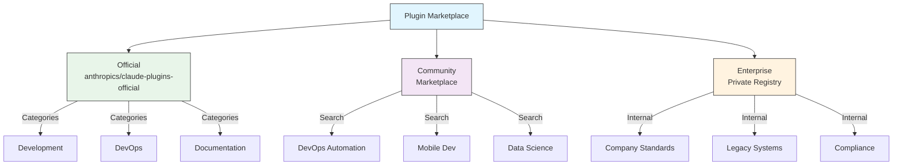
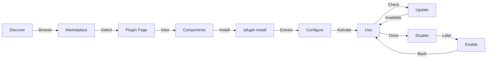
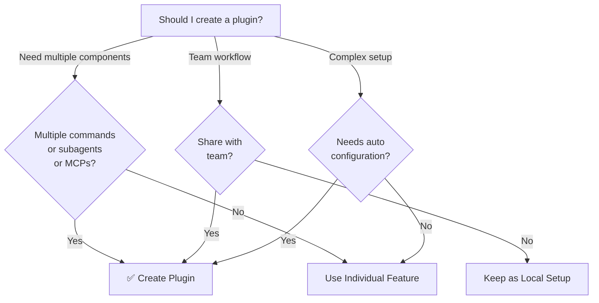

<!-- i18n-source: 07-plugins/README.md -->
<!-- i18n-source-sha: c5f1c75 -->
<!-- i18n-date: 2026-10-26 -->

<picture>
  <source media="(prefers-color-scheme: dark)" srcset="../../resources/logos/claude-howto-logo-dark.svg">
  
</picture>

# Claude Code 플러그인

이 폴더에는 여러 Claude Code 기능을 하나의 설치 가능한 패키지로 묶은, 완성도 높은 플러그인 예제가 수록되어 있습니다.

## 개요

Claude Code 플러그인은 커스터마이즈 요소(슬래시 명령어, 서브에이전트, MCP 서버, 훅)를 묶어 명령어 하나로 설치할 수 있는 번들 형식입니다. 여러 기능을 한꺼번에 배포할 수 있는, 가장 상위의 확장 메커니즘이라 할 수 있습니다.

## 플러그인 아키텍처



## 플러그인 로딩 과정



## 플러그인의 종류와 배포

| 종류 | 범위 | 공유 대상 | 관리 주체 | 예 |
|------|---------|---------|---------|----|
| Official | 전역 | 모든 사용자 | Anthropic | PR Review, Security Guidance |
| Community | 공개 | 모든 사용자 | 커뮤니티 | DevOps, Data Science |
| Organization | 사내 | 팀 구성원 | 기업 | 사내 표준·도구 |
| Personal | 개인 | 단일 사용자 | 개발자 | 개별 워크플로 |

## 플러그인 정의 구조

플러그인 매니페스트는 `.claude-plugin/plugin.json`에 JSON 형식으로 작성합니다:

```json
{
  "name": "my-first-plugin",
  "description": "A greeting plugin",
  "version": "1.0.0",
  "author": {
    "name": "Your Name"
  },
  "homepage": "https://example.com",
  "repository": "https://github.com/user/repo",
  "license": "MIT"
}
```

## 플러그인 구조 예시

```
my-plugin/
├── .claude-plugin/
│   └── plugin.json       # 매니페스트(name, description, version, author)
├── commands/             # Markdown 형식의 스킬
│   ├── task-1.md
│   ├── task-2.md
│   └── workflows/
├── agents/               # 커스텀 에이전트 정의
│   ├── specialist-1.md
│   ├── specialist-2.md
│   └── configs/
├── skills/               # SKILL.md 파일을 갖춘 에이전트 스킬
│   ├── skill-1/
│   │   └── SKILL.md
│   └── skill-2/
│       └── SKILL.md
├── hooks/                # hooks.json의 이벤트 핸들러
│   └── hooks.json
├── .mcp.json             # MCP 서버 설정
├── .lsp.json             # 코드 인텔리전스용 LSP 서버 설정
├── bin/                  # 플러그인 활성화 중 Bash 도구의 PATH에 추가되는 실행 파일
├── settings.json         # 플러그인 활성화 시 적용되는 기본 설정(유효한 키는 `agent`와 `subagentStatusLine`뿐)
├── themes/               # 선택 사항: Claude Code 커스텀 테마 동봉(v2.1.118 이상)
├── templates/
│   └── issue-template.md
├── scripts/
│   ├── helper-1.sh
│   └── helper-2.py
├── docs/
│   ├── README.md
│   └── USAGE.md
└── tests/
    └── plugin.test.js
```

### LSP 서버 설정

플러그인은 실시간 코드 인텔리전스를 위해 Language Server Protocol(LSP) 지원을 포함할 수 있습니다. LSP 서버는 작업 중 진단, 코드 내비게이션, 심볼 정보를 제공합니다.

**설정 위치**:
- 플러그인 루트 디렉터리의 `.lsp.json`
- `plugin.json` 안의 인라인 `lsp` 키

#### 필드 레퍼런스

| 필드 | 필수 | 설명 |
|----------|----|-----|
| `command` | 예 | LSP 서버 바이너리(PATH에 있어야 함) |
| `extensionToLanguage` | 예 | 파일 확장자를 언어 ID에 매핑 |
| `args` | 아니오 | 서버에 전달할 명령줄 인수 |
| `transport` | 아니오 | 통신 방식: `stdio`(기본값) 또는 `socket` |
| `env` | 아니오 | 서버 프로세스용 환경 변수 |
| `initializationOptions` | 아니오 | LSP 초기화 시 보낼 옵션 |
| `settings` | 아니오 | 서버에 전달할 워크스페이스 설정 |
| `workspaceFolder` | 아니오 | 워크스페이스 폴더 경로 재정의 |
| `startupTimeout` | 아니오 | 서버 시작을 기다리는 최대 시간(밀리초) |
| `shutdownTimeout` | 아니오 | 정상 종료를 기다리는 최대 시간(밀리초) |
| `restartOnCrash` | 아니오 | 크래시 시 자동 재시작 여부 |
| `maxRestarts` | 아니오 | 포기하기 전까지의 재시작 횟수 상한 |

#### 설정 예시

**Go(gopls)**:

```json
{
  "go": {
    "command": "gopls",
    "args": ["serve"],
    "extensionToLanguage": {
      ".go": "go"
    }
  }
}
```

**Python(pyright)**:

```json
{
  "python": {
    "command": "pyright-langserver",
    "args": ["--stdio"],
    "extensionToLanguage": {
      ".py": "python",
      ".pyi": "python"
    }
  }
}
```

**TypeScript**:

```json
{
  "typescript": {
    "command": "typescript-language-server",
    "args": ["--stdio"],
    "extensionToLanguage": {
      ".ts": "typescript",
      ".tsx": "typescriptreact",
      ".js": "javascript",
      ".jsx": "javascriptreact"
    }
  }
}
```

#### 사용 가능한 LSP 플러그인

공식 마켓플레이스에는 미리 설정된 LSP 플러그인이 포함되어 있습니다:

| 플러그인 | 언어 | 서버 바이너리 | 설치 명령어 |
|----------|------|---------------|-----------------|
| `pyright-lsp` | Python | `pyright-langserver` | `pip install pyright` |
| `typescript-lsp` | TypeScript / JavaScript | `typescript-language-server` | `npm install -g typescript-language-server typescript` |
| `rust-analyzer-lsp` | Rust | `rust-analyzer` | `rustup component add rust-analyzer`로 설치 |

#### LSP 기능

설정이 완료되면 LSP 서버는 다음을 제공합니다:

- **즉시 진단** — 편집 직후 오류와 경고가 표시됩니다
- **코드 내비게이션** — 정의로 이동, 참조와 구현 검색
- **호버 정보** — 호버 시 타입 시그니처와 문서 표시
- **심볼 목록** — 현재 파일이나 워크스페이스의 심볼 탐색

## 플러그인 옵션(v2.1.83 이상)

플러그인은 매니페스트의 `userConfig`를 통해 사용자가 설정할 수 있는 옵션을 선언할 수 있습니다. `sensitive: true`인 필드는 평문 설정 파일이 아니라 시스템 키체인에 저장됩니다:

```json
{
  "name": "my-plugin",
  "version": "1.0.0",
  "userConfig": {
    "apiKey": {
      "type": "string",
      "title": "API key",
      "description": "API key for the service",
      "sensitive": true
    },
    "region": {
      "type": "string",
      "title": "Region",
      "description": "Deployment region",
      "default": "us-east-1"
    }
  }
}
```

## 영속적인 플러그인 데이터(`${CLAUDE_PLUGIN_DATA}`)(v2.1.78 이상)

플러그인은 `${CLAUDE_PLUGIN_DATA}` 환경 변수를 통해 영속적인 상태 저장 디렉터리에 접근할 수 있습니다. 이 디렉터리는 플러그인마다 고유하며 세션을 넘어 유지되므로 캐시·데이터베이스·기타 영속 상태의 저장 위치로 적합합니다:

```json
{
  "hooks": {
    "PostToolUse": [
      {
        "matcher": "*",
        "hooks": [
          {
            "type": "command",
            "command": "node \"${CLAUDE_PLUGIN_ROOT}\"/scripts/track-usage.js \"${CLAUDE_PLUGIN_DATA}\"/usage.json"
          }
        ]
      }
    ]
  }
}
```

이 디렉터리(`~/.claude/plugins/data/<id>/`)는 처음 참조될 때 생성되며 플러그인 업데이트를 거쳐도 유지됩니다. 플러그인이 설치된 마지막 위치에서 제거하면 삭제됩니다(`--keep-data`를 전달한 경우 제외).

### 백그라운드 모니터(v2.1.105)

플러그인은 세션 시작 시, 또는 플러그인의 스킬 중 하나가 처음 실행될 때 시작되는 백그라운드 모니터를 등록할 수 있습니다. `plugin.json`의 `experimental.monitors`(또는 `monitors/monitors.json`)에서 선언합니다:

```json
{
  "name": "my-plugin",
  "version": "1.0.0",
  "experimental": {
    "monitors": [
      {
        "name": "app-log",
        "command": "tail -f /var/log/app.log",
        "description": "Application log errors",
        "when": "always"
      }
    ]
  }
}
```

`name`·`command`·`description`은 필수입니다. `when`이 받는 값:
- `"always"`(기본값) — 세션 시작 시와 플러그인 리로드 시 시작
- `"on-skill-invoke:<skill>"` — 해당 스킬이 처음 실행될 때 시작

알 수 없는 키는 오류가 되어 플러그인이 로드되지 않습니다. 최상위 `monitors` 키도 계속 읽히지만 `claude plugin validate`가 경고를 냅니다.

모니터는 내부적으로 Monitor 도구를 사용하며, stdout의 각 줄을 Claude가 반응할 수 있는 이벤트로 스트리밍합니다.

## 설정 기반 인라인 플러그인(`source: 'settings'`)(v2.1.80 이상)

플러그인은 `source: 'settings'` 필드를 사용해 설정 파일 안에 마켓플레이스 항목으로 인라인 정의할 수 있습니다. 이렇게 하면 별도의 저장소나 마켓플레이스를 마련하지 않고도 플러그인 정의를 직접 삽입할 수 있습니다. `extraKnownMarketplaces.<name>.source` 아래에 선언하고, `name`은 마켓플레이스 키와 일치시킵니다. 포함하는 플러그인은 GitHub나 npm 같은 외부 소스를 참조해야 합니다(상대 경로는 거부됩니다):

```json
{
  "extraKnownMarketplaces": {
    "inline-tools": {
      "source": {
        "source": "settings",
        "name": "inline-tools",
        "plugins": [
          {
            "name": "quick-lint",
            "source": {
              "source": "github",
              "repo": "my-org/quick-lint"
            }
          }
        ]
      }
    }
  }
}
```

## 플러그인 설정

플러그인은 기본 설정을 제공하기 위해 `settings.json`을 동봉할 수 있습니다. 유효한 키는 `agent`와 `subagentStatusLine` 두 가지이며, 그 밖의 키는 버려집니다. `agent`에는 플러그인 안의 에이전트 이름을 지정하며, 그 에이전트를 메인 스레드로 실행합니다:

```json
{
  "agent": "specialist-1"
}
```

`settings.json`을 포함한 플러그인을 설치하면 그 기본값이 적용됩니다. 사용자는 자신의 프로젝트 설정이나 사용자 설정으로 재정의할 수 있습니다.

## 독립형 vs 플러그인 방식

| 방식 | 명령어 이름 | 설정 | 적합한 경우 |
|------|----------|----|-------------|
| **독립형** | `/hello` | CLAUDE.md에서 수동 설정 | 개인용, 프로젝트 전용 |
| **플러그인** | `/plugin-name:hello` | plugin.json으로 자동화 | 공유·배포·팀 사용 |

개인이 빠르게 쓰는 워크플로에는 **독립형 슬래시 명령어**를, 여러 기능을 묶어 팀과 공유하거나 배포하고 싶을 때는 **플러그인**을 사용합니다.

## 실용 예제

### 예제 1: PR Review 플러그인

**파일:** `.claude-plugin/plugin.json`

```json
{
  "name": "pr-review",
  "version": "1.0.0",
  "description": "Complete PR review workflow with security, testing, and docs",
  "author": {
    "name": "Anthropic"
  },
  "repository": "https://github.com/your-org/pr-review",
  "license": "MIT"
}
```

**파일:** `commands/review-pr.md`

```markdown
---
name: Review PR
description: Start comprehensive PR review with security and testing checks
---

# PR Review

This command initiates a complete pull request review including:

1. Security analysis
2. Test coverage verification
3. Documentation updates
4. Code quality checks
5. Performance impact assessment
```

**파일:** `agents/security-reviewer.md`

```yaml
---
name: security-reviewer
description: Security-focused code review
tools: Read, Grep, Bash
---

# Security Reviewer

Specializes in finding security vulnerabilities:
- Authentication/authorization issues
- Data exposure
- Injection attacks
- Secure configuration
```

**설치:**

```bash
claude --plugin-dir ./07-plugins/pr-review

# Result:
# ✅ 3 slash commands installed
# ✅ 3 subagents configured
# ✅ 2 MCP servers connected
# ✅ 4 hooks registered
# ✅ Ready to use!
```

### 예제 2: DevOps 플러그인

**구성 요소:**

```
devops-automation/
├── commands/
│   ├── deploy.md
│   ├── rollback.md
│   ├── status.md
│   └── incident.md
├── agents/
│   ├── deployment-specialist.md
│   ├── incident-commander.md
│   └── alert-analyzer.md
├── mcp/
│   └── kubernetes-config.json
├── hooks/
│   ├── pre-deploy.js
│   └── post-deploy.js
└── scripts/
    ├── deploy.sh
    ├── rollback.sh
    └── health-check.sh
```

### 예제 3: Documentation 플러그인

**동봉 컴포넌트:**

```
documentation/
├── commands/
│   ├── generate-api-docs.md
│   ├── generate-readme.md
│   ├── sync-docs.md
│   └── validate-docs.md
├── agents/
│   ├── api-documenter.md
│   ├── code-commentator.md
│   └── example-generator.md
├── mcp/
│   └── github-docs-config.json
└── templates/
    ├── api-endpoint.md
    ├── function-docs.md
    └── adr-template.md
```

## 플러그인 마켓플레이스

Anthropic이 운영하는 공식 플러그인 디렉터리는 `anthropics/claude-plugins-official`입니다. 엔터프라이즈 관리자는 사내 배포용으로 비공개 플러그인 마켓플레이스를 만들 수도 있습니다.



### 마켓플레이스 설정

엔터프라이즈와 고급 사용자는 설정을 통해 마켓플레이스 동작을 제어할 수 있습니다:

| 설정 | 설명 |
|-----|-----|
| `extraKnownMarketplaces` | 기본값 이외의 마켓플레이스 소스를 추가 |
| `strictKnownMarketplaces` | 사용자가 추가할 수 있는 마켓플레이스를 제한(관리자 전용) |
| `blockedMarketplaces` | 관리자가 관리하는 마켓플레이스 차단 목록(v2.1.119 이상에서는 `hostPattern` / `pathPattern` 정규식 필드 지원) |
| `enabledPlugins`(`false`로 설정) | 특정 플러그인을 차단: managed settings에서 `"enabledPlugins": { "<plugin>@<marketplace>": false }`로 지정하면 모든 범위에서 설치가 차단되고 마켓플레이스에도 표시되지 않음 |

> **더 알기 쉬운 별칭(v2.1.232)**: `additionalMarketplaces`는 `extraKnownMarketplaces`의, `allowedMarketplaces`는 `strictKnownMarketplaces`의 별칭으로 받아들여집니다. 공식 settings 레퍼런스의 [Marketplace key aliases](https://code.claude.com/docs/en/settings-reference#marketplace-key-aliases)에 둘 다 기재되어 있습니다. 이전 버전은 별칭을 무시하므로 정식 키를 계속 사용해도 문제없습니다.

> **소유자 와일드카드(v2.1.223 이상)**: `"owner/*"` 항목은 특정 GitHub 소유자 아래의 모든 마켓플레이스 저장소를 허용하거나 차단합니다. **`strictKnownMarketplaces`와 `blockedMarketplaces`에서만 받아들여집니다.** `extraKnownMarketplaces`나 `/plugin marketplace add`를 포함해 `github` 소스가 등장하는 다른 곳에서는 `repo` 값이 단일 저장소를 지정해야 합니다.

> **적용 범위**(v2.1.117 이상): `blockedMarketplaces`와 `strictKnownMarketplaces`는 처음 추가할 때뿐 아니라 설치·업데이트·새로 고침·자동 업데이트 등 모든 플러그인 수명 주기 이벤트에서 적용됩니다. `strictKnownMarketplaces`는 관리자 전용입니다.

`blockedMarketplaces`에서 호스트 / 경로 정규식을 사용하는 예(v2.1.119):

```json
{
  "blockedMarketplaces": [
    { "source": "hostPattern", "hostPattern": "^evil\\.example\\.com$" },
    { "source": "pathPattern", "pathPattern": "^/marketplaces/.*" }
  ]
}
```

### 마켓플레이스 추가 기능

- **기본 git 타임아웃**: 대규모 플러그인 저장소를 위해 30초에서 120초로 확대
- **커스텀 npm 레지스트리**: 의존성 해결에 커스텀 npm 레지스트리 URL 지정 가능
- **버전 고정**: 재현 가능한 환경을 위해 플러그인을 특정 버전에 고정

### 마켓플레이스 정의 스키마

플러그인 마켓플레이스는 `.claude-plugin/marketplace.json`에서 정의합니다:

```json
{
  "name": "my-team-plugins",
  "owner": { "name": "my-org" },
  "plugins": [
    {
      "name": "code-standards",
      "source": "./plugins/code-standards",
      "description": "Enforce team coding standards",
      "version": "1.2.0",
      "author": { "name": "platform-team" }
    },
    {
      "name": "deploy-helper",
      "source": {
        "source": "github",
        "repo": "my-org/deploy-helper",
        "ref": "v2.0.0"
      },
      "description": "Deployment automation workflows"
    }
  ]
}
```

| 필드 | 필수 | 설명 |
|----------|----|-----|
| `name` | 예 | kebab-case 마켓플레이스 이름 |
| `owner` | 예 | 마켓플레이스를 유지 관리하는 조직 또는 사용자: 필수 `name`을 가진 객체(`email`, `url`은 선택) |
| `plugins` | 예 | 플러그인 항목 배열 |
| `plugins[].name` | 예 | 플러그인 이름(kebab-case) |
| `plugins[].source` | 예 | 플러그인 소스(경로 문자열 또는 source 객체) |
| `plugins[].description` | 아니오 | 플러그인의 간단한 설명 |
| `plugins[].version` | 아니오 | 시맨틱 버전 문자열 |
| `plugins[].author` | 아니오 | 플러그인 작성자: 필수 `name`을 가진 객체(`email`, `url`은 선택) |

### 플러그인 소스 종류

플러그인은 여러 소스에서 가져올 수 있습니다:

| 소스 | 구문 | 예 |
|-------|----|----|
| **상대 경로** | 경로 문자열 | `"./plugins/my-plugin"` |
| **GitHub** | `{ "source": "github", "repo": "owner/repo" }` | `{ "source": "github", "repo": "acme/lint-plugin", "ref": "v1.0" }` |
| **Git URL** | `{ "source": "url", "url": "..." }` | `{ "source": "url", "url": "https://git.internal/plugin.git" }` |
| **Git 하위 디렉터리** | `{ "source": "git-subdir", "url": "...", "path": "..." }` | `{ "source": "git-subdir", "url": "https://github.com/org/monorepo.git", "path": "packages/plugin" }` |
| **npm** | `{ "source": "npm", "package": "..." }` | `{ "source": "npm", "package": "@acme/claude-plugin", "version": "^2.0" }` |

GitHub 및 git 소스는 버전 고정용으로 선택적인 `ref`(브랜치 / 태그)와 `sha`(커밋 해시) 필드를 지원합니다.

### 배포 방법

**GitHub(권장)**:
```bash
# Users add your marketplace
/plugin marketplace add owner/repo-name
```

**기타 git 서비스**(전체 URL 필요):
```bash
/plugin marketplace add https://gitlab.com/org/marketplace-repo.git
```

**비공개 저장소**: git credential helper나 환경 변수 토큰을 통해 지원됩니다. 사용자는 대상 저장소에 대한 읽기 권한이 있어야 합니다.

**Anthropic 디렉터리에 제출**: 개발자 포털 [claude.ai/directory/manage](https://claude.ai/directory/manage)에서 Anthropic 디렉터리에 플러그인을 제출해 널리 배포할 수 있습니다. Anthropic의 공식 마켓플레이스 `claude-plugins-official`은 디렉터리 포털을 통한 제출을 받지 않습니다.

### 마켓플레이스 관리

```bash
# Marketplace CLI commands
claude plugin marketplace add <source>       # Add marketplace (GitHub, URL, local)
claude plugin marketplace update [name]      # Refresh catalog index
claude plugin marketplace remove <name>      # Remove marketplace
claude plugin marketplace list               # List configured marketplaces
```

> **중요**: `marketplace update`는 플러그인 카탈로그(설치 가능한 목록)만 갱신하며 설치된 플러그인은 업데이트하지 않습니다. 설치된 플러그인을 업데이트하려면 `plugin update <name>`을 사용합니다.

### Strict 모드

마켓플레이스 정의와 로컬 `plugin.json`의 관계를 제어합니다:

| 설정 | 동작 |
|-----|-----|
| `strict: true`(기본값) | 로컬 `plugin.json`이 기준이고, 마켓플레이스 항목은 보조 취급 |
| `strict: false` | 마켓플레이스 항목이 플러그인 정의의 전부가 됨 |

`strictKnownMarketplaces`를 통한 **조직 제한**:

| 값 | 효과 |
|----|----|
| 미설정 | 제한 없음 — 사용자는 임의의 마켓플레이스를 추가 가능 |
| 빈 배열 `[]` | 잠금 — 마켓플레이스 추가 불가 |
| 소스 객체 배열 | 허용 목록 — 일치하는 마켓플레이스만 추가 가능 |

```json
{
  "strictKnownMarketplaces": [
    { "source": "github", "repo": "my-org/*" },
    { "source": "github", "repo": "trusted-vendor/*" }
  ]
}
```

> **경고**: `strictKnownMarketplaces`를 사용한 strict 모드에서는 사용자가 허용 목록에 있는 마켓플레이스에서만 플러그인을 설치할 수 있습니다. 플러그인 배포를 통제하려는 엔터프라이즈 환경에서 유용합니다.

## 플러그인 설치와 수명 주기



## 플러그인 기능 비교

| 기능 | 슬래시 명령어 | 스킬 | 서브에이전트 | 플러그인 |
|------|--------------|------|-------------|---------|
| **설치** | 수동 복사 | 수동 복사 | 수동 설정 | 명령어 1개 |
| **설정 시간** | 5분 | 10분 | 15분 | 2분 |
| **번들** | 단일 파일 | 단일 파일 | 단일 파일 | 여러 개 |
| **버전 관리** | 수동 | 수동 | 수동 | 자동 |
| **팀 공유** | 파일 복사 | 파일 복사 | 파일 복사 | 설치 ID |
| **업데이트** | 수동 | 수동 | 수동 | 자동 가져오기 |
| **의존성** | 없음 | 없음 | 없음 | 포함 가능 |
| **마켓플레이스** | 없음 | 없음 | 없음 | 있음 |
| **배포** | 저장소 | 저장소 | 저장소 | 마켓플레이스 |

## 플러그인 CLI 명령어

모든 플러그인 작업은 CLI 명령어로 사용할 수 있습니다:

```bash
claude plugin install <name>@<marketplace>   # Install from a marketplace
claude plugin uninstall <name>               # Remove a plugin
claude plugin update <name>                  # Update installed plugin to latest version
claude plugin list                           # List installed plugins
claude plugin enable <name>                  # Enable a disabled plugin
claude plugin disable <name>                 # Disable a plugin
claude plugin validate <path>                # Validate the plugin structure at <path>
claude plugin tag [path]                     # Create a {name}--v{version} release git tag (v2.1.118+)
```

예: `claude plugin tag ./my-plugin`은 인수로 버전 문자열이 아니라 **경로**를 받습니다. `plugin.json`에서 도출한 `{name}--v{version}` git 태그를 만들며, 이때 `plugin.json`과 (존재한다면) 마켓플레이스 항목이 일치하는지 검증합니다. 배포용으로 플러그인을 릴리스할 때 권장되는 절차입니다.

## 설치 방법

### 마켓플레이스에서
```bash
/plugin install plugin-name
# or from CLI:
claude plugin install plugin-name@marketplace-name
```

**바로 반영되나요?** **v2.1.221** 이상에서는 대개 반영됩니다. 설치 요약의 마지막 줄을 확인하세요:

| 설치 요약 표시 | 의미 |
|---|---|
| `Plugin is now active.` | Claude Code가 설치의 일부로 플러그인을 활성화했습니다. 추가 작업이 필요 없습니다. |
| `Run /reload-plugins to activate.` | 설치는 됐지만 아직 활성화되지 않았습니다. 활성화하면 프롬프트 캐시가 무효화되기 때문이거나, 활성화 시도가 실패했기 때문입니다. |

v2.1.221 이전에는 `/reload-plugins`를 실행하거나 재시작할 때까지 어떤 설치도 현재 세션에 반영되지 않았습니다.

### 활성화 / 비활성화(범위는 자동 감지)
```bash
/plugin enable plugin-name
/plugin disable plugin-name
```

### 로컬 플러그인(개발용)
```bash
# CLI flag for local testing (repeatable for multiple plugins)
claude --plugin-dir ./path/to/plugin
claude --plugin-dir ./plugin-a --plugin-dir ./plugin-b
```

### Git 저장소에서
```bash
/plugin marketplace add username/repo                    # GitHub 저장소를 마켓플레이스로 추가
/plugin install plugin-name@marketplace-name             # 다음으로 거기서 플러그인을 설치
/plugin install plugin-name --marketplace username/repo  # 또는 한 단계로 둘 다 실행(v2.1.275+)
```

## 자동 업데이트

Claude Code는 시작 시 마켓플레이스와 거기서 설치한 플러그인을 자동으로 업데이트할 수 있습니다.

| 마켓플레이스 종류 | 자동 업데이트 기본값 | 전환 방법 |
|----------------|---------------|----------|
| Official(`claude-plugins-official`) | ✅ 활성 | `/plugin` → Marketplaces → 선택 |
| 서드파티 / 로컬 | ❌ 비활성 | 같은 UI 경로 |

자동 업데이트가 실행되면 Claude Code는 다음을 수행합니다:
1. 마켓플레이스 카탈로그 갱신
2. 설치된 플러그인을 최신 버전으로 업데이트
3. 플러그인별로 결과 보고: 업데이트의 일부로 활성화된 경우 `Plugin is now active.`, 그렇지 않은 경우 `Run /reload-plugins to activate.`

### 환경 변수

| 변수 | 효과 |
|-----|----|
| `DISABLE_AUTOUPDATER=1` | 모든 자동 업데이트(Claude Code + 플러그인) 비활성화 |
| `DISABLE_AUTOUPDATER=1` + `FORCE_AUTOUPDATE_PLUGINS=1` | 플러그인 자동 업데이트는 유지하고 Claude Code 자체 업데이트는 비활성화 |

```bash
# Disable all auto-updates
export DISABLE_AUTOUPDATER=1

# Keep plugin auto-updates only
export DISABLE_AUTOUPDATER=1
export FORCE_AUTOUPDATE_PLUGINS=1
```

## 플러그인을 만들어야 할 때



### 플러그인 사용 사례

| 사용 사례 | 권장 | 이유 |
|----------|----|----|
| **팀 온보딩** | ✅ 플러그인 사용 | 즉시 설정되고 구성이 모두 갖춰짐 |
| **프레임워크 설정** | ✅ 플러그인 사용 | 프레임워크 전용 명령어를 묶을 수 있음 |
| **엔터프라이즈 표준** | ✅ 플러그인 사용 | 중앙 배포와 버전 관리 |
| **작은 작업 자동화** | ❌ 명령어 사용 | 플러그인은 과함 |
| **단일 도메인 전문 지식** | ❌ 스킬 사용 | 플러그인은 너무 무겁고 스킬로 충분 |
| **특수 분석** | ❌ 서브에이전트 사용 | 수동 작성 또는 스킬로 대응 |
| **실시간 데이터 접근** | ❌ MCP 사용 | 단독으로 사용하고 번들하지 않음 |

## 플러그인 테스트

공개 전에 `--plugin-dir` CLI 플래그(여러 번 지정 가능)를 사용해 플러그인을 로컬에서 테스트합니다:

```bash
claude --plugin-dir ./my-plugin
claude --plugin-dir ./my-plugin --plugin-dir ./another-plugin
```

이렇게 하면 플러그인을 로드한 상태로 Claude Code가 시작되어 다음을 확인할 수 있습니다:
- 모든 슬래시 명령어를 사용할 수 있는지
- 서브에이전트와 에이전트가 올바르게 동작하는지
- MCP 서버가 정상적으로 연결되는지
- 훅이 실행되는지
- LSP 서버 설정
- 설정 오류가 없는지

## 핫 리로드

플러그인은 개발 중 핫 리로드를 지원합니다. 플러그인 파일을 수정하면 Claude Code가 변경을 자동으로 감지합니다. 다음 명령어로 강제로 리로드할 수도 있습니다:

```bash
/reload-plugins
```

이렇게 하면 세션을 재시작하지 않고도 모든 플러그인의 매니페스트·명령어·에이전트·스킬·훅·MCP / LSP 설정이 다시 로드됩니다.

## 플러그인용 관리형 설정

관리자는 관리형 설정을 사용해 조직 전체의 플러그인 동작을 제어할 수 있습니다:

| 설정 | 설명 |
|-----|-----|
| `enabledPlugins` | 기본으로 활성화할 플러그인 허용 목록 |
| `enabledPlugins`(`false`로 설정) | 특정 플러그인을 차단: managed settings에서 `"enabledPlugins": { "<plugin>@<marketplace>": false }`로 지정하면 모든 범위에서 설치가 차단되고 마켓플레이스에도 표시되지 않음 |
| `extraKnownMarketplaces` | 기본값 이외의 마켓플레이스 소스를 추가 |
| `strictKnownMarketplaces` | 사용자가 추가할 수 있는 마켓플레이스를 제한(관리자 전용, v2.1.117 이상에서는 모든 플러그인 수명 주기 이벤트에서 적용) |
| `blockedMarketplaces` | 마켓플레이스 차단 목록(v2.1.117 이상에서는 모든 수명 주기 이벤트에서 적용, v2.1.119 이상에서는 `hostPattern` / `pathPattern` 정규식 필드 지원) |
| `allowedChannelPlugins` | 세션에 메시지를 푸시할 수 있는 [channel](https://code.claude.com/docs/en/channels) 플러그인 허용 목록(각 항목은 `marketplace`와 `plugin`을 지정) |

> **더 알기 쉬운 별칭(v2.1.232)**: `additionalMarketplaces`는 `extraKnownMarketplaces`의, `allowedMarketplaces`는 `strictKnownMarketplaces`의 별칭으로 받아들여집니다. 공식 settings 레퍼런스의 [Marketplace key aliases](https://code.claude.com/docs/en/settings-reference#marketplace-key-aliases)에 둘 다 기재되어 있습니다. 이전 버전은 별칭을 무시하므로 정식 키를 계속 사용해도 문제없습니다.

> **소유자 와일드카드(v2.1.223 이상)**: `"owner/*"` 항목은 특정 GitHub 소유자 아래의 모든 마켓플레이스 저장소를 허용하거나 차단합니다. **`strictKnownMarketplaces`와 `blockedMarketplaces`에서만 받아들여집니다.** `extraKnownMarketplaces`나 `/plugin marketplace add`를 포함해 `github` 소스가 등장하는 다른 곳에서는 `repo` 값이 단일 저장소를 지정해야 합니다.

이 설정들은 관리형 설정 파일에서 조직 수준으로 적용할 수 있으며 사용자 수준 설정보다 우선합니다.

## 플러그인 보안

플러그인의 서브에이전트는 다음 프런트매터 키를 **무시합니다**(에이전트 자체는 로드되지만 이 키들은 효과가 없습니다):

- `hooks` — 서브에이전트는 이벤트 핸들러를 등록할 수 없음
- `mcpServers` — 서브에이전트는 MCP 서버를 설정할 수 없음
- `permissionMode` — 서브에이전트는 권한 모델을 재정의할 수 없음
- `initialPrompt` — 플러그인 에이전트는 첫 프롬프트를 자동 전송할 수 없음

에이전트 파일 단독으로는 훅이나 MCP 서버를 추가할 수 없으므로, 이들은 플러그인 수준의 훅과 MCP 서버로 동봉합니다.

## 플러그인 공개

**공개 절차:**

1. 모든 컴포넌트를 포함한 플러그인 구조 생성
2. `.claude-plugin/plugin.json` 매니페스트 작성
3. 문서용 `README.md` 작성
4. `claude --plugin-dir ./my-plugin`으로 로컬 테스트
5. `claude plugin tag ./my-plugin`(v2.1.118 이상)으로 릴리스 태그 생성 — 플러그인의 **경로**를 전달하면 `plugin.json`에서 도출한 `{name}--v{version}` git 태그를 생성
6. 플러그인 마켓플레이스에 제출
7. 리뷰와 승인
8. 마켓플레이스에 공개
9. 사용자가 명령어 하나로 설치 가능

**제출 예시:**

````markdown
# PR Review Plugin

## Description
Complete PR review workflow with security, testing, and documentation checks.

## What's Included
- 3 slash commands for different review types
- 3 specialized subagents
- GitHub and CodeQL MCP integration
- Automated security scanning hooks

## Installation
```bash
claude --plugin-dir ./07-plugins/pr-review
```

## Features
✅ Security analysis
✅ Test coverage checking
✅ Documentation verification
✅ Code quality assessment
✅ Performance impact analysis

## Usage
```bash
/review-pr
/check-security
/check-tests
```

## Requirements
- Claude Code 2.1+
- GitHub access
- CodeQL (optional)
````

## 플러그인 vs 수동 설정

**수동 설정(2시간 이상):**
- 슬래시 명령어를 하나씩 설치
- 서브에이전트를 개별 작성
- MCP를 따로 설정
- 훅을 수동으로 설정
- 모든 것을 문서화
- 팀에 공유(올바르게 설정해 주기를 바라며)

**플러그인을 사용하는 경우(2분):**
```bash
claude --plugin-dir ./07-plugins/pr-review
# ✅ Everything installed and configured
# ✅ Ready to use immediately
# ✅ Team can reproduce exact setup
```

## 모범 사례

### Do(권장) ✅
- 명확하고 설명적인 플러그인 이름 사용
- 포괄적인 README 포함
- 시맨틱 버저닝으로 적절히 버전 관리
- 모든 컴포넌트를 끝까지 테스트
- 필수 요구 사항을 명확히 문서화
- 사용 예시 제공
- 오류 처리 포함
- 검색성을 높이는 태그 부여
- 하위 호환성 유지
- 플러그인을 초점이 좁고 일관된 내용으로 유지
- 포괄적인 테스트 포함
- 모든 의존성 문서화

### Don't(피하기) ❌
- 관련 없는 기능을 섞지 않기
- 자격 증명을 하드코딩하지 않기
- 테스트를 생략하지 않기
- 문서화를 잊지 않기
- 중복된 플러그인을 만들지 않기
- 버전 관리를 소홀히 하지 않기
- 컴포넌트 간 의존을 너무 복잡하게 만들지 않기
- 오류를 우아하게 처리하는 것을 잊지 않기

## 설치 절차

### 마켓플레이스에서 설치

1. **사용 가능한 플러그인 둘러보기**(**Discover** 탭에 마켓플레이스의 플러그인이 목록으로 표시됩니다. `/plugin list`는 설치된 플러그인만 표시합니다):
   ```bash
   /plugin
   ```

2. **플러그인 상세 보기:** **Discover** 탭에서 플러그인을 선택하면 상세 정보가 열립니다. (`claude plugin details plugin-name`은 플러그인이 로드된 경우에만 동작합니다: 설치되었거나 `--plugin-dir`로 지정된 경우)

3. **플러그인 설치:**
   ```bash
   /plugin install plugin-name
   ```

### 로컬 경로에서 설치

```bash
# /plugin install에는 name@marketplace가 필요합니다. 경로를 전달하면 "marketplace not found"가 됩니다
claude --plugin-dir ./path/to/plugin-directory
```

### GitHub에서 설치

```bash
/plugin marketplace add username/repo                    # GitHub 저장소를 마켓플레이스로 추가
/plugin install plugin-name@marketplace-name             # 다음으로 거기서 플러그인을 설치
/plugin install plugin-name --marketplace username/repo  # 또는 한 단계로 둘 다 실행(v2.1.275+)
```

### 설치된 플러그인 목록

```bash
/plugin list             # 설치된 모든 플러그인
/plugin list --enabled   # 활성화된 플러그인만
/plugin list --disabled  # 비활성화된 플러그인만
```

### 플러그인 업데이트

업데이트에는 CLI 형식을 사용합니다. 이는 [`plugin update`](https://code.claude.com/docs/en/plugins-reference)로 문서화된 형식이며, 업데이트가 있을 때 Claude Code 자신이 안내하는 형식이기도 합니다:

```bash
claude plugin update plugin-name
```

### 플러그인 비활성화 / 활성화

```bash
# Temporarily disable
/plugin disable plugin-name

# Re-enable
/plugin enable plugin-name
```

### 플러그인 제거

```bash
/plugin uninstall plugin-name
```

## 관련 개념

다음 Claude Code 기능은 플러그인과 함께 동작합니다:

- **[슬래시 명령어](../01-slash-commands/)** — 플러그인에 포함되는 개별 명령어
- **[메모리](../02-memory/)** — 플러그인용 영속 컨텍스트
- **[스킬](../03-skills/)** — 플러그인에 담을 수 있는 도메인 전문 지식
- **[서브에이전트](../04-subagents/)** — 플러그인 컴포넌트로 포함되는 전문 에이전트
- **[MCP 서버](../05-mcp/)** — 플러그인에 동봉되는 Model Context Protocol 연동
- **[훅](../06-hooks/)** — 플러그인 워크플로를 시작하는 이벤트 핸들러

## 완전한 워크플로 예시

### PR Review 플러그인의 전체 워크플로

```
1. User: /review-pr

2. Plugin executes:
   ├── pre-review.js hook validates git repo
   ├── GitHub MCP fetches PR data
   ├── security-reviewer subagent analyzes security
   ├── test-checker subagent verifies coverage
   └── performance-analyzer subagent checks performance

3. Results synthesized and presented:
   ✅ Security: No critical issues
   ⚠️  Testing: Coverage 65% (recommend 80%+)
   ✅ Performance: No significant impact
   📝 12 recommendations provided
```

## 문제 해결

### 플러그인이 설치되지 않음
- Claude Code 버전 호환성 확인: `claude --version`
- JSON 검증기로 `plugin.json` 구문 검증
- 인터넷 연결 확인(원격 플러그인의 경우)
- 권한 확인: `ls -la plugin/`

### 컴포넌트가 로드되지 않음
- `plugin.json`의 경로가 실제 디렉터리 구조와 일치하는지 확인
- 파일 권한 확인: `chmod +x scripts/`
- 컴포넌트 파일의 구문 확인
- 컴포넌트 목록 확인: `claude plugin details plugin-name`

### MCP 연결 실패
- 환경 변수가 올바르게 설정되어 있는지 확인
- MCP 서버의 설치 상태와 건전성 확인
- `/mcp`로 MCP 서버 상태 확인
- `mcp/` 디렉터리 안의 MCP 설정 확인

### 설치 후 명령어를 사용할 수 없음
- 플러그인이 올바르게 설치되었는지 확인: `/plugin list`
- 플러그인이 활성화되어 있는지 확인: `/plugin list --enabled`
- 이미 활성화되었는지 확인 — [설치 방법](#설치-방법)의 설치 요약 설명을 참고: `Plugin is now active.`이면 추가 작업이 필요 없고, `Run /reload-plugins to activate.`이면 그 명령어를 실행합니다(재시작은 불필요)
- 기존 명령어와 이름이 충돌하지 않는지 확인

### 훅 실행 문제
- 훅 파일 권한이 올바른지 확인
- 훅 구문과 이벤트 이름 확인
- 훅 로그에서 오류 세부 사항 확인
- 가능하면 훅을 수동으로 테스트

## 추가 리소스

- [공식 플러그인 문서](https://code.claude.com/docs/en/plugins)
- [플러그인 찾기](https://code.claude.com/docs/en/discover-plugins)
- [플러그인 마켓플레이스](https://code.claude.com/docs/en/plugin-marketplaces)
- [플러그인 레퍼런스](https://code.claude.com/docs/en/plugins-reference)
- [MCP 서버 레퍼런스](https://modelcontextprotocol.io/)
- [서브에이전트 설정 가이드](../04-subagents/README.md)
- [훅 시스템 레퍼런스](../06-hooks/README.md)

---

**최종 업데이트**: 2026년 10월 18일
**Claude Code 버전**: 2.1.302
**출처**:
- https://code.claude.com/docs/en/discover-plugins
- https://code.claude.com/docs/en/plugins-reference
- https://code.claude.com/docs/en/settings
- https://code.claude.com/docs/en/plugins
- https://code.claude.com/docs/en/plugin-marketplaces
- https://github.com/anthropics/claude-code/releases/tag/v2.1.117
- https://github.com/anthropics/claude-code/releases/tag/v2.1.118
- https://github.com/anthropics/claude-code/releases/tag/v2.1.119
- https://code.claude.com/docs/en/plugins/install
- https://code.claude.com/docs/en/plugins/cli-reference
- https://code.claude.com/docs/en/plugins-reference#monitors
- https://code.claude.com/docs/en/plugins/manifest-reference
- https://code.claude.com/docs/en/plugins/marketplace-reference
- https://code.claude.com/docs/en/plugins/components
- https://code.claude.com/docs/en/plugins/publish
- https://code.claude.com/docs/en/plugins/overview
**지원 모델**: Claude Fable 5, Claude Opus 5, Claude Sonnet 5, Claude Sonnet 4.6, Claude Opus 4.8, Claude Haiku 4.5
