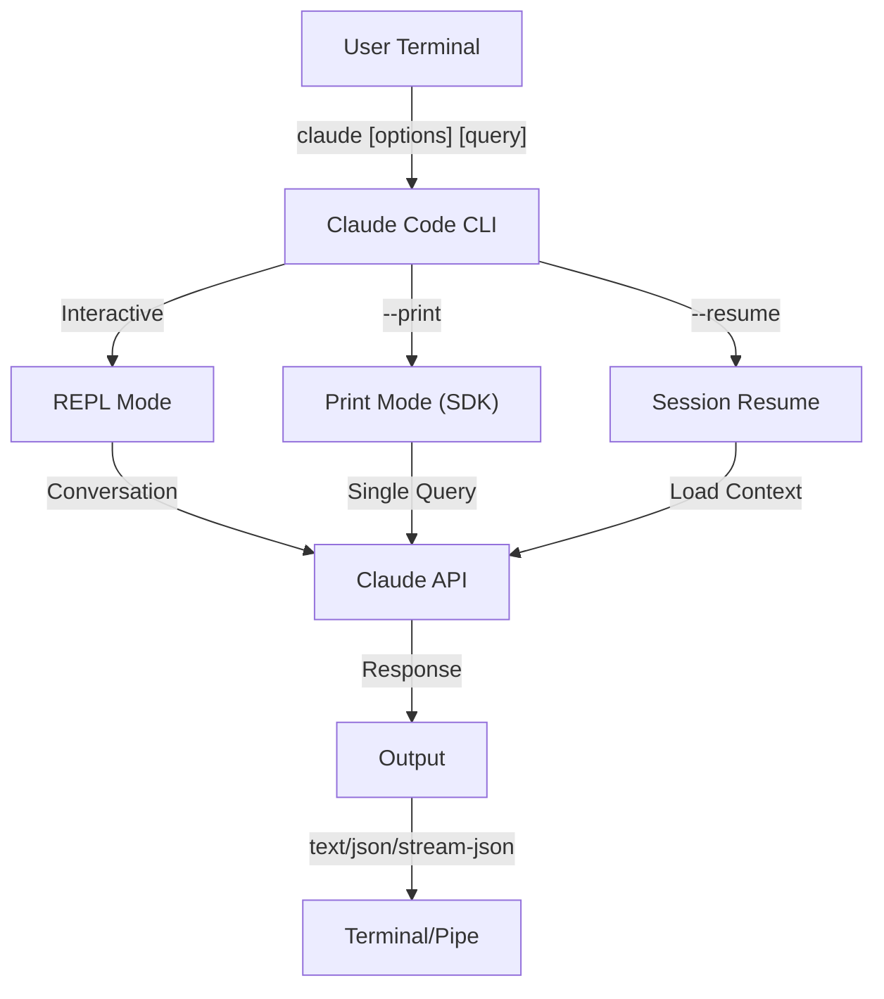
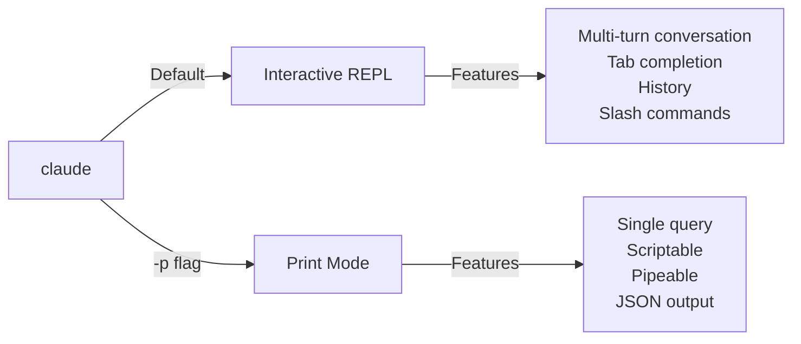

<!-- i18n-source: 10-cli/README.md -->
<!-- i18n-source-sha: e43872e -->
<!-- i18n-date: 2026-10-26 -->

<picture>
  <source media="(prefers-color-scheme: dark)" srcset="../../resources/logos/claude-howto-logo-dark.svg">
  
</picture>

# CLI 레퍼런스

## 개요

Claude Code CLI(Command Line Interface)는 Claude Code를 조작하는 주요 수단입니다. 쿼리 실행, 세션 관리, 모델 설정, 개발 워크플로 통합을 위한 강력한 옵션을 갖추고 있습니다.

## 아키텍처



## 런타임과 패키징

**v2.1.113** 이후 Claude Code CLI는 npm의 선택적 의존성을 통해 **플랫폼별 네이티브 바이너리**(macOS, Linux, Windows)를 실행합니다. 바이너리는 설치 시 OS와 아키텍처에 맞춰 선택됩니다 — 기존의 번들 JavaScript 런타임은 macOS / Linux에서 더 이상 기본값이 아닙니다.

**권장 설치 방법**은 네이티브 인스톨러입니다(`curl -fsSL https://claude.ai/install.sh | bash`, Windows에서는 `irm https://claude.ai/install.ps1 | iex`). 공식 README에서는 npm을 통한 설치를 권장하지 않습니다. 네이티브 인스톨러, Homebrew(`brew install --cask claude-code`) 또는 WinGet(`winget install Anthropic.ClaudeCode`)을 권장합니다. 참고로 `npm install -g @anthropic-ai/claude-code`(Node.js 22 이상)는 플랫폼별 선택적 의존성을 통해 같은 네이티브 바이너리를 설치합니다.

**다운로드 호스트**(v2.1.116+): 네이티브 바이너리 산출물은 `https://downloads.claude.ai/claude-code-releases`에서 배포됩니다.

> **기업 네트워크/프록시 환경**: 네트워크에 명시적인 허용 목록이 필요하다면 프록시의 이그레스 규칙에 `downloads.claude.ai`(및 `https://downloads.claude.ai/claude-code-releases`)를 추가하세요. 이전에 `storage.googleapis.com`이나 npm 레지스트리만 허용하던 환경은 업데이트가 필요하며, 그대로 두면 `claude update`나 최초 설치가 실패합니다.

기존 JavaScript 번들은 Windows용과 고정 환경용으로 계속 제공됩니다. 이 설치에서는 Glob과 Grep이 계속 퍼스트클래스 도구로 포함됩니다([도구](#도구와-권한-관리) 절의 Glob/Grep 주석 참고).

## CLI 명령어

| 명령어 | 설명 | 예 |
|---------|------|-----|
| `claude` | 대화형 REPL 시작 | `claude` |
| `claude "query"` | 초기 프롬프트와 함께 REPL 시작 | `claude "explain this project"` |
| `claude -p "query"` | 프린트 모드 - 쿼리 실행 후 종료 | `claude -p "explain this function"` |
| `cat file \| claude -p "query"` | 파이프 입력 처리 | `cat logs.txt \| claude -p "explain"` |
| `claude -c` | 가장 최근 대화 이어가기 | `claude -c` |
| `claude -c -p "query"` | 프린트 모드로 이어가기 | `claude -c -p "check for type errors"` |
| `claude -r "<session>" "query"` | ID 또는 이름으로 세션 재개 | `claude -r "auth-refactor" "finish this PR"` |
| `claude update` | 최신 버전으로 업데이트 | `claude update` |
| `/doctor`(슬래시 명령어) | 설치, 설정, 플러그인 상태를 진단합니다. v2.1.116 이후로는 **Claude가 응답 중에도 열 수 있고**, 상태 아이콘을 인라인으로 표시하며, `f` 키로 발견된 문제를 자동 수정합니다 | REPL 안에서 `/doctor` 실행 |
| `claude mcp` | MCP 서버 설정 | [MCP 문서](../05-mcp/) 참고 |
| `claude mcp serve` | Claude Code를 MCP 서버로 실행 | `claude mcp serve` |
| `claude agents` | 설정된 서브에이전트 목록 표시 | `claude agents` |
| `claude auto-mode defaults` | 자동 모드의 기본 규칙을 JSON으로 출력 | `claude auto-mode defaults` |
| `claude remote-control` | 리모트 컨트롤 서버 시작(서버 모드, 로컬 대화형 세션 없음. 여러 세션을 처리하며 `--capacity` 기본값 32) | `claude remote-control --name "My Project"` |
| `claude --remote-control [name]` | 리모트 컨트롤이 활성화된 대화형 세션 시작(별칭 `--rc`) | `claude --rc` |
| `claude plugin` | 플러그인 관리(설치·활성화·비활성화) | `claude plugin install my-plugin` |
| `claude plugin tag [path]` | `[path]`의 플러그인에 대해 `{name}--v{version}` 형식의 릴리스 git 태그를 만듭니다. `plugin.json`과 (있다면) 마켓플레이스 항목이 일치하는지 검증합니다(v2.1.118+) | `claude plugin tag ./my-plugin` |
| `claude install [version]` | 지정한 네이티브 바이너리 버전을 설치합니다. `stable`, `latest`, 명시적인 버전 문자열을 받습니다 | `claude install 2.1.119` |
| `claude auth login` | 로그인(`--email`, `--sso` 지원) | `claude auth login --email user@example.com` |
| `claude auth logout` | 현재 계정에서 로그아웃 | `claude auth logout` |
| `claude auth status` | 인증 상태 확인(로그인 상태면 exit 0, 아니면 1) | `claude auth status` |

## 주요 플래그

| 플래그 | 설명 | 예 |
|------|------|-----|
| `-p, --print` | 대화형 모드 없이 응답을 출력 | `claude -p "query"` |
| `-c, --continue` | 가장 최근 대화를 불러옴 | `claude --continue` |
| `-r, --resume` | ID 또는 이름으로 특정 세션 재개 | `claude --resume auth-refactor` |
| `-v, --version` | 버전 번호 출력 | `claude -v` |
| `-w, --worktree` | 격리된 git 워크트리에서 시작 | `claude -w` |
| `-n, --name` | 세션의 표시 이름 | `claude -n "auth-refactor"` |
| `--from-pr <url-or-number>` | 풀/머지 리퀘스트에 연결된 세션을 재개합니다. v2.1.119 이후로는 GitHub(클라우드 + Enterprise), GitLab MR, Bitbucket PR URL을 받습니다(이전에는 GitHub.com만) | `claude --from-pr 42` 또는 `claude --from-pr https://gitlab.example.com/org/repo/-/merge_requests/17` |
| `--cloud [description\|session_id\|url]` | 지정한 설명으로 claude.ai에 클라우드 세션을 만들거나, 세션 ID 또는 claude.ai/code URL로 기존 세션에 연결 | `claude --cloud "implement API"` |
| `--remote "task"` | **`--cloud`의 사용 중단된 별칭**(기존 세션에 연결하는 형식 포함). `--cloud`를 사용하세요 | `claude --remote "implement API"` |
| `--remote-control, --rc` | 리모트 컨트롤이 있는 대화형 세션 | `claude --rc` |
| `--teleport` | 웹 세션을 로컬에서 재개 | `claude --teleport` |
| `--teammate-mode` | 에이전트 팀 표시 모드 | `claude --teammate-mode tmux` |
| `--bare` | 최소 모드(훅, 스킬, 플러그인, MCP, 자동 메모리, CLAUDE.md 건너뜀) | `claude --bare` |
| `--enable-auto-mode` | 자동 권한 모드 활성화(Opus 4.7의 Max 구독자에게는 불필요) | `claude --enable-auto-mode` |
| `--channels` | MCP 채널 플러그인 구독. 각 항목은 `plugin:<name>@<marketplace>` 형식으로 태그를 붙여야 하며, 이름만 지정하면 거부됩니다 | `claude --channels plugin:discord@my-marketplace` |
| `--chrome` / `--no-chrome` | Chrome 브라우저 통합 활성화/비활성화 | `claude --chrome` |
| `--effort` | 사고 노력(effort) 수준 설정 | `claude --effort high` |
| `--init` / `--init-only` | `--init`은 세션 전에 초기화(Setup) 훅을 실행합니다(print 모드 전용). `--init-only`는 Setup과 `SessionStart` 훅을 실행하고 종료합니다 | `claude -p --init "query"` |
| `--maintenance` | 세션 전에 유지보수(Setup) 훅을 실행합니다(print 모드 전용) | `claude -p --maintenance "query"` |
| `--disable-slash-commands` | 모든 스킬과 슬래시 명령어 비활성화 | `claude --disable-slash-commands` |
| `--no-session-persistence` | 세션 저장 비활성화(프린트 모드) | `claude -p --no-session-persistence "query"` |
| `--exclude-dynamic-system-prompt-sections` | 프롬프트 캐시 적중률 향상을 위해 시스템 프롬프트에서 동적 섹션을 제외 | `claude -p --exclude-dynamic-system-prompt-sections "query"` |

### 대화형 모드와 프린트 모드



**대화형 모드**(기본값):
```bash
# 대화형 세션 시작
claude

# 초기 프롬프트와 함께 시작
claude "explain the authentication flow"
```

**프린트 모드**(비대화형):
```bash
# 단일 쿼리 실행 후 종료
claude -p "what does this function do?"

# 파일 내용 처리
cat error.log | claude -p "explain this error"

# 다른 도구와 연결
claude -p "list todos" | grep "URGENT"
```

## 모델과 설정

| 플래그 | 설명 | 예 |
|------|------|-----|
| `--model` | 모델 설정(sonnet, opus, haiku 또는 전체 이름) | `claude --model opus` |
| `--fallback-model` | 과부하 시 자동 폴백 모델 | `claude -p --fallback-model sonnet "query"` |
| `--agent` | 세션에 사용할 에이전트 지정 | `claude --agent my-custom-agent` |
| `--agents` | JSON으로 사용자 정의 서브에이전트 정의 | [Agents 설정](#agents-설정) 참고 |
| `--effort` | 노력 수준 설정(low, medium, high, xhigh, max) | `claude --effort xhigh` |

### 모델 선택 예

```bash
# 복잡한 작업에는 Opus 5.5
claude --model opus "design a caching strategy"

# 빠른 작업에는 Haiku(Anthropic API에서는 v2.1.293 이후 Haiku 5.5, Bedrock·Vertex·Foundry에서는 Haiku 4.5)
claude --model haiku -p "format this JSON"

# 모델 전체 이름 지정
claude --model claude-sonnet-4-6 "review this code"

# 안정성을 위해 폴백 지정
claude -p --model opus --fallback-model sonnet "analyze architecture"

# opusplan(Opus가 계획, Sonnet이 구현)
claude --model opusplan "design and implement the caching layer"
```

## 시스템 프롬프트 커스터마이징

| 플래그 | 설명 | 예 |
|------|------|-----|
| `--system-prompt` | 기본 프롬프트 전체를 대체 | `claude --system-prompt "You are a Python expert"` |
| `--system-prompt-file` | 파일에서 프롬프트를 읽어 기본 프롬프트를 대체 | `claude -p --system-prompt-file ./prompt.txt "query"` |
| `--append-system-prompt` | 기본 프롬프트에 추가 | `claude --append-system-prompt "Always use TypeScript"` |

### 시스템 프롬프트 예

```bash
# 완전히 사용자 정의한 페르소나
claude --system-prompt "You are a senior security engineer. Focus on vulnerabilities."

# 특정 지시 추가
claude --append-system-prompt "Always include unit tests with code examples"

# 복잡한 프롬프트를 파일에서 읽기
claude -p --system-prompt-file ./prompts/code-reviewer.txt "review main.py"
```

### 시스템 프롬프트 플래그 비교

| 플래그 | 동작 | 대화형 | 프린트 |
|------|-----|------|---------|
| `--system-prompt` | 기본 시스템 프롬프트 전체를 대체 | ✅ | ✅ |
| `--system-prompt-file` | 파일의 프롬프트로 대체 | ✅ | ✅ |
| `--append-system-prompt` | 기본 프롬프트에 추가 | ✅ | ✅ |

**모든 시스템 프롬프트 플래그는 대화형 모드와 프린트 모드 양쪽에서 동작합니다(파일 형식은 v2.1.69 이후). `--system-prompt`와 `--system-prompt-file`은 기본 프롬프트를 대체하고, append 계열 플래그는 거기에 추가합니다.**

## 도구와 권한 관리

| 플래그 | 설명 | 예 |
|------|------|-----|
| `--tools` | 사용 가능한 내장 도구 제한 | `claude -p --tools "Bash,Edit,Read" "query"` |
| `--allowedTools` | 확인 없이 실행할 수 있는 도구 | `"Bash(git log:*)" "Read"` |
| `--disallowedTools` | 컨텍스트에서 제외할 도구 | `"Bash(rm:*)" "Edit"` |
| `--dangerously-skip-permissions` | 모든 권한 프롬프트 건너뛰기 | `claude --dangerously-skip-permissions` |
| `--permission-mode` | 지정한 권한 모드로 시작 | `claude --permission-mode auto` |
| `--permission-prompt-tool` | 권한 처리용 MCP 도구 | `claude -p --permission-prompt-tool mcp_auth "query"` |
| `--enable-auto-mode` | 자동 권한 모드 활성화 | `claude --enable-auto-mode` |

> **Glob / Grep 주석(v2.1.113+)**: 네이티브 macOS/Linux 빌드에서는 `Glob`과 `Grep`이 독립된 퍼스트클래스 도구가 아니라, Bash 도구를 통해 호출되는 내장 `bfs` 및 `ugrep` 바이너리로 제공됩니다. Windows 버전과 npm 번들(JS) 버전에서는 계속 독립 도구로 노출됩니다. 서브에이전트의 `allowedTools`/`disallowedTools` 목록에서는 백엔드 치환이 투명하게 이루어지므로, 어떤 플랫폼에서든 설정에서는 계속 `Glob`/`Grep`을 참조하면 됩니다.

> **PowerShell 자동 승인(v2.1.119)**: PowerShell 도구의 명령도 Bash 명령과 똑같은 방식으로 권한 모드에 의한 자동 승인이 가능해졌습니다. `Bash(...)` 규칙에 쓰는 것과 같은 매처 문법으로 PowerShell 권한을 좁힐 수 있습니다 — 예: `PowerShell(Get-ChildItem:*)`.

### 권한 예

```bash
# 코드 리뷰용 읽기 전용 모드
claude --permission-mode plan "review this codebase"

# 안전한 도구만으로 제한
claude --tools "Read,Grep,Glob" -p "find all TODO comments"

# 특정 git 명령을 확인 없이 허용
claude --allowedTools "Bash(git status:*)" "Bash(git log:*)"

# 위험한 작업 차단
claude --disallowedTools "Bash(rm -rf:*)" "Bash(git push --force:*)"
```

## 출력과 포맷

| 플래그 | 설명 | 옵션 | 예 |
|------|------|-----------|-----|
| `--output-format` | 출력 포맷 지정(프린트 모드) | `text`, `json`, `stream-json` | `claude -p --output-format json "query"` |
| `--input-format` | 입력 포맷 지정(프린트 모드) | `text`, `stream-json` | `claude -p --input-format stream-json` |
| `--verbose` | 상세 로그 활성화 | | `claude --verbose` |
| `--include-partial-messages` | 스트리밍 이벤트 포함 | `stream-json` 필요 | `claude -p --output-format stream-json --include-partial-messages "query"` |
| `--json-schema` | 스키마에 따라 검증된 JSON 얻기 | | `claude -p --json-schema '{"type":"object"}' "query"` |
| `--max-budget-usd` | 프린트 모드의 최대 지출액. v2.1.217 이후로는 상한에 도달하면 백그라운드에서 실행 중인 서브에이전트도 중지되고 새 서브에이전트 시작도 거부됩니다(이전에는 백그라운드 에이전트가 상한을 넘어도 계속 실행됨) | | `claude -p --max-budget-usd 5.00 "query"` |

### 출력 포맷 예

```bash
# 일반 텍스트(기본값)
claude -p "explain this code"

# 프로그램에서 다루기 위한 JSON
claude -p --output-format json "list all functions in main.py"

# 실시간 처리를 위한 스트리밍 JSON
claude -p --output-format stream-json "generate a long report"

# 스키마 검증이 있는 구조화 출력
claude -p --json-schema '{"type":"object","properties":{"bugs":{"type":"array"}}}' \
  "find bugs in this code and return as JSON"
```

## 워크스페이스와 디렉터리

| 플래그 | 설명 | 예 |
|------|------|-----|
| `--add-dir` | 추가 작업 디렉터리 지정 | `claude --add-dir ../apps ../lib` |
| `--setting-sources` | 쉼표로 구분한 설정 소스 | `claude --setting-sources user,project` |

> **`/config` 영속화(v2.1.119)**: `/config` 명령어로 대화형으로 변경한 내용은 `~/.claude/settings.json`에 기록되어 일반 우선순위 체인(policy → local → project → user)에 포함됩니다. v2.1.119 이전에는 일부 `/config` 변경이 세션에만 적용되었습니다. 전체 우선순위는 [메모리와 설정](../02-memory/README.md)을 참고하세요.
| `--settings` | 파일 또는 JSON에서 설정 읽기 | `claude --settings ./settings.json` |
| `--plugin-dir` | 디렉터리에서 플러그인 읽기(여러 개 지정 가능) | `claude --plugin-dir ./my-plugin` |

### 여러 디렉터리 예

```bash
# 여러 프로젝트 디렉터리를 넘나들며 작업
claude --add-dir ../frontend ../backend ../shared "find all API endpoints"

# 사용자 정의 설정 읽기
claude --settings '{"model":"opus","verbose":true}' "complex task"
```

## MCP 설정

| 플래그 | 설명 | 예 |
|------|------|-----|
| `--mcp-config` | JSON에서 MCP 서버 읽기 | `claude --mcp-config ./mcp.json` |
| `--strict-mcp-config` | 지정한 MCP 설정만 사용 | `claude --strict-mcp-config --mcp-config ./mcp.json` |
| `--channels` | MCP 채널 플러그인 구독. 각 항목은 `plugin:<name>@<marketplace>` 형식으로 태그를 붙여야 하며, 이름만 지정하면 거부됩니다 | `claude --channels plugin:discord@my-marketplace` |

### MCP 예

```bash
# GitHub MCP 서버 읽기
claude --mcp-config ./github-mcp.json "list open PRs"

# 엄격 모드 - 지정한 서버만
claude --strict-mcp-config --mcp-config ./production-mcp.json "deploy to staging"
```

## 세션 관리

| 플래그 | 설명 | 예 |
|------|------|-----|
| `--session-id` | 특정 세션 ID(UUID) 사용 | `claude --session-id "550e8400-..."` |
| `--fork-session` | 재개 시 새 세션 생성 | `claude --resume abc123 --fork-session` |

### 세션 예

```bash
# 직전 대화 이어가기
claude -c

# 이름 붙인 세션 재개
claude -r "feature-auth" "continue implementing login"

# 실험을 위해 세션 포크
claude --resume feature-auth --fork-session "try alternative approach"

# 특정 세션 ID 사용
claude --session-id "550e8400-e29b-41d4-a716-446655440000" "continue"
```

### 세션 포크

기존 세션에서 분기한 브랜치를 만들어 실험합니다:

```bash
# 다른 접근법을 시도하기 위해 세션 포크
claude --resume abc123 --fork-session "try alternative implementation"

# 사용자 정의 메시지와 함께 포크
claude -r "feature-auth" --fork-session "test with different architecture"
```

**사용 사례:**
- 원래 세션을 잃지 않고 다른 구현을 시도
- 여러 접근법을 병렬로 실험
- 성공한 작업에서 변형 브랜치 만들기
- 메인 세션에 영향을 주지 않고 파괴적인 변경 시도

원래 세션은 변경되지 않으며, 포크는 새로운 독립 세션이 됩니다.

## 고급 기능

| 플래그 | 설명 | 예 |
|------|------|-----|
| `--chrome` | Chrome 브라우저 통합 활성화 | `claude --chrome` |
| `--no-chrome` | Chrome 브라우저 통합 비활성화 | `claude --no-chrome` |
| `--ide` | 가능하면 IDE에 자동 연결 | `claude --ide` |
| `--max-turns` | 에이전트 턴 제한(비대화형) | `claude -p --max-turns 3 "query"` |
| `--debug` | 필터가 있는 디버그 모드 활성화(필터는 `=` 형식으로만 적용) | `claude --debug=api,mcp` |
| `--enable-lsp-logging` | 상세 LSP 로그 활성화 | `claude --enable-lsp-logging` |
| `--betas` | API 요청의 베타 헤더 | `claude --betas interleaved-thinking` |
| `--plugin-dir` | 디렉터리에서 플러그인 읽기(여러 개 지정 가능) | `claude --plugin-dir ./my-plugin` |
| `--enable-auto-mode` | 자동 권한 모드 활성화 | `claude --enable-auto-mode` |
| `--effort` | 사고 노력 수준 설정 | `claude --effort high` |
| `--bare` | 최소 모드(훅, 스킬, 플러그인, MCP, 자동 메모리, CLAUDE.md 건너뜀) | `claude --bare` |
| `--channels` | MCP 채널 플러그인 구독(`plugin:<name>@<marketplace>` 형식으로 태그) | `claude --channels plugin:discord@my-marketplace` |
| `--tmux` | 워크트리용 tmux 세션 생성(`--worktree` 필요) | `claude --worktree feature-x --tmux` |
| `--fork-session` | 재개 시 새 세션 ID 생성 | `claude --resume abc --fork-session` |
| `--max-budget-usd` | 최대 지출액(프린트 모드). 상한에 도달하면 백그라운드 서브에이전트도 중지됩니다(v2.1.217) | `claude -p --max-budget-usd 5.00 "query"` |
| `--json-schema` | 검증이 있는 JSON 출력 | `claude -p --json-schema '{"type":"object"}' "q"` |

### 플랫폼과 테마 관련 주석(v2.1.112)

- **Windows 버전의 PowerShell 도구**: Windows용 전용 PowerShell 도구가 출시되었으며 환경 변수로 제어할 수 있습니다.
- **"Auto(터미널에 맞춤)" 테마**: 새 "Auto (match terminal)" 테마로 Claude Code의 라이트/다크 표시를 터미널과 동기화할 수 있습니다.
- **조용한 권한 프롬프트**: 읽기 전용 `Bash` 호출과 `Glob` 패턴은 더 이상 권한 프롬프트를 띄우지 않습니다.

### 고급 예

```bash
# 자율 액션 수 제한
claude -p --max-turns 5 "refactor this module"

# API 호출 디버그
claude --debug=api "test query"

# IDE 통합 활성화
claude --ide "help me with this file"
```

## Agents 설정

`--agents` 플래그는 세션용 사용자 정의 서브에이전트를 정의하는 JSON 객체를 받습니다.

### Agents JSON 형식

```json
{
  "agent-name": {
    "description": "Required: when to invoke this agent",
    "prompt": "Required: system prompt for the agent",
    "tools": ["Optional", "array", "of", "tools"],
    "model": "optional: sonnet|opus|haiku"
  }
}
```

**필수 필드:**
- `description` - 에이전트를 사용할 상황에 대한 자연어 설명
- `prompt` - 에이전트의 역할과 동작을 정의하는 시스템 프롬프트

**선택 필드:**
- `tools` - 사용 가능한 도구 배열(생략하면 모든 도구를 상속)
  - 형식: `["Read", "Grep", "Glob", "Bash"]`
- `model` - 사용할 모델: `sonnet`, `opus`, `haiku`

### 완전한 Agents 예

```json
{
  "code-reviewer": {
    "description": "Expert code reviewer. Use proactively after code changes.",
    "prompt": "You are a senior code reviewer. Focus on code quality, security, and best practices.",
    "tools": ["Read", "Grep", "Glob", "Bash"],
    "model": "sonnet"
  },
  "debugger": {
    "description": "Debugging specialist for errors and test failures.",
    "prompt": "You are an expert debugger. Analyze errors, identify root causes, and provide fixes.",
    "tools": ["Read", "Edit", "Bash", "Grep"],
    "model": "opus"
  },
  "documenter": {
    "description": "Documentation specialist for generating guides.",
    "prompt": "You are a technical writer. Create clear, comprehensive documentation.",
    "tools": ["Read", "Write"],
    "model": "haiku"
  }
}
```

### Agents 명령어 예

```bash
# 사용자 정의 에이전트를 인라인으로 정의
claude --agents '{
  "security-auditor": {
    "description": "Security specialist for vulnerability analysis",
    "prompt": "You are a security expert. Find vulnerabilities and suggest fixes.",
    "tools": ["Read", "Grep", "Glob"],
    "model": "opus"
  }
}' "audit this codebase for security issues"

# 파일에서 에이전트 읽기
claude --agents "$(cat ~/.claude/agents.json)" "review the auth module"

# 다른 플래그와 조합
claude -p --agents "$(cat agents.json)" --model sonnet "analyze performance"
```

### 에이전트 우선순위

여러 에이전트 정의가 있으면 다음 우선순위로 읽어 들입니다:
1. **CLI 정의**(`--agents` 플래그) - 세션 전용
2. **프로젝트 수준**(`.claude/agents/`) - 현재 프로젝트
3. **사용자 수준**(`~/.claude/agents/`) - 모든 프로젝트

CLI로 정의한 에이전트는 해당 세션에서 프로젝트 및 사용자 에이전트를 덮어씁니다. 프로젝트 수준 에이전트는 이름이 충돌할 때 사용자 수준 에이전트를 덮어씁니다. 플러그인 수준 에이전트를 포함한 전체 우선순위 표는 [Lesson 04 — 서브에이전트](../04-subagents/README.md#파일-위치)를 참고하세요.

---

## 가치가 높은 사용 사례

### 1. CI/CD 통합

Claude Code를 CI/CD 파이프라인에 통합해 코드 리뷰, 테스트, 문서 생성을 자동화합니다.

**GitHub Actions 예:**

```yaml
name: AI Code Review

on: [pull_request]

jobs:
  review:
    runs-on: ubuntu-latest
    steps:
      - uses: actions/checkout@v4

      - name: Install Claude Code
        run: npm install -g @anthropic-ai/claude-code

      - name: Run Code Review
        env:
          ANTHROPIC_API_KEY: ${{ secrets.ANTHROPIC_API_KEY }}
        run: |
          claude -p --output-format json \
            --max-turns 1 \
            "Review the changes in this PR for:
            - Security vulnerabilities
            - Performance issues
            - Code quality
            Output as JSON with 'issues' array" > review.json

      - name: Post Review Comment
        uses: actions/github-script@v7
        with:
          script: |
            const fs = require('fs');
            const review = JSON.parse(fs.readFileSync('review.json', 'utf8'));
            // Process and post review comments
```

**Jenkins 파이프라인:**

```groovy
pipeline {
    agent any
    stages {
        stage('AI Review') {
            steps {
                sh '''
                    claude -p --output-format json \
                      --max-turns 3 \
                      "Analyze test coverage and suggest missing tests" \
                      > coverage-analysis.json
                '''
            }
        }
    }
}
```

### 2. 스크립트 파이프 처리

파일, 로그, 데이터를 Claude에 흘려보내 분석합니다.

**로그 분석:**

```bash
# 오류 로그 분석
tail -1000 /var/log/app/error.log | claude -p "summarize these errors and suggest fixes"

# 액세스 로그의 패턴 추출
cat access.log | claude -p "identify suspicious access patterns"

# git 이력 요약
git log --oneline -50 | claude -p "summarize recent development activity"
```

**코드 처리:**

```bash
# 특정 파일 리뷰
cat src/auth.ts | claude -p "review this authentication code for security issues"

# 문서 생성
cat src/api/*.ts | claude -p "generate API documentation in markdown"

# TODO 추출과 우선순위 지정
grep -r "TODO" src/ | claude -p "prioritize these TODOs by importance"
```

### 3. 멀티 세션 워크플로

여러 대화 스레드로 복잡한 프로젝트를 관리합니다.

```bash
# 기능 브랜치용 세션 시작
claude -r "feature-auth" "let's implement user authentication"

# 나중에 같은 세션 이어가기
claude -r "feature-auth" "add password reset functionality"

# 다른 접근법을 시도하기 위해 포크
claude --resume feature-auth --fork-session "try OAuth instead"

# 다른 기능의 세션으로 전환
claude -r "feature-payments" "continue with Stripe integration"
```

### 4. 사용자 정의 에이전트 설정

팀 워크플로에 맞는 전문 에이전트를 정의합니다.

```bash
# 에이전트 설정을 파일에 저장
cat > ~/.claude/agents.json << 'EOF'
{
  "reviewer": {
    "description": "Code reviewer for PR reviews",
    "prompt": "Review code for quality, security, and maintainability.",
    "model": "opus"
  },
  "documenter": {
    "description": "Documentation specialist",
    "prompt": "Generate clear, comprehensive documentation.",
    "model": "sonnet"
  },
  "refactorer": {
    "description": "Code refactoring expert",
    "prompt": "Suggest and implement clean code refactoring.",
    "tools": ["Read", "Edit", "Glob"]
  }
}
EOF

# 세션에서 에이전트 사용
claude --agents "$(cat ~/.claude/agents.json)" "review the auth module"
```

### 5. 배치 처리

일관된 설정으로 여러 쿼리를 처리합니다.

```bash
# 여러 파일 처리
for file in src/*.ts; do
  echo "Processing $file..."
  claude -p --model haiku "summarize this file: $(cat $file)" >> summaries.md
done

# 배치 코드 리뷰
find src -name "*.py" -exec sh -c '
  echo "## $1" >> review.md
  cat "$1" | claude -p "brief code review" >> review.md
' _ {} \;

# 모든 모듈의 테스트 생성
for module in $(ls src/modules/); do
  claude -p "generate unit tests for src/modules/$module" > "tests/$module.test.ts"
done
```

### 6. 보안을 의식한 개발

권한 제어로 안전하게 운영합니다.

```bash
# 읽기 전용 보안 감사
claude --permission-mode plan \
  --tools "Read,Grep,Glob" \
  "audit this codebase for security vulnerabilities"

# 위험한 명령 차단
claude --disallowedTools "Bash(rm:*)" "Bash(curl:*)" "Bash(wget:*)" \
  "help me clean up this project"

# 제한된 자동화
claude -p --max-turns 2 \
  --allowedTools "Read" "Glob" \
  "find all hardcoded credentials"
```

### 7. JSON API로 활용

`jq` 파싱과 조합해 Claude를 프로그래밍 가능한 API로 활용합니다.

```bash
# 구조화된 분석 얻기
claude -p --output-format json \
  --json-schema '{"type":"object","properties":{"functions":{"type":"array"},"complexity":{"type":"string"}}}' \
  "analyze main.py and return function list with complexity rating"

# jq로 처리에 연결(스키마 출력은 .structured_output에 들어감)
claude -p --output-format json \
  --json-schema '{"type":"object","properties":{"endpoints":{"type":"array"}}}' \
  "list all API endpoints" | jq '.structured_output.endpoints[]'

# 스크립트 안에서 사용
RESULT=$(claude -p --output-format json \
  --json-schema '{"type":"object","properties":{"secure":{"type":"boolean"},"issues":{"type":"array"}},"required":["secure","issues"]}' \
  "is this code secure?" < code.py)
if echo "$RESULT" | jq -e '.structured_output.secure == false' > /dev/null; then
  echo "Security issues found!"
  echo "$RESULT" | jq '.structured_output.issues[]'
fi
```

### jq 파싱 예

`jq`로 Claude의 JSON 출력을 파싱·처리합니다. 응답 텍스트는 `.result`에 들어가고, `--json-schema`를 지정한 경우 검증된 객체가 `.structured_output`에 들어갑니다(아래 `$SCHEMA`는 각 필터가 읽는 필드를 정의한 스키마를 나타냅니다):

```bash
# 응답 텍스트 추출
claude -p --output-format json "analyze this code" | jq -r '.result'

# 배열 요소 필터
claude -p --output-format json --json-schema "$SCHEMA" "list issues" | jq -r '.structured_output.issues[] | select(.severity=="high")'

# 여러 필드 추출
claude -p --output-format json --json-schema "$SCHEMA" "describe the project" | jq -r '.structured_output | {name, version, description}'

# CSV로 변환
claude -p --output-format json --json-schema "$SCHEMA" "list functions" | jq -r '.structured_output.functions[] | [.name, .lineCount] | @csv'

# 조건부 처리
claude -p --output-format json --json-schema "$SCHEMA" "check security" | jq 'if (.structured_output.vulnerabilities | length) > 0 then "UNSAFE" else "SAFE" end'

# 중첩된 값 가져오기
claude -p --output-format json --json-schema "$SCHEMA" "analyze performance" | jq '.structured_output.metrics.cpu.usage'

# 배열 전체 처리
claude -p --output-format json --json-schema "$SCHEMA" "find todos" | jq '.structured_output.todos | length'

# 출력 변환
claude -p --output-format json --json-schema "$SCHEMA" "list improvements" | jq '.structured_output.improvements | map({title: .title, priority: .priority})'
```

---

## 모델

Claude Code는 능력이 다른 여러 모델을 지원합니다:

| 모델 | ID | 컨텍스트 윈도우 | 비고 |
|-------|-----|----------------------|------|
| Opus 4.7 | `claude-opus-4-7` | 1M 토큰(1M 컨텍스트 지원은 v2.1.117에서 구현) | 가장 능력이 높고 적응형 노력 수준을 갖춤. Claude Code에서는 Opus 4.7 출시(2026-04-16) 이후 `xhigh`가 기본 노력 수준 |
| Sonnet 4.6 | `claude-sonnet-4-6` | 1M 토큰 | 속도와 능력의 균형이 좋음. Pro/Max 구독자의 기본 노력 수준은 v2.1.117에서 `medium`에서 `high`로 상향 |
| Haiku 4.5 | `claude-haiku-4-5` | 1M 토큰 | 가장 빠르며 가벼운 작업에 최적 |

### 모델 선택

```bash
# 짧은 이름으로 지정
claude --model opus "complex architectural review"
claude --model sonnet "implement this feature"
claude --model haiku -p "format this JSON"

# opusplan 별칭(Opus가 계획, Sonnet이 구현)
claude --model opusplan "design and implement the API"

# 세션 중에 패스트 모드 전환
/fast
```

### 노력 수준(Opus 4.7)

Opus 4.7은 적응형 추론을 지원하며, 가벼운 순서로 `low`(○), `medium`(◐), `high`(●), `xhigh`(Claude Code에서는 Opus 4.7 출시 이후 기본값, 2026-04-16), `max`(Opus 4.7 전용)의 노력 수준을 갖습니다. Opus 4.6 / Sonnet 4.6에서는 Pro/Max 구독자의 기본 노력 수준이 v2.1.117에서 `medium`에서 `high`로 상향되었습니다.

```bash
# CLI 플래그로 노력 수준 설정
claude --effort xhigh "complex review"

# 슬래시 명령어로 노력 수준 설정
/effort xhigh

# 환경 변수로 노력 수준 설정
export CLAUDE_CODE_EFFORT_LEVEL=xhigh   # low, medium, high, xhigh (default on Opus 4.7), or max (Opus 4.7 only)
```

프롬프트 안의 키워드 "ultrathink"는 깊은 추론을 활성화합니다. `max` 노력 수준은 Opus 4.7 전용입니다.

---

## 주요 환경 변수

| 변수 | 설명 |
|------|------|
| `ANTHROPIC_API_KEY` | 인증용 API 키 |
| `ANTHROPIC_MODEL` | 기본 모델 덮어쓰기 |
| `ANTHROPIC_CUSTOM_MODEL_OPTION` | API용 사용자 정의 모델 옵션 |
| `ANTHROPIC_DEFAULT_OPUS_MODEL` | 기본 Opus 모델 ID 덮어쓰기 |
| `ANTHROPIC_DEFAULT_SONNET_MODEL` | 기본 Sonnet 모델 ID 덮어쓰기 |
| `ANTHROPIC_DEFAULT_HAIKU_MODEL` | 기본 Haiku 모델 ID 덮어쓰기 |
| `MAX_THINKING_TOKENS` | 확장 사고의 토큰 예산 설정 |
| `CLAUDE_CODE_EFFORT_LEVEL` | 노력 수준 설정(`low`/`medium`/`high`/`xhigh`/`max`) — `xhigh`는 Opus 4.7의 기본값, `max`는 Opus 4.7 전용 |
| `CLAUDE_CODE_SIMPLE` | 최소 모드(`--bare` 플래그로 설정됨) |
| `CLAUDE_CODE_DISABLE_AUTO_MEMORY` | `1`로 설정하면 자동 메모리를 비활성화합니다(자동 메모리 파일을 만들지도 읽지도 않음) |
| `CLAUDE_CODE_DISABLE_BACKGROUND_TASKS` | 백그라운드 작업 실행 비활성화 |
| `CLAUDE_CODE_DISABLE_CRON` | 예약/cron 작업 비활성화 |
| `CLAUDE_CODE_DISABLE_GIT_INSTRUCTIONS` | git 관련 지시 비활성화 |
| `CLAUDE_CODE_DISABLE_TERMINAL_TITLE` | 터미널 제목 업데이트 비활성화 |
| `CLAUDE_CODE_DISABLE_1M_CONTEXT` | 1M 토큰 컨텍스트 윈도우 비활성화 |
| `CLAUDE_CODE_DISABLE_NONSTREAMING_FALLBACK` | 비스트리밍 폴백 비활성화 |
| `CLAUDE_CODE_ENABLE_TASKS` | Task 도구가 기본값. `0`으로 설정하면 기존 `TodoWrite` 도구로 돌아감 |
| `CLAUDE_CODE_TASK_LIST_ID` | 세션 간에 공유하는 이름 붙은 작업 디렉터리 |
| `CLAUDE_CODE_ENABLE_PROMPT_SUGGESTION` | 프롬프트 제안 전환(`true`/`false`) |
| `CLAUDE_CODE_EXPERIMENTAL_AGENT_TEAMS` | 실험적인 에이전트 팀 활성화 |
| `CLAUDE_CODE_NEW_INIT` | 새 초기화 플로 사용 |
| `CLAUDE_CODE_SUBAGENT_MODEL` | 서브에이전트 실행용 모델 |
| `CLAUDE_CODE_PLUGIN_SEED_DIR` | 플러그인 시드 파일용 디렉터리 |
| `CLAUDE_CODE_SUBPROCESS_ENV_SCRUB` | 서브프로세스에서 제거할 환경 변수 |
| `CLAUDE_AUTOCOMPACT_PCT_OVERRIDE` | 자동 컴팩션 비율 덮어쓰기 |
| `CLAUDE_STREAM_IDLE_TIMEOUT_MS` | 스트림 유휴 타임아웃(밀리초) |
| `SLASH_COMMAND_TOOL_CHAR_BUDGET` | 슬래시 명령어 도구의 문자 수 예산 |
| `ENABLE_TOOL_SEARCH` | 도구 검색 기능 활성화 |
| `MAX_MCP_OUTPUT_TOKENS` | MCP 도구 출력의 최대 토큰 수 |
| `CLAUDE_CODE_PERFORCE_MODE` | `1`로 설정하면 Perforce 모드 활성화 — 파일을 기본적으로 읽기 전용으로 취급(Perforce/P4 버전 관리 워크플로용)(v2.1.98 추가) |
| `DISABLE_UPDATES` | 수동 `claude update`를 포함한 모든 업데이트 경로를 차단합니다. 백그라운드 자동 업데이트만 차단하는 `DISABLE_AUTOUPDATER`보다 엄격(v2.1.118+) |
| `CLAUDE_CODE_HIDE_CWD` | `1`로 설정하면 시작 로고에서 현재 작업 디렉터리를 숨김(프라이버시/화면 공유 용도)(v2.1.119+) |
| `CLAUDE_CODE_FORK_SUBAGENT` | `0`으로 설정하면 포크 서브에이전트를 비활성화합니다. v2.1.302 이후 터미널, `claude -p`, Agent SDK, 데스크톱 앱, VS Code에서 기본 활성화. v2.1.302 이전에는 `claude -p`와 Agent SDK에서 활성화하려면 `1`로 설정합니다. |
| `OTEL_LOG_TOOL_DETAILS` | `1`로 설정하면 OpenTelemetry 이벤트의 사용자 정의 및 MCP 명령 이름 마스킹을 해제합니다(v2.1.117+). 기본값은 마스킹 활성화. |

> **Vertex AI의 `ENABLE_TOOL_SEARCH`(v2.1.119+)**: 도구 검색은 **Google Cloud Vertex AI 배포에서는 기본적으로 비활성화**되어 있습니다. Vertex에서 도구 검색 기능을 쓰려면 `export ENABLE_TOOL_SEARCH=true`로 명시적으로 옵트인해야 합니다. Anthropic API 직접 연결에서는 기본 활성화 상태가 유지됩니다.

---

## 빠른 참조

### 가장 자주 쓰는 명령어

```bash
# 대화형 세션
claude

# 간단한 질문
claude -p "how do I..."

# 대화 이어가기
claude -c

# 파일 처리
cat file.py | claude -p "review this"

# 스크립트용 JSON 출력
claude -p --output-format json "query"
```

### 플래그 조합

| 사용 사례 | 명령어 |
|-------------|----------|
| 간단한 코드 리뷰 | `cat file \| claude -p "review"` |
| 구조화 출력 | `claude -p --output-format json "query"` |
| 안전한 탐색 | `claude --permission-mode plan` |
| 안전장치가 있는 자율 실행 | `claude --enable-auto-mode --permission-mode auto` |
| CI/CD 연동 | `claude -p --max-turns 3 --output-format json` |
| 작업 재개 | `claude -r "session-name"` |
| 사용자 정의 모델 | `claude --model opus "complex task"` |
| 최소 모드 | `claude --bare "quick query"` |
| 예산 상한이 있는 실행 | `claude -p --max-budget-usd 2.00 "analyze code"` |

---

## 문제 해결

### 명령어를 찾을 수 없음

**문제:** `claude: command not found`

**해결책:**
- Claude Code 설치: `curl -fsSL https://claude.ai/install.sh | bash`(네이티브, 권장) 또는 `npm install -g @anthropic-ai/claude-code`
- PATH에 `~/.local/bin`(네이티브 설치) 또는 npm 전역 bin 디렉터리가 포함되어 있는지 확인
- `claude doctor` 실행

### API 키 문제

**문제:** 인증에 실패함

**해결책:**
- API 키 설정: `export ANTHROPIC_API_KEY=your-key`
- 키가 유효하고 크레딧이 충분한지 확인
- 요청한 모델에 대한 키 권한 확인

### 세션을 찾을 수 없음

**문제:** 세션을 재개할 수 없음

**해결책:**
- 사용 가능한 세션을 나열해 올바른 이름/ID 확인
- 세션은 일정 기간 사용하지 않으면 만료될 수 있음
- `-c`로 가장 최근 세션을 이어가기

### 출력 포맷 문제

**문제:** JSON 출력이 깨짐

**해결책:**
- `--json-schema`로 구조를 강제
- 프롬프트에 명시적인 JSON 지시 포함
- 프롬프트에서 JSON을 요청하는 데 그치지 말고 `--output-format json` 사용

### 권한 거부

**문제:** 도구 실행이 차단됨

**해결책:**
- `--permission-mode` 설정 확인
- `--allowedTools`와 `--disallowedTools` 플래그 점검
- 자동화 용도에서는 (주의해서) `--dangerously-skip-permissions` 사용

---

## 추가 리소스

- **[공식 CLI 레퍼런스](https://code.claude.com/docs/en/cli-reference)** - 전체 명령어 레퍼런스
- **[헤드리스 모드 문서](https://code.claude.com/docs/en/headless)** - 자동 실행
- **[슬래시 명령어](../01-slash-commands/)** - Claude 안의 사용자 정의 단축 명령
- **[메모리 가이드](../02-memory/)** - CLAUDE.md를 통한 영속 컨텍스트
- **[MCP 프로토콜](../05-mcp/)** - 외부 도구 연동
- **[고급 기능](../09-advanced-features/)** - 플랜 모드, 확장 사고
- **[서브에이전트 가이드](../04-subagents/)** - 위임을 통한 작업 실행

---

*[Claude How To](../) 가이드 시리즈의 일부*

---

**최종 업데이트**: 2026년 10월 18일
**Claude Code 버전**: 2.1.302
**출처**:
- https://code.claude.com/docs/en/cli-reference
- https://code.claude.com/docs/en/model-config
- https://code.claude.com/docs/en/settings
- https://code.claude.com/docs/en/changelog
- https://www.anthropic.com/news/claude-opus-4-7
- https://github.com/anthropics/claude-code/releases/tag/v2.1.113
- https://github.com/anthropics/claude-code/releases/tag/v2.1.116
- https://github.com/anthropics/claude-code/releases/tag/v2.1.117
- https://github.com/anthropics/claude-code/releases/tag/v2.1.118
- https://github.com/anthropics/claude-code/releases/tag/v2.1.119
- https://code.claude.com/docs/en/remote-control
- https://code.claude.com/docs/en/setup
- https://code.claude.com/docs/en/troubleshoot-install#command-not-found-claude-after-installation
- https://code.claude.com/docs/en/headless
- https://code.claude.com/docs/en/env-vars
- https://code.claude.com/docs/en/sub-agents
- https://code.claude.com/docs/en/changelog#2-1-302
- https://github.com/anthropics/claude-code
- https://platform.claude.com/docs/en/about-claude/models/overview
**지원 모델**: Claude Fable 5, Claude Opus 5, Claude Sonnet 5, Claude Sonnet 4.6, Claude Opus 4.8, Claude Haiku 4.5
