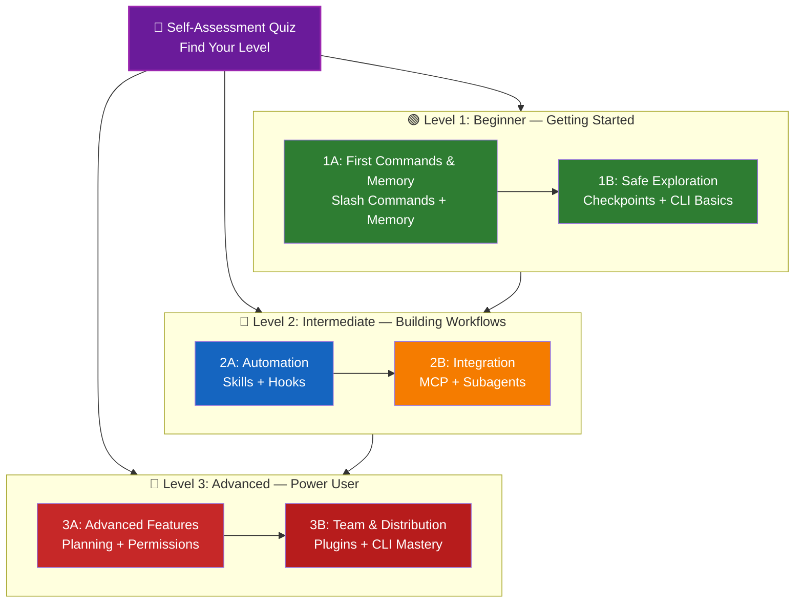

<!-- i18n-source: LEARNING-ROADMAP.md -->
<!-- i18n-source-sha: d17d515 -->
<!-- i18n-date: 2026-10-26 -->

<picture>
  <source media="(prefers-color-scheme: dark)" srcset="../resources/logos/claude-howto-logo-dark.svg">
  
</picture>

# 📚 Claude Code 학습 로드맵

**Claude Code가 처음인가요?** 이 가이드는 자신의 속도에 맞춰 Claude Code의 기능을 익히도록 도와줍니다. 완전한 초보자든 경험 많은 개발자든, 먼저 아래 자기 평가 퀴즈로 자신에게 맞는 경로를 찾아보세요.

---

## 🧭 자신의 레벨 찾기

모두가 같은 지점에서 시작하지는 않습니다. 간단한 자기 평가로 알맞은 입구를 찾으세요.

**솔직하게 답해 주세요:**

- [ ] Claude Code를 실행하고 대화할 수 있다(`claude`)
- [ ] CLAUDE.md 파일을 만들거나 편집해 본 적이 있다
- [ ] 내장 슬래시 명령어를 3개 이상 사용해 본 적이 있다(예: /help, /compact, /model)
- [ ] 사용자 지정 슬래시 명령어나 스킬(SKILL.md)을 만들어 본 적이 있다
- [ ] MCP 서버를 설정해 본 적이 있다(예: GitHub, 데이터베이스)
- [ ] `~/.claude/settings.json`에서 훅을 설정해 본 적이 있다
- [ ] 사용자 지정 서브에이전트를 만들거나 사용해 본 적이 있다(`.claude/agents/`)
- [ ] 스크립트나 CI/CD에서 프린트 모드(`claude -p`)를 사용해 본 적이 있다

**당신의 레벨:**

| 체크 수 | 레벨 | 시작 지점 | 완료까지 걸리는 시간 |
|--------|-------|----------|------------------|
| 0~2 | **레벨 1: 초급** — 첫걸음 | [마일스톤 1A](#마일스톤-1a-첫-명령어와-메모리) | 약 3시간 |
| 3~5 | **레벨 2: 중급** — 워크플로 구축 | [마일스톤 2A](#마일스톤-2a-자동화스킬--훅) | 약 5시간 |
| 6~8 | **레벨 3: 고급** — 파워 유저와 팀 리드 | [마일스톤 3A](#마일스톤-3a-고급-기능) | 약 5시간 |

> **팁**: 고민된다면 한 단계 아래에서 시작하는 편이 좋습니다. 익숙한 내용을 빠르게 복습하는 것이 기초를 놓치는 것보다 훨씬 유익합니다.

> **인터랙티브 버전**: Claude Code 안에서 `/self-assessment`를 실행하면 10개 기능 영역 전체의 숙련도를 측정하는 가이드형 퀴즈를 볼 수 있고, 개인별 학습 경로가 생성됩니다.

---

## 🎯 학습 철학

이 저장소의 폴더는 세 가지 원칙에 따른 **권장 학습 순서**로 번호가 매겨져 있습니다.

1. **의존 관계** — 기초 개념을 먼저 둡니다
2. **복잡도** — 쉬운 기능을 고급 기능보다 앞에 둡니다
3. **사용 빈도** — 가장 자주 쓰는 기능을 이른 단계에서 가르칩니다

이 접근 방식 덕분에 탄탄한 기초를 쌓으면서도 즉시 생산성을 얻을 수 있습니다.

---

## 🗺️ 당신의 학습 경로



**색상 범례:**
- 💜 보라: 자기 평가 퀴즈
- 🟢 초록: 레벨 1 — 초급 경로
- 🔵 파랑 / 🟡 노랑: 레벨 2 — 중급 경로
- 🔴 빨강: 레벨 3 — 고급 경로

---

## 📊 전체 로드맵 표

| 단계 | 기능 | 복잡도 | 시간 | 레벨 | 의존 | 배우는 이유 | 주요 이점 |
|------|---------|-----------|------|-------|--------------|----------------|--------------|
| **1** | [슬래시 명령어](01-slash-commands/) | ⭐ 초급 | 30분 | 레벨 1 | 없음 | 즉시 얻는 생산성 향상(내장 55개 + 번들 스킬) | 즉각적인 자동화, 팀 표준화 |
| **2** | [메모리](02-memory/) | ⭐⭐ 초급+ | 45분 | 레벨 1 | 없음 | 모든 기능의 기초 | 영속 컨텍스트, 설정 유지 |
| **3** | [체크포인트](08-checkpoints/) | ⭐⭐ 중급 | 45분 | 레벨 1 | 세션 관리 | 안전한 탐색 | 실험, 복구 |
| **4** | [CLI 기초](10-cli/) | ⭐⭐ 초급+ | 30분 | 레벨 1 | 없음 | 핵심 CLI 사용법 | 대화형 모드·프린트 모드 |
| **5** | [스킬](03-skills/) | ⭐⭐ 중급 | 1시간 | 레벨 2 | 슬래시 명령어 | 자동으로 발휘되는 전문성 | 재사용, 일관성 |
| **6** | [훅](06-hooks/) | ⭐⭐ 중급 | 1시간 | 레벨 2 | 도구, 명령어 | 워크플로 자동화(33개 이벤트, 5가지 종류) | 검증, 품질 게이트 |
| **7** | [MCP](05-mcp/) | ⭐⭐⭐ 중급+ | 1시간 | 레벨 2 | 설정 | 실시간 데이터 접근 | 실시간 연동, API |
| **8** | [서브에이전트](04-subagents/) | ⭐⭐⭐ 중급+ | 1.5시간 | 레벨 2 | 메모리, 명령어 | 복잡한 작업 처리(Explore와 Plan을 포함한 내장 6개) | 위임, 전문성 |
| **9** | [고급 기능](09-advanced-features/) | ⭐⭐⭐⭐⭐ 고급 | 2~3시간 | 레벨 3 | 지금까지의 모든 기능 | 파워 유저용 도구 | 플래닝, Auto Mode, 채널, 음성 입력, 권한 |
| **10** | [플러그인](07-plugins/) | ⭐⭐⭐⭐ 고급 | 2시간 | 레벨 3 | 지금까지의 모든 기능 | 완전한 솔루션 | 팀 온보딩, 배포 |
| **11** | [CLI 마스터리](10-cli/) | ⭐⭐⭐ 고급 | 1시간 | 레벨 3 | 권장: 지금까지의 모든 기능 | 명령줄 활용 숙달 | 스크립트, CI/CD, 자동화 |

**총 학습 시간**: 약 11~13시간(자신의 레벨로 건너뛰면 단축 가능)

---

## 🟢 레벨 1: 초급 — 첫걸음

**대상**: 퀴즈에서 0~2개 체크한 사용자
**시간**: 약 3시간
**초점**: 즉각적인 생산성, 기초 이해
**도달점**: 일상 사용에 익숙한 사용자, 레벨 2로 갈 준비 완료

### 마일스톤 1A: 첫 명령어와 메모리

**주제**: 슬래시 명령어 + 메모리
**시간**: 1~2시간
**복잡도**: ⭐ 초급
**목표**: 사용자 지정 명령어와 영속 컨텍스트로 즉각적인 생산성 향상

#### 달성 사항
✅ 반복 작업을 위한 사용자 지정 슬래시 명령어 작성
✅ 팀 표준을 위한 프로젝트 메모리 설정
✅ 개인 선호 설정 구성
✅ Claude가 컨텍스트를 자동으로 읽어 들이는 구조 이해

#### 실습 연습

```bash
# 연습 1: 첫 슬래시 명령어 설치
mkdir -p .claude/commands
cp 01-slash-commands/optimize.md .claude/commands/

# 연습 2: 프로젝트 메모리 생성
cp 02-memory/project-CLAUDE.md ./CLAUDE.md

# 연습 3: 시도해 보기
# Claude Code에서 다음을 입력: /optimize
```

#### 달성 기준
- [ ] `/optimize` 명령어를 정상적으로 실행할 수 있다
- [ ] Claude가 CLAUDE.md의 프로젝트 규약을 기억하고 있다
- [ ] 슬래시 명령어와 메모리를 언제 각각 쓰는지 이해하고 있다

#### 다음 단계
익숙해지면 다음을 읽으세요:
- [01-slash-commands/README.md](01-slash-commands/README.md)
- [02-memory/README.md](02-memory/README.md)

> **이해도 점검**: Claude Code 안에서 `/lesson-quiz slash-commands` 또는 `/lesson-quiz memory`를 실행해 학습 내용을 테스트하세요.

---

### 마일스톤 1B: 안전한 탐색

**주제**: 체크포인트 + CLI 기초
**시간**: 1시간
**복잡도**: ⭐⭐ 초급+
**목표**: 안전하게 실험하는 방법과 핵심 CLI 명령어 사용법 배우기

#### 달성 사항
✅ 안전한 실험을 위한 체크포인트 생성·복원
✅ 대화형 모드와 프린트 모드의 차이 이해
✅ 기본 CLI 플래그와 옵션 사용
✅ 파이프를 통한 파일 처리

#### 실습 연습

```bash
# 연습 1: 체크포인트 워크플로 시도
# Claude Code에서:
# 실험적인 변경을 몇 가지 가한 뒤 Esc+Esc를 누르거나 /rewind 실행
# 실험 전 체크포인트 선택
# "Restore code and conversation"을 골라 되돌리기

# 연습 2: 대화형 모드 vs 프린트 모드
claude "explain this project"           # 대화형 모드
claude -p "explain this function"       # 프린트 모드 (비대화형)

# 연습 3: 파이프로 파일 내용 처리
cat error.log | claude -p "explain this error"
```

#### 달성 기준
- [ ] 체크포인트를 만들고 그곳으로 되돌아갔다
- [ ] 대화형 모드와 프린트 모드를 모두 사용했다
- [ ] 파일을 파이프로 Claude에 넘겨 분석했다
- [ ] 안전한 실험을 위해 체크포인트를 언제 쓰는지 이해했다

#### 다음 단계
- 읽기: [08-checkpoints/README.md](08-checkpoints/README.md)
- 읽기: [10-cli/README.md](10-cli/README.md)
- **레벨 2로 갈 준비 완료!** [마일스톤 2A](#마일스톤-2a-자동화스킬--훅)로 이동하세요.

> **이해도 점검**: `/lesson-quiz checkpoints` 또는 `/lesson-quiz cli`를 실행해 레벨 2로 갈 준비가 되었는지 확인하세요.

---

## 🔵 레벨 2: 중급 — 워크플로 구축

**대상**: 퀴즈에서 3~5개 체크한 사용자
**시간**: 약 5시간
**초점**: 자동화, 통합, 작업 위임
**도달점**: 자동화된 워크플로, 외부 통합, 레벨 3으로 갈 준비 완료

### 전제 조건 점검

레벨 2를 시작하기 전에 다음 레벨 1 개념에 익숙한지 확인하세요:

- [ ] 슬래시 명령어를 만들고 사용할 수 있다([01-slash-commands/](01-slash-commands/))
- [ ] CLAUDE.md로 프로젝트 메모리를 설정했다([02-memory/](02-memory/))
- [ ] 체크포인트를 만들고 복원하는 방법을 안다([08-checkpoints/](08-checkpoints/))
- [ ] 명령줄에서 `claude`와 `claude -p`를 사용할 수 있다([10-cli/](10-cli/))

> **부족한 부분이 있나요?** 계속하기 전에 위 튜토리얼을 복습하세요.

---

### 마일스톤 2A: 자동화(스킬 + 훅)

**주제**: 스킬 + 훅
**시간**: 2~3시간
**복잡도**: ⭐⭐ 중급
**목표**: 일상 워크플로와 품질 점검 자동화

#### 달성 사항
✅ YAML 프런트매터(`effort`와 `shell` 필드 포함)로 전문 기능 자동 호출
✅ 33개 훅 이벤트에 걸친 이벤트 기반 자동화 구축
✅ 5가지 훅 종류(command, http, mcp_tool, prompt, agent) 활용
✅ 코드 품질 기준 강제
✅ 워크플로용 사용자 지정 훅 작성

#### 실습 연습

```bash
# 연습 1: 스킬 설치
cp -r 03-skills/code-review-specialist ~/.claude/skills/

# 연습 2: 훅 설정
mkdir -p ~/.claude/hooks
cp 06-hooks/pre-tool-check.sh ~/.claude/hooks/
chmod +x ~/.claude/hooks/pre-tool-check.sh

# 연습 3: 설정에서 훅 구성
# ~/.claude/settings.json에 추가:
{
  "hooks": {
    "PreToolUse": [
      {
        "matcher": "Bash",
        "hooks": [
          {
            "type": "command",
            "command": "~/.claude/hooks/pre-tool-check.sh"
          }
        ]
      }
    ]
  }
}
```

#### 달성 기준
- [ ] 관련 상황에서 code review 스킬이 자동으로 호출된다
- [ ] PreToolUse 훅이 도구 실행 전에 동작한다
- [ ] 스킬의 자동 호출과 훅의 이벤트 트리거의 차이를 이해하고 있다

#### 다음 단계
- 자신만의 사용자 지정 스킬 작성
- 워크플로용 추가 훅 설정
- 읽기: [03-skills/README.md](03-skills/README.md)
- 읽기: [06-hooks/README.md](06-hooks/README.md)

> **이해도 점검**: 다음으로 넘어가기 전에 `/lesson-quiz skills` 또는 `/lesson-quiz hooks`로 지식을 시험해 보세요.

---

### 마일스톤 2B: 통합(MCP + 서브에이전트)

**주제**: MCP + 서브에이전트
**시간**: 2~3시간
**복잡도**: ⭐⭐⭐ 중급+
**목표**: 외부 서비스를 통합하고 복잡한 작업을 위임하기

#### 달성 사항
✅ GitHub, 데이터베이스 등에서 실시간 데이터 접근
✅ 전문 AI 에이전트에 작업 위임
✅ MCP와 서브에이전트를 언제 각각 쓰는지 이해
✅ 통합 워크플로 구축

#### 실습 연습

```bash
# 연습 1: GitHub MCP 설정
claude mcp add --transport http github https://api.githubcopilot.com/mcp/ --header "Authorization: Bearer YOUR_GITHUB_PAT"

# 연습 2: MCP 통합 테스트
# Claude Code에서: /mcp__github__list_prs

# 연습 3: 서브에이전트 설치
mkdir -p .claude/agents
cp 04-subagents/*.md .claude/agents/
```

#### 통합 연습
다음 전체 워크플로를 시도해 보세요:
1. MCP로 GitHub PR 가져오기
2. Claude가 code-reviewer 서브에이전트에 리뷰 위임
3. 훅으로 테스트 자동 실행

#### 달성 기준
- [ ] MCP를 통해 GitHub 데이터를 정상적으로 가져왔다
- [ ] Claude가 복잡한 작업을 서브에이전트에 위임한다
- [ ] MCP와 서브에이전트의 차이를 이해하고 있다
- [ ] 워크플로에서 MCP + 서브에이전트 + 훅을 조합했다

#### 다음 단계
- 추가 MCP 서버(데이터베이스, Slack 등) 설정
- 자신의 도메인용 사용자 지정 서브에이전트 작성
- 읽기: [05-mcp/README.md](05-mcp/README.md)
- 읽기: [04-subagents/README.md](04-subagents/README.md)
- **레벨 3으로 갈 준비 완료!** [마일스톤 3A](#마일스톤-3a-고급-기능)로 이동하세요.

> **이해도 점검**: `/lesson-quiz mcp` 또는 `/lesson-quiz subagents`로 레벨 3으로 갈 준비가 되었는지 확인하세요.

---

## 🔴 레벨 3: 고급 — 파워 유저와 팀 리드

**대상**: 퀴즈에서 6~8개 체크한 사용자
**시간**: 약 5시간
**초점**: 팀 도구, CI/CD, 엔터프라이즈 기능, 플러그인 개발
**도달점**: 파워 유저, 팀 워크플로와 CI/CD 설정 가능

### 전제 조건 점검

레벨 3을 시작하기 전에 다음 레벨 2 개념에 익숙한지 확인하세요:

- [ ] 자동 호출되는 스킬을 만들고 사용할 수 있다([03-skills/](03-skills/))
- [ ] 이벤트 기반 자동화를 위한 훅을 설정했다([06-hooks/](06-hooks/))
- [ ] 외부 데이터용 MCP 서버를 설정할 수 있다([05-mcp/](05-mcp/))
- [ ] 작업 위임을 위한 서브에이전트 사용법을 안다([04-subagents/](04-subagents/))

> **부족한 부분이 있나요?** 계속하기 전에 위 튜토리얼을 복습하세요.

---

### 마일스톤 3A: 고급 기능

**주제**: 고급 기능(플래닝, 권한, 확장 사고, Auto Mode, 채널, 음성 입력, 리모트 / 데스크톱 / 웹)
**시간**: 2~3시간
**복잡도**: ⭐⭐⭐⭐⭐ 고급
**목표**: 고급 워크플로와 파워 유저용 도구 익히기

#### 달성 사항
✅ 복잡한 기능을 위한 플랜 모드
✅ 6가지 모드(default, acceptEdits, plan, auto, dontAsk, bypassPermissions)의 세밀한 권한 제어
✅ Alt+T / Option+T로 확장 사고 전환
✅ 백그라운드 작업 관리
✅ 학습된 선호 설정을 위한 Auto Memory
✅ 백그라운드 안전 분류기가 있는 Auto Mode
✅ 실행 중인 세션에 이벤트(CI 결과, 채팅 메시지, Webhook)를 푸시하는 채널
✅ 핸즈프리 조작을 위한 음성 입력
✅ 리모트 조작, 데스크톱 앱, 웹 세션
✅ 멀티 에이전트 협업을 위한 Agent Teams

#### 실습 연습

```bash
# 연습 1: 플랜 모드 사용
/plan Implement user authentication system

# 연습 2: 권한 모드 시도 (default, acceptEdits, plan, auto, dontAsk, bypassPermissions의 6가지)
claude --permission-mode plan "analyze this codebase"
claude --permission-mode acceptEdits "refactor the auth module"
claude --permission-mode auto "implement the feature"

# 연습 3: 확장 사고 활성화
# 세션 중에 Alt+T (macOS는 Option+T)를 눌러 전환

# 연습 4: 고급 체크포인트 워크플로
# 1. "Clean state" 체크포인트 생성
# 2. 플랜 모드로 기능 설계
# 3. 서브에이전트에 위임해 구현
# 4. 백그라운드에서 테스트 실행
# 5. 테스트 실패 시 체크포인트로 되감기
# 6. 다른 접근 방식 시도

# 연습 5: auto 모드 (백그라운드 안전 분류기) 시도
claude --permission-mode auto "implement user settings page"

# 연습 6: Agent Teams 활성화
export CLAUDE_CODE_EXPERIMENTAL_AGENT_TEAMS=1
# Claude에게 이렇게 요청: "Implement feature X using a team approach"

# 연습 7: 예약 작업
/loop 5m /check-status
# 작업은 세션 단위입니다. 영구적인 예약에는 Routines 또는 Desktop의 예약 작업을 사용하세요

# 연습 8: 채널 (리서치 프리뷰)
# 채널은 실행 중인 세션에 이벤트를 푸시하는 MCP 서버입니다

# 연습 9: 음성 입력
# 핸즈프리로 Claude Code와 소통하려면 음성 입력을 사용하세요
```

#### 달성 기준
- [ ] 복잡한 기능에서 플랜 모드를 사용했다
- [ ] 권한 모드를 설정했다(plan, acceptEdits, auto, dontAsk)
- [ ] Alt+T / Option+T로 확장 사고를 전환했다
- [ ] 백그라운드 안전 분류기가 있는 auto 모드를 사용했다
- [ ] 장시간 처리에 백그라운드 작업을 사용했다
- [ ] 외부 이벤트를 세션에 푸시하는 채널을 시도했다
- [ ] 핸즈프리 입력을 위해 음성 입력을 시도했다
- [ ] 리모트 조작, 데스크톱 앱, 웹 세션을 이해하고 있다
- [ ] 협업 작업을 위해 Agent Teams를 활성화하고 사용했다
- [ ] 반복 작업이나 정기 모니터링에 `/loop`를 사용했다

#### 다음 단계
- 읽기: [09-advanced-features/README.md](09-advanced-features/README.md)

> **이해도 점검**: `/lesson-quiz advanced`로 파워 유저 기능의 숙련도를 시험해 보세요.

---

### 마일스톤 3B: 팀과 배포(플러그인 + CLI 마스터리)

**주제**: 플러그인 + CLI 마스터리 + CI/CD
**시간**: 2~3시간
**복잡도**: ⭐⭐⭐⭐ 고급
**목표**: 팀 도구를 구축하고, 플러그인을 만들고, CI/CD 통합 익히기

#### 달성 사항
✅ 완전히 번들된 플러그인 설치와 작성
✅ 스크립트와 자동화를 위한 CLI 마스터리
✅ `claude -p`를 이용한 CI/CD 통합 설정
✅ 자동화 파이프라인을 위한 JSON 출력
✅ 세션 관리와 배치 처리

#### 실습 연습

```bash
# 연습 1: 완전한 플러그인 설치
claude --plugin-dir ./07-plugins/pr-review  # 저장소 루트에서

# 연습 2: CI/CD를 위한 프린트 모드
claude -p "Run all tests and generate report"

# 연습 3: 스크립트용 JSON 출력
claude -p --output-format json "list all functions"

# 연습 4: 세션 관리와 재개
claude -r "feature-auth" "continue implementation"

# 연습 5: 제약이 있는 CI/CD 통합
claude -p --max-turns 3 --output-format json "review code"

# 연습 6: 배치 처리
for file in *.md; do
  claude -p --output-format json "summarize this: $(cat $file)" > ${file%.md}.summary.json
done
```

#### CI/CD 통합 연습
간단한 CI/CD 스크립트를 작성하세요:
1. `claude -p`로 변경된 파일 리뷰
2. 결과를 JSON으로 출력
3. `jq`로 특정 문제 추출
4. GitHub Actions 워크플로에 통합

#### 달성 기준
- [ ] 플러그인을 설치하고 사용했다
- [ ] 팀을 위해 플러그인을 만들거나 수정했다
- [ ] CI/CD에서 프린트 모드(`claude -p`)를 사용했다
- [ ] 스크립트용 JSON 출력을 생성했다
- [ ] 이전 세션을 정상적으로 재개했다
- [ ] 배치 처리 스크립트를 작성했다
- [ ] Claude를 CI/CD 워크플로에 통합했다

#### CLI의 실용적인 사용 사례
- **코드 리뷰 자동화**: CI/CD 파이프라인에서 코드 리뷰 실행
- **로그 분석**: 오류 로그와 시스템 출력 분석
- **문서 생성**: 문서 배치 생성
- **테스트 분석**: 테스트 실패 분석
- **성능 분석**: 성능 지표 리뷰
- **데이터 처리**: 데이터 파일 변환과 분석

#### 다음 단계
- 읽기: [07-plugins/README.md](07-plugins/README.md)
- 읽기: [10-cli/README.md](10-cli/README.md)
- 팀 공용 CLI 단축 명령과 플러그인 작성
- 배치 처리 스크립트 설정

> **이해도 점검**: `/lesson-quiz plugins` 또는 `/lesson-quiz cli`로 숙련도를 확인하세요.

---

## 🧪 지식 시험하기

이 저장소에는 Claude Code 안에서 언제든 이해도를 평가할 수 있는 인터랙티브 스킬 2개가 포함되어 있습니다.

| 스킬 | 명령어 | 용도 |
|-------|---------|---------|
| **자기 평가** | `/self-assessment` | 10개 기능 전체에 걸친 종합 숙련도 평가. Quick(2분) 또는 Deep(5분) 모드를 골라 개인별 스킬 프로필과 학습 경로를 얻습니다. |
| **레슨 퀴즈** | `/lesson-quiz [lesson]` | 특정 레슨의 이해도를 10문항으로 시험합니다. 레슨 전(사전 테스트), 도중(진행 확인), 후(숙련 확인)에 활용합니다. |

**예:**
```
/self-assessment                  # 종합 레벨 판정
/lesson-quiz hooks                # 레슨 06: 훅 퀴즈
/lesson-quiz 03                   # 레슨 03: 스킬 퀴즈
/lesson-quiz advanced-features    # 레슨 09 퀴즈
```

---

## ⚡ 빠른 시작 경로

### 15분밖에 없다면
**목표**: 첫 성과 얻기

1. 슬래시 명령어 하나 복사: `cp 01-slash-commands/optimize.md .claude/commands/`
2. Claude Code에서 시도: `/optimize`
3. 읽기: [01-slash-commands/README.md](01-slash-commands/README.md)

**도달점**: 동작하는 슬래시 명령어가 하나 있고 기초를 이해하고 있음

---

### 1시간이 있다면
**목표**: 필수 생산성 도구 설정

1. **슬래시 명령어**(15분): `/optimize`와 `/pr`를 복사해 시도
2. **프로젝트 메모리**(15분): 프로젝트 규약이 담긴 CLAUDE.md 작성
3. **스킬 설치**(15분): code-review 스킬 설정
4. **조합해서 시도**(15분): 연동 동작 확인

**도달점**: 명령어, 메모리, 자동 스킬을 통한 기본적인 생산성 향상

---

### 주말이 있다면
**목표**: 대부분의 기능을 능숙하게 다루기

**토요일 오전**(3시간):
- 마일스톤 1A: 슬래시 명령어 + 메모리
- 마일스톤 1B: 체크포인트 + CLI 기초

**토요일 오후**(3시간):
- 마일스톤 2A: 스킬 + 훅
- 마일스톤 2B: MCP + 서브에이전트

**일요일**(4시간):
- 마일스톤 3A: 고급 기능
- 마일스톤 3B: 플러그인 + CLI 마스터리 + CI/CD
- 팀용 사용자 지정 플러그인 구축

**도달점**: 다른 사람을 교육하고 복잡한 워크플로를 자동화할 수 있는 Claude Code 파워 유저

---

## 💡 학습 팁

### ✅ 권장

- **먼저 퀴즈를 풀어** 시작 지점을 찾으세요
- 각 마일스톤의 **실습 연습을 완료하세요**
- **단순하게 시작해** 점차 복잡도를 높이세요
- 다음으로 넘어가기 전에 **각 기능을 테스트**하세요
- 자신의 워크플로에서 무엇이 효과적인지 **메모하세요**
- 고급 주제를 배우는 과정에서 이전 개념을 **다시 살펴보세요**
- 체크포인트로 **안전하게 실험하세요**
- 팀과 **지식을 공유하세요**

### ❌ 비권장

- 상위 레벨로 건너뛸 때 **전제 조건 점검을 건너뛰지 마세요**
- **한 번에 모든 것을 배우려 하지 마세요** — 압도당합니다
- 설정을 이해하지 않은 채 **복사해 붙여 넣지 마세요** — 디버깅할 수 없게 됩니다
- **테스트를 잊지 마세요** — 기능이 동작하는지 반드시 검증하세요
- 마일스톤을 **서둘러 지나치지 마세요** — 이해에 시간을 들이세요
- 문서를 **무시하지 마세요** — 각 README에는 귀중한 세부 정보가 있습니다
- **고립되어 작업하지 마세요** — 팀과 논의하세요

---

## 🎓 학습 스타일

### 시각형 학습자
- 각 README의 Mermaid 다이어그램을 학습합니다
- 명령어 실행 흐름을 관찰합니다
- 직접 워크플로 다이어그램을 그려 봅니다
- 위의 시각적 학습 경로를 활용합니다

### 실습형 학습자
- 모든 실습 연습을 완료합니다
- 변형을 시도해 봅니다
- 부수고 고칩니다(체크포인트를 사용하세요!)
- 자신만의 예제를 만듭니다

### 독서형 학습자
- 각 README를 꼼꼼히 읽습니다
- 코드 예제를 학습합니다
- 비교표를 다시 살펴봅니다
- 리소스에 적힌 블로그 글을 읽습니다

### 사회형 학습자
- 페어 프로그래밍 세션을 마련합니다
- 팀 구성원에게 개념을 가르칩니다
- Claude Code 커뮤니티 토론에 참여합니다
- 자신의 사용자 지정 설정을 공유합니다

---

## 📈 진행 상황 추적

이 체크리스트로 레벨별 진행 상황을 따라갈 수 있습니다. 언제든 `/self-assessment`를 실행해 최신 스킬 프로필을 얻거나, 각 튜토리얼 뒤에 `/lesson-quiz [lesson]`으로 이해도를 확인하세요.

### 🟢 레벨 1: 초급
- [ ] [01-slash-commands](01-slash-commands/) 완료
- [ ] [02-memory](02-memory/) 완료
- [ ] 첫 사용자 지정 슬래시 명령어 작성
- [ ] 프로젝트 메모리 설정
- [ ] **마일스톤 1A 달성**
- [ ] [08-checkpoints](08-checkpoints/) 완료
- [ ] [10-cli](10-cli/) 기초 완료
- [ ] 체크포인트를 만들고 되돌아감
- [ ] 대화형 모드와 프린트 모드 사용
- [ ] **마일스톤 1B 달성**

### 🔵 레벨 2: 중급
- [ ] [03-skills](03-skills/) 완료
- [ ] [06-hooks](06-hooks/) 완료
- [ ] 첫 스킬 설치
- [ ] PreToolUse 훅 설정
- [ ] **마일스톤 2A 달성**
- [ ] [05-mcp](05-mcp/) 완료
- [ ] [04-subagents](04-subagents/) 완료
- [ ] GitHub MCP에 연결
- [ ] 사용자 지정 서브에이전트 작성
- [ ] 워크플로에서 여러 통합을 조합
- [ ] **마일스톤 2B 달성**

### 🔴 레벨 3: 고급
- [ ] [09-advanced-features](09-advanced-features/) 완료
- [ ] 플랜 모드를 정상적으로 사용
- [ ] 권한 모드 설정(auto를 포함한 6가지 모드)
- [ ] 안전 분류기가 있는 auto 모드 사용
- [ ] 확장 사고 전환 사용
- [ ] 채널과 음성 입력 시도
- [ ] **마일스톤 3A 달성**
- [ ] [07-plugins](07-plugins/) 완료
- [ ] [10-cli](10-cli/) 고급 활용 완료
- [ ] CI/CD에서 프린트 모드(`claude -p`) 설정
- [ ] 자동화를 위한 JSON 출력 작성
- [ ] CI/CD 파이프라인에 Claude 통합
- [ ] 팀 플러그인 작성
- [ ] **마일스톤 3B 달성**

---

## 🆘 흔한 학습 고민

### 고민 1: "개념이 너무 많아요"
**해결책**: 한 번에 하나의 마일스톤에 집중하세요. 앞으로 나아가기 전에 모든 연습을 완료하세요.

### 고민 2: "어떤 기능을 언제 써야 할지 모르겠어요"
**해결책**: 메인 README의 [사용 사례 표](README.md#무엇을-만들-수-있나)를 참고하세요.

### 고민 3: "설정이 동작하지 않아요"
**해결책**: [트러블슈팅](README.md#트러블슈팅) 섹션을 확인하고 파일 배치 위치를 검증하세요.

### 고민 4: "개념이 겹쳐 보여요"
**해결책**: 차이를 이해하기 위해 [기능 비교](README.md#기능-비교) 표를 다시 살펴보세요.

### 고민 5: "전부 외우기가 힘들어요"
**해결책**: 자신만의 치트 시트를 만드세요. 체크포인트로 안전하게 실험하세요.

### 고민 6: "경험은 있는데 어디서 시작해야 할지 모르겠어요"
**해결책**: 위의 [자기 평가 퀴즈](#-자신의-레벨-찾기)를 풀어 보세요. 자신의 레벨로 건너뛰고, 전제 조건 점검으로 빈틈을 찾으세요.

---

## 🎯 완료 후에는 무엇을 할까요

모든 마일스톤을 완료했다면:

1. **팀 문서 작성** — 팀의 Claude Code 설정을 문서화합니다
2. **사용자 지정 플러그인 구축** — 팀의 워크플로를 패키지로 만듭니다
3. **리모트 컨트롤 시도** — 로컬 Claude Code 세션을 스마트폰, 브라우저 또는 Claude 앱에서 이어 갑니다
4. **웹 세션 시도** — 원격 개발을 위해 브라우저 기반 인터페이스로 Claude Code를 사용합니다
5. **데스크톱 앱 사용** — 네이티브 데스크톱 앱에서 Claude Code 기능을 활용합니다
6. **Auto Mode 사용** — 백그라운드 안전 분류기와 함께 Claude를 자율적으로 동작시킵니다
7. **Auto Memory 활용** — Claude가 시간이 지나면서 선호를 자동으로 학습하게 합니다
8. **Agent Teams 설정** — 복잡하고 다면적인 작업에서 여러 에이전트를 협업시킵니다
9. **채널 사용** — 실행 중인 세션에 이벤트(CI 결과, 채팅 메시지, Webhook)를 푸시하는 MCP 서버를 연결합니다
10. **음성 입력 시도** — 핸즈프리 음성 입력으로 Claude Code와 소통합니다
11. **예약 작업 사용** — `/loop`나 cron 도구로 반복 점검을 자동화합니다
12. **예제 기여** — 커뮤니티와 공유합니다
13. **다른 사람 지도** — 팀 구성원의 학습을 돕습니다
14. **워크플로 최적화** — 사용 현황을 바탕으로 지속적으로 개선합니다
15. **최신 정보 팔로우** — Claude Code의 릴리스와 새 기능을 따라갑니다

---

## 📚 추가 리소스

### 공식 문서
- [Claude Code Documentation](https://code.claude.com/docs/en/overview)
- [Anthropic Documentation](https://docs.anthropic.com)
- [MCP Protocol Specification](https://modelcontextprotocol.io)

### 블로그 글
- [Discovering Claude Code Slash Commands](https://medium.com/@luongnv89/discovering-claude-code-slash-commands-cdc17f0dfb29)

### 커뮤니티
- [Anthropic Cookbook](https://github.com/anthropics/anthropic-cookbook)
- [MCP Servers Repository](https://github.com/modelcontextprotocol/servers)

---

## 💬 피드백과 지원

- **문제를 발견했나요?** 저장소에 이슈를 만들어 주세요
- **제안이 있나요?** 풀 리퀘스트를 보내 주세요
- **도움이 필요한가요?** 문서를 확인하거나 커뮤니티에 물어보세요

---

**최종 업데이트**: 2026년 10월 18일
**Claude Code 버전**: 2.1.302
**정보 출처**:
- https://code.claude.com/docs/en/overview
- https://code.claude.com/docs/en/hooks
- https://github.com/anthropics/claude-code/releases/tag/v2.1.119
- https://code.claude.com/docs/en/agent-teams
- https://code.claude.com/docs/en/mcp
- https://code.claude.com/docs/en/plugins/install
- https://code.claude.com/docs/en/channels
- https://code.claude.com/docs/en/remote-control
- https://code.claude.com/docs/en/scheduled-tasks
- https://code.claude.com/docs/en/commands
- https://code.claude.com/docs/en/sub-agents
**호환 모델**: Claude Fable 5, Claude Opus 5, Claude Sonnet 5, Claude Sonnet 4.6, Claude Opus 4.8, Claude Haiku 4.5
**메인테이너**: Claude How-To Contributors
**라이선스**: 교육 목적, 자유롭게 사용·수정 가능

---

[← 메인 README로 돌아가기](README.md)
