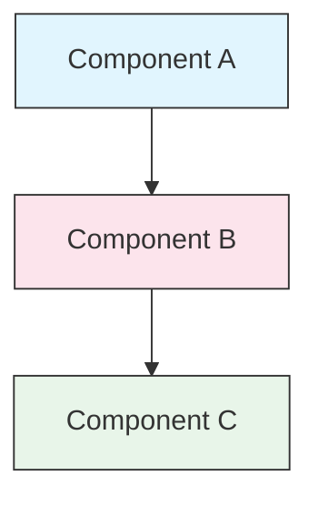

<!-- i18n-source: STYLE_GUIDE.md -->
<!-- i18n-source-sha: d17d515 -->
<!-- i18n-date: 2026-10-26 -->

<picture>
  <source media="(prefers-color-scheme: dark)" srcset="../resources/logos/claude-howto-logo-dark.svg">
  
</picture>

# 스타일 가이드

> Claude How To에 기여할 때의 규약과 포맷 규칙입니다. 콘텐츠를 일관되고 전문적이며 유지보수하기 쉬운 상태로 유지하기 위해 이 가이드를 따르세요.
>
> ※ 한국어판의 문체·용어 규칙은 `TRANSLATION_NOTES.md`도 참고하세요.

---

## 목차

- [파일과 폴더 명명](#파일과-폴더-명명)
- [문서 구조](#문서-구조)
- [제목](#제목)
- [텍스트 서식](#텍스트-서식)
- [목록](#목록)
- [표](#표)
- [코드 블록](#코드-블록)
- [링크와 상호 참조](#링크와-상호-참조)
- [다이어그램](#다이어그램)
- [이모지 사용법](#이모지-사용법)
- [YAML 프런트매터](#yaml-프런트매터)
- [이미지와 미디어](#이미지와-미디어)
- [어조와 목소리](#어조와-목소리)
- [커밋 메시지](#커밋-메시지)
- [저자용 체크리스트](#저자용-체크리스트)

---

## 파일과 폴더 명명

### 레슨 폴더

레슨 폴더는 **2자리 번호 접두사** 뒤에 **kebab-case** 설명자를 붙입니다:

```
01-slash-commands/
02-memory/
03-skills/
04-subagents/
05-mcp/
```

번호는 초보자에서 고급자로 이어지는 학습 경로의 순서를 반영합니다.

### 파일명

| 종류 | 규약 | 예 |
|------|-----------|----------|
| **레슨 README** | `README.md` | `01-slash-commands/README.md` |
| **기능 파일** | kebab-case `.md` | `code-reviewer.md`, `generate-api-docs.md` |
| **셸 스크립트** | kebab-case `.sh` | `format-code.sh`, `validate-input.sh` |
| **설정 파일** | 표준 이름 | `.mcp.json`, `settings.json` |
| **메모리 파일** | 범위 접두사 | `project-CLAUDE.md`, `personal-CLAUDE.md` |
| **최상위 문서** | UPPER_CASE `.md` | `CATALOG.md`, `QUICK_REFERENCE.md`, `CONTRIBUTING.md` |
| **이미지 에셋** | kebab-case | `pr-slash-command.png`, `claude-howto-logo.svg` |

### 규칙

- 모든 파일명·폴더명은 **소문자**를 사용합니다(`README.md`, `CATALOG.md` 등 최상위 문서 제외)
- 단어 구분에는 **하이픈**(`-`)을 사용하고 밑줄이나 공백은 사용하지 않습니다
- 이름은 서술적이면서 간결하게 유지합니다

---

## 문서 구조

### 루트 README

루트 `README.md`는 다음 순서를 따릅니다:

1. 로고(다크/라이트 모두 지원하는 `<picture>` 요소)
2. H1 제목
3. 도입 블록 인용(한 줄 가치 제안)
4. "Why This Guide?" 섹션과 비교 표
5. 수평선(`---`)
6. 목차
7. 기능 카탈로그
8. 빠른 내비게이션
9. 학습 경로
10. 기능 섹션
11. 시작하기
12. 모범 사례/문제 해결
13. 기여/라이선스

### 레슨 README

각 레슨 `README.md`는 다음 순서를 따릅니다:

1. H1 제목(예: `# Slash Commands`)
2. 간결한 개요 단락
3. 빠른 참조 표(선택)
4. 아키텍처 다이어그램(Mermaid)
5. 상세 섹션(H2)
6. 실전 예제(번호 매김, 4~6개)
7. 모범 사례(Do와 Don't 표)
8. 문제 해결
9. 관련 가이드/공식 문서
10. 문서 메타데이터 푸터

### 기능/샘플 파일

개별 기능 파일(예: `optimize.md`, `pr.md`):

1. YAML 프런트매터(해당하는 경우)
2. H1 제목
3. 목적/설명
4. 사용 방법
5. 코드 예시
6. 커스터마이즈 힌트

### 섹션 구분

주요 문서 영역을 구분하기 위해 수평선(`---`)을 사용합니다:

```markdown
---

## 새로운 주요 섹션
```

도입 블록 인용 뒤와 논리적으로 다른 부분 사이에 배치합니다.

---

## 제목

### 계층

| 레벨 | 용도 | 예 |
|-------|-----|---------|
| `#` H1 | 페이지 제목(문서당 1개) | `# Slash Commands` |
| `##` H2 | 주요 섹션 | `## Best Practices` |
| `###` H3 | 하위 섹션 | `### Adding a Skill` |
| `####` H4 | 하위-하위 섹션(드묾) | `#### Configuration Options` |

### 규칙

- **문서당 H1은 1개** — 페이지 제목뿐
- **레벨을 건너뛰지 않음** — H2에서 H4로 건너뛰지 않음
- **제목은 간결하게** — 2~5단어가 기준
- **문장식 대소문자 사용** — 첫 단어와 고유명사만 대문자(예외: 기능명은 그대로)
- **이모지 접두사는 루트 README의 섹션 헤더에만 추가**([이모지 사용법](#이모지-사용법) 참고)

---

## 텍스트 서식

### 강조

| 스타일 | 언제 사용하는가 | 예 |
|-------|------------|---------|
| **볼드**(`**text**`) | 중요한 용어, 표 안의 라벨, 핵심 개념 | `**Installation**:` |
| *이탤릭*(`*text*`) | 전문 용어의 첫 등장, 책/문서 제목 | `*frontmatter*` |
| `코드`(`` `text` ``) | 파일명, 명령어, 설정값, 코드 참조 | `` `CLAUDE.md` `` |

### 콜아웃용 블록 인용

중요한 주의 사항에는 볼드 접두사가 붙은 블록 인용을 사용합니다:

```markdown
> **Note**: Custom slash commands have been merged into skills since v2.0.

> **Important**: Never commit API keys or credentials.

> **Tip**: Combine memory with skills for maximum effectiveness.
```

지원하는 콜아웃 종류: **Note**, **Important**, **Tip**, **Warning**.

### 단락

- 단락은 짧게 유지합니다(2~4문장)
- 단락 사이에 빈 줄을 넣습니다
- 핵심을 먼저, 맥락은 나중에
- "무엇을"뿐 아니라 "왜"를 설명합니다

---

## 목록

### 번호 없는 목록

대시(`-`)와 2칸 들여쓰기로 중첩합니다:

```markdown
- 첫 번째 항목
- 두 번째 항목
  - 중첩 항목
  - 또 다른 중첩 항목
    - 깊은 중첩(3단계보다 깊게 하지 않음)
- 세 번째 항목
```

### 번호 있는 목록

순서가 있는 단계, 절차, 순위 항목에는 번호 있는 목록을 사용합니다:

```markdown
1. 첫 번째 단계
2. 두 번째 단계
   - 하위 항목 상세
   - 또 다른 하위 항목
3. 세 번째 단계
```

### 설명형 목록

키·값 형식의 목록에는 볼드 라벨을 사용합니다:

```markdown
- **성능 병목** - O(n^2) 연산, 비효율적인 루프를 찾아낸다
- **메모리 누수** - 해제되지 않은 리소스, 순환 참조를 발견한다
- **알고리즘 개선** - 더 나은 알고리즘이나 자료 구조를 제안한다
```

### 규칙

- 일관된 들여쓰기를 유지합니다(단계당 2칸)
- 목록 앞뒤에 빈 줄을 넣습니다
- 목록 항목은 구조를 맞춥니다(모두 동사로 시작하거나 모두 명사 등)
- 3단계보다 깊은 중첩은 피합니다

---

## 표

### 표준 형식

```markdown
| Column 1 | Column 2 | Column 3 |
|----------|----------|----------|
| Data     | Data     | Data     |
```

### 흔한 표 패턴

**기능 비교(3~4열):**

```markdown
| Feature | Invocation | Persistence | Best For |
|---------|-----------|------------|----------|
| **Slash Commands** | Manual (`/cmd`) | Session only | Quick shortcuts |
| **Memory** | Auto-loaded | Cross-session | Long-term learning |
```

**Do와 Don't:**

```markdown
| Do | Don't |
|----|-------|
| Use descriptive names | Use vague names |
| Keep files focused | Overload a single file |
```

**빠른 참조:**

```markdown
| Aspect | Details |
|--------|---------|
| **Purpose** | Generate API documentation |
| **Scope** | Project-level |
| **Complexity** | Intermediate |
```

### 규칙

- **표 헤더를 볼드로** — 행 라벨(첫 번째 열)인 경우
- 소스 가독성을 위해 파이프를 정렬합니다(선택이지만 권장)
- 셀 내용은 간결하게 유지하고 상세 내용은 링크로
- 셀 안의 명령어나 파일 경로에는 `code formatting`을 사용합니다

---

## 코드 블록

### 언어 태그

구문 강조를 위해 반드시 언어 태그를 지정합니다:

| 언어 | 태그 | 용도 |
|----------|-----|---------|
| 셸 | `bash` | CLI 명령어, 스크립트 |
| Python | `python` | Python 코드 |
| JavaScript | `javascript` | JS 코드 |
| TypeScript | `typescript` | TS 코드 |
| JSON | `json` | 설정 파일 |
| YAML | `yaml` | 프런트매터, 설정 |
| Markdown | `markdown` | Markdown 예시 |
| SQL | `sql` | 데이터베이스 쿼리 |
| 일반 텍스트 | (태그 없음) | 기대 출력, 디렉터리 트리 |

### 규약

```bash
# 명령어의 동작을 설명하는 주석
claude mcp add notion --transport http https://mcp.notion.com/mcp
```

- 자명하지 않은 명령어 앞에 **주석 행**을 추가합니다
- 모든 예시를 **복사·붙여넣기 가능**하게 만듭니다
- 관련이 있을 때는 **단순 버전과 고급 버전 모두**를 보여 줍니다
- 이해에 도움이 되면 **기대 출력**을 포함합니다(태그 없는 코드 블록 사용)

### 설치 블록

설치 절차에는 다음 패턴을 사용합니다:

```bash
# 프로젝트에 파일을 복사
cp 01-slash-commands/*.md .claude/commands/
```

### 여러 단계 워크플로

```bash
# Step 1: 디렉터리 생성
mkdir -p .claude/commands

# Step 2: 템플릿 복사
cp 01-slash-commands/*.md .claude/commands/

# Step 3: 설치 확인
ls .claude/commands/
```

---

## 링크와 상호 참조

### 내부 링크(상대)

모든 내부 링크는 상대 경로를 사용합니다:

```markdown
[Slash Commands](01-slash-commands/)
[Skills Guide](03-skills/)
[Memory Architecture](02-memory/#memory-architecture)
```

레슨 폴더에서 루트 또는 형제 폴더로:

```markdown
[Back to main guide](../README.md)
[Related: Skills](../03-skills/)
```

### 외부 링크(절대)

서술적인 앵커 텍스트를 동반한 전체 URL을 사용합니다:

```markdown
[Anthropic's official documentation](https://code.claude.com/docs/en/overview)
```

- 앵커 텍스트에 "click here", "this link"를 사용하지 않습니다
- 문맥 밖에서도 의미가 통하는 서술적인 텍스트를 사용합니다

### 섹션 앵커

GitHub 스타일 앵커로 같은 문서 안의 섹션에 링크합니다:

```markdown
[Feature Catalog](#-feature-catalog)
[Best Practices](#best-practices)
```

### 관련 가이드 패턴

레슨 끝에 관련 가이드 섹션을 둡니다:

```markdown
## Related Guides

- [Slash Commands](../01-slash-commands/) - Quick shortcuts
- [Memory](../02-memory/) - Persistent context
- [Skills](../03-skills/) - Reusable capabilities
```

---

## 다이어그램

### Mermaid

모든 다이어그램에 Mermaid를 사용합니다. 지원하는 종류:

- `graph TB` / `graph LR` — 아키텍처, 계층, 흐름
- `sequenceDiagram` — 상호작용 흐름
- `timeline` — 시간 순서

GitHub는 Mermaid를 네이티브로 렌더링합니다. 웹사이트와 EPUB은 같은 소스를 [Pele](https://github.com/obsidianmd/pele) (`scripts/vendor_assets.py`로 버전 고정)로 렌더링하고, pre-commit의 `mermaid-syntax` 훅도 같은 번들로 모든 블록을 검증합니다. 따라서 훅을 통과한 블록은 어디서든 표시됩니다.

### 스타일 규약

스타일 블록으로 일관된 색상을 적용합니다:



**컬러 팔레트:**

| 색 | Hex | 용도 |
|-------|-----|---------|
| 라이트 블루 | `#e1f5fe` | 주요 컴포넌트, 입력 |
| 라이트 핑크 | `#fce4ec` | 처리, 미들웨어 |
| 라이트 그린 | `#e8f5e9` | 출력, 결과 |
| 라이트 옐로 | `#fff9c4` | 설정, 선택 사항 |
| 라이트 퍼플 | `#f3e5f5` | 사용자 대상, UI |

### 규칙

- 노드 라벨에는 `["Label text"]`를 사용합니다(특수 문자 허용)
- 라벨 안의 줄바꿈에는 `<br/>`를 사용합니다
- 라벨은 일반 텍스트로 하고, 번호가 붙은 라벨은 그대로 씁니다(`["1. Load file"]`, 마침표 앞에 백슬래시를 붙이지 않음)
- `%%{init}%%` 지시문이나 Mermaid 테마에 의존하지 않습니다: 웹사이트는 독자적인 라이트/다크 배색을 적용합니다
- 다이어그램은 단순하게 유지합니다(최대 10~12 노드)
- 접근성을 위해 다이어그램 아래에 간결한 텍스트 설명을 추가합니다
- 계층에는 위에서 아래(`TB`), 워크플로에는 왼쪽에서 오른쪽(`LR`)을 사용합니다

---

## 이모지 사용법

### 이모지를 사용하는 곳

이모지는 **절제해서 목적을 갖고** 사용합니다 — 특정 맥락에서만:

| 맥락 | 이모지 | 예 |
|---------|--------|---------|
| 루트 README의 섹션 헤더 | 카테고리 아이콘 | `## 📚 Learning Path` |
| 스킬 레벨 표시 | 색깔 원 | 🟢 초보자, 🔵 중급자, 🔴 고급자 |
| Do와 Don't | 체크/엑스 표시 | ✅ 이렇게 한다, ❌ 이렇게 하지 않는다 |
| 복잡도 평가 | 별 | ⭐⭐⭐ |

### 표준 이모지 세트

| 이모지 | 의미 |
|-------|---------|
| 📚 | 학습, 가이드, 문서 |
| ⚡ | 시작하기, 빠른 참조 |
| 🎯 | 기능, 빠른 참조 |
| 🎓 | 학습 경로 |
| 📊 | 통계, 비교 |
| 🚀 | 설치, 빠른 명령어 |
| 🟢 | 초보자 레벨 |
| 🔵 | 중급자 레벨 |
| 🔴 | 고급자 레벨 |
| ✅ | 권장 관행 |
| ❌ | 피해야 함/안티패턴 |
| ⭐ | 복잡도 평가 단위 |

### 규칙

- **본문이나 단락에서 이모지를 사용하지 않습니다**
- 헤더에서 이모지를 사용하는 것은 **루트 README뿐**(레슨 README에서는 사용하지 않음)
- **장식용 이모지를 추가하지 않습니다** — 모든 이모지는 의미를 전달해야 합니다
- 이모지 사용법은 위 표와 일관되게 합니다

---

## YAML 프런트매터

### 기능 파일(스킬, 명령어, 에이전트)

```yaml
---
name: unique-identifier
description: What this feature does and when to use it
allowed-tools: Bash, Read, Grep
---
```

### 선택 필드

```yaml
---
name: my-feature
description: Brief description
argument-hint: "[file-path] [options]"
allowed-tools: Bash, Read, Grep, Write, Edit
model: opus                        # opus, sonnet 또는 haiku
disable-model-invocation: true     # 사용자 전용 호출
user-invocable: false              # 사용자 메뉴에서 숨김
context: fork                      # 격리된 서브에이전트에서 실행
agent: Explore                     # context: fork의 에이전트 종류
---
```

### 규칙

- 프런트매터는 파일 맨 위에 둡니다
- `name` 필드는 **kebab-case**를 사용합니다
- `description`은 한 문장으로 유지합니다
- 필요한 필드만 포함합니다

---

## 이미지와 미디어

### 로고 패턴

로고로 시작하는 문서는 모두 다크/라이트 모드 지원을 위해 `<picture>` 요소를 사용합니다:

```html
<picture>
  <source media="(prefers-color-scheme: dark)" srcset="resources/logos/claude-howto-logo-dark.svg">
  
</picture>
```

### 스크린샷

- 관련 레슨 폴더에 저장합니다(예: `01-slash-commands/pr-slash-command.png`)
- 파일명에 kebab-case를 사용합니다
- 서술적인 alt 텍스트를 포함합니다
- 다이어그램에는 SVG, 스크린샷에는 PNG를 우선합니다

### 규칙

- 이미지에는 항상 alt 텍스트를 제공합니다
- 이미지 파일 크기를 적절히 유지합니다(PNG는 500KB 미만)
- 이미지 참조에는 상대 경로를 사용합니다
- 이미지는 참조하는 문서와 같은 디렉터리에, 공유 이미지라면 `assets/`에 저장합니다

---

## 어조와 목소리

### 집필 스타일

- **전문적이지만 친근하게** — 전문 용어 과다 없이 기술적으로 정확하게
- **능동태** — "파일을 만든다"("파일이 만들어져야 한다"가 아님)
- **직접적인 지시** — "이 명령어를 실행한다"("이 명령어를 실행하고 싶을 수도 있다"가 아님)
- **초보자 친화적** — 독자는 Claude Code에는 처음이지만 프로그래밍에는 처음이 아니라고 가정

### 콘텐츠 원칙

| 원칙 | 예 |
|-----------|---------|
| **말하지 말고 보여 준다** | 추상적인 서술이 아니라 동작하는 샘플을 제공 |
| **단계적인 복잡도** | 단순하게 시작하고 뒤 섹션에서 깊이를 더함 |
| **"왜"를 설명한다** | "메모리는 …에 사용한다"만이 아니라 "메모리는 …인데, 왜냐하면 …" |
| **복사·붙여넣기로 동작** | 모든 코드 블록은 붙여넣기만으로 동작해야 함 |
| **실제 세계의 맥락** | 억지스러운 예가 아니라 실용적인 시나리오를 사용 |

### 어휘

- "Claude Code"를 사용합니다("Claude CLI"나 "the tool"이 아님)
- "skill"을 사용합니다("custom command"가 아님 — 옛 명칭)
- 번호가 붙은 섹션에는 "lesson" 또는 "guide"를 사용합니다
- 개별 기능 파일에는 "example"을 사용합니다

---

## 커밋 메시지

[Conventional Commits](https://www.conventionalcommits.org/)를 따릅니다:

```
type(scope): description
```

### 종류

| 종류 | 용도 |
|------|---------|
| `feat` | 새 기능, 샘플, 가이드 |
| `fix` | 버그 수정, 정정, 깨진 링크 |
| `docs` | 문서 개선 |
| `refactor` | 동작을 바꾸지 않는 재구성 |
| `style` | 포맷 변경만 |
| `test` | 테스트 추가·변경 |
| `chore` | 빌드, 의존성, CI |

### 스코프

스코프에는 레슨 이름이나 파일 영역을 사용합니다:

```
feat(slash-commands): Add API documentation generator
docs(memory): Improve personal preferences example
fix(README): Correct table of contents link
docs(skills): Add comprehensive code review skill
```

---

## 문서 메타데이터 푸터

레슨 README는 메타데이터 블록으로 끝납니다:

```markdown
---
**Last Updated**: August 2026
**Claude Code Version**: 2.1.245
**Compatible Models**: Claude Sonnet 4.6, Claude Opus 4.7, Claude Haiku 4.5
```

- 월 + 연도 형식을 사용합니다(예: "August 2026")
- 버전은 여기에 적힌 값이 아니라 현재 동기화 실행에서 얻은 값을 사용합니다
- 기능 변경 시 버전을 업데이트합니다
- 호환 모델을 모두 나열합니다

---

## 저자용 체크리스트

콘텐츠를 제출하기 전에 확인합니다:

- [ ] 파일/폴더명이 kebab-case
- [ ] 문서가 H1 제목으로 시작(파일당 1개)
- [ ] 제목 계층이 올바름(레벨 건너뛰기 없음)
- [ ] 모든 코드 블록에 언어 태그가 있음
- [ ] 코드 예시가 복사·붙여넣기로 동작
- [ ] 내부 링크는 상대 경로
- [ ] 외부 링크에는 서술적인 앵커 텍스트
- [ ] 표가 올바르게 포맷됨
- [ ] 이모지는 표준 세트를 따름(사용하는 경우)
- [ ] Mermaid 다이어그램은 표준 컬러 팔레트를 사용
- [ ] 민감한 정보(API 키, 인증 정보)가 포함되지 않음
- [ ] YAML 프런트매터가 유효함(해당하는 경우)
- [ ] 이미지에 alt 텍스트가 있음
- [ ] 단락이 짧고 초점이 분명함
- [ ] 관련 가이드 섹션이 관련 레슨에 링크함
- [ ] 커밋 메시지가 Conventional Commits 형식을 따름

---

**최종 업데이트**: 2026년 8월 25일
**Claude Code 버전**: 2.1.245
**정보 출처**:
- https://code.claude.com/docs/en/overview
- https://code.claude.com/docs/en/changelog
- https://www.anthropic.com/news/claude-opus-4-7
**호환 모델**: Claude Sonnet 4.6, Claude Opus 4.7, Claude Haiku 4.5
