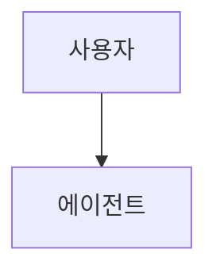
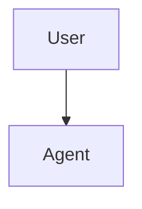

# 번역 용어집과 스타일 가이드

# Translation Glossary & Style Guide

> **중요:** 이 문서는 Claude Code 문서를 한국어로 번역할 때 지켜야 할 규칙을 정합니다. 작업을 시작하기 전에 반드시 읽어 주세요.

## 기본 방침

- **문체:** 합니다체(격식체 경어). "~합니다", "~입니다", "~하세요"
- **용어 방침:** IT 업계에서 정착한 외래어 표기를 우선 (예: 커밋, 브랜치, 플러그인)
- **원본 기준:** 일본어판(`ja/`)을 1차 원본으로 삼고, 일본어 표현이 모호하면 영어 원문(저장소 루트)을 참고합니다
- **코드 보존:** 실행 코드는 100% 유지. 주석과 docstring만 번역
- **Mermaid 다이어그램:** 라벨 텍스트는 영어 그대로 유지
- **원문 추적:** 각 파일 첫머리에 `i18n-source-sha`를 넣어 재동기화가 가능하게 합니다

---

## 기술 용어집

모든 파일에서 통일해야 하는 대역표:

| English | 한국어 | 비고 |
|---------|--------|------|
| slash command | 슬래시 명령어 | Claude Code 기능명 |
| hook | 훅 | IT 업계 정착 표기 |
| skill | 스킬 | Claude Code 기능명 |
| subagent | 서브에이전트 | Claude Code 기능명 |
| agent | 에이전트 | 일반 외래어 표기 |
| memory | 메모리 | Claude Code 기능명 (기억 영역의 의미) |
| checkpoint | 체크포인트 | 세션 스냅샷 |
| plugin | 플러그인 | 일반 용어 |
| pull request / PR | 풀 리퀘스트 / PR | GitHub 용어 |
| commit | 커밋 | Git 용어 |
| branch | 브랜치 | Git 용어 |
| merge | 머지 / 병합 | Git 용어, 문맥에 따라 |
| MCP (Model Context Protocol) | MCP | 프로토콜명은 그대로 |
| CLAUDE.md | CLAUDE.md | 파일명은 그대로 |
| prompt | 프롬프트 | 정착한 외래어 |
| workflow | 워크플로 | 정착한 외래어 ("워크플로우" 아님) |
| repository | 저장소 | 번역어가 정착 |
| issue | 이슈 | GitHub 용어 |
| release | 릴리스 | 정착한 외래어 ("릴리즈" 아님) |
| API | API | 그대로 |
| CLI | CLI | Command-Line Interface, 그대로 |
| CI/CD | CI/CD | 그대로 |
| pre-commit hook | pre-commit 훅 | 도구명은 유지 |
| environment variable | 환경 변수 | 번역어가 정착 |
| dependencies | 의존성 | 번역어가 정착 |
| template | 템플릿 | 외래어 표기 |
| worktree | 워크트리 | Git 용어 |
| frontmatter | 프런트매터 | YAML 머리 블록 |
| token | 토큰 | 외래어 표기 |
| context window | 컨텍스트 윈도우 | 외래어 표기 |
| fork | 포크 | Git 용어 |
| clone | 클론(하다) / 복제 | Git 용어 |
| sandbox | 샌드박스 | 외래어 표기 |
| boilerplate | 보일러플레이트 | 외래어 표기 |
| debugging | 디버깅 | 외래어 표기 |
| linting | 린팅 | 외래어 표기 |
| refactoring | 리팩터링 | 외래어 표기 ("리팩토링" 아님) |
| build | 빌드 | 외래어 표기 |
| deploy | 배포 | 번역어가 정착 |
| feature | 기능 | 문맥에 따라 "피처"도 가능 |
| user | 사용자 | 번역어가 정착 |
| developer | 개발자 | 번역어가 정착 |
| documentation | 문서 / 문서화 | 짧은 "문서"를 우선 |
| roadmap | 로드맵 | 외래어 표기 |
| ecosystem | 생태계 | 번역어가 정착 |
| orchestration | 오케스트레이션 | 외래어 표기 |
| permission | 권한 | 번역어가 정착 |
| settings | 설정 | 번역어가 정착 |
| configuration | 설정 / 구성 | 짧은 "설정"을 우선 |
| trigger | 트리거 | 외래어 표기 |
| event | 이벤트 | 외래어 표기 |
| script | 스크립트 | 외래어 표기 |
| handler | 핸들러 | 외래어 표기 |
| wrapper | 래퍼 | 외래어 표기 |
| middleware | 미들웨어 | 외래어 표기 |
| pipeline | 파이프라인 | 외래어 표기 |
| best practice | 모범 사례 | 번역어가 정착 |
| use case | 사용 사례 | 번역어가 정착 |
| trade-off | 트레이드오프 | 외래어 표기 |
| planning mode | 플랜 모드 | Claude Code 기능명 |
| session | 세션 | 외래어 표기 |
| background task | 백그라운드 작업 | 혼합 표기 |
| headless mode | 헤드리스 모드 | 외래어 표기 |
| marketplace | 마켓플레이스 | 외래어 표기 |

---

## Claude Code 고유 명사 (절대 변경 금지)

다음은 Claude Code의 **제품명·기능명**이며, **번역하지 않고 영어 표기 그대로** 유지합니다:

| 표기 | 종류 | 보충 |
|------|------|------|
| Claude | 제품명 | "클로드"로 쓰지 않음 |
| Claude Code | 제품명 | 그대로 |
| Anthropic | 회사명 | 그대로 |
| CLAUDE.md | 파일명 | 대문자 유지 |
| SKILL.md | 파일명 | 대문자 유지 |
| MCP / Model Context Protocol | 프로토콜명 | 약어 사용, 첫 등장 시 병기 |
| `.claude/` | 디렉터리명 | 그대로 |
| `~/.claude/` | 경로 | 그대로 |
| `claude.ai` / `claude.com` / `code.claude.com` | URL | 그대로 |
| Sonnet / Opus / Haiku | 모델명 | 한글로 쓰지 않음 |

다만 **기능 카테고리**는 한국어로 옮깁니다:

| English | 한국어 | 비고 |
|---------|--------|------|
| Slash Commands (기능명) | 슬래시 명령어 | 제목에서도 번역 |
| Memory (기능명) | 메모리 | "기억"으로 번역하지 않음 |
| Skills (기능명) | 스킬 | 그대로 |
| Subagents (기능명) | 서브에이전트 | "하위 에이전트" 금지 |
| Hooks (기능명) | 훅 | 그대로 |
| Plugins (기능명) | 플러그인 | 그대로 |
| Checkpoints (기능명) | 체크포인트 | 그대로 |
| Advanced Features (카테고리) | 고급 기능 | 번역 |
| CLI Reference (카테고리) | CLI 레퍼런스 | 번역 |

---

## 모듈명 취급

각 모듈의 제목·URL 처리:

| 원문 제목 | 한국어 번역 | URL (변경하지 않음) |
|-----------|--------|--------------|
| 01 Slash Commands | 슬래시 명령어 | `01-slash-commands/` |
| 02 Memory | 메모리 | `02-memory/` |
| 03 Skills | 스킬 | `03-skills/` |
| 04 Subagents | 서브에이전트 | `04-subagents/` |
| 05 MCP | MCP | `05-mcp/` |
| 06 Hooks | 훅 | `06-hooks/` |
| 07 Plugins | 플러그인 | `07-plugins/` |
| 08 Checkpoints | 체크포인트 | `08-checkpoints/` |
| 09 Advanced Features | 고급 기능 | `09-advanced-features/` |
| 10 CLI | CLI | `10-cli/` |

**중요:** 디렉터리명·파일 경로는 절대 변경하지 않습니다. 한국어로 옮기는 것은 제목과 본문 속 언급뿐입니다.

---

## 번역 규칙

### 1. 코드와 명령어

**황금률:** 실행 가능한 코드는 100% 보존합니다. 번역하는 것은 주석과 설명문뿐입니다.

**올바른 예 (✅):**

````markdown
이 명령어를 실행하려면:

```bash
/optimize
```

이 명령어는 코드를 분석합니다.
````

**잘못된 예 (❌):**

````markdown
이 명령어를 실행하려면:

```bash
/최적화  # 명령어 이름은 절대 번역하지 않음
```
````

### 2. 코드 안의 주석

주석은 한국어로 번역합니다:

```python
# ✅ 올바름 — 주석을 번역
# 이 슬래시 명령어는 코드를 최적화합니다
def optimize_code():
    pass

# ❌ 잘못됨 — 함수명은 번역하지 않음
def 최적화_코드():  # 함수명은 변경하지 않음
    pass
```

### 3. 함수명·변수명·클래스명

영어 그대로 유지합니다:

```python
# ✅ 올바름
def create_subagent(name: str, system_prompt: str):
    pass

# ❌ 잘못됨
def 서브에이전트_생성(이름: str, 시스템_프롬프트: str):
    pass
```

### 4. Mermaid 다이어그램

**100% 그대로 유지합니다.** mermaid 블록 안의 텍스트는 일절 번역하지 않습니다.

````markdown
<!-- ❌ 잘못됨 -->


<!-- ✅ 올바름 -->

````

**중요:** Mermaid 주석은 `%%`를 사용합니다. `#`은 파서 오류를 일으킵니다.

````markdown
<!-- ✅ 올바름 -->


<!-- ❌ 잘못됨 -->
```text
graph TD
    # 이것은 파서를 깨뜨립니다!
    A[User] --> B[Agent]
```
````

### 5. 파일 경로와 URL

그대로 유지합니다:

```markdown
<!-- ✅ 올바름 -->
설정은 `.claude/settings.json`을 참고하세요.

<!-- ❌ 잘못됨 -->
설정은 `.claude/설정.json`을 참고하세요.
```

### 6. 표

구조(열·행 수)는 그대로 유지합니다. 텍스트 내용은 번역하고 기술적인 값은 그대로 둡니다:

```markdown
| 명령어 | 설명 | 예 |
|---------|------|-----|
| `/help` | 도움말 표시 | `/help memory` |
| `/clear` | 세션 초기화 | `/clear` |
```

### 7. 파일 간 링크

`ko/` 안에서는 상대 경로를 사용합니다:

```markdown
<!-- 모듈 간 -->
[메모리](../02-memory/)

<!-- 영어 원문으로 -->
[English version](../../README.md)

<!-- 코드 파일 — 원문을 참조합니다. 복사하지 않습니다 -->
[`format-code.sh`](../../06-hooks/format-code.sh)
```

### 8. 버전 추적용 프런트매터

번역 파일마다 첫머리에 원문 버전 추적용 HTML 주석을 둡니다:

```markdown
<!-- i18n-source: 01-slash-commands/README.md -->
<!-- i18n-source-sha: a1b2c3d4 -->
<!-- i18n-date: 2026-10-26 -->

# 번역된 파일의 제목
```

SHA는 기준이 된 영어 파일의 짧은 커밋 해시입니다. 확인 방법: `git log --oneline -1 -- <영어 파일 경로>`.

### 9. 문체 규칙

- **기본 문체:** 합니다체. 예: "~합니다", "~입니다", "~할 수 있습니다"
- **독자 호칭:** "당신"은 쓰지 않고, 명령형("~하세요")이나 "~할 수 있습니다"를 사용
- **제목·목록 항목:** 명사형 종결 가능 ("설치", "설정 방법" 등)
- **본문:** 합니다체로 통일
- **군더더기 표현 지양:** "실행합니다" > "실행을 수행합니다"
- **기술 약어:** 첫 등장 시 "정식 명칭(약어)", 이후에는 약어만
- **숫자:** 아라비아 숫자 사용 (10개, 3단계 등)
- **띄어쓰기:** 외래어 복합어는 띄어 씀 ("컨텍스트 윈도우", "슬래시 명령어")
- **외래어 표기:** 국립국어원 표기를 기본으로 하되, 업계 관용 표기가 압도적이면 관용을 따름

### 10. 합니다체와 명사형 종결의 경계

- **본문·설명:** 합니다체
  - "이 기능은 CLAUDE.md 파일에서 설정을 읽어 들입니다"
- **목록 항목 끝:** 명사형 종결 또는 합니다체
  - "설치 순서", "메모리 관리 방법"
- **코드 주석 안:** 합니다체 또는 간결한 명사형 종결
  - `# 이 훅은 커밋 전에 실행됩니다`
- **제목:** 명사형 종결 또는 의문형
  - "## 시작하기", "## 왜 필요한가요?"

---

## DO / DON'T

### ✅ DO: 설명문을 번역합니다

```markdown
슬래시 명령어는 Claude의 대화 세션 중 동작을 제어하는 단축 명령입니다.
```

### ✅ DO: 코드 안의 주석을 번역합니다

```python
# ✅ 올바름
# 이 함수는 새 서브에이전트를 만듭니다
def create_subagent():
    pass
```

### ❌ DON'T: 함수명을 번역하지 않습니다

```python
# ❌ 잘못됨
def 서브에이전트_생성():
    pass

# ✅ 올바름
def create_subagent():
    pass
```

### ❌ DON'T: Mermaid 다이어그램을 번역하지 않습니다

````markdown
<!-- ❌ 잘못됨 -->


<!-- ✅ 올바름 -->

````

### ❌ DON'T: 기계 번역을 검수 없이 쓰지 않습니다

기계 번역(Google 번역, DeepL 등)은 다음 문제를 자주 일으킵니다:

- 기술 용어 오역
- 코드 문맥을 이해하지 못함
- 명령어 의미를 왜곡
- Markdown 서식을 깨뜨림

**기계 번역 뒤에는 반드시 사람이 검토·편집해야 합니다.**

### ❌ DON'T: 커밋 메시지 예시를 번역하지 않습니다

Conventional Commits 형식은 규약이므로 영어 그대로 유지합니다:

```markdown
<!-- ✅ 올바름 -->
- `feat(slash-commands): Add API documentation generator`

<!-- ❌ 잘못됨 -->
- `기능(slash-commands): API 문서 생성기 추가`
```

### ❌ DON'T: CLI 출력 예시를 번역하지 않습니다

실제 명령어 출력을 보여 주는 예시는 재현성을 위해 영어 그대로 유지합니다:

```text
✅ 올바름:
$ claude --version
2.1.119

❌ 잘못됨:
$ claude --version
버전 2.1.119
```

---

## 커밋 전 체크리스트

- [ ] 기술적 정확성이 유지된다
- [ ] 한국어로 자연스럽게 읽힌다
- [ ] 용어가 용어집과 일치한다
- [ ] 코드는 100% 그대로다 (변경 없음)
- [ ] Mermaid 다이어그램이 변경되지 않았다
- [ ] 내부 링크가 동작한다
