<!-- i18n-source: claude_concepts_guide.md -->
<!-- i18n-source-sha: d17d515 -->
<!-- i18n-date: 2026-10-26 -->

<picture>
  <source media="(prefers-color-scheme: dark)" srcset="../resources/logos/claude-howto-logo-dark.svg">
  
</picture>

# Claude 개념 완전 가이드

슬래시 명령어, 서브에이전트, 메모리, MCP 프로토콜, Agent Skills를 표·다이어그램·실제 예시와 함께 포괄적으로 정리한 레퍼런스 가이드입니다.

---

## 목차

1. [슬래시 명령어](#슬래시-명령어)
2. [서브에이전트](#서브에이전트)
3. [메모리](#메모리)
4. [MCP 프로토콜](#mcp-프로토콜)
5. [Agent Skills](#agent-skills)
6. [플러그인](#claude-code-플러그인)
7. [훅](#훅)
8. [체크포인트와 되감기](#체크포인트와-되감기)
9. [고급 기능](#고급-기능)
10. [비교와 통합](#비교와-통합)

---

## 슬래시 명령어

### 개요

슬래시 명령어는 사용자가 호출하는 단축 명령으로, Claude Code가 실행할 수 있는 Markdown 파일로 저장됩니다. 팀에서 자주 쓰는 프롬프트와 워크플로를 표준화하는 데 사용합니다.

### 아키텍처

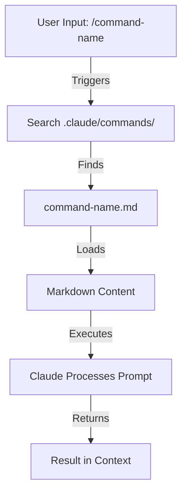

### 파일 구조

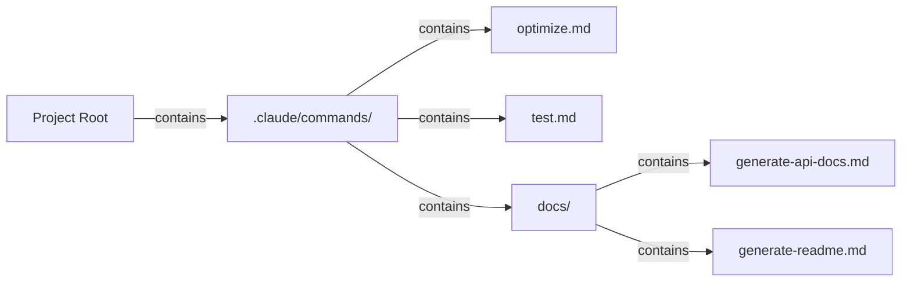

### 명령어 배치 위치 비교

| 배치 위치 | 범위 | 사용 가능 대상 | 사용 사례 | Git 관리 |
|----------|-------|--------------|----------|-------------|
| `.claude/commands/` | 프로젝트 전용 | 팀 구성원 | 팀 워크플로, 공유 표준 | ✅ 예 |
| `~/.claude/commands/` | 개인 | 사용자 본인 | 프로젝트를 넘나드는 개인 단축 명령 | ❌ 아니요 |
| 하위 디렉터리 | 네임스페이스 적용 | 상위 디렉터리를 따름 | 카테고리별 정리 | ✅ 예 |

### 기능과 사용 상황

| 기능 | 예 | 지원 |
|---------|---------|-----------|
| 셸 스크립트 실행 | `bash scripts/deploy.sh` | ✅ 예 |
| 파일 참조 | `@path/to/file.js` | ✅ 예 |
| Bash 통합 | `$(git log --oneline)` | ✅ 예 |
| 인수 | `/pr --verbose` | ✅ 예 |
| MCP 명령어 | `/mcp__github__list_prs` | ✅ 예 |

### 실제 예시

#### 예 1: 코드 최적화 명령어

**파일:** `.claude/commands/optimize.md`

```markdown
---
name: Code Optimization
description: Analyze code for performance issues and suggest optimizations
tags: performance, analysis
---

# Code Optimization

Review the provided code for the following issues in order of priority:

1. **Performance bottlenecks** - identify O(n²) operations, inefficient loops
2. **Memory leaks** - find unreleased resources, circular references
3. **Algorithm improvements** - suggest better algorithms or data structures
4. **Caching opportunities** - identify repeated computations
5. **Concurrency issues** - find race conditions or threading problems

Format your response with:
- Issue severity (Critical/High/Medium/Low)
- Location in code
- Explanation
- Recommended fix with code example
```

**사용법:**
```bash
# Claude Code에 입력
/optimize

# Claude가 프롬프트를 읽어 들이고 코드 입력을 기다립니다
```

#### 예 2: 풀 리퀘스트 보조 명령어

**파일:** `.claude/commands/pr.md`

```markdown
---
name: Prepare Pull Request
description: Clean up code, stage changes, and prepare a pull request
tags: git, workflow
---

# Pull Request Preparation Checklist

Before creating a PR, execute these steps:

1. Run linting: `prettier --write .`
2. Run tests: `npm test`
3. Review git diff: `git diff HEAD`
4. Stage changes: `git add .`
5. Create commit message following conventional commits:
   - `fix:` for bug fixes
   - `feat:` for new features
   - `docs:` for documentation
   - `refactor:` for code restructuring
   - `test:` for test additions
   - `chore:` for maintenance

6. Generate PR summary including:
   - What changed
   - Why it changed
   - Testing performed
   - Potential impacts
```

**사용법:**
```bash
/pr

# Claude가 체크리스트를 실행하고 PR을 준비합니다
```

#### 예 3: 계층형 문서 생성 명령어

**파일:** `.claude/commands/docs/generate-api-docs.md`

```markdown
---
name: Generate API Documentation
description: Create comprehensive API documentation from source code
tags: documentation, api
---

# API Documentation Generator

Generate API documentation by:

1. Scanning all files in `/src/api/`
2. Extracting function signatures and JSDoc comments
3. Organizing by endpoint/module
4. Creating markdown with examples
5. Including request/response schemas
6. Adding error documentation

Output format:
- Markdown file in `/docs/api.md`
- Include curl examples for all endpoints
- Add TypeScript types
```

### 명령어 생명 주기 다이어그램

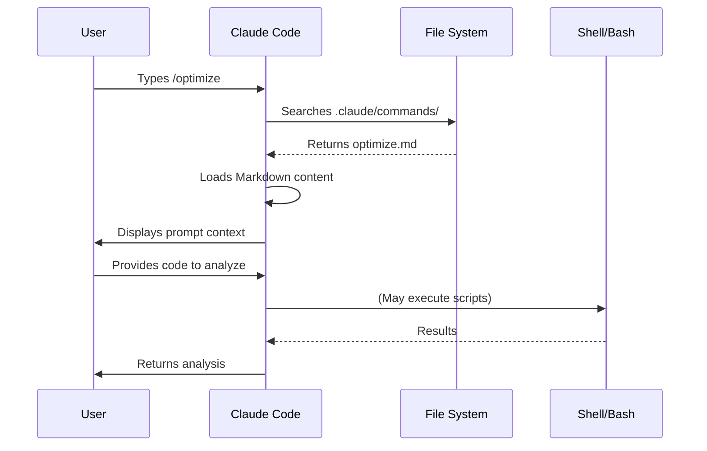

### 모범 사례

| ✅ 권장 | ❌ 비권장 |
|------|---------|
| 명확하고 동작 중심의 이름을 붙입니다 | 한 번만 쓸 작업을 명령어로 만듭니다 |
| description에 트리거 단어를 적습니다 | 명령어 안에 복잡한 로직을 넣습니다 |
| 하나의 작업에 초점을 맞춥니다 | 중복된 명령어를 만듭니다 |
| 프로젝트 명령어는 버전 관리합니다 | 민감한 정보를 하드코딩합니다 |
| 하위 디렉터리로 정리합니다 | 지나치게 긴 명령어 목록을 만듭니다 |
| 단순하고 읽기 쉬운 프롬프트를 작성합니다 | 약어나 난해한 표현을 사용합니다 |

---

## 서브에이전트

### 개요

서브에이전트는 독립된 컨텍스트 윈도우와 맞춤형 시스템 프롬프트를 갖는 전문 AI 어시스턴트입니다. 관심사의 분리를 유지하면서 작업을 위임할 수 있게 해 줍니다.

### 아키텍처 다이어그램

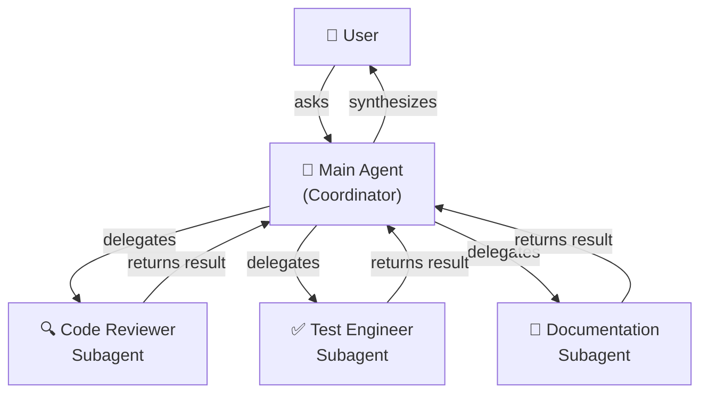

### 서브에이전트의 생명 주기

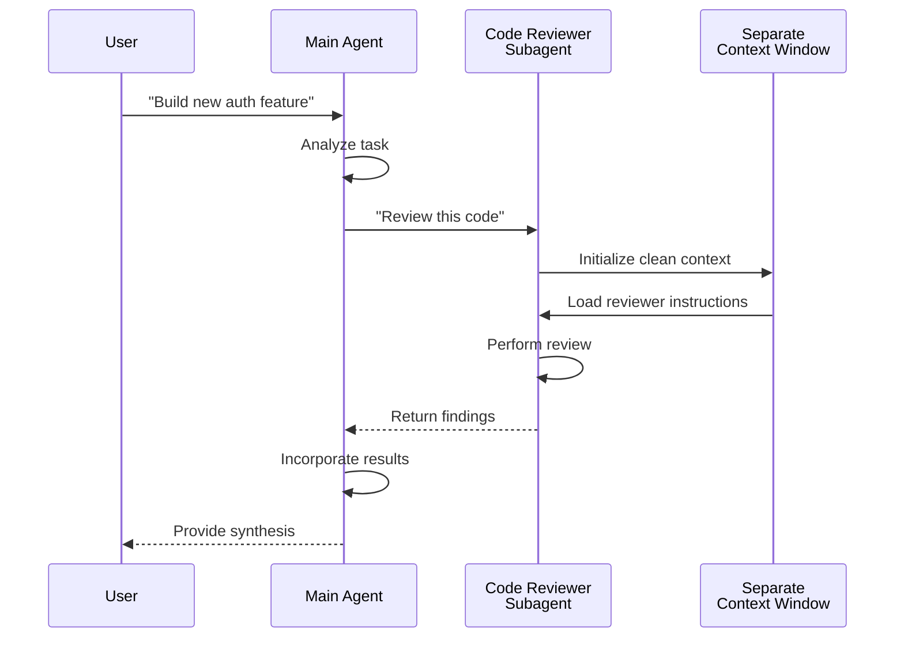

### 서브에이전트 설정 항목

| 설정 항목 | 타입 | 용도 | 예 |
|---------------|------|---------|---------|
| `name` | 문자열 | 에이전트 식별자 | `code-reviewer` |
| `description` | 문자열 | 용도와 트리거 단어 | `Comprehensive code quality analysis` |
| `tools` | 리스트 / 문자열 | 사용 가능한 도구 | `Read, Grep, Glob, Bash` |
| *(Markdown 본문)* | Markdown | 시스템 프롬프트 / 동작 지침 | 맞춤 가이드라인 |

### 도구 접근 계층

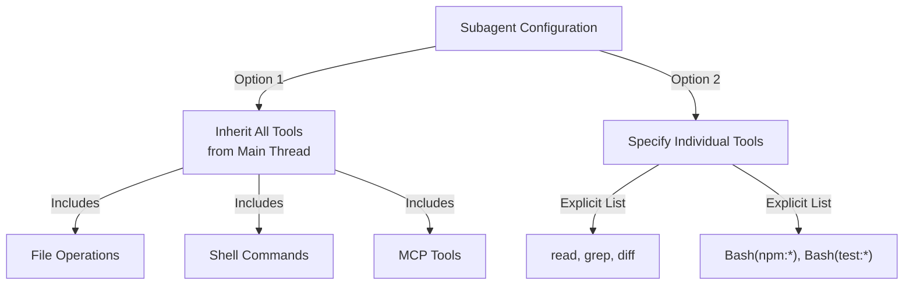

### 실제 예시

#### 예 1: 완전한 서브에이전트 설정

**파일:** `.claude/agents/code-reviewer.md`

```yaml
---
name: code-reviewer
description: Comprehensive code quality and maintainability analysis
tools: Read, Grep, Glob, Bash
---

# Code Reviewer Agent

You are an expert code reviewer specializing in:
- Performance optimization
- Security vulnerabilities
- Code maintainability
- Testing coverage
- Design patterns

## Review Priorities (in order)

1. **Security Issues** - Authentication, authorization, data exposure
2. **Performance Problems** - O(n²) operations, memory leaks, inefficient queries
3. **Code Quality** - Readability, naming, documentation
4. **Test Coverage** - Missing tests, edge cases
5. **Design Patterns** - SOLID principles, architecture

## Review Output Format

For each issue:
- **Severity**: Critical / High / Medium / Low
- **Category**: Security / Performance / Quality / Testing / Design
- **Location**: File path and line number
- **Issue Description**: What's wrong and why
- **Suggested Fix**: Code example
- **Impact**: How this affects the system

## Example Review

### Issue: N+1 Query Problem
- **Severity**: High
- **Category**: Performance
- **Location**: src/user-service.ts:45
- **Issue**: Loop executes database query in each iteration
- **Fix**: Use JOIN or batch query
```

**파일:** `.claude/agents/test-engineer.md`

```yaml
---
name: test-engineer
description: Test strategy, coverage analysis, and automated testing
tools: read, write, bash, grep
---

# Test Engineer Agent

You are expert at:
- Writing comprehensive test suites
- Ensuring high code coverage (>80%)
- Testing edge cases and error scenarios
- Performance benchmarking
- Integration testing

## Testing Strategy

1. **Unit Tests** - Individual functions/methods
2. **Integration Tests** - Component interactions
3. **End-to-End Tests** - Complete workflows
4. **Edge Cases** - Boundary conditions
5. **Error Scenarios** - Failure handling

## Test Output Requirements

- Use Jest for JavaScript/TypeScript
- Include setup/teardown for each test
- Mock external dependencies
- Document test purpose
- Include performance assertions when relevant

## Coverage Requirements

- Minimum 80% code coverage
- 100% for critical paths
- Report missing coverage areas
```

**파일:** `.claude/agents/documentation-writer.md`

```yaml
---
name: documentation-writer
description: Technical documentation, API docs, and user guides
tools: read, write, grep
---

# Documentation Writer Agent

You create:
- API documentation with examples
- User guides and tutorials
- Architecture documentation
- Changelog entries
- Code comment improvements

## Documentation Standards

1. **Clarity** - Use simple, clear language
2. **Examples** - Include practical code examples
3. **Completeness** - Cover all parameters and returns
4. **Structure** - Use consistent formatting
5. **Accuracy** - Verify against actual code

## Documentation Sections

### For APIs
- Description
- Parameters (with types)
- Returns (with types)
- Throws (possible errors)
- Examples (curl, JavaScript, Python)
- Related endpoints

### For Features
- Overview
- Prerequisites
- Step-by-step instructions
- Expected outcomes
- Troubleshooting
- Related topics
```

#### 예 2: 서브에이전트 위임 실제 예시

```markdown
# 시나리오: 결제 기능 구축

## 사용자 요청
"Stripe와 통합된 안전한 결제 처리 기능을 구축해 주세요"

## 메인 에이전트의 흐름

1. **계획 단계**
   - 요구 사항을 이해합니다
   - 필요한 작업을 식별합니다
   - 아키텍처를 설계합니다

2. **코드 리뷰어 서브에이전트에 위임**
   - 작업: "결제 처리 구현을 보안 관점에서 리뷰하라"
   - 컨텍스트: 인증, API 키, 토큰 처리
   - 리뷰 대상: SQL 인젝션, 키 유출, HTTPS 강제

3. **테스트 엔지니어 서브에이전트에 위임**
   - 작업: "결제 흐름의 포괄적인 테스트를 작성하라"
   - 컨텍스트: 성공·실패·엣지 케이스
   - 작성할 테스트: 정상 결제, 카드 거절, 네트워크 장애, Webhook

4. **문서 작성자 서브에이전트에 위임**
   - 작업: "결제 API 엔드포인트를 문서화하라"
   - 컨텍스트: 요청·응답 스키마
   - 산출물: curl 예시와 오류 코드가 포함된 API 문서

5. **통합**
   - 메인 에이전트가 모든 출력을 모읍니다
   - 결과를 통합합니다
   - 완성된 솔루션을 사용자에게 돌려줍니다
```

#### 예 3: 도구 권한 범위 설정

**제한적 설정 — 특정 명령어만 허용**

```yaml
---
name: secure-reviewer
description: Security-focused code review with minimal permissions
tools: read, grep
---

# Secure Code Reviewer

Reviews code for security vulnerabilities only.

This agent:
- ✅ Reads files to analyze
- ✅ Searches for patterns
- ❌ Cannot execute code
- ❌ Cannot modify files
- ❌ Cannot run tests

This ensures the reviewer doesn't accidentally break anything.
```

**확장 설정 — 구현용으로 모든 도구 허용**

```yaml
---
name: implementation-agent
description: Full implementation capabilities for feature development
tools: read, write, bash, grep, edit, glob
---

# Implementation Agent

Builds features from specifications.

This agent:
- ✅ Reads specifications
- ✅ Writes new code files
- ✅ Runs build commands
- ✅ Searches codebase
- ✅ Edits existing files
- ✅ Finds files matching patterns

Full capabilities for independent feature development.
```

### 서브에이전트의 컨텍스트 관리

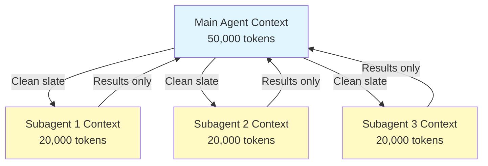

### 서브에이전트를 써야 하는 상황

| 시나리오 | 서브에이전트 사용 | 이유 |
|----------|--------------|-----|
| 여러 단계로 이루어진 복잡한 기능 | ✅ 예 | 관심사를 분리하고 컨텍스트 오염을 막습니다 |
| 간단한 코드 리뷰 | ❌ 아니요 | 오버헤드에 비해 이점이 적습니다 |
| 병렬 작업 실행 | ✅ 예 | 각 서브에이전트가 독립된 컨텍스트를 가집니다 |
| 전문 지식이 필요 | ✅ 예 | 맞춤 시스템 프롬프트를 사용할 수 있습니다 |
| 장시간 분석 | ✅ 예 | 메인 컨텍스트 고갈을 막습니다 |
| 단일 작업 | ❌ 아니요 | 불필요한 지연이 생깁니다 |

### Agent Teams

Agent Teams는 서로 관련된 작업을 맡은 여러 에이전트를 협조적으로 동작시킵니다. 서브에이전트에 하나씩 위임하는 대신, 메인 에이전트가 여러 에이전트 그룹을 오케스트레이션하고 중간 결과를 공유하면서 공통 목표로 향하게 합니다. 프런트엔드 에이전트·백엔드 에이전트·테스트 에이전트가 병렬로 움직이는 풀스택 기능 개발 같은 대규모 작업에 효과적입니다.

---

## 메모리

### 개요

메모리는 세션과 대화를 넘나들며 Claude가 컨텍스트를 유지하게 하는 장치입니다. 형식은 2가지로, claude.ai의 자동 합성과 Claude Code의 파일 시스템 기반 CLAUDE.md가 있습니다.

### 메모리 아키텍처

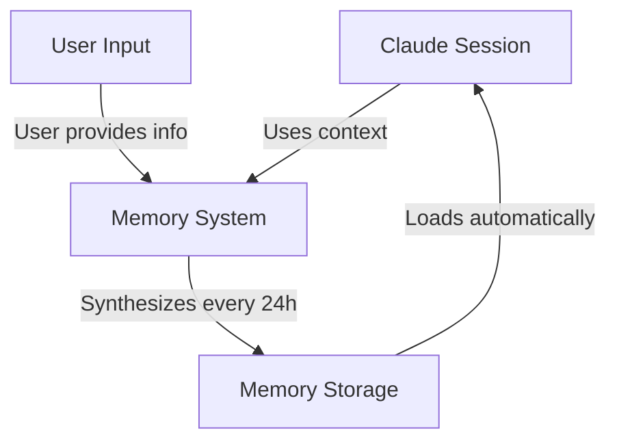

### Claude Code의 메모리 계층(7층)

Claude Code는 7개 계층에서 메모리를 읽어 들입니다. CLAUDE.md 파일은 서로 덮어쓰지 않고 컨텍스트에 이어 붙여지며, managed → user → project → local 순으로 읽힙니다(더 구체적인 파일일수록 나중에 읽힙니다):

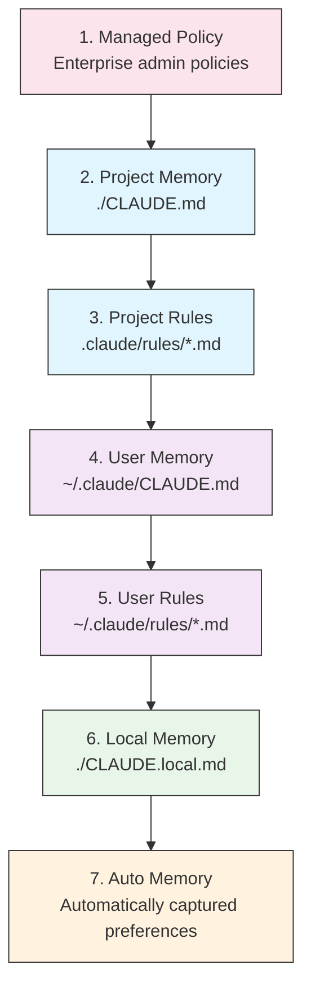

### 메모리 배치 위치 목록

| 계층 | 배치 위치 | 범위 | 우선순위 | 공유 | 용도 |
|------|----------|-------|----------|--------|----------|
| 1. Managed Policy | 엔터프라이즈 관리자 | 조직 | 최고 | 조직 전원 | 컴플라이언스, 보안 정책 |
| 2. Project | `./CLAUDE.md` | 프로젝트 | 높음 | 팀(Git) | 팀 표준, 아키텍처 |
| 3. Project Rules | `.claude/rules/*.md` | 프로젝트 | 높음 | 팀(Git) | 프로젝트 규약의 모듈화 |
| 4. User | `~/.claude/CLAUDE.md` | 개인 | 중간 | 개인 | 개인 선호 |
| 5. User Rules | `~/.claude/rules/*.md` | 개인 | 중간 | 개인 | 개인 규칙의 모듈화 |
| 6. Local | `./CLAUDE.local.md` | 로컬 | 낮음 | 공유 안 함 | 머신별 설정 |
| 7. Auto Memory | 자동 | 저장소 단위 | 최저 | 개인 | 학습된 선호·패턴 |

### Auto Memory

Auto Memory는 세션 중에 관찰된 사용자의 선호와 패턴을 자동으로 가져옵니다. Claude는 상호작용에서 학습해 다음과 같은 정보를 기억합니다:

- 코딩 스타일 선호
- 사용자가 자주 하는 수정
- 프레임워크·도구 선택
- 커뮤니케이션 스타일 선호

Auto Memory는 백그라운드에서 동작하며 수동 설정이 필요 없습니다.

### 메모리 업데이트 생명 주기

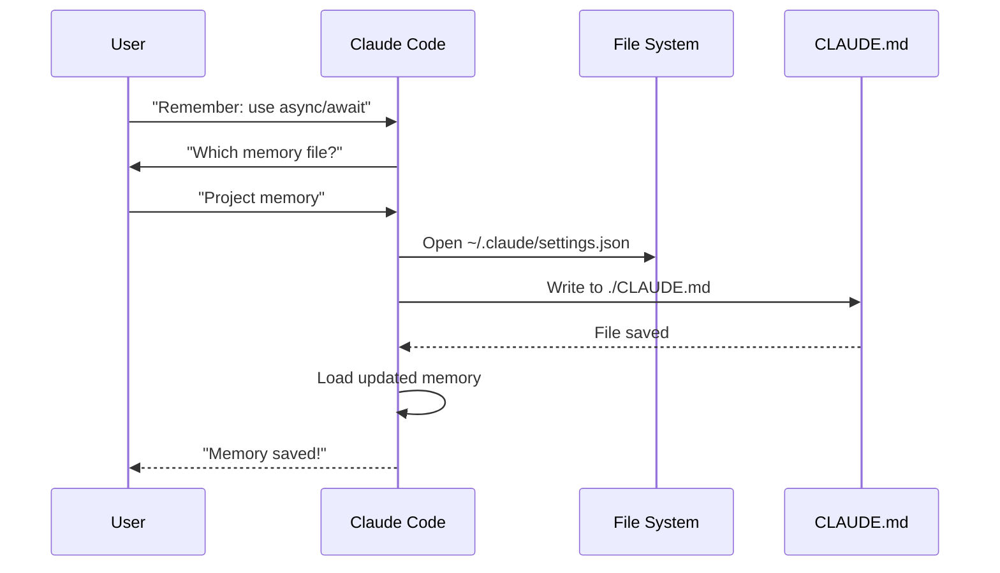

### 실제 예시

#### 예 1: 프로젝트 메모리 구조

**파일:** `./CLAUDE.md`

```markdown
# Project Configuration

## Project Overview
- **Name**: E-commerce Platform
- **Tech Stack**: Node.js, PostgreSQL, React 18, Docker
- **Team Size**: 5 developers
- **Deadline**: Q4 2025

## Architecture
@docs/architecture.md
@docs/api-standards.md
@docs/database-schema.md

## Development Standards

### Code Style
- Use Prettier for formatting
- Use ESLint with airbnb config
- Maximum line length: 100 characters
- Use 2-space indentation

### Naming Conventions
- **Files**: kebab-case (user-controller.js)
- **Classes**: PascalCase (UserService)
- **Functions/Variables**: camelCase (getUserById)
- **Constants**: UPPER_SNAKE_CASE (API_BASE_URL)
- **Database Tables**: snake_case (user_accounts)

### Git Workflow
- Branch names: `feature/description` or `fix/description`
- Commit messages: Follow conventional commits
- PR required before merge
- All CI/CD checks must pass
- Minimum 1 approval required

### Testing Requirements
- Minimum 80% code coverage
- All critical paths must have tests
- Use Jest for unit tests
- Use Cypress for E2E tests
- Test filenames: `*.test.ts` or `*.spec.ts`

### API Standards
- RESTful endpoints only
- JSON request/response
- Use HTTP status codes correctly
- Version API endpoints: `/api/v1/`
- Document all endpoints with examples

### Database
- Use migrations for schema changes
- Never hardcode credentials
- Use connection pooling
- Enable query logging in development
- Regular backups required

### Deployment
- Docker-based deployment
- Kubernetes orchestration
- Blue-green deployment strategy
- Automatic rollback on failure
- Database migrations run before deploy

## Common Commands

| Command | Purpose |
|---------|---------|
| `npm run dev` | Start development server |
| `npm test` | Run test suite |
| `npm run lint` | Check code style |
| `npm run build` | Build for production |
| `npm run migrate` | Run database migrations |

## Team Contacts
- Tech Lead: Sarah Chen (@sarah.chen)
- Product Manager: Mike Johnson (@mike.j)
- DevOps: Alex Kim (@alex.k)

## Known Issues & Workarounds
- PostgreSQL connection pooling limited to 20 during peak hours
- Workaround: Implement query queuing
- Safari 14 compatibility issues with async generators
- Workaround: Use Babel transpiler

## Related Projects
- Analytics Dashboard: `/projects/analytics`
- Mobile App: `/projects/mobile`
- Admin Panel: `/projects/admin`
```

#### 예 2: 디렉터리별 메모리

**파일:** `./src/api/CLAUDE.md`

~~~~markdown
# API Module Standards

This file overrides root CLAUDE.md for everything in /src/api/

## API-Specific Standards

### Request Validation
- Use Zod for schema validation
- Always validate input
- Return 400 with validation errors
- Include field-level error details

### Authentication
- All endpoints require JWT token
- Token in Authorization header
- Token expires after 24 hours
- Implement refresh token mechanism

### Response Format

All responses must follow this structure:

```json
{
  "success": true,
  "data": { /* actual data */ },
  "timestamp": "2025-11-06T10:30:00Z",
  "version": "1.0"
}
```

### Error responses:
```json
{
  "success": false,
  "error": {
    "code": "VALIDATION_ERROR",
    "message": "User message",
    "details": { /* field errors */ }
  },
  "timestamp": "2025-11-06T10:30:00Z"
}
```

### Pagination
- Use cursor-based pagination (not offset)
- Include `hasMore` boolean
- Limit max page size to 100
- Default page size: 20

### Rate Limiting
- 1000 requests per hour for authenticated users
- 100 requests per hour for public endpoints
- Return 429 when exceeded
- Include retry-after header

### Caching
- Use Redis for session caching
- Cache duration: 5 minutes default
- Invalidate on write operations
- Tag cache keys with resource type
~~~~

#### 예 3: 개인 메모리

**파일:** `~/.claude/CLAUDE.md`

~~~~markdown
# My Development Preferences

## About Me
- **Experience Level**: 8 years full-stack development
- **Preferred Languages**: TypeScript, Python
- **Communication Style**: Direct, with examples
- **Learning Style**: Visual diagrams with code

## Code Preferences

### Error Handling
I prefer explicit error handling with try-catch blocks and meaningful error messages.
Avoid generic errors. Always log errors for debugging.

### Comments
Use comments for WHY, not WHAT. Code should be self-documenting.
Comments should explain business logic or non-obvious decisions.

### Testing
I prefer TDD (test-driven development).
Write tests first, then implementation.
Focus on behavior, not implementation details.

### Architecture
I prefer modular, loosely-coupled design.
Use dependency injection for testability.
Separate concerns (Controllers, Services, Repositories).

## Debugging Preferences
- Use console.log with prefix: `[DEBUG]`
- Include context: function name, relevant variables
- Use stack traces when available
- Always include timestamps in logs

## Communication
- Explain complex concepts with diagrams
- Show concrete examples before explaining theory
- Include before/after code snippets
- Summarize key points at the end

## Project Organization
I organize my projects as:
```
project/
  ├── src/
  │   ├── api/
  │   ├── services/
  │   ├── models/
  │   └── utils/
  ├── tests/
  ├── docs/
  └── docker/
```

## Tooling
- **IDE**: VS Code with vim keybindings
- **Terminal**: Zsh with Oh-My-Zsh
- **Format**: Prettier (100 char line length)
- **Linter**: ESLint with airbnb config
- **Test Framework**: Jest with React Testing Library
~~~~

#### 예 4: 세션 중 메모리 업데이트

**세션 중 상호작용:**

```markdown
User: Remember that I prefer using React hooks instead of class components
     for all new components.

Claude: I'm adding that to your memory. Which memory file should this go in?
        1. Project memory (./CLAUDE.md)
        2. Personal memory (~/.claude/CLAUDE.md)

User: Project memory

Claude: ✅ Memory saved!

Added to ./CLAUDE.md:
---

### Component Development
- Use functional components with React Hooks
- Prefer hooks over class components
- Custom hooks for reusable logic
- Use useCallback for event handlers
- Use useMemo for expensive computations
```

### Claude Web / Desktop의 메모리

#### 메모리 합성 타임라인


**메모리 요약 예시:**

```markdown
## Claude's Memory of User

### Professional Background
- Senior full-stack developer with 8 years experience
- Focus on TypeScript/Node.js backends and React frontends
- Active open source contributor
- Interested in AI and machine learning

### Project Context
- Currently building e-commerce platform
- Tech stack: Node.js, PostgreSQL, React 18, Docker
- Working with team of 5 developers
- Using CI/CD and blue-green deployments

### Communication Preferences
- Prefers direct, concise explanations
- Likes visual diagrams and examples
- Appreciates code snippets
- Explains business logic in comments

### Current Goals
- Improve API performance
- Increase test coverage to 90%
- Implement caching strategy
- Document architecture
```

### 메모리 기능 비교

| 기능 | Claude Web / Desktop | Claude Code(CLAUDE.md) |
|---------|-------------------|------------------------|
| 자동 합성 | ✅ 24시간마다 | ❌ 수동 |
| 프로젝트 간 공유 | ✅ 공유 | ❌ 프로젝트 전용 |
| 팀 접근 | ✅ 공유 프로젝트 | ✅ Git 관리 |
| 검색 가능 | ✅ 기본 기능 | ✅ `/memory`로 |
| 편집 가능 | ✅ 채팅 안에서 | ✅ 파일 직접 편집 |
| 가져오기 / 내보내기 | ✅ 가능 | ✅ 복사 & 붙여넣기 |
| 지속성 | ✅ 24시간 이상 | ✅ 무기한 |

---

## MCP 프로토콜

### 개요

MCP(Model Context Protocol)는 Claude가 외부 도구·API·실시간 데이터 소스에 접근하기 위한 표준화된 방식입니다. 메모리와 달리 MCP는 변화하는 데이터에 대한 실시간 접근을 제공합니다.

### MCP 아키텍처

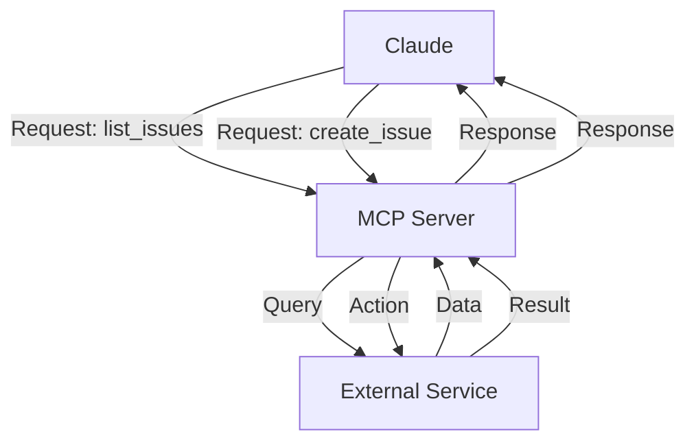

### MCP 생태계

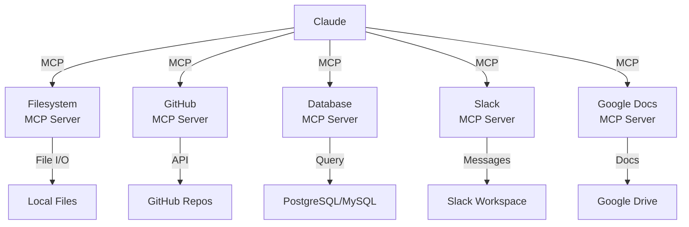

### MCP 설정 절차

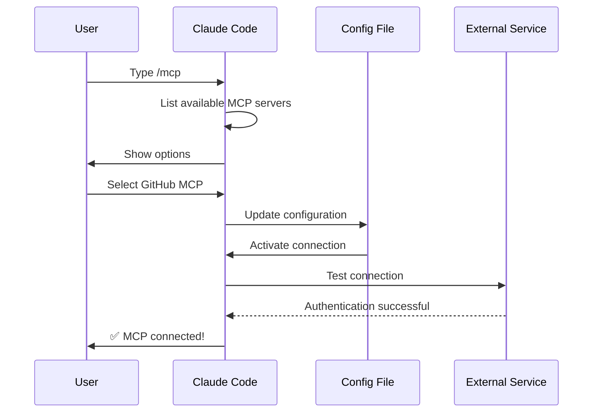

### 사용 가능한 MCP 서버 목록

| MCP 서버 | 용도 | 주요 도구 | 인증 | 실시간 |
|------------|---------|--------------|------|-----------|
| **Filesystem** | 파일 조작 | read, write, delete | OS 권한 | ✅ 예 |
| **GitHub** | 저장소 관리 | list_prs, create_issue, push | OAuth | ✅ 예 |
| **Slack** | 팀 커뮤니케이션 | send_message, list_channels | 토큰 | ✅ 예 |
| **Database** | SQL 쿼리 | query, insert, update | 인증 정보 | ✅ 예 |
| **Google Docs** | 문서 접근 | read, write, share | OAuth | ✅ 예 |
| **Asana** | 프로젝트 관리 | create_task, update_status | API 키 | ✅ 예 |
| **Stripe** | 결제 데이터 | list_charges, create_invoice | API 키 | ✅ 예 |
| **Memory** | 영구 메모리 | store, retrieve, delete | 로컬 | ❌ 아니요 |

### 실제 예시

#### 예 1: GitHub MCP 설정

**파일:** `.mcp.json`(프로젝트 범위) 또는 `~/.claude.json`(사용자 범위)

```json
{
  "mcpServers": {
    "github": {
      "command": "npx",
      "args": ["@modelcontextprotocol/server-github"],
      "env": {
        "GITHUB_TOKEN": "${GITHUB_TOKEN}"
      }
    }
  }
}
```

**사용 가능한 GitHub MCP 도구:**

~~~~markdown
# GitHub MCP Tools

## Pull Request Management
- `list_prs` - List all PRs in repository
- `get_pr` - Get PR details including diff
- `create_pr` - Create new PR
- `update_pr` - Update PR description/title
- `merge_pr` - Merge PR to main branch
- `review_pr` - Add review comments

Example request:
```
/mcp__github__get_pr 456

# Returns:
Title: Add dark mode support
Author: @alice
Description: Implements dark theme using CSS variables
Status: OPEN
Reviewers: @bob, @charlie
```

## Issue Management
- `list_issues` - List all issues
- `get_issue` - Get issue details
- `create_issue` - Create new issue
- `close_issue` - Close issue
- `add_comment` - Add comment to issue

## Repository Information
- `get_repo_info` - Repository details
- `list_files` - File tree structure
- `get_file_content` - Read file contents
- `search_code` - Search across codebase

## Commit Operations
- `list_commits` - Commit history
- `get_commit` - Specific commit details
- `create_commit` - Create new commit
~~~~

#### 예 2: 여러 MCP를 조합한 워크플로

**시나리오: 일일 리포트 생성**

```markdown
# Daily Report Workflow using Multiple MCPs

## Setup
1. GitHub MCP - fetch PR metrics
2. Database MCP - query sales data
3. Slack MCP - post report
4. Filesystem MCP - save report

## Workflow

### Step 1: Fetch GitHub Data
/mcp__github__list_prs completed:true last:7days

Output:
- Total PRs: 42
- Average merge time: 2.3 hours
- Review turnaround: 1.1 hours

### Step 2: Query Database
SELECT COUNT(*) as sales, SUM(amount) as revenue
FROM orders
WHERE created_at > NOW() - INTERVAL '1 day'

Output:
- Sales: 247
- Revenue: $12,450

### Step 3: Generate Report
Combine data into HTML report

### Step 4: Save to Filesystem
Write report.html to /reports/

### Step 5: Post to Slack
Send summary to #daily-reports channel

Final Output:
✅ Report generated and posted
📊 42 PRs merged this week
💰 $12,450 in daily sales
```

#### 예 3: Filesystem MCP 조작

**설정:**

```json
{
  "mcpServers": {
    "filesystem": {
      "command": "npx",
      "args": ["@modelcontextprotocol/server-filesystem", "/home/user/projects"]
    }
  }
}
```

**사용 가능한 조작:**

| 조작 | 명령어 | 용도 |
|-----------|---------|---------|
| 파일 목록 | `ls ~/projects` | 디렉터리 내용을 표시 |
| 파일 읽기 | `cat src/main.ts` | 내용을 읽기 |
| 파일 생성 | `create docs/api.md` | 새 파일 생성 |
| 파일 편집 | `edit src/app.ts` | 파일을 변경 |
| 검색 | `grep "async function"` | 파일 내 검색 |
| 삭제 | `rm old-file.js` | 파일 삭제 |

### MCP vs 메모리: 판단 매트릭스

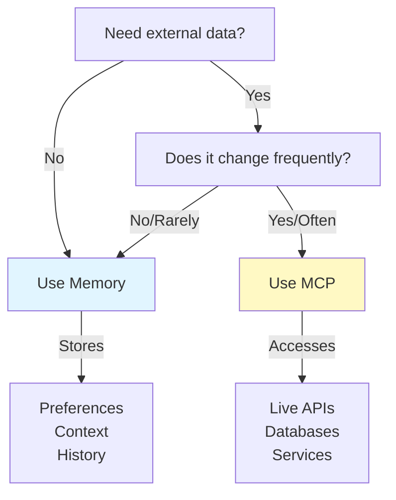

### 요청·응답 패턴

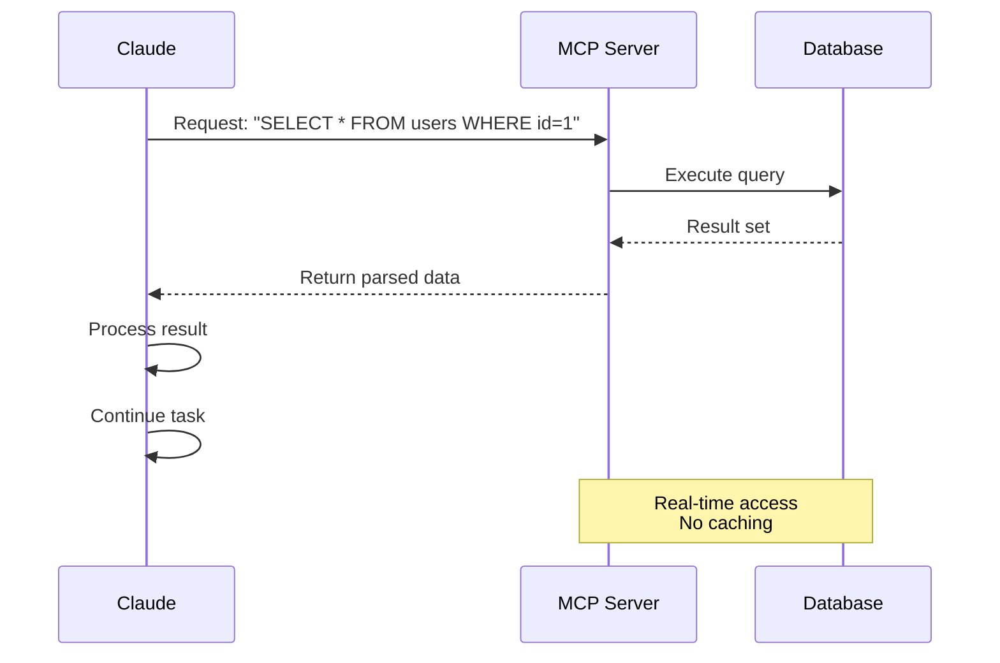

---

## Agent Skills

### 개요

Agent Skills는 지시문·스크립트·리소스를 폴더에 함께 담은, 재사용 가능하며 모델이 자율적으로 호출하는 능력입니다. Claude는 관련 스킬을 자동으로 찾아 활용합니다.

### 스킬 아키텍처

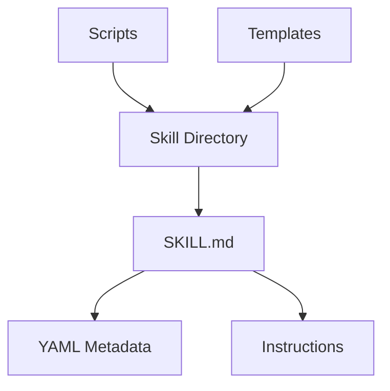

### 스킬 로딩 절차

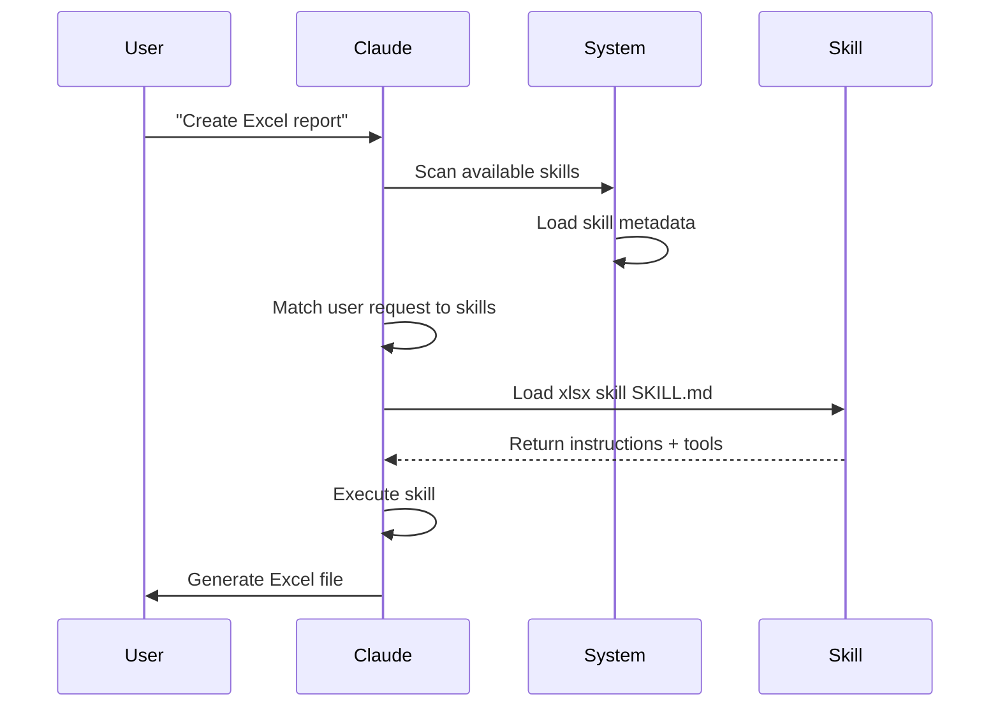

### 스킬의 종류와 배치 위치

| 종류 | 배치 위치 | 범위 | 공유 | 동기화 | 용도 |
|------|----------|-------|--------|------|----------|
| 사전 구축 | 내장 | 전역 | 모든 사용자 | 자동 | 문서 생성 |
| 개인 | `~/.claude/skills/` | 개인 | 없음 | 수동 | 개인 자동화 |
| 프로젝트 | `.claude/skills/` | 팀 | 있음 | Git | 팀 표준 |
| 플러그인 | 플러그인을 통해 | 상황에 따름 | 상황에 따름 | 자동 | 통합 기능 |

### 사전 구축 스킬

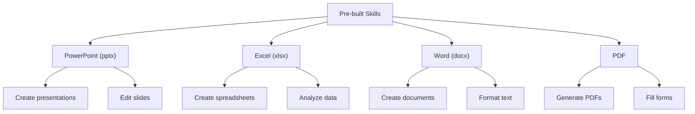

### 번들 스킬

Claude Code에는 기본으로 20개의 번들 스킬이 포함되어 있습니다:

| 스킬 | 명령어 | 용도 |
|-------|---------|---------|
| **Simplify** | `/simplify` | 복잡한 코드나 설명을 단순화 |
| **Batch** | `/batch` | 여러 파일·항목에 대한 일괄 작업 |
| **Debug** | `/debug` | 현재 세션의 디버그 로그를 켜고, 그 로그를 읽어 문제를 조사 |
| **Loop** | `/loop` | 타이머로 정기 실행 |
| **Claude API** | `/claude-api` | 프로젝트 언어에 맞는 Claude API와 Managed Agents 레퍼런스를 읽어 들임. 코드가 `anthropic` 또는 `@anthropic-ai/sdk`를 import하면 자동으로 활성화 |

이 번들 스킬은 항상 사용할 수 있으며 설치나 설정이 필요 없습니다.

### 실제 예시

#### 예 1: 맞춤 코드 리뷰 스킬

**디렉터리 구성:**

```
~/.claude/skills/code-review/
├── SKILL.md
├── templates/
│   ├── review-checklist.md
│   └── finding-template.md
└── scripts/
    ├── analyze-metrics.py
    └── compare-complexity.py
```

**파일:** `~/.claude/skills/code-review/SKILL.md`

```yaml
---
name: Code Review Specialist
description: Comprehensive code review with security, performance, and quality analysis
version: "1.0.0"
tags:
  - code-review
  - quality
  - security
when_to_use: When users ask to review code, analyze code quality, or evaluate pull requests
effort: high
shell: bash
---

# Code Review Skill

This skill provides comprehensive code review capabilities focusing on:

1. **Security Analysis**
   - Authentication/authorization issues
   - Data exposure risks
   - Injection vulnerabilities
   - Cryptographic weaknesses
   - Sensitive data logging

2. **Performance Review**
   - Algorithm efficiency (Big O analysis)
   - Memory optimization
   - Database query optimization
   - Caching opportunities
   - Concurrency issues

3. **Code Quality**
   - SOLID principles
   - Design patterns
   - Naming conventions
   - Documentation
   - Test coverage

4. **Maintainability**
   - Code readability
   - Function size (should be < 50 lines)
   - Cyclomatic complexity
   - Dependency management
   - Type safety

## Review Template

For each piece of code reviewed, provide:

### Summary
- Overall quality assessment (1-5)
- Key findings count
- Recommended priority areas

### Critical Issues (if any)
- **Issue**: Clear description
- **Location**: File and line number
- **Impact**: Why this matters
- **Severity**: Critical/High/Medium
- **Fix**: Code example

### Findings by Category

#### Security (if issues found)
List security vulnerabilities with examples

#### Performance (if issues found)
List performance problems with complexity analysis

#### Quality (if issues found)
List code quality issues with refactoring suggestions

#### Maintainability (if issues found)
List maintainability problems with improvements
```

## Python 스크립트: analyze-metrics.py

```python
#!/usr/bin/env python3
import re
import sys

def analyze_code_metrics(code):
    """코드의 일반적인 메트릭을 분석합니다."""

    # 함수 수를 셉니다
    functions = len(re.findall(r'^def\s+\w+', code, re.MULTILINE))

    # 클래스 수를 셉니다
    classes = len(re.findall(r'^class\s+\w+', code, re.MULTILINE))

    # 평균 줄 길이
    lines = code.split('\n')
    avg_length = sum(len(l) for l in lines) / len(lines) if lines else 0

    # 복잡도 추정
    complexity = len(re.findall(r'\b(if|elif|else|for|while|and|or)\b', code))

    return {
        'functions': functions,
        'classes': classes,
        'avg_line_length': avg_length,
        'complexity_score': complexity
    }

if __name__ == '__main__':
    with open(sys.argv[1], 'r') as f:
        code = f.read()
    metrics = analyze_code_metrics(code)
    for key, value in metrics.items():
        print(f"{key}: {value:.2f}")
```

## Python 스크립트: compare-complexity.py

```python
#!/usr/bin/env python3
"""
변경 전후의 코드 순환 복잡도를 비교합니다.
리팩터링이 실제로 구조를 단순화했는지 확인하는 데 유용합니다.
"""

import re
import sys
from typing import Dict, Tuple

class ComplexityAnalyzer:
    """코드의 복잡도 메트릭을 분석합니다."""

    def __init__(self, code: str):
        self.code = code
        self.lines = code.split('\n')

    def calculate_cyclomatic_complexity(self) -> int:
        """
        McCabe 방식으로 순환 복잡도를 계산합니다.
        판정 지점을 셉니다: if, elif, else, for, while, except, and, or
        """
        complexity = 1  # 기본 복잡도

        # 판정 지점을 셉니다
        decision_patterns = [
            r'\bif\b',
            r'\belif\b',
            r'\bfor\b',
            r'\bwhile\b',
            r'\bexcept\b',
            r'\band\b(?!$)',
            r'\bor\b(?!$)'
        ]

        for pattern in decision_patterns:
            matches = re.findall(pattern, self.code)
            complexity += len(matches)

        return complexity

    def calculate_cognitive_complexity(self) -> int:
        """
        인지 복잡도를 계산합니다 — 이해하기 어려운 정도.
        중첩 깊이와 제어 흐름을 기준으로 합니다.
        """
        cognitive = 0
        nesting_depth = 0

        for line in self.lines:
            # 중첩 깊이를 추적합니다
            if re.search(r'^\s*(if|for|while|def|class|try)\b', line):
                nesting_depth += 1
                cognitive += nesting_depth
            elif re.search(r'^\s*(elif|else|except|finally)\b', line):
                cognitive += nesting_depth

            # 들여쓰기가 해제되면 중첩을 줄입니다
            if line and not line[0].isspace():
                nesting_depth = 0

        return cognitive

    def calculate_maintainability_index(self) -> float:
        """
        유지보수성 지수(0~100).
        > 85: 우수
        > 65: 양호
        > 50: 보통
        < 50: 불량
        """
        lines = len(self.lines)
        cyclomatic = self.calculate_cyclomatic_complexity()
        cognitive = self.calculate_cognitive_complexity()

        # 단순화한 MI 계산
        mi = 171 - 5.2 * (cyclomatic / lines) - 0.23 * (cognitive) - 16.2 * (lines / 1000)

        return max(0, min(100, mi))

    def get_complexity_report(self) -> Dict:
        """포괄적인 복잡도 리포트를 생성합니다."""
        return {
            'cyclomatic_complexity': self.calculate_cyclomatic_complexity(),
            'cognitive_complexity': self.calculate_cognitive_complexity(),
            'maintainability_index': round(self.calculate_maintainability_index(), 2),
            'lines_of_code': len(self.lines),
            'avg_line_length': round(sum(len(l) for l in self.lines) / len(self.lines), 2) if self.lines else 0
        }


def compare_files(before_file: str, after_file: str) -> None:
    """두 코드 버전의 복잡도 메트릭을 비교합니다."""

    with open(before_file, 'r') as f:
        before_code = f.read()

    with open(after_file, 'r') as f:
        after_code = f.read()

    before_analyzer = ComplexityAnalyzer(before_code)
    after_analyzer = ComplexityAnalyzer(after_code)

    before_metrics = before_analyzer.get_complexity_report()
    after_metrics = after_analyzer.get_complexity_report()

    print("=" * 60)
    print("CODE COMPLEXITY COMPARISON")
    print("=" * 60)

    print("\nBEFORE:")
    print(f"  Cyclomatic Complexity:    {before_metrics['cyclomatic_complexity']}")
    print(f"  Cognitive Complexity:     {before_metrics['cognitive_complexity']}")
    print(f"  Maintainability Index:    {before_metrics['maintainability_index']}")
    print(f"  Lines of Code:            {before_metrics['lines_of_code']}")
    print(f"  Avg Line Length:          {before_metrics['avg_line_length']}")

    print("\nAFTER:")
    print(f"  Cyclomatic Complexity:    {after_metrics['cyclomatic_complexity']}")
    print(f"  Cognitive Complexity:     {after_metrics['cognitive_complexity']}")
    print(f"  Maintainability Index:    {after_metrics['maintainability_index']}")
    print(f"  Lines of Code:            {after_metrics['lines_of_code']}")
    print(f"  Avg Line Length:          {after_metrics['avg_line_length']}")

    print("\nCHANGES:")
    cyclomatic_change = after_metrics['cyclomatic_complexity'] - before_metrics['cyclomatic_complexity']
    cognitive_change = after_metrics['cognitive_complexity'] - before_metrics['cognitive_complexity']
    mi_change = after_metrics['maintainability_index'] - before_metrics['maintainability_index']
    loc_change = after_metrics['lines_of_code'] - before_metrics['lines_of_code']

    print(f"  Cyclomatic Complexity:    {cyclomatic_change:+d}")
    print(f"  Cognitive Complexity:     {cognitive_change:+d}")
    print(f"  Maintainability Index:    {mi_change:+.2f}")
    print(f"  Lines of Code:            {loc_change:+d}")

    print("\nASSESSMENT:")
    if mi_change > 0:
        print("  ✅ Code is MORE maintainable")
    elif mi_change < 0:
        print("  ⚠️  Code is LESS maintainable")
    else:
        print("  ➡️  Maintainability unchanged")

    if cyclomatic_change < 0:
        print("  ✅ Complexity DECREASED")
    elif cyclomatic_change > 0:
        print("  ⚠️  Complexity INCREASED")
    else:
        print("  ➡️  Complexity unchanged")

    print("=" * 60)


if __name__ == '__main__':
    if len(sys.argv) != 3:
        print("Usage: python compare-complexity.py <before_file> <after_file>")
        sys.exit(1)

    compare_files(sys.argv[1], sys.argv[2])
```

## 템플릿: review-checklist.md

```markdown
# Code Review Checklist

## Security Checklist
- [ ] No hardcoded credentials or secrets
- [ ] Input validation on all user inputs
- [ ] SQL injection prevention (parameterized queries)
- [ ] CSRF protection on state-changing operations
- [ ] XSS prevention with proper escaping
- [ ] Authentication checks on protected endpoints
- [ ] Authorization checks on resources
- [ ] Secure password hashing (bcrypt, argon2)
- [ ] No sensitive data in logs
- [ ] HTTPS enforced

## Performance Checklist
- [ ] No N+1 queries
- [ ] Appropriate use of indexes
- [ ] Caching implemented where beneficial
- [ ] No blocking operations on main thread
- [ ] Async/await used correctly
- [ ] Large datasets paginated
- [ ] Database connections pooled
- [ ] Regular expressions optimized
- [ ] No unnecessary object creation
- [ ] Memory leaks prevented

## Quality Checklist
- [ ] Functions < 50 lines
- [ ] Clear variable naming
- [ ] No duplicate code
- [ ] Proper error handling
- [ ] Comments explain WHY, not WHAT
- [ ] No console.logs in production
- [ ] Type checking (TypeScript/JSDoc)
- [ ] SOLID principles followed
- [ ] Design patterns applied correctly
- [ ] Self-documenting code

## Testing Checklist
- [ ] Unit tests written
- [ ] Edge cases covered
- [ ] Error scenarios tested
- [ ] Integration tests present
- [ ] Coverage > 80%
- [ ] No flaky tests
- [ ] Mock external dependencies
- [ ] Clear test names
```

## 템플릿: finding-template.md

~~~~markdown
# Code Review Finding Template

Use this template when documenting each issue found during code review.

---

## Issue: [TITLE]

### Severity
- [ ] Critical (blocks deployment)
- [ ] High (should fix before merge)
- [ ] Medium (should fix soon)
- [ ] Low (nice to have)

### Category
- [ ] Security
- [ ] Performance
- [ ] Code Quality
- [ ] Maintainability
- [ ] Testing
- [ ] Design Pattern
- [ ] Documentation

### Location
**File:** `src/components/UserCard.tsx`

**Lines:** 45-52

**Function/Method:** `renderUserDetails()`

### Issue Description

**What:** Describe what the issue is.

**Why it matters:** Explain the impact and why this needs to be fixed.

**Current behavior:** Show the problematic code or behavior.

**Expected behavior:** Describe what should happen instead.

### Code Example

#### Current (Problematic)

```typescript
// N+1 쿼리 문제를 보여 줍니다
const users = fetchUsers();
users.forEach(user => {
  const posts = fetchUserPosts(user.id); // 사용자마다 쿼리!
  renderUserPosts(posts);
});
```

#### Suggested Fix

```typescript
// JOIN 쿼리로 최적화
const usersWithPosts = fetchUsersWithPosts();
usersWithPosts.forEach(({ user, posts }) => {
  renderUserPosts(posts);
});
```

### Impact Analysis

| Aspect | Impact | Severity |
|--------|--------|----------|
| Performance | 100+ queries for 20 users | High |
| User Experience | Slow page load | High |
| Scalability | Breaks at scale | Critical |
| Maintainability | Hard to debug | Medium |

### Related Issues

- Similar issue in `AdminUserList.tsx` line 120
- Related PR: #456
- Related issue: #789

### Additional Resources

- [N+1 Query Problem](https://en.wikipedia.org/wiki/N%2B1_problem)
- [Database Join Documentation](https://docs.example.com/joins)

### Reviewer Notes

- This is a common pattern in this codebase
- Consider adding this to the code style guide
- Might be worth creating a helper function

### Author Response (for feedback)

*To be filled by the code author:*

- [ ] Fix implemented in commit: `abc123`
- [ ] Fix status: Complete / In Progress / Needs Discussion
- [ ] Questions or concerns: (describe)

---

## Finding Statistics (for Reviewer)

When reviewing multiple findings, track:

- **Total Issues Found:** X
- **Critical:** X
- **High:** X
- **Medium:** X
- **Low:** X

**Recommendation:** ✅ Approve / ⚠️ Request Changes / 🔄 Needs Discussion

**Overall Code Quality:** 1-5 stars
~~~~

## 사용 예

~~~~markdown
User: Review this React component code

Claude: I'll conduct a comprehensive code review using my Code Review Skill.

[Loads SKILL.md]
[Analyzes code against checklist]
[Runs Python metrics script]
[Applies templates]

## Code Review Results

### Summary
Quality Score: 3.5/5
Key Findings: 7 items
Priority Areas: Performance optimization, error handling

### Critical Issues: 1

**Issue**: N+1 Query Problem
**Location**: UserComponent.tsx, lines 45-52
**Impact**: Renders 100+ database queries for list of 20 users
**Severity**: High
**Fix**:
```javascript
// Before: N+1 queries
const users = fetchUsers();
users.forEach(user => fetchUserPosts(user.id)); // 20+ queries

// After: Single query with JOIN
const users = fetchUsersWithPosts(); // 1 query
```

### Performance Findings
- Missing pagination on large lists
- Recommendation: Use React.memo() for items
- Database query: Could be optimized with index

### Quality Findings
- Function in line 20 is 127 lines (max: 50)
- Missing error boundary
- Props should have TypeScript types
~~~~

#### 예 2: 브랜드 보이스 스킬

**디렉터리 구성:**

```
.claude/skills/brand-voice/
├── SKILL.md
├── brand-guidelines.md
├── tone-examples.md
└── templates/
    ├── email-template.txt
    ├── social-post-template.txt
    └── blog-post-template.md
```

**파일:** `.claude/skills/brand-voice/SKILL.md`

```yaml
---
name: Brand Voice Consistency
description: Ensure all communication matches brand voice and tone guidelines
tags:
  - brand
  - writing
  - consistency
when_to_use: When creating marketing copy, customer communications, or public-facing content
---

# Brand Voice Skill

## Overview
This skill ensures all communications maintain consistent brand voice, tone, and messaging.

## Brand Identity

### Mission
Help teams automate their development workflows with AI

### Values
- **Simplicity**: Make complex things simple
- **Reliability**: Rock-solid execution
- **Empowerment**: Enable human creativity

### Tone of Voice
- **Friendly but professional** - approachable without being casual
- **Clear and concise** - avoid jargon, explain technical concepts simply
- **Confident** - we know what we're doing
- **Empathetic** - understand user needs and pain points

## Writing Guidelines

### Do's ✅
- Use "you" when addressing readers
- Use active voice: "Claude generates reports" not "Reports are generated by Claude"
- Start with value proposition
- Use concrete examples
- Keep sentences under 20 words
- Use lists for clarity
- Include calls-to-action

### Don'ts ❌
- Don't use corporate jargon
- Don't patronize or oversimplify
- Don't use "we believe" or "we think"
- Don't use ALL CAPS except for emphasis
- Don't create walls of text
- Don't assume technical knowledge

## Vocabulary

### ✅ Preferred Terms
- Claude (not "the Claude AI")
- Code generation (not "auto-coding")
- Agent (not "bot")
- Streamline (not "revolutionize")
- Integrate (not "synergize")

### ❌ Avoid Terms
- "Cutting-edge" (overused)
- "Game-changer" (vague)
- "Leverage" (corporate-speak)
- "Utilize" (use "use")
- "Paradigm shift" (unclear)
```
## 예

### ✅ 좋은 예
"Claude automates your code review process. Instead of manually checking each PR, Claude reviews security, performance, and quality—saving your team hours every week."

효과적인 이유: 명확한 가치, 구체적인 이점, 행동 지향

### ❌ 나쁜 예
"Claude leverages cutting-edge AI to provide comprehensive software development solutions."

문제가 되는 이유: 모호함, 기업식 전문 용어, 구체적인 가치 없음

## 템플릿: 이메일

```
Subject: [Clear, benefit-driven subject]

Hi [Name],

[Opening: What's the value for them]

[Body: How it works / What they'll get]

[Specific example or benefit]

[Call to action: Clear next step]

Best regards,
[Name]
```

## 템플릿: SNS

```
[Hook: Grab attention in first line]
[2-3 lines: Value or interesting fact]
[Call to action: Link, question, or engagement]
[Emoji: 1-2 max for visual interest]
```

## 파일: tone-examples.md
```
Exciting announcement:
"Save 8 hours per week on code reviews. Claude reviews your PRs automatically."

Empathetic support:
"We know deployments can be stressful. Claude handles testing so you don't have to worry."

Confident product feature:
"Claude doesn't just suggest code. It understands your architecture and maintains consistency."

Educational blog post:
"Let's explore how agents improve code review workflows. Here's what we learned..."
```

#### 예 3: 문서 생성 스킬

**파일:** `.claude/skills/doc-generator/SKILL.md`

~~~~yaml
---
name: API Documentation Generator
description: Generate comprehensive, accurate API documentation from source code
version: "1.0.0"
tags:
  - documentation
  - api
  - automation
when_to_use: When creating or updating API documentation
---

# API Documentation Generator Skill

## Generates

- OpenAPI/Swagger specifications
- API endpoint documentation
- SDK usage examples
- Integration guides
- Error code references
- Authentication guides

## Documentation Structure

### For Each Endpoint

```markdown
## GET /api/v1/users/:id

### Description
Brief explanation of what this endpoint does

### Parameters

| Name | Type | Required | Description |
|------|------|----------|-------------|
| id | string | Yes | User ID |

### Response

**200 Success**
```json
{
  "id": "usr_123",
  "name": "John Doe",
  "email": "john@example.com",
  "created_at": "2025-01-15T10:30:00Z"
}
```

**404 Not Found**
```json
{
  "error": "USER_NOT_FOUND",
  "message": "User does not exist"
}
```

### Examples

**cURL**
```bash
curl -X GET "https://api.example.com/api/v1/users/usr_123" \
  -H "Authorization: Bearer YOUR_TOKEN"
```

**JavaScript**
```javascript
const user = await fetch('/api/v1/users/usr_123', {
  headers: { 'Authorization': 'Bearer token' }
}).then(r => r.json());
```

**Python**
```python
response = requests.get(
    'https://api.example.com/api/v1/users/usr_123',
    headers={'Authorization': 'Bearer token'}
)
user = response.json()
```

## Python Script: generate-docs.py

```python
#!/usr/bin/env python3
import ast
import json
from typing import Dict, List

class APIDocExtractor(ast.NodeVisitor):
    """Extract API documentation from Python source code."""

    def __init__(self):
        self.endpoints = []

    def visit_FunctionDef(self, node):
        """Extract function documentation."""
        if node.name.startswith('get_') or node.name.startswith('post_'):
            doc = ast.get_docstring(node)
            endpoint = {
                'name': node.name,
                'docstring': doc,
                'params': [arg.arg for arg in node.args.args],
                'returns': self._extract_return_type(node)
            }
            self.endpoints.append(endpoint)
        self.generic_visit(node)

    def _extract_return_type(self, node):
        """Extract return type from function annotation."""
        if node.returns:
            return ast.unparse(node.returns)
        return "Any"

def generate_markdown_docs(endpoints: List[Dict]) -> str:
    """Generate markdown documentation from endpoints."""
    docs = "# API Documentation\n\n"

    for endpoint in endpoints:
        docs += f"## {endpoint['name']}\n\n"
        docs += f"{endpoint['docstring']}\n\n"
        docs += f"**Parameters**: {', '.join(endpoint['params'])}\n\n"
        docs += f"**Returns**: {endpoint['returns']}\n\n"
        docs += "---\n\n"

    return docs

if __name__ == '__main__':
    import sys
    with open(sys.argv[1], 'r') as f:
        tree = ast.parse(f.read())

    extractor = APIDocExtractor()
    extractor.visit(tree)

    markdown = generate_markdown_docs(extractor.endpoints)
    print(markdown)
~~~~
### 스킬의 탐지와 실행

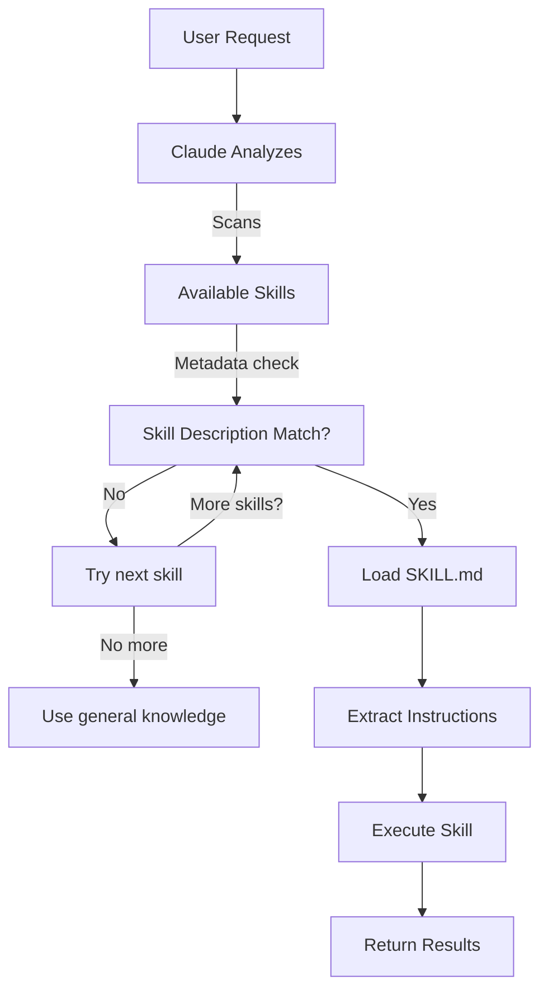

### 스킬과 다른 기능의 비교

```mermaid
graph TB
    A["Extending Claude"]
    B["Slash Commands"]
    C["Subagents"]
    D["Memory"]
    E["MCP"]
    F["Skills"]

    A --> B
    A --> C
    A --> D
    A --> E
    A --> F

    B -->|User-invoked| G["Quick shortcuts"]
    C -->|Auto-delegated| H["Isolated contexts"]
    D -->|Persistent| I["Cross-session context"]
    E -->|Real-time| J["External data access"]
    F -->|Auto-invoked| K["Autonomous execution"]
```

---

## Claude Code 플러그인

### 개요

Claude Code 플러그인은 커스터마이징(슬래시 명령어, 서브에이전트, MCP 서버, 훅)을 하나로 묶은 패키지로, 명령어 하나로 설치할 수 있습니다. 여러 기능을 응집된 공유 가능한 패키지로 묶는 최상위 확장 메커니즘입니다.

### 아키텍처

```mermaid
graph TB
    A["Plugin"]
    B["Slash Commands"]
    C["Subagents"]
    D["MCP Servers"]
    E["Hooks"]
    F["Configuration"]

    A -->|bundles| B
    A -->|bundles| C
    A -->|bundles| D
    A -->|bundles| E
    A -->|bundles| F
```

### 플러그인 로딩 절차

```mermaid
sequenceDiagram
    participant User
    participant Claude as Claude Code
    participant Plugin as Plugin Marketplace
    participant Install as Installation
    participant SlashCmds as Slash Commands
    participant Subagents
    participant MCPServers as MCP Servers
    participant Hooks
    participant Tools as Configured Tools

    User->>Claude: claude --plugin-dir ./07-plugins/pr-review
    Claude->>Plugin: Download plugin manifest
    Plugin-->>Claude: Return plugin definition
    Claude->>Install: Extract components
    Install->>SlashCmds: Configure
    Install->>Subagents: Configure
    Install->>MCPServers: Configure
    Install->>Hooks: Configure
    SlashCmds-->>Tools: Ready to use
    Subagents-->>Tools: Ready to use
    MCPServers-->>Tools: Ready to use
    Hooks-->>Tools: Ready to use
    Tools-->>Claude: Plugin installed ✅
```

### 플러그인의 종류와 배포

| 종류 | 범위 | 공유 | 제공처 | 예 |
|------|-------|--------|-----------|----------|
| Official | 전역 | 모든 사용자 | Anthropic | PR Review, Security Guidance |
| Community | 공개 | 모든 사용자 | 커뮤니티 | DevOps, Data Science |
| Organization | 사내 | 팀 구성원 | 기업 | 사내 표준·도구 |
| Personal | 개인 | 본인만 | 개발자 | 맞춤 워크플로 |

### 플러그인 정의 구조

매니페스트는 `.claude-plugin/plugin.json`에 두는 JSON입니다. 필수 항목은 `name`뿐이며, 인식되지 않는 최상위 키는 제거됩니다:

```json
{
  "name": "plugin-name",
  "version": "1.0.0",
  "description": "What this plugin does"
}
```

### 플러그인 디렉터리 구조

```
my-plugin/
├── .claude-plugin/
│   └── plugin.json
├── commands/
│   ├── task-1.md
│   ├── task-2.md
│   └── workflows/
├── agents/
│   ├── specialist-1.md
│   ├── specialist-2.md
│   └── configs/
├── skills/
│   └── skill-name/
│       └── SKILL.md
├── hooks/
│   └── hooks.json
├── .mcp.json
├── bin/
│   └── my-tool
├── .lsp.json
├── settings.json
├── templates/
│   └── issue-template.md
├── scripts/
│   ├── helper-1.sh
│   └── helper-2.py
├── docs/
│   ├── README.md
│   └── USAGE.md
└── tests/
    └── plugin.test.js
```

### 실제 예시

#### 예 1: PR 리뷰 플러그인

**파일:** `.claude-plugin/plugin.json`

```json
{
  "name": "pr-review",
  "version": "1.0.0",
  "description": "Complete PR review workflow with security, testing, and docs",
  "author": {
    "name": "Anthropic"
  },
  "license": "MIT"
}
```

**파일:** `commands/review-pr.md`

```markdown
---
name: Review PR
description: Start comprehensive PR review with security and testing checks
---

# PR Review

This command initiates a complete pull request review including:

1. Security analysis
2. Test coverage verification
3. Documentation updates
4. Code quality checks
5. Performance impact assessment
```

**파일:** `agents/security-reviewer.md`

```yaml
---
name: security-reviewer
description: Security-focused code review
tools: read, grep, diff
---

# Security Reviewer

Specializes in finding security vulnerabilities:
- Authentication/authorization issues
- Data exposure
- Injection attacks
- Secure configuration
```

**설치:**

```bash
claude --plugin-dir ./07-plugins/pr-review

# 결과:
# ✅ 3 slash commands installed
# ✅ 3 subagents configured
# ✅ 2 MCP servers connected
# ✅ 4 hooks registered
# ✅ Ready to use!
```

#### 예 2: DevOps 플러그인

**구성 요소:**

```
devops-automation/
├── commands/
│   ├── deploy.md
│   ├── rollback.md
│   ├── status.md
│   └── incident.md
├── agents/
│   ├── deployment-specialist.md
│   ├── incident-commander.md
│   └── alert-analyzer.md
├── mcp/
│   ├── github-config.json
│   ├── kubernetes-config.json
│   └── prometheus-config.json
├── hooks/
│   ├── pre-deploy.js
│   ├── post-deploy.js
│   └── on-error.js
└── scripts/
    ├── deploy.sh
    ├── rollback.sh
    └── health-check.sh
```

#### 예 3: 문서 플러그인

**포함된 구성 요소:**

```
documentation/
├── commands/
│   ├── generate-api-docs.md
│   ├── generate-readme.md
│   ├── sync-docs.md
│   └── validate-docs.md
├── agents/
│   ├── api-documenter.md
│   ├── code-commentator.md
│   └── example-generator.md
├── mcp/
│   ├── github-docs-config.json
│   └── slack-announce-config.json
└── templates/
    ├── api-endpoint.md
    ├── function-docs.md
    └── adr-template.md
```

### 플러그인 마켓플레이스

```mermaid
graph TB
    A["Plugin Marketplace"]
    B["Official<br/>Anthropic"]
    C["Community<br/>Marketplace"]
    D["Enterprise<br/>Registry"]

    A --> B
    A --> C
    A --> D

    B -->|Categories| B1["Development"]
    B -->|Categories| B2["DevOps"]
    B -->|Categories| B3["Documentation"]

    C -->|Search| C1["DevOps Automation"]
    C -->|Search| C2["Mobile Dev"]
    C -->|Search| C3["Data Science"]

    D -->|Internal| D1["Company Standards"]
    D -->|Internal| D2["Legacy Systems"]
    D -->|Internal| D3["Compliance"]
```

### 플러그인 설치와 생명 주기

```mermaid
graph LR
    A["Discover"] -->|Browse| B["Marketplace"]
    B -->|Select| C["Plugin Page"]
    C -->|View| D["Components"]
    D -->|Install| E["/plugin install"]
    E -->|Extract| F["Configure"]
    F -->|Activate| G["Use"]
    G -->|Check| H["Update"]
    H -->|Available| G
    G -->|Done| I["Disable"]
    I -->|Later| J["Enable"]
    J -->|Back| G
```

### 플러그인 기능 비교

| 기능 | 슬래시 명령어 | 스킬 | 서브에이전트 | 플러그인 |
|---------|---------------|-------|----------|--------|
| **설치** | 수동 복사 | 수동 복사 | 수동 설정 | 명령어 1개 |
| **설정 시간** | 5분 | 10분 | 15분 | 2분 |
| **번들** | 단일 파일 | 단일 파일 | 단일 파일 | 여러 개 |
| **버전 관리** | 수동 | 수동 | 수동 | 자동 |
| **팀 공유** | 파일 복사 | 파일 복사 | 파일 복사 | 설치 ID |
| **업데이트** | 수동 | 수동 | 수동 | 자동 업데이트 가능 |
| **의존성** | 없음 | 없음 | 없음 | 포함 가능 |
| **마켓플레이스** | 없음 | 없음 | 없음 | 있음 |
| **배포** | 저장소 | 저장소 | 저장소 | 마켓플레이스 |

### 플러그인 사용 사례

| 사용 사례 | 권장 | 이유 |
|----------|-----------------|-----|
| **팀 온보딩** | ✅ 플러그인 권장 | 즉시 설정, 구성 일괄 적용 |
| **프레임워크 도입** | ✅ 플러그인 권장 | 프레임워크 전용 명령어를 한데 묶음 |
| **엔터프라이즈 표준** | ✅ 플러그인 권장 | 중앙 배포, 버전 관리 |
| **간단한 작업 자동화** | ❌ 명령어 권장 | 플러그인은 과합니다 |
| **단일 도메인 전문 업무** | ❌ 스킬 권장 | 플러그인은 너무 무겁습니다 |
| **전문적인 분석** | ❌ 서브에이전트 권장 | 수동 작성 또는 스킬로 대응 |
| **실시간 데이터 접근** | ❌ MCP 권장 | 단독 사용, 번들하지 않음 |

### 플러그인 제작 판단

```mermaid
graph TD
    A["Should I create a plugin?"]
    A -->|Need multiple components| B{"Multiple commands<br/>or subagents<br/>or MCPs?"}
    B -->|Yes| C["✅ Create Plugin"]
    B -->|No| D["Use Individual Feature"]
    A -->|Team workflow| E{"Share with<br/>team?"}
    E -->|Yes| C
    E -->|No| F["Keep as Local Setup"]
    A -->|Complex setup| G{"Needs auto<br/>configuration?"}
    G -->|Yes| C
    G -->|No| D
```

### 플러그인 공개

**공개 절차:**

1. 모든 구성 요소를 포함한 플러그인 구조를 만듭니다
2. `.claude-plugin/plugin.json` 매니페스트를 작성합니다
3. 문서가 담긴 `README.md`를 만듭니다
4. `claude --plugin-dir ./my-plugin`으로 로컬 테스트를 합니다
5. 플러그인 마켓플레이스에 제출합니다
6. 리뷰를 거쳐 승인받습니다
7. 마켓플레이스에 공개됩니다
8. 사용자는 명령어 하나로 설치할 수 있습니다

**제출 예시:**

~~~~markdown
# PR Review Plugin

## Description
Complete PR review workflow with security, testing, and documentation checks.

## What's Included
- 3 slash commands for different review types
- 3 specialized subagents
- GitHub and CodeQL MCP integration
- Automated security scanning hooks

## Installation
```bash
claude --plugin-dir ./07-plugins/pr-review
```

## Features
✅ Security analysis
✅ Test coverage checking
✅ Documentation verification
✅ Code quality assessment
✅ Performance impact analysis

## Usage
```bash
/review-pr
/check-security
/check-tests
```

## Requirements
- Claude Code 2.1+
- GitHub access
- CodeQL (optional)
~~~~

### 플러그인 vs 수동 설정

**수동 설정(2시간 이상):**
- 슬래시 명령어를 하나씩 설치
- 서브에이전트를 개별로 작성
- MCP를 개별로 설정
- 훅을 수동으로 설정
- 전부 문서화
- 팀에 공유(올바르게 설정되기를 바라며)

**플러그인 사용(2분):**
```bash
claude --plugin-dir ./07-plugins/pr-review
# ✅ 모두 설치·설정 완료
# ✅ 즉시 사용 가능
# ✅ 팀에서도 완전히 동일한 환경을 재현 가능
```

---

## 비교와 통합

### 기능 비교 매트릭스

| 기능 | 실행 방식 | 지속성 | 범위 | 사용 사례 |
|---------|-----------|------------|-------|----------|
| **슬래시 명령어** | 수동(`/cmd`) | 세션 한정 | 단일 명령어 | 빠른 단축 명령 |
| **서브에이전트** | 자동 위임 | 독립 컨텍스트 | 전문 작업 | 작업 분담 |
| **메모리** | 자동 로딩 | 세션 간 유지 | 사용자 / 팀 컨텍스트 | 장기 학습 |
| **MCP 프로토콜** | 자동 쿼리 | 실시간 외부 | 실시간 데이터 접근 | 동적 정보 |
| **스킬** | 자동 실행 | 파일 시스템 | 재사용 가능한 전문성 | 워크플로 자동화 |

### 기능 호출 타임라인

```mermaid
graph LR
    A["Session Start"] -->|Load| B["Memory (CLAUDE.md)"]
    B -->|Discover| C["Available Skills"]
    C -->|Register| D["Slash Commands"]
    D -->|Connect| E["MCP Servers"]
    E -->|Ready| F["User Interaction"]

    F -->|Type /cmd| G["Slash Command"]
    F -->|Request| H["Skill Auto-Invoke"]
    F -->|Query| I["MCP Data"]
    F -->|Complex task| J["Delegate to Subagent"]

    G -->|Uses| B
    H -->|Uses| B
    I -->|Uses| B
    J -->|Uses| B
```

### 통합 실제 예시: 고객 지원 자동화

#### 아키텍처

```mermaid
graph TB
    User["Customer Email"] -->|Receives| Router["Support Router"]

    Router -->|Analyze| Memory["Memory<br/>Customer history"]
    Router -->|Lookup| MCP1["MCP: Customer DB<br/>Previous tickets"]
    Router -->|Check| MCP2["MCP: Slack<br/>Team status"]

    Router -->|Route Complex| Sub1["Subagent: Tech Support<br/>Context: Technical issues"]
    Router -->|Route Simple| Sub2["Subagent: Billing<br/>Context: Payment issues"]
    Router -->|Route Urgent| Sub3["Subagent: Escalation<br/>Context: Priority handling"]

    Sub1 -->|Format| Skill1["Skill: Response Generator<br/>Brand voice maintained"]
    Sub2 -->|Format| Skill2["Skill: Response Generator"]
    Sub3 -->|Format| Skill3["Skill: Response Generator"]

    Skill1 -->|Generate| Output["Formatted Response"]
    Skill2 -->|Generate| Output
    Skill3 -->|Generate| Output

    Output -->|Post| MCP3["MCP: Slack<br/>Notify team"]
    Output -->|Send| Reply["Customer Reply"]
```

#### 요청의 흐름

```markdown
## Customer Support Request Flow

### 1. Incoming Email
"I'm getting error 500 when trying to upload files. This is blocking my workflow!"

### 2. Memory Lookup
- Loads CLAUDE.md with support standards
- Checks customer history: VIP customer, 3rd incident this month

### 3. MCP Queries
- GitHub MCP: List open issues (finds related bug report)
- Database MCP: Check system status (no outages reported)
- Slack MCP: Check if engineering is aware

### 4. Skill Detection & Loading
- Request matches "Technical Support" skill
- Loads support response template from Skill

### 5. Subagent Delegation
- Routes to Tech Support Subagent
- Provides context: customer history, error details, known issues
- Subagent has full access to: read, bash, grep tools

### 6. Subagent Processing
Tech Support Subagent:
- Searches codebase for 500 error in file upload
- Finds recent change in commit 8f4a2c
- Creates workaround documentation

### 7. Skill Execution
Response Generator Skill:
- Uses Brand Voice guidelines
- Formats response with empathy
- Includes workaround steps
- Links to related documentation

### 8. MCP Output
- Posts update to #support Slack channel
- Tags engineering team
- Updates ticket in Jira MCP

### 9. Response
Customer receives:
- Empathetic acknowledgment
- Explanation of cause
- Immediate workaround
- Timeline for permanent fix
- Link to related issues
```

### 기능의 종합 오케스트레이션

```mermaid
sequenceDiagram
    participant User
    participant Claude as Claude Code
    participant Memory as Memory<br/>CLAUDE.md
    participant MCP as MCP Servers
    participant Skills as Skills
    participant SubAgent as Subagents

    User->>Claude: Request: "Build auth system"
    Claude->>Memory: Load project standards
    Memory-->>Claude: Auth standards, team practices
    Claude->>MCP: Query GitHub for similar implementations
    MCP-->>Claude: Code examples, best practices
    Claude->>Skills: Detect matching Skills
    Skills-->>Claude: Security Review Skill + Testing Skill
    Claude->>SubAgent: Delegate implementation
    SubAgent->>SubAgent: Build feature
    Claude->>Skills: Apply Security Review Skill
    Skills-->>Claude: Security checklist results
    Claude->>SubAgent: Delegate testing
    SubAgent-->>Claude: Test results
    Claude->>User: Complete system delivered
```

### 어떤 기능을 쓸 것인가

```mermaid
graph TD
    A["New Task"] --> B{Type of Task?}

    B -->|Repeated workflow| C["Slash Command"]
    B -->|Need real-time data| D["MCP Protocol"]
    B -->|Remember for next time| E["Memory"]
    B -->|Specialized subtask| F["Subagent"]
    B -->|Domain-specific work| G["Skill"]

    C --> C1["✅ Team shortcut"]
    D --> D1["✅ Live API access"]
    E --> E1["✅ Persistent context"]
    F --> F1["✅ Parallel execution"]
    G --> G1["✅ Auto-invoked expertise"]
```

### 선택 플로차트

```mermaid
graph TD
    Start["Need to extend Claude?"]

    Start -->|Quick repeated task| A{"Manual or Auto?"}
    A -->|Manual| B["Slash Command"]
    A -->|Auto| C["Skill"]

    Start -->|Need external data| D{"Real-time?"}
    D -->|Yes| E["MCP Protocol"]
    D -->|No/Cross-session| F["Memory"]

    Start -->|Complex project| G{"Multiple roles?"}
    G -->|Yes| H["Subagents"]
    G -->|No| I["Skills + Memory"]

    Start -->|Long-term context| J["Memory"]
    Start -->|Team workflow| K["Slash Command +<br/>Memory"]
    Start -->|Full automation| L["Skills +<br/>Subagents +<br/>MCP"]
```

---

## 요약 목록

| 관점 | 슬래시 명령어 | 서브에이전트 | 메모리 | MCP | 스킬 | 플러그인 |
|--------|---|---|---|---|---|---|
| **설정 난이도** | 쉬움 | 보통 | 쉬움 | 보통 | 보통 | 쉬움 |
| **학습 곡선** | 낮음 | 보통 | 낮음 | 보통 | 보통 | 낮음 |
| **팀 이점** | 높음 | 높음 | 보통 | 높음 | 높음 | 매우 높음 |
| **자동화 수준** | 낮음 | 높음 | 보통 | 높음 | 높음 | 매우 높음 |
| **컨텍스트 관리** | 단일 세션 | 독립 | 영구 | 실시간 | 영구 | 모든 기능 |
| **유지보수 부담** | 낮음 | 보통 | 낮음 | 보통 | 보통 | 낮음 |
| **확장성** | 양호 | 우수 | 양호 | 우수 | 우수 | 우수 |
| **공유 용이성** | 보통 | 보통 | 양호 | 양호 | 양호 | 우수 |
| **버전 관리** | 수동 | 수동 | 수동 | 수동 | 수동 | 자동 |
| **설치** | 수동 복사 | 수동 설정 | 불필요 | 수동 설정 | 수동 복사 | 명령어 1개 |

---

## 빠른 시작 가이드

### 1주 차: 단순하게 시작하기
- 자주 쓰는 작업에 대해 슬래시 명령어를 2~3개 만듭니다
- 설정에서 메모리를 활성화합니다
- 팀 표준을 CLAUDE.md에 문서화합니다

### 2주 차: 실시간 접근 추가하기
- MCP를 1개 설정합니다(GitHub 또는 Database)
- `/mcp`로 설정합니다
- 워크플로에서 실시간 데이터를 쿼리합니다

### 3주 차: 작업 분담하기
- 특정 역할을 가진 서브에이전트를 처음으로 만듭니다
- Claude에게 작성을 요청하거나 `.claude/agents/<name>.md` 파일을 추가합니다(`/agents` 마법사는 제거되었습니다)
- 간단한 작업으로 위임을 테스트합니다

### 4주 차: 모든 것을 자동화하기
- 반복 작업에 대해 스킬을 처음으로 만듭니다
- 스킬 마켓플레이스를 활용하거나 직접 만듭니다
- 모든 기능을 조합해 완전한 워크플로를 만듭니다

### 지속적으로
- 매월 메모리를 검토하고 업데이트합니다
- 새로운 패턴을 발견하면 스킬을 추가합니다
- MCP 쿼리를 최적화합니다
- 서브에이전트의 프롬프트를 다듬습니다

---

## 훅

### 개요

훅은 Claude Code의 이벤트에 반응해 자동으로 실행되는 셸 명령어입니다. 수동 조작 없이 자동화·검증·맞춤 워크플로를 구현합니다.

### 훅 이벤트

Claude Code는 5가지 유형(command, http, mcp_tool, prompt, agent)에 걸쳐 **33종의 훅 이벤트**를 지원합니다:

| 훅 이벤트 | 트리거 | 사용 사례 |
|------------|---------|-----------|
| **SessionStart** | 세션 시작 / 재개 / 초기화 / 압축 시 | 환경 구축, 초기화 |
| **Setup** | `--init-only`로 시작했을 때, 또는 `-p`와 `--init` / `--maintenance`를 함께 썼을 때(일반 시작에서는 발생하지 않음) | 도구 준비, 의존성 설치 |
| **InstructionsLoaded** | CLAUDE.md나 규칙 파일을 읽어 들일 때 | 검증, 변환, 보강 |
| **UserPromptSubmit** | 사용자가 프롬프트를 제출할 때 | 입력 검증, 프롬프트 필터 |
| **UserPromptExpansion** | 입력한 슬래시 명령어(스킬, 맞춤 명령어, MCP 프롬프트)가 프롬프트로 확장될 때. 확장을 차단할 수 있음 | 직접 `/command` 사용 차단·기록, 스킬별 컨텍스트 추가 |
| **PreToolUse** | 모든 도구 실행 전 | 검증, 승인 게이트, 로그 |
| **PermissionRequest** | 권한 대화상자 표시 시 | 자동 승인·거부 흐름 |
| **PermissionDenied** | auto 모드가 도구 호출을 거부했을 때(수동 거부에서는 발생하지 않음) | 로그, 분석, 정책 적용 |
| **PostToolUse** | 도구 성공 후 | 자동 포매팅, 알림, 후처리 |
| **PostToolUseFailure** | 도구 실행 실패 시 | 오류 처리, 로그 |
| **PostToolBatch** | 도구 실행 배치 완료 후 | 집계 리포트, 배치 검증 |
| **Notification** | 알림 전송 시 | 경보, 외부 연동 |
| **MessageDisplay** | 어시스턴트 메시지 표시 시 | 표시 텍스트 변환·숨김 |
| **SubagentStart** | 서브에이전트 생성 시 | 컨텍스트 주입, 초기화 |
| **SubagentStop** | 서브에이전트 종료 시 | 결과 검증, 로그 |
| **Stop** | Claude의 응답 완료 시 | 요약 생성, 후처리 |
| **StopFailure** | API 오류로 턴이 끝날 때 | 오류 복구, 로그 |
| **TeammateIdle** | 에이전트 팀 구성원이 유휴 상태일 때 | 작업 분배, 조정 |
| **TaskCompleted** | 작업 완료 시(todo 도구가 활성화된 경우에만 발생 — Claude 3.x, Opus 4~4.7, Sonnet 4~4.6, Haiku 4.5에서만 기본 활성화. `CLAUDE_CODE_ENABLE_TODO_TOOLS=1`로 되살릴 수 있음) | 후속 처리 |
| **TaskCreated** | TaskCreate로 작업을 만들 때(todo 도구가 활성화된 경우에만 발생 — Claude 3.x, Opus 4~4.7, Sonnet 4~4.6, Haiku 4.5에서만 기본 활성화. `CLAUDE_CODE_ENABLE_TODO_TOOLS=1`로 되살릴 수 있음) | 작업 추적, 로그 |
| **ConfigChange** | 설정 파일 변경 시 | 검증, 전파 |
| **CwdChanged** | 작업 디렉터리 변경 시 | 디렉터리별 설정 |
| **DirectoryAdded** | 세션 중에 작업 디렉터리가 추가 등록될 때 | 새 디렉터리용 도구 설정 |
| **FileChanged** | 감시 대상 파일 변경 시 | 파일 감시, 재빌드 |
| **PreCompact** | 컨텍스트 압축 직전 | 상태 저장 |
| **PostCompact** | 압축 완료 후 | 압축 후 처리 |
| **PreModelSwitch** | 모델 전환이 적용되기 직전 | 모델 변경 게이트·거부 |
| **PostModelSwitch** | 세션의 모델이 변경된 후 | 모델 변경 로그·연동 |
| **WorktreeCreate** | 워크트리 생성 시 | 기본 git 워크트리 생성을 대체. 워크트리 경로를 출력해야 함 |
| **WorktreeRemove** | 워크트리 삭제 시 | 정리, 리소스 해제 |
| **Elicitation** | MCP 서버가 사용자 입력을 요청할 때 | 입력 검증 |
| **ElicitationResult** | 사용자가 입력 요청에 응답할 때 | 응답 처리 |
| **SessionEnd** | 세션 종료 시 | 정리, 최종 로그 |

### 자주 쓰는 훅

훅은 `~/.claude/settings.json`(사용자 수준) 또는 `.claude/settings.json`(프로젝트 수준)에 설정합니다:

```json
{
  "hooks": {
    "PostToolUse": [
      {
        "matcher": "Write",
        "hooks": [
          {
            "type": "command",
            "command": "jq -r '.tool_input.file_path' | xargs npx prettier --write"
          }
        ]
      }
    ],
    "PreToolUse": [
      {
        "matcher": "Edit",
        "hooks": [
          {
            "type": "command",
            "command": "jq -r '.tool_input.file_path' | xargs npx eslint"
          }
        ]
      }
    ]
  }
}
```

### 훅 환경 변수

- 훅 입력은 stdin의 JSON으로 전달됩니다(`session_id`, `tool_name`, `tool_input.file_path` 등) — `jq`로 읽습니다
- `$CLAUDE_CODE_SESSION_ID` — 현재 세션 ID
- `$CLAUDE_PROJECT_DIR` — 프로젝트 디렉터리 경로

### 모범 사례

✅ **권장:**
- 훅은 빠르게 만듭니다(1초 이내)
- 검증과 자동화에 사용합니다
- 오류를 정중하게 처리합니다
- 절대 경로를 사용합니다

❌ **비권장:**
- 훅을 대화형으로 만듭니다
- 장시간 작업을 훅에서 실행합니다
- 인증 정보를 하드코딩합니다

**자세히:** [06-hooks/](06-hooks/)

---

## 체크포인트와 되감기

### 개요

체크포인트는 대화 상태를 저장하고 과거 지점으로 되감을 수 있게 합니다. 여러 접근 방식을 안전하게 시도하고 검토할 수 있습니다.

### 주요 개념

| 개념 | 설명 |
|---------|-------------|
| **체크포인트** | 메시지, 파일, 컨텍스트를 포함한 대화 상태의 스냅숏 |
| **되감기** | 과거 체크포인트로 돌아가 그 이후의 변경을 폐기 |
| **분기점** | 여러 접근 방식을 시도하기 위한 출발점이 되는 체크포인트 |

### 체크포인트에 접근하기

체크포인트는 사용자 프롬프트마다 자동으로 만들어집니다. 되감으려면:

```bash
# Esc를 2번 누르면 체크포인트 브라우저가 열립니다
Esc + Esc

# 또는 /rewind 명령어
/rewind
```

체크포인트를 고르면 6가지 옵션 중에서 선택할 수 있습니다:
1. **코드와 대화 복원** — 둘 다 그 시점으로 되돌립니다
2. **대화 복원** — 메시지를 되감고 현재 코드는 유지합니다
3. **코드 복원** — 파일을 되돌리고 대화는 유지합니다
4. **여기서부터 요약** — 대화를 요약으로 압축합니다
5. **여기까지 요약** — 이 시점 이전을 모두 요약으로 압축합니다
6. **취소** — 그만둡니다

### 사용 사례

| 시나리오 | 워크플로 |
|----------|----------|
| **접근 방식 비교** | 저장 → A 시도 → 저장 → 되감기 → B 시도 → 비교 |
| **안전한 리팩터링** | 저장 → 리팩터링 → 테스트 → 실패 시 되감기 |
| **A/B 테스트** | 저장 → 설계 A → 저장 → 되감기 → 설계 B → 비교 |
| **실수 복구** | 문제 발견 → 직전의 정상 상태로 되감기 |

### 설정

체크포인트는 기본으로 활성화되어 있으며 `fileCheckpointingEnabled`로 제어합니다:

```json
{
  "fileCheckpointingEnabled": true
}
```

**자세히:** [08-checkpoints/](08-checkpoints/)

---

## 고급 기능

### 플랜 모드

구현 전에 상세한 계획을 세웁니다.

**실행:**
```bash
/plan Implement user authentication system
```

**이점:**
- 공수 추정이 포함된 명확한 로드맵
- 리스크 평가
- 체계적인 작업 분할
- 검토와 수정의 기회

### 확장 사고(Extended Thinking)

복잡한 문제에 대한 깊은 추론입니다.

**실행:**
- 세션 중에 `Alt+T`(macOS에서는 `Option+T`)로 토글합니다
- Opus 4.7 이후, Sonnet 5 이후, Haiku 5.5, Fable은 항상 적응형 추론을 사용하므로 고정된 `MAX_THINKING_TOKENS` 예산이 적용되지 않습니다. 추론 깊이는 `/effort`로 조정합니다

```bash
# effort 수준으로 추론 깊이를 조정
/effort high
```

**이점:**
- 트레이드오프를 철저히 분석
- 더 나은 아키텍처 판단
- 엣지 케이스 고려
- 체계적인 평가

### 백그라운드 작업

대화를 막지 않고 장시간 처리를 실행합니다.

**사용법:**
```bash
User: Run tests in background

Claude: Started task bg-1234

/tasks               # 백그라운드 작업 표시·관리(별칭: /bashes)
```

### 권한 모드

Claude가 할 수 있는 일을 제어합니다.

| 모드 | 설명 | 사용 사례 |
|------|-------------|----------|
| **default** | 표준 권한. 민감한 조작은 확인을 요청 | 일반 개발 |
| **acceptEdits** | 파일 편집을 확인 없이 승인 | 신뢰할 수 있는 편집 워크플로 |
| **plan** | 분석·계획만 가능, 파일 변경 불가 | 코드 리뷰, 아키텍처 계획 |
| **auto** | 분류기가 안전한 조작을 승인하고 위험한 조작을 차단. 연속 3회 또는 합계 20회 차단되면 확인으로 되돌아감 | 안전성과 균형을 이룬 자율성 |
| **dontAsk** | 확인이 필요한 조작은 모두 자동 거부. 사전 승인된 도구와 읽기만 실행 | 잠긴 CI·스크립트 |
| **bypassPermissions** | 제한 없음, 안전 검사 없음 | CI/CD, 신뢰할 수 있는 스크립트 |

**사용법:**
```bash
claude --permission-mode plan          # 읽기 전용 분석
claude --permission-mode acceptEdits   # 편집을 자동 승인
claude --permission-mode auto          # 안전한 조작을 자동 승인
claude --permission-mode dontAsk       # 사전 승인된 도구만. 그 외에는 거부
```

### 헤드리스 모드(Print Mode)

`-p`(print) 플래그로 대화형 입력 없이 자동화나 CI/CD용으로 Claude Code를 실행합니다.

**사용법:**
```bash
# 특정 작업을 실행
claude -p "Run all tests"

# 입력을 파이프로 넘겨 분석
cat error.log | claude -p "explain this error"

# CI/CD 연동(GitHub Actions)
- name: AI Code Review
  run: claude -p "Review PR changes and report issues"

# 스크립트용 JSON 출력
claude -p --output-format json "list all functions in src/"
```

### 정기 작업

`/loop` 명령어로 정기 실행합니다.

**사용법:**
```bash
/loop every 30m "Run tests and report failures"
/loop every 2h "Check for dependency updates"
/loop every 1d "Generate daily summary of code changes"
```

정기 작업은 백그라운드에서 실행되며 완료 시 결과를 보고합니다. 지속적인 모니터링, 정기 점검, 자동 유지보수 워크플로에 유용합니다.

### Chrome 연동

Claude Code는 Chrome 브라우저와 연동할 수 있습니다. 웹 페이지 탐색, 폼 입력, 스크린샷 촬영, 사이트에서 데이터 추출 등 개발 워크플로 안에서 웹 자동화가 가능해집니다.

### 세션 관리

여러 작업 세션을 관리합니다.

**명령어:**
```bash
/resume                # 과거 대화를 재개
/rename "Feature"      # 현재 세션에 이름을 붙임
/fork                  # 새 세션으로 포크
claude -c              # 가장 최근 대화를 이어서 진행
claude -r "Feature"    # 이름 / ID로 세션을 재개
```

### 대화형 기능

**키보드 단축키:**
- `Ctrl + R` — 명령어 기록 검색
- `Tab` — 자동 완성
- `↑ / ↓` — 명령어 기록
- `Ctrl + L` — 화면 지우기

**여러 줄 입력:** `\` + Enter, Option+Enter(macOS), Shift+Enter, 또는 Ctrl+J로 줄을 바꿉니다. `\end` 같은 종료 기호는 없습니다.

### 설정

완전한 설정 예시:

```json
{
  "alwaysThinkingEnabled": true,
  "showThinkingSummaries": true,
  "permissions": {
    "defaultMode": "default"
  }
}
```

`settings.json`에는 백그라운드 작업용 블록이 없습니다. 이 기능은 환경 변수 `CLAUDE_CODE_DISABLE_BACKGROUND_TASKS`로 제어하며, 동시 실행 수는 `CLAUDE_CODE_MAX_CONCURRENT_SUBAGENTS`(기본값 `20`)로 정해집니다.

**상세 가이드:** [09-advanced-features/](09-advanced-features/)

---

## 모델과 추론 노력(Reasoning Effort)

Claude Code는 추론 노력을 조정할 수 있는 3가지 모델을 지원합니다:

| 모델 | 컨텍스트 윈도우 | 노력 수준 | 기본 노력(Claude Code) |
|-------|----------------|---------------|------------------------------|
| Claude Opus 4.7 | 1M 토큰(네이티브) | `low`, `medium`, `high`, `xhigh`, `max` | `xhigh`(Opus 4.7 릴리스 시점, 2026-04-16 이후) |
| Claude Sonnet 4.6 | 1M 토큰 | `low`, `medium`, `high`, `max` | Pro/Max 구독자는 `high`(v2.1.117에서 `medium`에서 상향) |
| Claude Haiku 4.5 | 200K 토큰 | `low`, `medium`, `high` | `medium` |

> **참고:** v2.1.117에서는 Opus 4.7 세션에서 `/context`가 네이티브 1M이 아니라 200K 기준으로 계산되던 버그가 수정되었습니다. Opus 4.7에서 본래의 1M 컨텍스트를 사용하려면 v2.1.117 이상으로 업그레이드하세요.

> **참고:** v2.1.118에서 `/cost`와 `/stats`는 `/usage`로 통합되었습니다. `/usage`가 비용·통계 등의 탭을 가진 정식 명령어가 되었고, `/cost`와 `/stats`는 해당 탭을 여는 단축 별칭으로 남아 있습니다.

## 참고 자료

- [Claude Code Documentation](https://code.claude.com/docs/en/overview)
- [Claude Code Changelog](https://code.claude.com/docs/en/changelog)
- [MCP GitHub Servers](https://github.com/modelcontextprotocol/servers)
- [Anthropic Cookbook](https://github.com/anthropics/anthropic-cookbook)

---

*최종 업데이트: 2026년 9월 2일*
*지원: Claude Fable 5, Claude Opus 5, Claude Sonnet 5, Claude Sonnet 4.6, Claude Opus 4.8, Claude Haiku 4.5*
*수록 기능: 훅, 체크포인트, 플랜 모드, 확장 사고, 백그라운드 작업, 권한 모드(6종), 헤드리스 모드, 세션 관리, Auto Memory, Agent Teams, 정기 작업, Chrome 연동, Channels, 음성 입력, 번들 스킬*

---
**최종 업데이트:** 2026년 10월 18일
**Claude Code 버전:** 2.1.302
**출처:**
- https://code.claude.com/docs/en/plugins/manifest-reference
- https://code.claude.com/docs/en/plugins/create
- https://code.claude.com/docs/en/plugins/install
- https://code.claude.com/docs/en/settings-reference
- https://code.claude.com/docs/en/interactive-mode
- https://code.claude.com/docs/en/checkpointing
- https://code.claude.com/docs/en/memory
- https://code.claude.com/docs/en/tools-reference#task-tool-availability
- https://code.claude.com/docs/en/overview
- https://code.claude.com/docs/en/hooks
- https://www.anthropic.com/news/claude-opus-4-7
- https://github.com/anthropics/claude-code/releases/tag/v2.1.117
- https://code.claude.com/docs/en/model-config
- https://code.claude.com/docs/en/sub-agents
- https://code.claude.com/docs/en/commands
- https://code.claude.com/docs/en/permission-modes
- https://code.claude.com/docs/en/hooks#userpromptexpansion

**지원 모델:** Claude Fable 5, Claude Opus 5, Claude Sonnet 5, Claude Sonnet 4.6, Claude Opus 4.8, Claude Haiku 4.5
