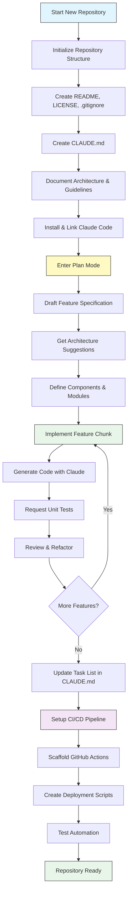
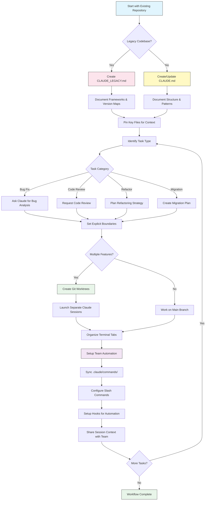

<!-- i18n-source: resources.md -->
<!-- i18n-source-sha: d17d515 -->
<!-- i18n-date: 2026-10-26 -->

<picture>
  <source media="(prefers-color-scheme: dark)" srcset="../resources/logos/claude-howto-logo-dark.svg">
  
</picture>

# 좋은 리소스 모음

## 공식 문서

| 리소스 | 설명 | 링크 |
|----------|-------------|------|
| Claude Code Docs | Claude Code 공식 문서 | [code.claude.com/docs/en/overview](https://code.claude.com/docs/en/overview) |
| Anthropic Docs | Anthropic 공식 종합 문서 | [docs.anthropic.com](https://docs.anthropic.com) |
| MCP Protocol | Model Context Protocol 명세 | [modelcontextprotocol.io](https://modelcontextprotocol.io) |
| MCP Servers | 공식 MCP 서버 구현 | [github.com/modelcontextprotocol/servers](https://github.com/modelcontextprotocol/servers) |
| Anthropic Cookbook | 코드 예제와 튜토리얼 | [github.com/anthropics/anthropic-cookbook](https://github.com/anthropics/anthropic-cookbook) |
| Claude Code Skills | 커뮤니티 스킬 저장소 | [github.com/anthropics/skills](https://github.com/anthropics/skills) |
| Agent Teams | 멀티 에이전트 조정과 협업 | [code.claude.com/docs/en/agent-teams](https://code.claude.com/docs/en/agent-teams) |
| Scheduled Tasks | `/loop`와 cron을 이용한 정기 작업 | [code.claude.com/docs/en/scheduled-tasks](https://code.claude.com/docs/en/scheduled-tasks) |
| Chrome Integration | 브라우저 자동화 | [code.claude.com/docs/en/chrome](https://code.claude.com/docs/en/chrome) |
| Keybindings | 키보드 단축키 커스터마이즈 | [code.claude.com/docs/en/keybindings](https://code.claude.com/docs/en/keybindings) |
| Desktop App | 네이티브 데스크톱 애플리케이션 | [code.claude.com/docs/en/desktop](https://code.claude.com/docs/en/desktop) |
| Remote Control | 원격 세션 제어 | [code.claude.com/docs/en/remote-control](https://code.claude.com/docs/en/remote-control) |
| Auto Mode | 자동 권한 관리 | [code.claude.com/docs/en/permissions](https://code.claude.com/docs/en/permissions) |
| Channels | 멀티 채널 통신 | [code.claude.com/docs/en/channels](https://code.claude.com/docs/en/channels) |
| Voice Dictation | Claude Code 음성 입력 | [code.claude.com/docs/en/voice-dictation](https://code.claude.com/docs/en/voice-dictation) |

## Anthropic 엔지니어링 블로그

| 글 | 설명 | 링크 |
|---------|-------------|------|
| Code Execution with MCP | 코드 실행으로 MCP의 컨텍스트 비대화를 해결하는 방법 — 98.7% 토큰 절감 | [anthropic.com/engineering/code-execution-with-mcp](https://www.anthropic.com/engineering/code-execution-with-mcp) |

---

## 30분 만에 Claude Code 마스터하기

_동영상_: https://www.youtube.com/watch?v=6eBSHbLKuN0

_**전체 팁**_
- **고급 기능과 단축키 탐색하기**
  - 릴리스 노트에서 Claude의 새로운 코드 편집·컨텍스트 기능을 정기적으로 확인합니다.
  - 채팅, 파일, 에디터 뷰 사이를 빠르게 전환하는 키보드 단축키를 익힙니다.

- **효율적인 설정**
  - 나중에 찾기 쉽도록 명확한 이름/설명을 붙인 프로젝트별 세션을 만듭니다.
  - Claude가 언제든 접근할 수 있도록 자주 쓰는 파일이나 폴더를 고정합니다.
  - Claude의 연동 기능(GitHub, 인기 IDE 등)을 설정해 코딩 과정을 간소화합니다.

- **효과적인 코드베이스 Q&A**
  - 아키텍처, 디자인 패턴, 특정 모듈에 대해 Claude에게 자세히 질문합니다.
  - 질문에 파일과 줄 참조를 사용합니다(예: "`app/models/user.py`의 로직은 무엇을 달성하나요?").
  - 큰 코드베이스에서는 Claude가 초점을 좁힐 수 있도록 요약이나 매니페스트를 제공합니다.
  - **프롬프트 예시**: _"src/auth/AuthService.ts:45-120에 구현된 인증 흐름을 설명해 줄 수 있나요? src/middleware/auth.ts의 미들웨어와는 어떻게 통합되나요?"_

- **코드 편집과 리팩터링**
  - 인라인 주석이나 코드 블록 안의 요청으로 초점을 좁힌 편집을 얻습니다("이 함수를 알기 쉽게 리팩터링해 줘").
  - 나란히 놓인 변경 전/후 비교를 요청합니다.
  - 큰 편집 뒤에는 품질 보증을 위해 Claude에게 테스트나 문서를 생성하게 합니다.
  - **프롬프트 예시**: _"api/users.js의 getUserData 함수를 Promise 대신 async/await를 쓰도록 리팩터링해 줘. 변경 전/후 비교를 보여 주고, 리팩터링된 버전의 단위 테스트를 생성해 줘"_

- **컨텍스트 관리**
  - 붙여 넣는 코드/컨텍스트는 현재 작업과 관련된 것만으로 제한합니다.
  - 구조화된 프롬프트("파일 A는 이것, 함수 B는 이것, 내 질문은 X")를 쓰면 최고의 성능이 나옵니다.
  - 컨텍스트 제한을 넘지 않도록 프롬프트 창에서 큰 파일을 제거하거나 접습니다.
  - **프롬프트 예시**: _"models/User.js의 User 모델과 utils/validation.js의 validateUser 함수. 내 질문: 하위 호환성을 유지하면서 이메일 검증을 추가하려면 어떻게 해야 하나요?"_

- **팀 도구와 통합하기**
  - Claude 세션을 팀의 저장소나 문서에 연결합니다.
  - 반복되는 엔지니어링 작업에는 내장 템플릿을 쓰거나 직접 만듭니다.
  - 세션 기록이나 프롬프트를 팀원과 공유해 협업합니다.

- **성능 높이기**
  - Claude에게 명확하고 목표 지향적인 지시를 줍니다(예: "이 클래스를 5개의 글머리 기호로 요약해 줘").
  - 컨텍스트 윈도우에서 불필요한 주석과 보일러플레이트를 제거합니다.
  - Claude의 출력이 빗나가면 컨텍스트를 초기화하거나 질문을 바꿔 말해 정합성을 높입니다.
  - **프롬프트 예시**: _"src/db/Manager.ts의 DatabaseManager 클래스를 5개의 글머리 기호로 요약하고, 주요 책임과 핵심 메서드에 초점을 맞춰 줘"_

- **실용적인 활용 사례**
  - 디버깅: 오류나 스택 트레이스를 붙여 넣고 원인과 수정안을 묻습니다.
  - 테스트 생성: 복잡한 로직에 대한 속성 기반, 단위, 통합 테스트를 요청합니다.
  - 코드 리뷰: 위험한 변경, 엣지 케이스, 코드 스멜을 Claude가 찾아내게 합니다.
  - **프롬프트 예시**:
    - _"'TypeError: Cannot read property 'map' of undefined at line 42 in components/UserList.jsx'라는 오류가 납니다. 스택 트레이스와 해당 코드는 이것입니다. 원인과 수정 방법은?"_
    - _"PaymentProcessor 클래스의 포괄적인 단위 테스트를 생성해 줘. 실패한 트랜잭션, 타임아웃, 잘못된 입력의 엣지 케이스를 포함해서"_
    - _"이 풀 리퀘스트의 diff를 리뷰하고, 잠재적인 보안 문제, 성능 병목, 코드 스멜을 찾아 줘"_

- **워크플로 자동화**
  - 반복 작업(포맷, 정리, 반복적인 이름 변경 등)을 Claude 프롬프트로 스크립트화합니다.
  - 코드 diff에서 PR 설명, 릴리스 노트, 문서를 Claude가 초안 작성하게 합니다.
  - **프롬프트 예시**: _"git diff를 바탕으로 변경 요약, 변경된 파일 목록, 테스트 절차, 영향을 포함한 상세한 PR 설명을 작성해 줘. 버전 2.3.0의 릴리스 노트도 생성해 줘"_

**팁**: 최고의 결과를 얻으려면 여러 관행을 조합하세요 — 먼저 핵심 파일을 고정하고 목표를 요약한 다음, 초점을 좁힌 프롬프트와 Claude의 리팩터링 도구를 사용해 코드베이스와 자동화를 점진적으로 개선합니다.

**Claude Code 권장 워크플로**

### Claude Code 권장 워크플로

#### 새 저장소의 경우

1. **저장소와 Claude 연동 초기화**
   - 필수 구조(README, LICENSE, .gitignore, 루트 설정)로 새 저장소를 설정합니다.
   - 아키텍처, 상위 수준의 목표, 코딩 가이드라인을 기술한 `CLAUDE.md` 파일을 만듭니다.
   - Claude Code를 설치하고 저장소에 연결해 코드 제안, 테스트 스캐폴딩, 워크플로 자동화를 활성화합니다.

2. **플랜 모드와 명세 활용하기**
   - 플랜 모드(`shift-tab` 또는 `/plan`)를 사용해 기능 구현 전에 상세한 명세를 작성합니다.
   - Claude에게 아키텍처 제안과 초기 프로젝트 레이아웃을 요청합니다.
   - 명확하고 목표 지향적인 프롬프트 연쇄를 유지합니다 — 컴포넌트 개요, 주요 모듈, 책임을 묻습니다.

3. **반복적으로 개발·검토하기**
   - 핵심 기능을 작은 단위로 구현하고, 코드 생성, 리팩터링, 문서화를 Claude에게 요청합니다.
   - 각 증분 뒤에 단위 테스트와 예시를 요청합니다.
   - CLAUDE.md에 진행 중인 작업 목록을 유지합니다.

4. **CI/CD와 배포 자동화하기**
   - GitHub Actions, npm/yarn 스크립트, 배포 워크플로의 스캐폴딩을 Claude가 만들게 합니다.
   - CLAUDE.md를 갱신하고 해당 명령어/스크립트를 요청해 파이프라인을 쉽게 조정합니다.

#### 기존 저장소의 경우

1. **저장소와 컨텍스트 설정**
   - 저장소 구조, 코딩 패턴, 주요 파일을 기록하기 위해 `CLAUDE.md`를 추가하거나 갱신합니다. 레거시 저장소에서는 프레임워크, 버전 맵, 절차, 알려진 버그, 업그레이드 노트를 다루는 `CLAUDE_LEGACY.md`를 사용합니다.
   - Claude가 컨텍스트로 삼아야 할 주요 파일을 고정하거나 강조합니다.

2. **맥락에 맞는 코드 Q&A**
   - 특정 파일/함수를 참조하면서 코드 리뷰, 버그 설명, 리팩터링, 마이그레이션 계획을 Claude에게 요청합니다.
   - Claude에게 명확한 경계를 줍니다(예: "이 파일들만 변경할 것", "새 의존성을 추가하지 말 것").

3. **브랜치, 워크트리, 멀티 세션 관리**
   - 여러 git 워크트리를 사용해 기능이나 버그 수정을 격리하고, 워크트리마다 별도의 Claude 세션을 시작합니다.
   - 터미널 탭/창을 브랜치나 기능별로 정리해 병렬 워크플로를 만듭니다.

4. **팀 도구와 자동화**
   - `.claude/commands/`를 통해 커스텀 명령어를 동기화해 팀 전체의 일관성을 유지합니다.
   - Claude의 슬래시 명령어나 훅으로 반복 작업, PR 생성, 코드 포맷을 자동화합니다.
   - 공동 문제 해결과 리뷰를 위해 세션과 컨텍스트를 팀원과 공유합니다.

**팁**:
- 새 기능이나 수정은 명세와 플랜 모드 프롬프트에서 시작합니다.
- 레거시이거나 복잡한 저장소에서는 상세한 가이드를 CLAUDE.md/CLAUDE_LEGACY.md에 저장합니다.
- 명확하고 초점을 좁힌 지시를 주고, 복잡한 작업을 다단계 계획으로 분해합니다.
- 어수선해지지 않도록 정기적으로 세션을 정리하고, 컨텍스트를 정돈하고, 완료된 워크트리를 삭제합니다.

이 단계들은 새 코드베이스와 기존 코드베이스 모두에서 Claude Code와 매끄럽게 일하기 위한 핵심 권장 사항을 담고 있습니다.

---

## 새 기능과 역량(2026년 3월)

### 주요 기능 리소스

| 기능 | 설명 | 자세히 |
|---------|-------------|------------|
| **Auto Memory** | Claude가 세션을 넘나들며 선호를 자동으로 학습·기억 | [메모리 가이드](02-memory/) |
| **Remote Control** | 로컬 Claude Code 세션을 스마트폰, 브라우저 또는 Claude 앱에서 이어서 진행 | [고급 기능](09-advanced-features/) |
| **Web Sessions** | 원격 개발을 위한 브라우저 기반 Claude Code 접근 | [CLI 레퍼런스](10-cli/) |
| **Desktop App** | UI를 강화한 Claude Code 네이티브 데스크톱 앱 | [Claude Code Docs](https://code.claude.com/docs/en/desktop) |
| **Extended Thinking** | `Alt+T`/`Option+T`로 깊은 추론 전환. Opus 4.7 이상, Sonnet 5 이상, Haiku 5.5, Fable은 항상 적응형 추론을 사용하므로 `MAX_THINKING_TOKENS`에 의한 고정 예산이 적용되지 않음(깊이는 `/effort`로 조정) | [고급 기능](09-advanced-features/) |
| **Permission Modes** | 세밀한 제어: default, acceptEdits, plan, auto, dontAsk, bypassPermissions | [고급 기능](09-advanced-features/) |
| **7-Tier Memory** | Managed Policy, Project, Project Rules, User, User Rules, Local, Auto Memory | [메모리 가이드](02-memory/) |
| **Hook Events** | 33개 이벤트: PreToolUse, PostToolUse, PostToolUseFailure, Stop, StopFailure, SubagentStart, SubagentStop, Notification, Elicitation 등 | [훅 가이드](06-hooks/) |
| **Agent Teams** | 복잡한 작업에서 여러 에이전트를 협조시킴 | [서브에이전트 가이드](04-subagents/) |
| **Scheduled Tasks** | `/loop`와 cron 도구로 정기 작업 설정 | [고급 기능](09-advanced-features/) |
| **Chrome Integration** | Claude in Chrome 확장 프로그램을 통한 자신의 Chrome에서의 브라우저 자동화 | [고급 기능](09-advanced-features/) |
| **Keyboard Customization** | 코드 시퀀스를 포함한 키 바인딩 커스터마이즈 | [고급 기능](09-advanced-features/) |
| **Monitor Tool** | 백그라운드 명령어의 stdout 스트림을 감시하고, 폴링 대신 이벤트에 반응(v2.1.98+) | [고급 기능](09-advanced-features/) |

---
**Last Updated**: October 18, 2026
**Claude Code Version**: 2.1.302
**Sources**:
- https://code.claude.com/docs/en/overview
- https://code.claude.com/docs/en/changelog
- https://github.com/anthropics/claude-code/releases/tag/v2.1.119
- https://code.claude.com/docs/en/model-config
- https://code.claude.com/docs/en/chrome
- https://code.claude.com/docs/en/remote-control
**Compatible Models**: Claude Fable 5, Claude Opus 5, Claude Sonnet 5, Claude Sonnet 4.6, Claude Opus 4.8, Claude Haiku 4.5
